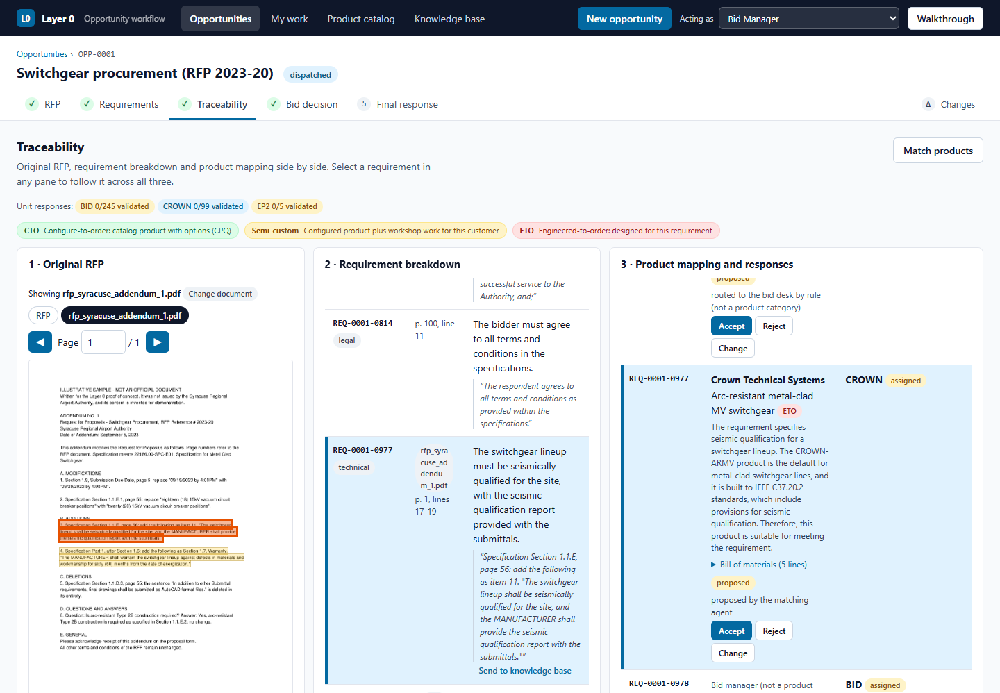

# Layer 0: System Architecture (Current System)

Status: Implemented (as built). Describes the code at commit 4c6d866 of the Layer0-Flex repository as of 13 Oct 2026.

Audience: architects, newly joined developers, the Zensar point of contact and the client's technical reviewers.

Companion documents: [02-technical-architecture.md](02-technical-architecture.md), [03-ui-view.md](03-ui-view.md), [04-api-view.md](04-api-view.md). Earlier design documents: [../technical-architecture.md](../technical-architecture.md), [../architecture-overview.md](../architecture-overview.md).

Screenshots were taken from an isolated copy of the application running the bundled demo data in offline mode; they are in [images/](images/).

## Changes Decided After This Baseline

This document describes the system as built at commit 4c6d866. The review of 12 Oct 2026 decided changes that are not built yet; they are listed in [../changes.md](../changes.md) (C-01 to C-22) with their target design in [../technical-architecture.md](../technical-architecture.md) section 16. Until each change is built, the description below stays accurate. Sections affected:

**Sign-in is now built (C-09, tasks P-20 and P-21).** Every person signs in on `/login` with a username and password; where this baseline describes the "Acting as" picker, the `X-Actor` header, the `actor` cookie, the "Bid Manager" default or "no sign-in", read the following instead. `POST /api/auth/login` returns an HS256 token (claims `sub`, `name`, `role`, `bu`, `exp`; 8 hours), set in the HttpOnly cookie `layer0_token`; the API also accepts `Authorization: Bearer <token>`. `POST /api/auth/logout` and `GET /api/auth/me` complete the set. Every other `/api` route returns 401 without a valid token; there are no refresh tokens and no token store. The audit log records the signed-in user's name. The roles are `bid_manager`, `product_manager`, `design_engineer` and `admin`, and the server enforces them on write routes (403). The top bar shows the signed-in name and a **Switch** link that opens `/login`. Accounts are rows of the table `user_account` in a MySQL database (`MYSQL_*` settings in `.env`; the local SQLite store when `MYSQL_HOST` is not set), seeded on start from `data/accounts.json` with `DEMO_PASSWORD` as the starting password and stored only as salted PBKDF2-SHA256 hashes (see [../technical-architecture.md](../technical-architecture.md) section 16.6). The remainder of this document is unchanged and still shows the baseline.

| Section | Changes | What will differ |
|---|---|---|
| [2. What the System Does](#2-what-the-system-does) | C-05, C-06 | Revised workflow: summary and routing, unit assessment before go/no-go |
| [3. Users and Roles](#3-users-and-roles) | C-07, C-09 | Signed-in accounts with assigned roles; product manager and design engineer distinct; validation by the unit |
| [7. End-to-End Workflow](#7-end-to-end-workflow) | C-02 to C-08 | No per-requirement approval; exception queue; Send for assessment; go/no-go last |
| [8. AI Agents and Automation](#8-ai-agents-and-automation) | C-03 | The reader returns line references; answers regenerated |
| [9. Information Architecture](#9-information-architecture) | C-04, C-17 | Extraction snapshot, version origin, comments |
| [10. Lifecycles and State Models](#10-lifecycles-and-state-models) | C-02, C-04, C-06, C-12 | New `exception` and `dismissed` statuses; publish replaces freeze; dispatch without go; compliance values |
| [12. Cross-Cutting Concerns](#12-cross-cutting-concerns) | C-09, C-16 | Sign-in and server-enforced permissions; activity log |
| [14. Quality Attributes, Constraints and Known Limits](#14-quality-attributes-constraints-and-known-limits) | C-02, C-03, C-09 | Several known limits addressed |

## Contents

- [Changes Decided After This Baseline](#changes-decided-after-this-baseline)
- [1. About This Document](#1-about-this-document)
- [2. What the System Does](#2-what-the-system-does)
- [3. Users and Roles](#3-users-and-roles)
- [4. System Context and Boundaries](#4-system-context-and-boundaries)
- [5. Architectural Style and Principles](#5-architectural-style-and-principles)
- [6. Logical Architecture](#6-logical-architecture)
- [7. End-to-End Workflow](#7-end-to-end-workflow)
- [8. AI Agents and Automation](#8-ai-agents-and-automation)
- [9. Information Architecture](#9-information-architecture)
- [10. Lifecycles and State Models](#10-lifecycles-and-state-models)
- [11. Knowledge and Retrieval Architecture](#11-knowledge-and-retrieval-architecture)
- [12. Cross-Cutting Concerns](#12-cross-cutting-concerns)
- [13. Runtime and Deployment View](#13-runtime-and-deployment-view)
- [14. Quality Attributes, Constraints and Known Limits](#14-quality-attributes-constraints-and-known-limits)
- [15. Glossary](#15-glossary)
- [Appendix A. Module-to-Code Map](#appendix-a-module-to-code-map)
- [Appendix B. Design Rules and Where They Are Implemented](#appendix-b-design-rules-and-where-they-are-implemented)

## 1. About This Document

### 1.1 Purpose

This document describes the architecture of Layer 0 as it is built today. It explains what the system does, who uses it, where its boundaries are, how it is structured, how its parts work together, and how a bid moves through it from the arrival of a request for proposal (RFP) to the final response. Every statement is taken from the code and the committed data, not from earlier plans.

Layer 0 is a proof of concept (PoC). It is the "front layer" of the bid process for SpinCo / Axiom Solutions: it reads a customer's RFP, turns it into requirement line items with exact sources, routes each requirement to the business unit that can meet it, records the bid decision, collects each unit's answers and helps the bid manager consolidate them.

### 1.2 Audience

| Reader | What this document gives them |
|---|---|
| Business sponsors and bid managers | What the system does, the roles it supports, the workflow and its decision points, and what it deliberately leaves out |
| Solution and enterprise architects | Context, boundaries, architectural style, logical components, dependencies, information model, runtime and known limits |
| Engineering teams taking the PoC further | The structural map that the companion documents fill in detail, with the code location of each element |
| Reviewers of AI use | Every AI agent, what it may and may not do, how a person reviews its proposal, and how answers are frozen and replayed |

### 1.3 Scope, and what the companion documents cover

This document is conceptual and structural. It covers every capability, but it leaves the internal detail of each one to the three companion documents.

| Document | Covers | Does not cover |
|---|---|---|
| `01-system-architecture.md` (this document) | Purpose, users and roles, context and boundaries, architectural style and principles, logical components and how they collaborate, the end-to-end workflow, AI agents, information model, lifecycles, knowledge and retrieval, cross-cutting concerns, runtime and deployment, quality attributes and known limits | Code-level algorithms, every screen element, every request and response field |
| `02-technical-architecture.md` | Technology stack, internals of each module and of the shared platform, data model in full, algorithms and thresholds, build, configuration, tests | Screen-by-screen behaviour, endpoint-by-endpoint contract |
| `03-ui-view.md` | Every screen, every component and control, states, messages, roles as seen on screen, the guided walkthrough | Server internals |
| `04-api-view.md` | Every one of the 51 API operations, its inputs, outputs, errors and preconditions, and the calling sequences of interdependent endpoints | Screen layout |

### 1.4 As-of date and code baseline

| Item | Value |
|---|---|
| Described as of | 13 Oct 2026 |
| Code baseline | Repository `Layer0-Flex`, commit `4c6d866` (latest commit message: "Inbox unit switcher - one chip per work package with the number of answers waiting for validation") |
| Backend | Python 3.12, FastAPI, SQLAlchemy, SQLite (versions pinned in `requirements.txt`) |
| Front end | Next.js 16.4, React 19.3, TypeScript 5.9 (`web/package.json`, `web/package-lock.json`) |
| Size | 11 backend modules, 6 shared platform files, 51 API operations, 11 database tables, 14 web pages, 50 automated tests |

Anything added to the repository after commit `4c6d866` is not described.

### 1.5 Status labels

| Label | Meaning |
|---|---|
| Implemented | The code at commit `4c6d866` does this. Stated once per section or in a table column, not on every sentence. Everything in this document is Implemented unless it carries another label. |
| Proposed (not built) | An idea recorded in `SUGGESTIONS.md`, in the earlier design documents, or in a code comment that marks later work. The code does not do it. |
| Needs confirmation | A fact that cannot be verified from the code or data, or a value the data files themselves mark as a placeholder awaiting confirmation (for example capacity figures, drastic-change threshold, which business units Layer 0 offers). |
| Illustrative / placeholder | Data shipped to make the PoC work (past responses, standard product ratings, capacities, go/no-go thresholds). The data files say so in their `_note` fields. |

### 1.6 How the screenshots and examples were produced

- **An isolated copy.** The screenshots and live examples come from a separate copy of the application at commit `4c6d866`, with its own database and file store. It ran on its own port pair, so the team's normal installation (API on port 8000, web on port 3000) was not touched.
- **Offline (mock) mode.** The copy ran with `LLM_PROVIDER=mock`: every model answer was replayed from the frozen answers committed in `data/llm_cache/`, and no live model call was made. Section 4.4 explains this mode.
- **Bundled demo data.** The database was seeded with `scripts/seed_demo.py --reset`, which creates two opportunities through the same services a user action calls. Further states were then created through the API and the screens, so that every screen could be shown with data and empty:

| Opportunity | Content as captured |
|---|---|
| `OPP-0001` | Syracuse Regional Airport Authority, RFP 2023-20 switchgear procurement (101 pages). Read by the reader and grouping agents from frozen answers, 348 requirements approved and frozen as baseline 1, matched, participation and "go" recorded, work dispatched, sample answers attached. Then the illustrative Addendum No. 1 was read, every proposal confirmed and the change applied, giving baseline 2 (349 requirements): `REQ-0001-0977` and `REQ-0001-0978` added, `REQ-0001-0039` and `REQ-0001-0332` modified, `REQ-0001-0130` removed. |
| `OPP-0002` | A fictional one-page RFP for a hyperscale AI training campus: 10 requirements, several business units, dispatched. |
| `OPP-0003` | A blank opportunity with no document (empty states). |
| `OPP-0004` | The hyperscale sample attached and read into a page layout, the reader agent not run, 4 requirements added by hand from quotes and selected lines (1 approved, 3 still to decide), no baseline. |
| Knowledge base | One requirement (`REQ-0001-0002`) sent to the knowledge-base queue as `KB-0001`, waiting for review. |

- **Capture.** The screenshots were taken on 13 Oct 2026 at a desktop width of 1440 pixels, and a few at a phone width of 390 pixels. They are in `images/` beside this document. The web application ran in development mode, so a small Next.js development indicator appears in the bottom-left corner of some screenshots; it is not part of the application.
- **Examples.** Example values (counts, identifiers, messages) are real values returned by that copy, unless marked otherwise.

### 1.7 Related documents

| Document | Relationship |
|---|---|
| `02-technical-architecture.md`, `03-ui-view.md`, `04-api-view.md` | Companion as-built documents (section 1.3) |
| `Documents/technical-architecture.md` | The earlier design document. Its terms (design rules R1 to R8, "screen 1/2/3", "baseline", "work package") are used here. Where it differs from the code, the code wins and this document follows the code. |
| `Documents/architecture-overview.md`, `project-overview.md`, `problem-mapping.md`, `business-and-domain-background.md` | Business context, the intended workflow and the earlier code lines that preceded this PoC |
| `README.md`, `INSTALL.md` | How to run the PoC for development and on a Windows laptop |
| `WALKTHROUGH_GUIDE.md` | Coverage map of the guided walkthrough built into the web application |
| `SUGGESTIONS.md` | Ideas for later iterations; the source of most "Proposed (not built)" items |

### 1.8 Conventions

- File paths are relative to the repository root, for example `app/modules/requirements/service.py`.
- API paths are written as served, with the `/api` prefix, for example `POST /api/opportunities/{opp_id}/baselines`.
- Identifiers follow the code: opportunities `OPP-0001`, requirements `REQ-0001-0042` (the opportunity number is embedded), documents `OPP-0001-893403680eda` (the opportunity and the first 12 characters of the file's SHA-256 hash), knowledge items `KB-0001`.
- Diagrams are plain text in fenced code blocks.
- Status values, field names, button labels and messages are quoted exactly as the code writes them.

## 2. What the System Does

### 2.1 Business purpose

Layer 0 takes **one bid opportunity from the moment an RFP arrives to the final response**, for the business units of SpinCo / Axiom Solutions (the power, cooling and data-centre businesses being separated from Flex). In the words of the README: "The RFP is read into requirement line items with exact sources. Each item is matched to a business unit's product (EP² and the other units). Participation and go/no-go are recorded. Each unit gets one work package, answers it as a checklist, and the bid manager validates and consolidates the answers, with three linked screens."

The chain it preserves for every requirement is:

```text
Original RFP text (page, lines, highlight)
  -> requirement line item (REQ ID, verbatim quote, short restatement)
    -> business unit, product family and offering type (CTO / semi-custom / ETO)
      -> the unit's checklist answer (compliance, product, response)
        -> the bid manager's validation
          -> the compliance matrix and the response outline
```

Every link in that chain is stored, attributed to a named person or to an agent acting on a person's request, and written to an append-only audit log.

### 2.2 Scope of the proof of concept

The PoC is a single application (one API, one web application, one database) that runs on a laptop. It implements the following capabilities:

| # | Capability | Where |
|---|---|---|
| 1 | Create an opportunity and attach its RFP (file upload, or a bundled sample) | `opportunities` |
| 2 | Read a PDF into a deterministic page layout: native text with line numbers and boxes, optional OCR for pages without a text layer, headers and footers, contents pages, ruled tables, page images | `ingestion` |
| 3 | Propose requirement line items with an AI reader agent, anchor every quote on its page, mark duplicates, and group related items into requirements with an AI grouping agent | `requirements` |
| 4 | Human review: approve, reject, edit, split, merge, ungroup, add a missed requirement (paste a quote or select lines), full history; freeze an approved baseline | `requirements` |
| 5 | Business units, products, models, past responses and the long-term retrieval index | `catalog` |
| 6 | Match each requirement to business units, products and offering types with an AI matcher agent and rule-based routing, with evidence; people accept, reject or change each match | `matching` |
| 7 | Decision support (evidence pack, engineering checks, data-sheet deviations, workload) and the recorded participation and go/no-go decisions | `decisions`, `matching` |
| 8 | One-step dispatch of one work package per unit, checklist answers, validation and return, per-unit hand-off file | `workpackages` |
| 9 | Coverage check, compliance matrix (CSV and Excel), and an AI-drafted response outline written only from validated answers | `consolidation` |
| 10 | A knowledge-base queue: people send requirements, validated answers and decision rationales; a curator approves; approved items join the long-term retrieval index | `knowledge`, `catalog` |
| 11 | Change handling: an addendum, Q&A answers or a change request is read and classified against the frozen baseline by AI change agents, confirmed by people, and applied as a new baseline | `changes` |
| 12 | Three linked traceability screens (RFP page, requirement list, product mapping and responses) and the portfolio of opportunities | `trace` |
| 13 | Freezing and replay of every model answer and every embedding, and a model-change guard | `app/core/llm.py`, `app/core/vectors.py`, `scripts/model_guard.py` |
| 14 | A guided walkthrough of every screen, built into the web application | `web/components/tour/`, `web/tour/` |

### 2.3 The six workflow steps and change handling at a glance

The web application shows every opportunity with a stepper of five links (RFP, Requirements, Traceability, Bid decision, Final response) and a separate "Changes" link. The guided walkthrough describes the same flow as six steps, because the units' own work happens in their inboxes ("My work") rather than on an opportunity page.

| Step | Name | What happens | Who acts | Screen |
|---|---|---|---|---|
| 1 | RFP | The RFP is attached and read into a page layout; the reader agent proposes line items | Bid manager; reader and grouping agents | RFP documents (`/opportunities/{id}`) |
| 2 | Requirements | A person checks each line item against its source, approves or corrects it, then freezes the baseline | Bid manager | Requirements (`/opportunities/{id}/requirements`) |
| 3 | Traceability | Each frozen requirement is matched to a unit's product and an offering type; a person accepts, rejects or changes each match | Matcher agent; bid manager | Traceability (`/opportunities/{id}/trace`) |
| 4 | Bid decision | Participating units and go/no-go are recorded with a rationale and the evidence as shown; work is dispatched | Bid manager | Bid decision (`/opportunities/{id}/decisions`) |
| 5 | Unit work | Each unit answers its work package as a checklist; the bid manager validates or returns each answer | Unit product managers and design engineers; bid manager | My work (`/inbox/{unit}`) |
| 6 | Final response | Coverage check, compliance matrix and response outline | Bid manager; drafting agent | Final response (`/opportunities/{id}/consolidation`) and Response outline |
| Alongside | Changes | An addendum is read and classified against the frozen baseline; a person confirms each change; the bid manager applies it as a new baseline | Change agents; any person (confirm); bid manager (apply) | Changes (`/opportunities/{id}/changes`) |

```text
 RFP arrives
     |
     v
 [1 RFP] --> [2 Requirements] --> [3 Traceability] --> [4 Bid decision] --> [5 Unit work] --> [6 Final response]
  read        review, freeze       match, accept        participation,       answer,           coverage, matrix,
  propose     baseline 1           or change            go/no-go, dispatch   validate          outline
                    ^                                                            ^
                    |                                                            |
              [Changes] addendum read against the baseline, confirmed, applied:
              new baseline, affected answers returned, new work re-matched and re-dispatched
```

### 2.4 Bundled demonstration scenarios

The repository carries everything needed to run a realistic bid offline.

| Scenario | Files | What it shows | Offline behaviour |
|---|---|---|---|
| Syracuse switchgear RFP | `data/RFP/RFP-2023-20-Switchgear-Procurement-Final.pdf` (101 pages, public RFP of the Syracuse Regional Airport Authority, RFP 2023-20 Switchgear Procurement); seed `data/seed/demo_syracuse.json`; frozen layout `data/layout_cache/893403680eda….json`; golden list `data/golden/RFP-2023-20-Switchgear-Procurement-Final.json` | A real, long RFP: 814 line items proposed by the reader agent, 21 marked as duplicates, 162 groups formed, giving 348 requirements to review; one page (page 83) has no text layer and was read by OCR on the parsing machine | Fully replayable: reader, grouping, matcher and outline answers are frozen. It can be attached as a new opportunity and read again offline. |
| Hyperscale AI campus | `data/RFP/samples/rfp_hyperscale_campus.pdf` (1 page, fictional 48 MW AI training campus with 800 V DC distribution and liquid cooling), its text source, seed `data/seed/demo_hyperscale.json` | The multi-unit case: one RFP whose requirements go to several units (Anord Mardix, Flex Power Modules, JetCool, Cloud and the bid desk) | The seeded opportunity uses 10 hand-picked line items. A new opportunity from this sample is stored and laid out offline, but reading it needs the model connection (no frozen reader answers). |
| Syracuse Addendum No. 1 | `data/RFP/samples/rfp_syracuse_addendum_1.pdf` (1 page, illustrative, written for the PoC) and `data/seed/syracuse_addendum_1_expected.json` (expected outcome used by the tests) | Change handling: 8 statements (2 modified, 2 added, 1 removed, 1 unchanged, 2 not a requirement) against the frozen Syracuse baseline | Frozen change-agent answers exist only for the demo opportunity's requirement set (`OPP-0001` as seeded). |

The API lists the three samples under `GET /api/samples` (name, file name, kind, pages and description, never a server path). The guided walkthrough attaches them through `POST /api/opportunities/{opp_id}/documents/from-sample` and `POST /api/opportunities/{opp_id}/changes/from-sample`, which run exactly the same code as a file upload. The `data/RFP/samples/` folder also holds further plain-text RFP samples (`rfp_modular_inference_pod.txt`, `rfp_REAL_davis_monthan_ai_dc.txt`, `rfp_REAL_ftlauderdale_ups.txt`, `rfp_REAL_syracuse_switchgear.txt`); they are not offered by `GET /api/samples` and are not used by the application.

### 2.5 What the system deliberately does not do

| Not done | Evidence in the code | Status |
|---|---|---|
| Pricing, costing, margins or quotes | No price field exists in any table. The go/no-go criterion "Cost against budget" is marked `"data": "not_available"` in `data/knowledge_base/go_no_go.json` and always shows "Data not yet available." | Out of scope; whether prices belong in Layer 0 is an open question in the design documents |
| Configure, price, quote (CPQ) or product configuration | The hand-off file routes catalog items to "Route A: commercial CPQ (configuration seed only; Layer 0 seeds the configurator, it does not configure)" and marks every payload `requires_human_completion: true` | Not integrated; a downloadable JSON seed only |
| Engineering design | Basis-of-design items carry `"spec_claimed": false` and the note "Layer 0 has NOT designed this: captured requirements only."; specialist items carry `"design_attempted": false` | Out of scope |
| Bill of materials (BOM) generation or a BOM system connection | `catalog.bom()` returns the illustrative BOM lines stored in `products.json`; the code comment says to replace it with the real BOM system connector | BOM shown only; connector Proposed (not built) |
| Enterprise resource planning (ERP), product life-cycle management (PLM), customer relationship management (CRM) | No connector, client library or setting exists for any of them | Not integrated |
| E-mail intake or notifications | Documents arrive only by upload in the web application or as bundled samples; nothing is sent by e-mail | Not integrated |
| Sign-in, single sign-on (SSO) or authorisation by identity | The acting person is a name chosen in the "Acting as" picker and sent in a header or cookie (section 3.4) | Real sign-in Proposed (not built) |
| Writing the final proposal | The response outline is "A first draft for the bid manager to edit … Writing the final response stays a human task." | By design |
| Making decisions | The decision record says "A named person's decision with the evidence shown at the time. Layer 0 never decides." The go/no-go summary ends "A person decides." | By design |
| Reading non-PDF files (Word, Excel, CAD, e-mail) | A non-PDF upload is stored with status `unsupported` and never read | Out of scope for the PoC |
| Creating a linked opportunity for a drastic change | The change set is flagged `drastic` above a 25 % share; the code comment says a person decides on a new linked opportunity and "Layer 0 never decides that" | Flag implemented; creation Proposed (not built) |
| Workflow templates per customer type | Dispatch is one step; no template table or setting exists | Not built (simplified on purpose) |
| Submitting the response or tracking it after submission | The statuses `consolidating` and `submitted` exist in the status list, but no code sets them | Not built |

## 3. Users and Roles

### 3.1 Roles as implemented

The PoC has no user accounts. A "person" is a name. The names come from the business-unit data file and one fixed name, "Bid Manager". The code recognises four roles.

| Role | Who (name in the PoC) | Unit code | What the role does | Where the code defines it |
|---|---|---|---|---|
| Bid Manager | "Bid Manager" | `BID` (the bid desk, a pseudo-unit) | Runs the opportunity end to end: attaches the RFP, reviews and freezes requirements, matches, decides, dispatches, answers the bid desk's own items (commercial, submission, legal and other non-product items), validates or returns every unit answer, consolidates, applies or discards change sets | `DEFAULT_ACTOR = "Bid Manager"` in `app/core/web.py` and `web/lib/api.ts`; `BID_MANAGER` in `app/modules/workpackages/service.py` and `app/modules/changes/service.py`; `BID_DESK = "BID"` in `app/modules/workpackages/models.py` |
| Product Manager of a business unit | One per unit, for example "Crown Product Manager" | The unit's code | Answers the unit's work package (compliance, product, response) | `product_manager` field of each unit in `data/knowledge_base/business_units.json` |
| Design Engineer of a business unit | One per unit, for example "EP² Design Engineer" | The unit's code | Owner of each assignment dispatched to the unit; answers the unit's work package | `design_engineer` field of each unit; dispatch sets `owner` to the unit's design engineer |
| Knowledge-base curator | "Bid Manager" in the PoC | - | Approves or rejects items sent to the knowledge base | `CURATOR = "Bid Manager"` in `app/modules/knowledge/service.py` (the comment says a named curator role comes with sign-in) |

AI agents are not users, but their proposals are attributed. A requirement read by the reader agent at the request of the Bid Manager has `created_by = "reader agent (Bid Manager)"`; a group has `"grouping agent (Bid Manager)"`; matching runs as `"matching agent (Bid Manager)"`. The person who asked is always part of the name.

### 3.2 Business units

The business units are data, not code (`data/knowledge_base/business_units.json`). The file's note says the units come from the public Flex web pages retrieved on 12 Oct 2026, that the scope (which units Layer 0 offers: SpinCo / Axiom Solutions or the wider Flex group) still needs confirmation, that EP² is part of SpinCo per client direction, and that the product manager and design engineer names are role placeholders until real people are named.

| Code | Name | Pillar | Status | Product manager (placeholder) | Design engineer (placeholder) | Focus (abridged from the data file) |
|---|---|---|---|---|---|---|
| `EP2` | Electrical Power Products (EP²) | Critical Power | active | EP² Product Manager | EP² Design Engineer | Engineered-to-order protective relay and control panels, integrated control enclosures and their auxiliary AC/DC power; Des Moines, Iowa; acquisition completed May 2026 |
| `CROWN` | Crown Technical Systems | Critical Power | active | Crown Product Manager | Crown Design Engineer | Medium-voltage metal-clad switchgear 4.16 to 38 kV (arc-resistant and standard), relay, metering and communication panels, E-Houses and other enclosures |
| `ANORD` | Anord Mardix | Critical Power | active | Anord Mardix Product Manager | Anord Mardix Design Engineer | Data-centre LV switchgear and switchboards, MV switchgear, busway, PDUs, transfer switches, prefabricated power pods, power management; mostly configure-to-order |
| `FPM` | Flex Power Modules | Embedded Power | active | Flex Power Modules Product Manager | Flex Power Modules Design Engineer | Board-level DC/DC power modules and custom rack power (AI rack power shelves, 800 V DC power rack) |
| `JETCOOL` | JetCool | Thermal Management | active | JetCool Product Manager | JetCool Design Engineer | Direct-to-chip liquid cooling: cold plates, coolant distribution units, manifolds |
| `CLOUD` | Cloud (in-house) | Cloud | active | Cloud Product Manager | Cloud Design Engineer | Compute and storage design and manufacturing, data-centre racks, rack-level integration |
| `EPC` | EPC Power | Critical or Embedded Power | **pending** | EPC Power Product Manager | EPC Power Design Engineer | SiC power conversion; acquisition announced Sep 2026, close expected Q4 2026: "not offered until closed" |
| `EMS` | Flex Design, Engineering and Manufacturing Services | Flex group (outside SpinCo, needs confirmation) | active | Flex Manufacturing Services Product Manager | Flex Manufacturing Services Design Engineer | Product design and engineering, NPI, PCBA, box build, supply chain |
| `AFS` | Flex Fulfillment, Logistics and Aftermarket Services | Flex group (outside SpinCo, needs confirmation) | active | Flex Aftermarket Services Product Manager | Flex Aftermarket Services Design Engineer | Inventory, logistics, repair, warranty, spare parts |

What "active" and "pending" change in the system:

- Only **active** units are offered anywhere a unit is chosen: the people list, participation, product matching (the matcher's catalog holds only active units' products), manual match changes and the retrieval index of products and models.
- **EPC Power** (pending) appears on the Product catalog page as a unit, but its product family and models are left out of matching and search, its people are not in the "Acting as" list, and recording it as a participant is refused with "Choose at least one active business unit; not active: ['EPC']."
- The two **Flex group units** (`EMS`, `AFS`) are active in the data, so they are offered like the SpinCo units; whether they belong in Layer 0 is marked "needs confirmation" in the data.

### 3.3 The people list

`GET /api/people` returns the names the "Acting as" picker offers: "Bid Manager" first (with `bu: null`), then the product manager and the design engineer of every **active** unit, with the unit code. With the current data the list has 17 entries: the Bid Manager plus two people for each of the 8 active units. The list is built by `catalog.people()` and `catalog.unit_of()`; it is not stored in the database.

### 3.4 How a person is chosen

```text
 Browser                                Next.js web app                   FastAPI API
 -------                                ---------------                   -----------
 "Acting as" picker  --sets cookie-->   actor=<name> (1 year, path /)
 every API call      --header------->   X-Actor: <URL-encoded name>  -->  actor(request):
 images, downloads   --cookie only-->   (proxied unchanged)          -->    header, else cookie,
                                                                            URL-decoded, printable
                                                                            characters only, trimmed,
                                                                            max 80 characters,
                                                                            else "Bid Manager"
```

- **The picker.** The top bar of every page shows "Acting as" with a drop-down of the people list (`web/components/shell/ActorPicker.tsx`). Choosing a name writes the cookie `actor` (valid for one year, whole site) and reloads the page, so every screen fetches its data again as that person.
- **The header.** The API client (`web/lib/api.ts`) adds `X-Actor` with the URL-encoded name to every request it sends. Requests the browser makes by itself (page images, file downloads) carry the cookie instead; the API reads either.
- **On the server.** `actor(request)` in `app/core/web.py` takes the `X-Actor` header, or else the `actor` cookie, URL-decodes it, drops non-printable characters, trims it and cuts it to 80 characters (the width of every "who" column). If nothing is left, the actor is "Bid Manager".
- **No sign-in.** There is no password, token, session or identity provider. Any client can send any name, and a request with no header and no cookie acts as the Bid Manager. The code comment states the intent: "real sign-in before a pilot". Real sign-in is Proposed (not built).
- **What the name is used for.** It is written into every audit event and into the "who" columns: `created_by`, `frozen_by`, `decided_by`, `responded_by`, `validated_by`, `sent_by`, `reviewed_by`, `applied_by`. It also decides the few permission checks below.

### 3.5 What each role may do, and where the backend enforces it

The backend enforces five rules, all by comparing the actor name. A refusal is raised as a `PermissionError` in the service and returned as HTTP 403 with the message shown.

| Action | Endpoint | Who may do it | Backend check (service) | Message when refused | Screen behaviour |
|---|---|---|---|---|---|
| Answer an assignment (compliance, product, response) | `POST /api/assignments/{assignment_id}/respond` | The unit's product manager or design engineer; for the bid desk (`BID`) only "Bid Manager" | `workpackages.respond` → `_may_answer(actor, bu)` | "Only {unit code}'s product manager or design engineer can answer this item." (for example "Only CROWN's product manager or design engineer can answer this item.") | The inbox shows answer forms only to those people; others see "You are acting as {name}: you can read this work package but not answer it. Switch with "Acting as" in the top bar." |
| Validate or return a submitted answer | `POST /api/assignments/{assignment_id}/validate` | "Bid Manager" only (no self-validation by a unit) | `workpackages.validate` | "Only the Bid Manager validates or returns answers." | Validate and Return buttons shown only to the Bid Manager |
| Apply a change set | `POST /api/changes/{set_id}/apply` | "Bid Manager" only | `changes.apply` | "Only the Bid Manager applies a change set." | "Apply to requirements" disabled for others, with "Only the Bid Manager applies or discards; switch with Acting as" |
| Discard a change set | `POST /api/changes/{set_id}/discard` | "Bid Manager" only | `changes.discard` | "Only the Bid Manager discards a change set." | "Discard" disabled for others |
| Approve or reject a knowledge-base item | `POST /api/knowledge/{kb_id}/review` | The curator ("Bid Manager") | `knowledge.review` | "Only the knowledge curator (in the PoC, the Bid Manager) approves knowledge." | Review form shown only to the curator; others see "Only the curator (Bid Manager) approves or rejects; switch with "Acting as" in the top bar." |

Every other write is open to any acting person. The name is recorded, but no role is checked:

| Open to anyone (name recorded) | Endpoints |
|---|---|
| Create an opportunity, attach documents, read a document again | `POST /api/opportunities`, `POST /api/opportunities/{opp_id}/documents`, `POST /api/opportunities/{opp_id}/documents/from-sample`, `POST /api/documents/{doc_id}/ingest` |
| Run the reader agent, review requirements, add missed requirements, split, merge, ungroup, freeze | `POST /api/opportunities/{opp_id}/requirements/extract`, `POST /api/opportunities/{opp_id}/requirements`, `POST /api/opportunities/{opp_id}/requirements/from-lines`, `POST /api/opportunities/{opp_id}/requirements/merge`, `POST /api/requirements/{req_id}/review`, `POST /api/requirements/{req_id}/split`, `POST /api/requirements/{req_id}/ungroup`, `POST /api/opportunities/{opp_id}/baselines` |
| Run matching, accept, reject or change a match | `POST /api/opportunities/{opp_id}/match`, `POST /api/matches/{match_id}/decide`, `POST /api/opportunities/{opp_id}/requirements/{req_id}/match` |
| Record participation and go/no-go, dispatch | `POST /api/opportunities/{opp_id}/participation`, `POST /api/opportunities/{opp_id}/go-no-go`, `POST /api/opportunities/{opp_id}/dispatch` |
| Send to the knowledge base | `POST /api/knowledge` |
| Read a change document, confirm or override a proposed change, confirm all | `POST /api/opportunities/{opp_id}/changes`, `POST /api/opportunities/{opp_id}/changes/from-sample`, `POST /api/changes/{set_id}/items/{item_id}`, `POST /api/changes/{set_id}/confirm-all` |

All 23 read operations (`GET`) are open to anyone. The walkthrough text says the same about the bid decision: it is "open to anyone in this PoC". The intent recorded in the code is that real roles come with sign-in (comment on `BID_MANAGER` in `app/modules/workpackages/service.py`).

### 3.6 Ownership and the bid desk

- **Assignment owner.** When work is dispatched, each assignment's `owner` is the unit's design engineer; for the bid desk it is "Bid Manager". The owner is informational: either the product manager or the design engineer of the unit may answer.
- **The bid desk (`BID`).** A requirement goes to the bid desk when none of its matched units participates: non-product categories (commercial, schedule, submission, legal, staffing) routed there by rule, matches with no unit, rejected matches, requirements with no match, and matches whose units did not participate. The Bid Manager answers these in "My work" under "Bid desk", and also validates them.
- **"My work".** `/inbox` sends the acting person to their unit's inbox (`/inbox/{unit}`), and the Bid Manager (or a name that belongs to no unit) to `/inbox/BID`.
- **Unit names in exports.** The compliance matrix and the response outline show a unit by its name from the data file, and the bid desk as "Bid desk".

## 4. System Context and Boundaries

### 4.1 Context diagram

```text
   Bid Manager            Unit product managers         Knowledge curator
   (bid desk)             and design engineers          (Bid Manager in the PoC)
        \                          |                           /
         \_________________________|__________________________/
                                   |  web browser (any modern browser; desktop and phone widths)
                                   |  HTTP, same origin; identity = "Acting as" name (cookie / X-Actor)
                                   v
  +-----------------------------------------------------------------------------------------------+
  |  LAYER 0 (one laptop or one host)                                                             |
  |                                                                                               |
  |  +------------------------------+     /api/* proxied      +-------------------------------+   |
  |  | Next.js web app (port 3000)  | ----------------------> | FastAPI API (port 8000)       |   |
  |  | screens, walkthrough,        |   HTTP, JSON, files     | 11 modules, model gateway,    |   |
  |  | /tour-session                |   (30-minute timeout)   | retrieval indexes, audit      |   |
  |  +------------------------------+                         +-------------------------------+   |
  |                                                              |        |        |       |      |
  |                       SQL (SQLAlchemy) ----------------------+        |        |       |      |
  |                       v                                               |        |       |      |
  |  +-----------------------------+   files   +--------------------------+--+     |       |      |
  |  | SQLite database             |           | Local file store data/store/ |     |       |      |
  |  | data/store/layer0.db (WAL)  |           | files/ layouts/ pages/       |     |       |      |
  |  | 11 tables, audit append-only|           | knowledge_learned.json       |     |       |      |
  |  +-----------------------------+           +------------------------------+     |       |      |
  |                                                                                 |       |      |
  |  +--------------------------------------------------------------------------+   |       |      |
  |  | Committed data (read; written only when a new answer is generated)       | <-+       |      |
  |  | data/knowledge_base/ (units, products, rules)  data/llm_cache/ (answers) |           |      |
  |  | data/vector_cache/ (embeddings)  data/layout_cache/ (frozen parses)      |           |      |
  |  | data/RFP/ (sample documents)  data/seed/  data/golden/                   |           |      |
  |  +--------------------------------------------------------------------------+           |      |
  +-----------------------------------------------------------------------------------------|------+
                                                                                            |
                    HTTPS, only in live mode (LLM_PROVIDER=azure) and only on a cache miss  |
                                       +----------------------------------------------------+
                                       v
  +--------------------------------------------------+     +------------------------------------+
  | Azure OpenAI                                     |     | Tesseract OCR 5.x (optional)       |
  | chat: deployment "gpt-4o" (default), JSON schema |     | local executable on the parsing    |
  | embeddings: "text-embedding-3-small", 256 dims   |     | machine only; called as a process  |
  +--------------------------------------------------+     +------------------------------------+

  NOT integrated (boundaries): CPQ / configurator, ERP, PLM, CRM, BOM system, e-mail, SSO / identity provider
```

### 4.2 Elements in the context

| Element | Technology | Role | Location |
|---|---|---|---|
| Users | Web browser | Bid Manager, unit product managers and design engineers, curator (section 3) | Anywhere that can reach the web app |
| Web application | Next.js 16.4 (React 19.3, TypeScript), plain CSS, no UI library | 14 pages, shared shell, guided walkthrough; proxies every `/api/*` call to the API | `web/`; port 3000 by default |
| API | Python 3.12, FastAPI, Uvicorn | One application with 11 modules under `/api`; interactive API documentation at `/docs` | `app/`; port 8000 by default |
| Database | SQLite through SQLAlchemy 2.1 | 11 tables; write-ahead logging; the audit table rejects updates and deletes | `data/store/layer0.db` (path set by `DATABASE_URL`) |
| File store | Local folders | Uploaded files by SHA-256, page layouts, rendered page images, approved knowledge | `data/store/` (set by `STORE_DIR`); not committed |
| Committed data | JSON and NumPy files in the repository | Rules and knowledge as data, frozen model answers, frozen embeddings, frozen RFP parse, samples, seeds, golden list | `data/` |
| Chat model | Azure OpenAI chat completions, deployment name from `AZURE_OPENAI_DEPLOYMENT` (default `gpt-4o`) | Six agent tasks (section 8), structured JSON output, temperature 0 | External; live mode only |
| Embedding model | Azure OpenAI embeddings, deployment from `EMBEDDING_DEPLOYMENT_NAME` (default `text-embedding-3-small`), 256 dimensions | Vectors for the two retrieval indexes | External; live mode only |
| OCR engine | Tesseract OCR 5.x, path from `TESSERACT_CMD` (default `%LOCALAPPDATA%\Tesseract-OCR\tesseract.exe`) | Reads pages that have no usable text layer | Parsing machine only; optional |

### 4.3 What crosses each boundary

| Boundary | Direction | What crosses | Form |
|---|---|---|---|
| Browser ↔ web application | Both | Page requests; every API call; uploaded PDF files (multipart form); page images; downloads (compliance matrix CSV and Excel, response outline Markdown, hand-off JSON) | HTTP; the browser talks only to the web application's origin |
| Browser → web application | In | The acting person's name | Cookie `actor`, and header `X-Actor` on calls made by the API client |
| Web application → API | Both | Every `/api/*` request and response, unchanged | HTTP rewrite to `API_URL` (default `http://127.0.0.1:8000`); proxy timeout 30 minutes, because a first read of a new RFP can run for many minutes |
| Web application (own route) | Out | The walkthrough session identifier | `GET /tour-session` (a Next.js route, not the API): a random identifier created once per web-server start |
| API ↔ database | Both | All records | SQL through SQLAlchemy; one session per request |
| API ↔ file store | Both | PDF bytes (written once under their hash, never changed), layout JSON, page PNG images, approved knowledge JSON | Local file system |
| API → committed data | In (read) | Units, products, models, past responses, rules, criteria, placeholders; frozen answers, vectors and layouts | Local JSON and `.npy` files; read once and cached in memory |
| API → committed data | Out (write) | A newly generated model answer, a newly computed set of vectors | Only in live mode, only on a cache miss; the files are meant to be committed so the answer is frozen |
| API → Azure OpenAI chat | Out / In | A system message, a user prompt and a JSON schema; back a JSON answer | HTTPS through the `openai` client (`AzureOpenAI`), API version `AZURE_OPENAI_API_VERSION` (default `2024-10-21`), `max_tokens` 16000 |
| API → Azure OpenAI embeddings | Out / In | Up to 256 texts per request, each cut to 8000 characters; back 256-dimension vectors | HTTPS, API version `EMBEDDING_API_VERSION` (default `2024-02-01`) |
| API → Tesseract | Out / In | A page rendered at 300 dpi as PNG; back words with boxes and confidence | Local process call (`stdin` / `stdout`, TSV output, language `eng`, page segmentation mode 3, one thread) |

What never crosses a boundary:

- The server's file paths. The document responses leave out the stored `path`, and the sample list gives names, never paths.
- The API key. It is read from `.env`, which is not committed (`.gitignore`); `.env.example` holds only placeholders.
- Data of another opportunity. Every record carries its opportunity identifier and every per-opportunity screen is scoped by it (section 5.10).

### 4.4 Offline (mock) mode and live (azure) mode

One setting, `LLM_PROVIDER` (alternative name `MODEL_PROVIDER`), selects the mode. The default is `mock`.

| Capability | Offline: `LLM_PROVIDER=mock` (default, used by the demo) | Live: `LLM_PROVIDER=azure` |
|---|---|---|
| Model answers | Replayed from `data/llm_cache/<task>/<key>.json`. A call with no frozen answer raises `LLMUnavailable` ("No cached answer for {task}/{key}; set LLM_PROVIDER=azure to generate it.") and the caller reports the gap | A frozen answer is still used first; only a miss calls Azure OpenAI, and the new answer is written to the cache (frozen) |
| Reading the Syracuse RFP | Works: every page has a frozen answer | Same answers (frozen) |
| Reading any other RFP | The file is stored and laid out; the reader reports every page it could not read, for example "pages 1-1: No cached answer for read_requirements/…" | The reader agent reads it |
| Grouping | Frozen for Syracuse; elsewhere a page is left ungrouped and reported "page N: not grouped (…)" | Live |
| Matching | Frozen per page batch for the demo; a batch with no answer falls back to retrieval-only matching, labelled as such | Live |
| Change documents | Only the sample addendum on the demo opportunity's requirement set; any other document is refused: "No frozen answers exist for {file} in this offline demo; connect the model service to read new documents." | Live |
| Response outline | Chapters whose validated answers match a frozen draft are drafted; others show "Draft not refreshed: the model service is not connected in this demo, so the validated answers are shown as they are." | Live |
| Embeddings | No embedding call is ever made. Indexes whose texts have frozen vectors report mode `embeddings`; each query is scored by keywords (TF-IDF), because the query itself cannot be embedded offline (section 8.8) | Query and new texts embedded; new vectors frozen |
| OCR | Independent of the mode: depends only on whether Tesseract is installed | Same |

Live mode needs `AZURE_OPENAI_ENDPOINT` (or `ENDPOINT_URL`), `AZURE_OPENAI_API_KEY`, and optionally `AZURE_OPENAI_API_VERSION` (or `API_VERSION`), `AZURE_OPENAI_DEPLOYMENT` (or `DEPLOYMENT_NAME`), `EMBEDDING_DEPLOYMENT_NAME` and `EMBEDDING_API_VERSION`. The second name of each pair is the team's shared naming.

### 4.5 External systems that are not integrated

These systems sit around Layer 0 in the bid-to-order process. None of them is connected. Each row states the nearest point in the code where a connection would attach.

| System | Kind | Status in the code | Nearest touch point |
|---|---|---|---|
| CPQ / configurator (configure, price, quote) | Downstream | Not integrated | Per-unit hand-off file `GET /api/opportunities/{opp_id}/handoff/{bu}`: "Route A: commercial CPQ (configuration seed only …)" with product and BOM lines |
| BOM system | Source of product parts lists | Not integrated; illustrative BOM lines in `products.json` | `catalog.bom(product_id)`, marked in the code for replacement by the real connector |
| ERP | System of record for orders, inventory, finance | Not integrated | None |
| PLM / design vaults | Product data and drawings | Not integrated | None |
| CRM | Where opportunities may originate | Not integrated; opportunities are created in Layer 0 | `POST /api/opportunities` |
| E-mail | Where RFPs, addenda and questions arrive | Not integrated; files are uploaded by hand | `POST /api/opportunities/{opp_id}/documents`, `POST /api/opportunities/{opp_id}/changes` |
| SSO / identity provider | Sign-in and roles | Not integrated; the acting name is chosen in the picker | `actor(request)` in `app/core/web.py` |
| Customer submission portal | Where the final response goes | Not integrated; the compliance matrix and outline are downloaded | `GET /api/opportunities/{opp_id}/compliance-matrix.xlsx`, `GET /api/opportunities/{opp_id}/response-outline.md` |

### 4.6 What is committed and what is local

| Path | Committed | Content | Written by the running application? |
|---|---|---|---|
| `data/knowledge_base/` | Yes | 8 JSON files: business units, products (61 families), catalog items (76 models), past responses (8, illustrative), engineering rules, go/no-go criteria, portfolio placeholders, scope layers and tiers | No (read only) |
| `data/llm_cache/` | Yes | 253 frozen model answers in six task folders (section 8.12) | Only in live mode, on a miss |
| `data/vector_cache/` | Yes | 8 frozen embedding sets (`.npy`, half precision) | Only in live mode, on a miss |
| `data/layout_cache/` | Yes | 1 frozen page layout: the Syracuse RFP (parsed with OCR available) | No; written by `scripts/freeze_layout.py` on the parsing machine |
| `data/RFP/`, `data/seed/`, `data/golden/` | Yes | Sample documents, seed files, the golden requirement list and the model-guard known-gaps list | No |
| `data/store/` | No (`.gitignore`) | `layer0.db` (and its `-wal` and `-shm` files), `files/<sha256>.pdf`, `layouts/<document id>.json`, `pages/<sha256>/<page>.png`, `knowledge_learned.json` | Yes |
| `.env` | No | Local settings and the API key | No |

## 5. Architectural Style and Principles

### 5.1 Modular monolith

**What it means.** Layer 0 is one deployable API with one database, divided into modules that each own one part of the business. Modules can be developed and tested by different people, but they run in one process and share one transaction per request, so a workflow step never has to coordinate several services.

**How the code does it.**

- `app/main.py` creates one FastAPI application and loops over a fixed list, in workflow order: `MODULES = ["opportunities", "ingestion", "requirements", "catalog", "matching", "decisions", "workpackages", "consolidation", "knowledge", "changes", "trace"]`. For each name it imports `app.modules.<name>.controller` and includes its router under the prefix `/api`.
- The comment on that list records the rule "Every module ships a working (possibly stub) controller, so the app runs at any stage".
- Importing the controllers imports every module's models, so `db.init_db()` (called at the end of `app/main.py`) creates all tables from the shared declarative `Base` in one database.
- There is no message bus and no network call between modules: a module calls another module's service as a Python function, in the caller's database session.

### 5.2 Modular MVC inside each module

**What it means.** Every module has the same internal shape: data (model), logic (service), HTTP interface (controller), AI prompts (agent), and screens (view) in the web application.

**How the code does it.**

| Part | File | Holds | Rule |
|---|---|---|---|
| Model | `app/modules/<name>/models.py` | SQLAlchemy table classes and the module's vocabularies (for example `STATUSES`, `CATEGORIES`, `OFFERING_TYPES`, `COMPLIANCE`, `KINDS`, `ACTIONS`) | Only the owning module reads or writes its tables |
| Service | `app/modules/<name>/service.py` | All business logic. The file starts with a docstring headed "Public contract" that lists every function other modules may call | Other modules call only these functions |
| Controller | `app/modules/<name>/controller.py` | An `APIRouter`, request bodies as Pydantic models, and the mapping of service errors to HTTP status codes | No business logic; returns JSON (or a file download) |
| Agent | `app/modules/<name>/agent.py` (and `grouping.py` in requirements) | The system prompt, the JSON schema, prompt building, batching and the guard that checks the model's answer | Calls the model only through `app/core/llm.py` |
| Helpers | `anchoring.py`, `grouping.py` (requirements), `checks.py` (matching), `portfolio.py` (decisions), `excel.py` (consolidation) | Pure functions used by the module's own service | Private to the module |
| View | `web/app/<route>/page.tsx` and `web/components/<area>/` | Screens and shared components in the Next.js application | Talk to the API only through `/api/*` |

Four modules own no table: `catalog` (reads data files), `ingestion` (writes layout files), `consolidation` and `trace` (read-only views over other modules).

Each controller maps the service's error types the same way:

| Service raises | Meaning | HTTP status |
|---|---|---|
| `LookupError` | Unknown opportunity, document, requirement, match, assignment, change set or knowledge item | 404 |
| `PermissionError` | Wrong person (section 3.5) | 403 |
| `ValueError` | Not allowed in the current state (for example "Freeze the requirements before dispatch (review page).") | 409 (422 for a few input errors: creating an opportunity without a title, a participation naming no active unit, a manual match naming an unknown product) |
| Pydantic validation | Malformed request body or parameter | 422 |

### 5.3 Module boundary rules and how they are enforced

| Rule | Enforcement |
|---|---|
| A module may import another module's `service` only, never its models, agent or controller | Automated test `test_modules_talk_only_through_services` in `tests/test_smoke.py`: for every Python file under `app/modules/`, every dotted reference `app.modules.<module>.<part>` must name the file's own module or the part `service`. Limit: the test inspects dotted paths only; an import written as `from app.modules.<other> import models` would not be caught. A reading of every import at commit `4c6d866` finds no such case: every cross-module import names `service` |
| Other modules call only the functions listed in the "Public contract" docstring | Convention, checked in review; not tested automatically |
| A module owns its tables | Convention: no service queries another module's table. Reads go through the owner's service (for example `requirements.current()`, `matching.for_opportunity()`, `workpackages.by_requirement()`). The one shared table is `audit_event` (platform), which `requirements` and `opportunities` also read to rebuild history, to avoid reusing identifiers and to resume a stopped bid |
| Circular dependencies are broken locally | `decisions` and `workpackages` need each other. `workpackages.service` imports `decisions.service` at the top; `decisions.service.summary()` and `decisions.portfolio.workload()` import `workpackages.service` inside the function, with the comment "imported here: workpackages imports decisions" |
| A copy is preferred to a forbidden import | `changes/agent.py` copies the page-packing function of the reader agent, with the comment "Copied from requirements/agent.py (modules talk only through services)" |

### 5.4 Agents propose, people decide (design rule R4)

**What it means.** An AI agent may suggest line items, groups, matches, change classifications and draft text. A named person decides everything that counts: what the requirements are, the baseline, the matches, participation, go/no-go, dispatch, each unit's answer, its validation, each change and what the knowledge base learns.

**How the code does it.**

- **One gateway.** The only place a language model is called is `complete_json()` in `app/core/llm.py` (embeddings: `embed()` in the same file). Six task names exist (section 8.1).
- **Proposals have their own status.** Requirements start as `proposed`; matches as `proposed`; change items as `proposed`. Nothing proposed is used downstream: freezing refuses while any line item is still `proposed` ("{n} line items still need approve or reject before freezing."); applying a change set refuses while any item is not `confirmed`.
- **People's decisions survive re-runs.** Running matching again refreshes only `proposed` matches: accepted, rejected and manual ones are kept (the result reports them as `kept`). Running the reader again replaces only the agents' unreviewed proposals, and is refused once any review action exists: "Review has started ({n} review actions); re-reading would lose that work. Add what is missing with 'Add a requirement' instead."
- **Decisions are named records.** Participation and go/no-go are rows in `decision` with `decided_by`, the rationale, the person's judgement per criterion and a copy of the evidence as it was shown. The go/no-go summary is advice only: "Advice from Layer 0: {met} of {n} assessable criteria met; … A person decides."
- **Gates between steps.** Go/no-go needs a frozen baseline; dispatch needs a frozen baseline and a latest go/no-go of "go"; validation needs a submitted answer; knowledge needs the curator's approval.
- **Agents are attributed.** Their output is recorded as "reader agent ({person})", "grouping agent ({person})", "matching agent ({person})".

### 5.5 Freeze and replay of model answers (design rule R2)

**What it means.** The first answer a model gives for a question is kept and reused for ever. A re-run returns the same answer, the demo runs without a model or a key, and nobody can be surprised by a different answer to the same RFP.

**How the code does it.**

- **Cache key.** `complete_json(task, system, prompt, schema)` computes `sha256(json.dumps([task, LLM_MODEL, system, prompt, schema], sort_keys=True))`, keeps the first 24 hexadecimal characters, and looks for `data/llm_cache/<task>/<key>.json`. A hit returns the stored `output` without any call.
- **Write on miss.** In live mode a miss calls Azure OpenAI and writes `{"task", "model", "output"}` to that file. The folder is committed, so the answer is frozen for everyone.
- **Stale answers are never reused.** Changing the prompt, the schema or the model deployment changes the key, so a stale answer cannot be served for a new question. The model-change guard (section 8.11) makes such misses visible.
- **Prompts are built so that answers stay valid.**
  - The matcher, change classifier and outline drafter never put requirement IDs in the prompt; they use numbers or letters, so the same RFP text gets the same frozen answer in any opportunity.
  - The candidates shown to the change classifier, and the past responses shown to the outline drafter, are chosen without the embedding search, so the prompt does not depend on whether search runs on embeddings or keywords.
  - Approved knowledge joins the search index only, never the matcher's fixed catalog prompt, "so its frozen answers stay valid".
- **The same idea beyond model answers.**
  - Page layouts are frozen in `data/layout_cache/<sha256>.json` on the parsing machine (`scripts/freeze_layout.py`) and used by everyone.
  - Embeddings are frozen in `data/vector_cache/<key>.npy`.
  - OCR runs on one thread "repeatable".
  - The sample PDF is generated byte-for-byte deterministically (`scripts/txt_to_pdf.py`: no dates, fixed file identifier).
  - The demo is seeded through the real services (`scripts/seed_demo.py`).

### 5.6 Trace everything to its source (design rule R1)

**What it means.** Every requirement points to the exact place in the document it came from: document, page, line range, highlight boxes and the verbatim quote. A location is never invented.

**How the code does it.**

- **Line numbers.** The ingestion module numbers the lines of every page (1-based, in reading order) and keeps each line's box in PDF points.
- **Anchoring.** `anchoring.find()` looks for the quote on the page, after normalising Unicode, quotes, dashes, spaces and case. It returns the page, `line_start`, `line_end` and the boxes. A quote that is not found is stored as `UNANCHORED`, with no page, and shown as "not found in source". The model's own page number is used only as a hint for where to look first.
- **Nothing is deleted from the layout.** Headers, footers and tables are marked (`furniture`, `cell`), never removed, so line numbers and highlights stay stable.
- **Selected lines.** A requirement added by selecting lines is anchored only in the selected lines, so its source is the selection itself.
- **Change documents too.** Change statements and the new requirement versions they create are anchored in the change document. The exports then name that document first, for example "rfp_syracuse_addendum_1.pdf, p. 1, lines 14-15".
- **Group highlights.** The highlight of a group is computed from its current sub-requirements, so a sub-requirement revised by an addendum no longer marks its old lines.
- **Everywhere downstream.** The source text "p. {page}, line {n}" or "p. {page}, lines {a}-{b}" is carried into the traceability screens, the inbox, the compliance matrix, the response outline, the hand-off file and knowledge items.

### 5.7 Unknown never passes (design rule R5)

**What it means.** Anything the system could not read or could not decide is reported, never defaulted, guessed or skipped. Requirements are never identified by patterns.

**How the code does it.**

| Situation | Behaviour |
|---|---|
| Page without a usable text layer and no OCR engine | Page marked `unreviewed`, reason "no text layer; OCR not available on this machine" (or "text layer unreadable (unmapped characters) …") |
| Damaged or encrypted PDF | Document status `failed`, error returned |
| Non-PDF file | Stored with status `unsupported` ("recorded but not read"), never marked failed |
| Model answer missing | `LLMUnavailable`; the reader lists each unread page range under `problems`; the grouping agent reports "page N: not grouped (…)"; the change agents refuse the document; the outline shows the validated answers "as they are" |
| Model refuses or is cut short | `LLMUnavailable("Model refused: …")` or "Answer truncated at max_tokens; send a smaller chunk." |
| Quote not found on the page | `UNANCHORED`, listed in the decision evidence and counted as an open question |
| Requirement identification | No regular-expression or keyword fallback: the reader agent docstring says "No regex for identifying requirements" |
| Fact not stated in the RFP | Engineering rule status `warn`, "never pass"; the low-voltage solver returns `NOT_SOLVABLE` with the reason, for example "Required input(s) not stated: ups_kva, rack_count. The solver does not assume values." |
| Go/no-go criteria without data | Status `unknown`, "Data not yet available." |
| Agent answer that breaks a rule | Discarded by a guard: a matched product that is not in the catalog, a group with fewer than two members, a change target letter that was not shown, an outline paragraph without a valid citation |

Pattern matching does appear in three places, none of them for identifying requirements:

- detecting contents pages (layout clean-up);
- reading stated facts (voltages, rack density, UPS size) out of requirements the reader already identified, for the engineering checks;
- reading numbers out of data-sheet cells for the deviation check.

The code comments state this distinction.

### 5.8 Rules and knowledge as data (design rule R7)

**What it means.** Business units, products, past responses, engineering rules, criteria and placeholder values live in versioned data files, so they can be changed without changing code.

**How the code does it.**

- `catalog.service` reads `data/knowledge_base/*.json` once and keeps it in memory (`_load`, cached). Every other module reaches it through catalog functions: `units()`, `products()`, `items()`, `past_responses()`, `layers()`, `engineering_rules()`, `go_no_go()`, `portfolio()`.
- The matcher's catalog prompt, the scope layers and automation tiers, the engineering rules R-001 to R-004, the go/no-go criteria with the coverage threshold (0.8), the standard product ratings and the unit capacities all come from these files. Each file carries a `_note` saying what is illustrative or a placeholder.
- Some starting thresholds are still constants in code. Examples: the matcher's minimum retrieval score 0.08, the drastic-change share 0.25, the duplicate similarity 0.92, and the ingestion thresholds for OCR, headers and tables. Each is marked in a comment as a starting value to calibrate or confirm. Moving them to data is Proposed (not built).

### 5.9 Append-only audit (design rule R8)

**What it means.** Every decision and change is an event that can never be edited or deleted.

**How the code does it.**

- `app/core/audit.py` defines the table `audit_event` (time, opportunity, actor, action, entity, entity identifier, JSON data with before / after / reason) and one function, `record()`. That function adds the event to the caller's transaction, so the event and the change it describes are committed together or not at all.
- `db.init_db()` creates two SQLite triggers, `audit_event_no_update` and `audit_event_no_delete`, that abort any `UPDATE` or `DELETE` on the table with "audit_event is append-only".
- The audit log is also a source of truth:
  - the history of a requirement is rebuilt from it (`requirements.history()`);
  - new requirement IDs are numbered past every ID it mentions, so a discarded draft's ID is never reused;
  - a "go" after a "no-go" resumes the status that the stop replaced, read from the log.
- The code contains 35 calls to `record()`, in 7 modules (requirements 14, changes 6, workpackages 6, matching 3, opportunities 3, knowledge 2, decisions 1). The full list of actions is in `02-technical-architecture.md`.

### 5.10 Every engagement is separate (design rule R6)

**What it means.** Each opportunity is its own workspace. Its documents, requirements, matches, decisions, assignments and change sets never mix with another opportunity's.

**How the code does it.**

- Every business table except `change_item` has an `opportunity_id` column; `change_item` belongs to a `change_set` that has one.
- Requirement IDs embed the opportunity number (`REQ-0001-0042`), so they are unique across opportunities.
- A document's ID is `<opportunity>-<first 12 hash characters>`: the same file sent to two opportunities is two documents with their own layouts and requirements, although the stored bytes and the rendered page images are shared by hash.
- The short-term retrieval index is built per document and searched per opportunity.
- Merging requirements from two opportunities is refused ("Line items from another opportunity cannot be merged.").
- Cross-opportunity views are deliberate and read-only:
  - the portfolio;
  - a unit's inbox (its work across every opportunity);
  - the workload check (open work per unit across opportunities);
  - the long-term knowledge index, which by design learns from every opportunity once the curator approves.

### 5.11 Changes touch only what changed (design rule R3)

**What it means.** After a freeze, the requirements change only through a change document. Only the affected requirements get new versions, and only their answers go back to the units.

**How the code does it.**

- After a baseline exists, every requirement write except `apply_change()` refuses with "Requirements are frozen in baseline {n}; later changes go through the changes module."
- `apply_change()` writes a new version for a modified requirement and a new version with status `removed` for a removed one (with its sub-requirements), and a new ID for an added one. All of them go into the next baseline, in one transaction.
- Only affected answers return to their units (`workpackages.return_for_change`). Only added and modified requirements are matched again, "so the frozen page batches of the untouched requirements stay as they were". Dispatch then withdraws removed work and creates new work.
- A large share of modified or removed requirements is flagged as drastic (above 0.25 of the baseline, a placeholder) for a person to consider a new opportunity.

### 5.12 Further principles visible in the code

| Principle | How it shows |
|---|---|
| Deterministic before generative | Page reading, duplicate detection, candidate ranking for changes, scope and engineering checks, the compliance matrix and the hand-off file are plain code. Only reading, grouping, matching, change reading and classification, and outline drafting use a model. The Excel matrix is "Written by code from the stored answers, never by a model." |
| Status moves forward only | `opportunities.set_status()` ignores a move backwards. Exceptions: "no_go" may stop a bid at any point before submission, and a later "go" resumes it. |
| Identifiers are never reused | Opportunity IDs are allocated as the highest number plus one, retried if two people create at once. Requirement IDs also count IDs that exist only in the audit log. Knowledge IDs (`KB-0001`) follow the last one issued. |
| Repeatable, idempotent actions | Dispatch can run again without duplicating work (a unique constraint on requirement and unit). A repeated approve records no new event. Re-uploading the same file returns the existing document with `existing: true`. Two simultaneous applies of one change set: only the first goes through. |
| Simplest thing that works, with known ceilings | Code comments mark deliberate simplifications and their upgrade path. Examples: tables created without migrations; vector search in memory with NumPy; one page per quote; a 30-minute proxy timeout instead of background jobs. Section 14 lists them as known limits. |


## 6. Logical Architecture

### 6.1 Layered view

```text
+--------------------------------------------------------------------------------------------------+
| PRESENTATION  - Next.js web application (web/)                                                   |
|   shell: brand, top navigation, "Acting as", Walkthrough | opportunity header: stepper, Changes  |
|   14 pages (screens) | shared components | guided walkthrough engine | lib/api.ts (fetch, X-Actor)|
+------------------------------- /api/*  (HTTP + JSON, files; proxied by Next.js) ------------------+
| API CONTROLLERS  - one APIRouter per module, mounted under /api by app/main.py (51 operations)   |
|   Pydantic request models | actor(request) | service error -> HTTP status | row() serialisation  |
+--------------------------------------------------------------------------------------------------+
| SERVICES  - the public contract of each module (plain Python functions, one DB session)          |
|   opportunities  ingestion  requirements  catalog  matching  decisions  workpackages             |
|   consolidation  knowledge  changes  trace                                                       |
|   module helpers: anchoring, duplicate detection, engineering checks, portfolio checks, Excel     |
+--------------------------------------------------------------------------------------------------+
| AGENTS  - prompt, JSON schema, batching and answer guard per task                                |
|   reader | grouping | matcher | change reader | change classifier | response-outline drafter     |
+--------------------------------------------------------------------------------------------------+
| CORE PLATFORM  (app/core)                                                                        |
|   config | db (engine, session, Base, init, triggers) | audit | llm (model gateway) | vectors | web|
+--------------------------------------------------------------------------------------------------+
| DATA                                                                                             |
|   SQLite (11 tables) | data/store (files, layouts, page images, learned knowledge)               |
|   data/knowledge_base | data/llm_cache | data/vector_cache | data/layout_cache | data/RFP, seed  |
|   external, live mode only: Azure OpenAI (chat, embeddings); optional: Tesseract OCR             |
+--------------------------------------------------------------------------------------------------+
```

Calls go downwards only. A controller calls its own service (and, in six controllers, a read function of another module's service, listed in section 6.5). A service calls its own agents and helpers, other modules' services, and the core platform. Agents call only the model gateway.

### 6.2 The eleven modules

The modules are listed in the order of `MODULES` in `app/main.py`, which is the workflow order.

| # | Module | Responsibility | Tables owned | Public service functions | Agents and helpers | API operations |
|---|---|---|---|---|---|---|
| 1 | `opportunities` | The engagement workspace: create opportunities, store their documents by hash, keep the forward-only status, serve the bundled samples | `opportunity`, `document` | `create`, `get`, `require`, `list_all`, `set_status`, `add_document`, `get_document`, `documents`, `main_document`, `set_document_status`, `samples`, `sample_file` | none | 5 |
| 2 | `ingestion` | Turn a PDF into a deterministic page layout model (lines, boxes, OCR, headers and footers, contents pages, ruled tables), render page images, build and search the short-term RFP index | none (layout and image files) | `ingest`, `parse`, `layout`, `page`, `page_png`, `passages`, `rfp_index`, `search_rfp`, `tesseract_version`, `pipeline_version` | none (no model call) | 4 |
| 3 | `requirements` | Requirement line items with exact sources: AI reading and grouping, duplicates, human review, baselines, versions, history, and the only post-freeze write (`apply_change`) | `requirement`, `baseline` | `extract`, `add`, `add_missed`, `add_from_lines`, `review`, `split`, `merge`, `ungroup`, `children`, `current`, `get`, `freeze`, `baseline`, `apply_change`, `history`, `locate`; vocabulary `CATEGORIES` | Reader agent (`agent.py`), grouping agent and duplicate detection (`grouping.py`), anchoring (`anchoring.py`) | 10 |
| 4 | `catalog` | Business units, product families, models, past responses, rules data and placeholders; the people list; the long-term retrieval index and what it learns | none (data files; `data/store/knowledge_learned.json`) | `units`, `unit`, `products`, `product`, `items`, `past_responses`, `learned`, `learn`, `search`, `search_many`, `index_mode`, `bom`, `layers`, `engineering_rules`, `go_no_go`, `portfolio`, `people`, `unit_of` | none | 3 |
| 5 | `matching` | Propose business units, product and offering type per approved requirement, with evidence; record people's accept, reject and manual choices; run the engineering evidence checks | `match` | `match`, `for_opportunity`, `decide`, `set_manual`, `suggested_units`, `evidence_checks` | Matcher agent (`agent.py`); rule-based checks (`checks.py`: scope, facts, automation-tier flags, engineering rules R-001 to R-004, low-voltage solver) | 3 |
| 6 | `decisions` | Evidence pack and go/no-go summary; record participation and go/no-go as named decisions with the evidence shown | `decision` | `evidence`, `summary`, `record`, `latest`, `get`, `participating_units` | Portfolio checks (`portfolio.py`: data-sheet deviations against standard ratings, workload against capacity) | 3 |
| 7 | `workpackages` | One-step dispatch of one assignment per requirement and participating unit (else the bid desk); checklist answers; validation and return; return for change; per-unit hand-off file; progress | `assignment` | `dispatch`, `by_requirement`, `inbox`, `get`, `respond`, `validate`, `return_for_change`, `progress`, `handoff` | none | 5 |
| 8 | `consolidation` | Coverage check, compliance matrix (CSV and Excel), response outline (JSON and Markdown) | none (read-only over other modules) | `coverage`, `compliance_matrix_csv`, `compliance_matrix_xlsx`, `response_outline`, `response_outline_md` | Response-outline drafter (`agent.py`); Excel writer (`excel.py`) | 5 |
| 9 | `knowledge` | Knowledge-base queue: send a requirement, a validated answer or a decision rationale; curator approval; approved items handed to the catalog's long-term index | `knowledge_item` | `send`, `items`, `for_opportunity`, `review` | none | 4 |
| 10 | `changes` | Change documents (addenda, Q&A answers, change requests) read and classified against the frozen baseline; people confirm; the Bid Manager applies (new baseline, returns, re-match, re-dispatch) or discards | `change_set`, `change_item` | `upload`, `overview`, `sets`, `get`, `decide`, `confirm_all`, `apply`, `discard`, `view`, `item_view`, `rank` | Change reader and change classifier (`agent.py`) | 7 |
| 11 | `trace` | Read-only views: the three linked traceability screens and the portfolio | none (read-only) | `trace`, `portfolio` | none | 2 |
| | **Total** | | **10 tables** (+ `audit_event` in the core = 11) | | **6 model tasks** | **51** |

### 6.3 Core platform

| File | Responsibility | Used by |
|---|---|---|
| `app/main.py` | Creates the FastAPI application "Layer 0 API - opportunity workflow PoC", mounts the 11 routers under `/api`, calls `db.init_db()` | Uvicorn, tests, seed and guard scripts |
| `app/core/config.py` | Every setting in one place, read from the environment and `.env`: data folders (`DATA`, `KB`, `SEED`, `LLM_CACHE`, `VECTOR_CACHE`, `STORE`), `DATABASE_URL`, model provider and Azure settings, embedding model and size (256), Tesseract path. Creates the store folder at start-up | Every module |
| `app/core/db.py` | Database engine (SQLite with a 30-second lock wait, write-ahead logging, busy timeout 30 000 ms), session factory, declarative `Base`, `utcnow()`, `get_db()` (one session per request), `init_db()` (create tables, check that no column is missing, create the audit triggers) | Every module's models and controllers |
| `app/core/audit.py` | The `audit_event` table, `record()` (adds an event to the caller's transaction) and `history()` | Every module that writes |
| `app/core/llm.py` | The model gateway: `complete_json()` (frozen answers, Azure OpenAI chat on a miss in live mode), `embed()` (Azure embeddings in live mode, else none), `LLMUnavailable`, and the `record()` hook used by the model-change guard | All agents; `app/core/vectors.py` |
| `app/core/vectors.py` | Retrieval index class `Index`: frozen or computed embeddings with cosine search, keyword (TF-IDF) fallback, filters, batched search | `ingestion` (short-term index), `catalog` (long-term index) |
| `app/core/web.py` | `actor(request)` (the acting person) and `row(obj, *extra)` (a table row as a dictionary, plus named properties such as `source`) | Every controller |

### 6.4 How the modules collaborate

- **Synchronous calls in one transaction.** A request gets one database session. A service that calls other services passes that session along. Where several modules must change together, they share one commit. Example: applying a change set writes the new requirement versions, the new baseline, the audit events and the change set's "applied" record in one commit.
- **Background work.** Uploading a document on the RFP documents page returns at once. Reading the PDF runs as a FastAPI background task in the same process with its own session; the screen offers "Refresh status". Every other operation, including the reader agent and change documents, runs inside the request. The web proxy waits up to 30 minutes for it.
- **Parallel model calls.** Within one request, the reader, grouping, matcher and change agents send up to 4 model calls at once (thread pools of `PARALLEL_CALLS = 4`), keeping the results in document order.
- **In-memory caches.**
  - The knowledge-base files are cached in memory.
  - The long-term index is cached and rebuilt when the curator approves an item.
  - The short-term RFP indexes are cached for up to 8 documents and rebuilt whenever an RFP is read.
- **Status events.** Modules move the opportunity status through `opportunities.set_status()`: requirements to `review` and `frozen`, decisions to `go` or `no_go`, work packages to `dispatched`.
- **Polling by the screens.** The opportunity header asks for the opportunity every 5 seconds and whenever the page regains focus, so a status changed elsewhere appears without a reload.

### 6.5 Module dependencies (from the actual imports)

Which module's code imports which other module's service (service, agent and helper files; checked against every `import` line at commit `4c6d866`):

| Importing module | opportunities | ingestion | requirements | catalog | matching | decisions | workpackages |
|---|---|---|---|---|---|---|---|
| `opportunities` | - | | | | | | |
| `ingestion` | X | - | | | | | |
| `requirements` | X | X | - | | | | |
| `catalog` | | | | - | | | |
| `matching` | (X) | X | X | X | - | | |
| `decisions` | X | X | X | X | X | - | X (inside functions) |
| `workpackages` | X | | X | X | X | X | - |
| `consolidation` | X | X | X | X | X | | X |
| `knowledge` | | | X | X | | X | X |
| `changes` | X | X | X | | X | X | X |
| `trace` | X | X | X | X | X | | X |

(X) `matching` imports `opportunities` only in its command-line freezing entry point, not at run time. No module imports `consolidation`, `knowledge`, `changes` or `trace`: they are the leaves of the graph. `changes/agent.py` imports the requirement categories from `requirements.service`.

Controllers add a few direct calls to other modules' services:

- `opportunities` controller: `ingestion.ingest` for the background read;
- `requirements` and `changes` controllers: `opportunities.require`;
- `decisions` controller: `catalog` and `opportunities`;
- `workpackages` controller: `catalog.unit` and `requirements.get`;
- `knowledge` controller: `catalog.learned` and `catalog.index_mode`.

```text
 Level 0      opportunities                      catalog
                   ^   ^                           ^  ^
 Level 1       ingestion |                         |  |
                 ^   ^   |                         |  |
 Level 2      requirements                         |  |
                 ^      ^__________________________|  |
 Level 3      matching (-> catalog, ingestion, requirements)
                 ^
 Level 4      decisions <====> workpackages        (mutual: decisions imports workpackages
                 ^                 ^                inside summary() and workload())
                 |                 |
 Level 5      consolidation   knowledge   changes   trace      (leaves; each uses several of the above)

 Every module also uses the core platform: config, db, audit, llm (agents only), vectors (ingestion, catalog), web (controllers).
```

### 6.6 Front-end structure

The web application follows the same split as the API: one route folder per screen, shared shell components, a small UI kit, a few domain components, and one API client.

| Route | Screen title | Purpose | API modules it calls |
|---|---|---|---|
| `/` | (redirect) | Sends the browser to `/portfolio` | - |
| `/portfolio` | Opportunities | Every opportunity with status, requirement count and unit progress | trace |
| `/opportunities/new` | New opportunity | Create an opportunity | opportunities |
| `/opportunities/{id}` | RFP documents | Attach the RFP or other documents, see reading status, run the reader agent, search the RFP | opportunities, requirements, ingestion |
| `/opportunities/{id}/requirements` | Requirements | Review, edit, split, merge, ungroup, add missed requirements (with the line picker), history, freeze | requirements, ingestion, opportunities |
| `/opportunities/{id}/trace` | Traceability | Three linked panes: RFP page with highlights; requirement breakdown; product mapping and responses; run matching; accept, reject or change a match; send a requirement to the knowledge base | trace, matching, catalog, ingestion, knowledge |
| `/opportunities/{id}/decisions` | Bid decision | Evidence pack, checks and summary; participation; go/no-go with criteria; dispatch; send a decision rationale to the knowledge base | decisions, workpackages, knowledge |
| `/opportunities/{id}/consolidation` | Final response | Coverage check, downloads of the compliance matrix | consolidation |
| `/opportunities/{id}/consolidation/outline` | Response outline | The drafted outline per chapter; Markdown download; send a validated answer to the knowledge base | consolidation, knowledge |
| `/opportunities/{id}/changes` | Changes | Read a change document, review and decide each proposed change, apply or discard | changes, ingestion |
| `/inbox` | (redirect) | Opens the acting person's unit, or the bid desk | catalog (people) |
| `/inbox/{bu}` | My work: {unit name} | A unit's work packages across opportunities: answer, submit, validate, return; hand-off download | workpackages, trace (portfolio) |
| `/catalog` | Product catalog | Units, product families, models; search over the long-term index | catalog |
| `/knowledge` | Knowledge base | Curator queue: approve or reject | knowledge |

Shared parts:

| Part | Files | Role |
|---|---|---|
| Root layout and shell | `web/app/layout.tsx`, `web/components/shell/TopNav.tsx`, `ActorPicker.tsx`, `PageHead.tsx` | Top bar on every page: brand "Layer 0 · Opportunity workflow", navigation (Opportunities, My work, Product catalog, Knowledge base), "New opportunity", "Acting as", "Walkthrough" |
| Opportunity header | `web/app/opportunities/[id]/layout.tsx`, `web/components/shell/OppSteps.tsx` | Breadcrumb, title, status badge, the five-step stepper (ticked by status) and the "Changes" link on every opportunity page |
| UI kit | `web/components/ui/` (Alert, ConfirmDialog, EmptyState, Spinner / Busy / Skeleton, StatusBadge, Toast) | One look and one colour scheme for every status |
| Domain components | `web/components/matching/MatchActions.tsx`, `requirements/LinePicker.tsx`, `changes/ChangeSetCard.tsx`, `ChangeDecision.tsx`, `ChangeDocument.tsx`, `knowledge/SendToKnowledge.tsx` | Match accept / reject / change; add a requirement by selecting lines; change-set review; "Send to knowledge base" |
| API client and types | `web/lib/api.ts`, `web/lib/types.ts` | Fetch with `X-Actor`, error messages from the API's `detail`, reload on focus; the shapes the API returns |
| Styles | `web/app/globals.css` and five page-group stylesheets in `web/app/styles/` | Plain CSS, design tokens, responsive rules down to phone width |
| Guided walkthrough | `web/components/tour/` (TourProvider, TourOverlay, TourLauncher), `web/tour/` (types, helpers, 12 chapter files), `web/app/tour-session/route.ts` | 12 chapters with 220 steps that spotlight every screen and control through `data-tour` markers. Steps can run real actions and attach the bundled samples ("Use example"). Progress is kept in the browser and the walkthrough is offered once per web-server start |

`03-ui-view.md` describes every screen, component and walkthrough step in detail.

## 7. End-to-End Workflow

### 7.1 The whole workflow

```text
 (Bid Manager)                                                         opportunity status
 New opportunity --POST /opportunities-------------------------------> new
      |
 RFP documents: upload or sample --POST .../documents------------------ (document: uploaded)
      |   background read: layout, OCR, tables, headers, page images,  (document: ingesting -> ingested
      |   short-term index                                              | failed | unsupported)
      v
 "Run the reader agent" --POST .../requirements/extract
      |   reader agent -> anchoring -> duplicates -> grouping agent  -----> review
      v
 Requirements: approve / reject / edit / split / merge / ungroup / add missed (quote or lines)
      |   GATE: every line item decided, >= 1 approved
 "Freeze baseline" --POST .../baselines-----------------------------------> frozen   (baseline 1)
      |
 Traceability: "Match products" --POST .../match
      |   rule routing + matcher agent + retrieval evidence (fallback: retrieval only)
      |   people: Accept / Reject / Change per requirement
      v
 Bid decision: evidence pack, checks, summary
      |   "Record participation" --POST .../participation
      |   GATE: frozen baseline
      |   "Go" / "No-go" with criteria --POST .../go-no-go-------------------> go | no_go
      |   GATE: latest go/no-go is "go"
      |   "Dispatch work packages to units" --POST .../dispatch-------------> dispatched
      v
 My work (each unit): answer -> Submit --POST /assignments/{id}/respond     (assignment: submitted)
 My work (Bid Manager): Validate | Return with note --POST .../validate     (validated | returned -> answer again)
      v
 Final response: coverage, compliance matrix (CSV, Excel), Response outline (drafting agent)
      |   (read-only; the status stays dispatched)
      v
 Final proposal written by people outside Layer 0

 Any time after the freeze:
 Changes: read a change document --POST .../changes   change reader + classifier agents (set: review)
      |   people confirm or override each item; "Confirm all proposals"
      |   Bid Manager: "Apply to requirements" --POST /changes/{id}/apply   (set: applied, baseline n+1)
      |        -> affected answers returned, added/modified re-matched, re-dispatch
      |   or "Discard" --POST /changes/{id}/discard                         (set: discarded)

 Alongside, from the Traceability, Bid decision and Response outline screens:
 "Send to knowledge base" --POST /knowledge  -> curator approves --POST /knowledge/{kb}/review
      -> approved item joins the long-term retrieval index
```

### 7.2 Steps at a glance

| # | Step | Actor | Screen and control | Endpoint | Opportunity status after |
|---|---|---|---|---|---|
| 1 | Create opportunity | Any person (normally the Bid Manager) | New opportunity, "Create" | `POST /api/opportunities` | `new` |
| 2 | Attach the RFP | Any person | RFP documents, "Upload and read" (walkthrough: "Use example") | `POST /api/opportunities/{opp_id}/documents`, `…/documents/from-sample` | unchanged |
| 3 | Ingestion | System (background) | RFP documents, "Refresh status" | (background task; `POST /api/documents/{doc_id}/ingest` exists but no screen uses it) | unchanged |
| 4 | Reading | Any person; reader and grouping agents | RFP documents, "Run the reader agent → requirements" | `POST /api/opportunities/{opp_id}/requirements/extract` | `review` |
| 5 | Human review | Any person (Bid Manager) | Requirements: Approve, Reject, Edit, Split, Merge into one, Ungroup, History, add a missed requirement | `POST /api/requirements/{req_id}/review`, `…/split`, `…/ungroup`, `POST /api/opportunities/{opp_id}/requirements`, `…/requirements/from-lines`, `…/requirements/merge`, `GET /api/requirements/{req_id}/history` | unchanged |
| 6 | Freeze baseline | Any person (Bid Manager) | Requirements, "Freeze baseline" | `POST /api/opportunities/{opp_id}/baselines` | `frozen` |
| 7 | Matching | Any person; matcher agent | Traceability, "Match products" | `POST /api/opportunities/{opp_id}/match` | unchanged |
| 8 | Match decisions | Any person (Bid Manager) | Traceability pane 3: Accept, Reject, Change | `POST /api/matches/{match_id}/decide`, `POST /api/opportunities/{opp_id}/requirements/{req_id}/match` | unchanged |
| 9 | Bid decision | Any person (Bid Manager) | Bid decision: "Record participation", "Go", "No-go" | `POST /api/opportunities/{opp_id}/participation`, `…/go-no-go` | `go` or `no_go` |
| 10 | Dispatch | Any person (Bid Manager) | Bid decision, "Dispatch work packages to units" | `POST /api/opportunities/{opp_id}/dispatch` | `dispatched` |
| 11 | Unit answers and validation | Unit product manager or design engineer; Bid Manager | My work: "Submit", "Submit all answered rows"; "Validate", "Return", "Return with note" | `POST /api/assignments/{assignment_id}/respond`, `…/validate` | unchanged |
| 12 | Consolidation | Bid Manager; drafting agent | Final response (downloads), Response outline | `GET …/consolidation`, `…/compliance-matrix.csv`, `…/compliance-matrix.xlsx`, `…/response-outline`, `…/response-outline.md` | unchanged |
| 13 | Knowledge queue | Any person; curator (Bid Manager) | "Send to knowledge base"; Knowledge base, approve or reject | `POST /api/knowledge`, `POST /api/knowledge/{kb_id}/review` | unchanged |
| 14 | Change handling | Any person (read, confirm); Bid Manager (apply, discard); change agents | Changes: "Read the change document", per-item decision, "Confirm all proposals", "Apply to requirements", "Discard" | `POST /api/opportunities/{opp_id}/changes`, `…/changes/from-sample`, `POST /api/changes/{set_id}/items/{item_id}`, `…/confirm-all`, `…/apply`, `…/discard` | unchanged (the baseline number rises) |

The statuses `reading`, `consolidating` and `submitted` are defined but never set by the current code, so the stepper's fifth step ("Final response") is never ticked.

### 7.3 Step 1: create an opportunity

| Aspect | Detail |
|---|---|
| Actor | Any acting person; normally the Bid Manager |
| Screen | New opportunity (`/opportunities/new`), reached from "New opportunity" in the top bar or on the Opportunities screen ([image: `images/02-new-opportunity.png`]) |
| Module | `opportunities` |
| Inputs | Title (required), Customer (optional), Customer type (optional: utility, hyperscaler, neocloud, colocation, silicon provider, public sector) |
| Processing | The next identifier is the highest existing number plus one (`OPP-0005` after `OPP-0004`); if two people create at once, the second retries with the next number (up to 20 tries) |
| Output | The opportunity; the browser opens its RFP documents page |
| Records written | `opportunity` row (status `new`, `created_by`); audit `created` / `opportunity` |
| Gate | Title not blank: "A title is required." (checked on the screen and by the API, HTTP 422) |
| State change | Opportunity status `new` |

### 7.4 Step 2: attach the RFP

| Aspect | Detail |
|---|---|
| Actor | Any acting person |
| Screen | RFP documents (`/opportunities/{id}`): "RFP file (PDF)", "Role" (main, addendum, qa, change, other; "main" by default while the status is `new` or `review`, "addendum" afterwards), "Upload and read" ([image: `images/19-rfp-step-OPP-0003-empty.png`]). The walkthrough's "Use example" attaches a bundled sample instead |
| Module | `opportunities` (storage), then `ingestion` in the background |
| Inputs | The file bytes, its name and the role; or a sample name (`syracuse_rfp`, `hyperscale_rfp`) |
| Processing | SHA-256 of the bytes. If the same content is already attached to this opportunity, the existing document is returned with `existing: true` and nothing is added. Otherwise the bytes are written once to `data/store/files/<sha256>.pdf`, and the document gets the identifier `<opportunity>-<first 12 hash characters>`. A PDF starts as `uploaded` and is read in the background; any other file is stored as `unsupported` and never read |
| Output | The document record (without the server path) and `existing` |
| Records written | File in the store; `document` row (`role`, `status`, `received_at`); audit `uploaded` / `document` |
| Gates | Opportunity exists (404). One main RFP per opportunity: "This opportunity already has a main RFP; upload this file as an addendum, Q&A or other." (409). For a sample: the name must be known ("Unknown sample 'x'; see /api/samples.") and of kind RFP ("Sample 'syracuse_addendum_1' is a change document, not an RFP.") |
| State change | Document `uploaded`; opportunity status unchanged |

A document attached here with a role other than "main" is stored and read like the RFP, but it is not processed as a change. Change processing goes through the Changes screen (step 14).

### 7.5 Step 3: ingestion (reading the PDF into a page layout)

| Aspect | Detail |
|---|---|
| Actor | The system, as a background task started by the upload. `POST /api/documents/{doc_id}/ingest` runs the same read on request; no screen calls it |
| Screen | RFP documents shows the status badge; "Refresh status" reloads it ([image: `images/40-rfp-step-OPP-0004-before-reading.png`]) |
| Module | `ingestion` (no model call) |
| Inputs | The stored PDF; the frozen layout `data/layout_cache/<sha256>.json` if one exists for this file |
| Processing | Status `ingesting`. The frozen layout is used when present; otherwise the PDF is parsed. **Text:** each page's native text lines are numbered from 1 with their boxes (PyMuPDF). **OCR:** a page without text, or with more than 5 % unreadable characters, is read by Tesseract at 300 dpi if it is installed. Words become lines with a confidence; below 60 a line is marked low confidence. Without Tesseract the page is marked `unreviewed` with its reason. **Tables:** ruled tables are found (pdfplumber) and each line inside a cell is tagged with its table, row and column; a table that continues on the next page is linked. **Headers and footers:** text repeated in the top or bottom 8 % of at least 3 pages is marked as page furniture. **Contents pages** are flagged. Nothing is removed, so line numbers stay stable |
| Output | Layout file `data/store/layouts/<document id>.json`; page count; the short-term RFP index rebuilt (passages of about 500 characters per page, headers and footers left out); the list of unreviewed pages |
| Records written | `document.status`, `document.page_count` (no audit event). Page images are rendered later, on first view, at 110 dpi into `data/store/pages/<sha256>/<page>.png` |
| Failure | A damaged or encrypted PDF sets the status `failed` and returns the error |
| State change | Document `uploaded` → `ingesting` → `ingested` (or `failed`); opportunity status unchanged (`reading` is not used) |

On the Syracuse RFP the frozen layout has 101 pages:

- 100 pages with native text, and 1 page read by OCR (page 83, "no text layer": 106 lines, 38 of them low confidence);
- 1 contents page (page 54);
- 34 ruled tables;
- 7,834 lines, of which 346 are headers or footers.

### 7.6 Step 4: reading (reader agent, anchoring, duplicates, grouping)

| Aspect | Detail |
|---|---|
| Actor | Any acting person; the reader and grouping agents act on that person's request |
| Screen | RFP documents, "Run the reader agent → requirements". Shown while the status is `new` or `review`; disabled until the main RFP is read. Busy text: "Reader agent running… (about a minute for a 100-page RFP)" |
| Modules | `requirements` (with `ingestion` for the layout and `opportunities` for the status) |
| Agents | Reader agent (task `read_requirements`), grouping agent (task `group_requirements`); duplicate detection and anchoring are plain code (section 8) |
| Inputs | The main RFP's layout |
| Processing | 1. The reader gets every page except contents pages, without headers and footers, packed into calls, and returns line items (page, verbatim quote, short restatement, category, section). 2. Earlier unreviewed agent proposals are discarded; requirements added by people stay. 3. Each item gets a new ID (`REQ-<opportunity number>-<4 digits>`, never reused) and is anchored on its page: `EXTRACTED` with page, lines and boxes, or `UNANCHORED`. 4. Items whose quote repeats an earlier one (same normalised text, or at least 92 % similar for quotes over 40 characters) are marked `duplicate` of the first. 5. On every page with at least 3 remaining items, the grouping agent forms groups of related items. Each group becomes one requirement (`kind` group) whose sub-requirements point to it (`parent_id`) |
| Output | `{proposed, duplicates, groups, requirements, problems}`. With problems, the screen lists them ("{n} line items proposed, but some pages were not read:"); otherwise it opens the Requirements page |
| Records written | `requirement` rows (status `proposed`, `created_by` "reader agent ({person})" or "grouping agent ({person})"); audit `discarded`, `proposed`, `duplicate_of`, `grouped` |
| Gates | No baseline yet; main RFP read ("Upload the main RFP and wait until it has been read."); review not started ("Review has started ({n} review actions); re-reading would lose that work. Add what is missing with 'Add a requirement' instead.") |
| State change | Requirements `proposed` (or `duplicate`); opportunity `review` |

On the Syracuse RFP the frozen answers give 814 line items, 21 duplicates and 162 groups: **348 requirements** to review (groups plus stand-alone items).

### 7.7 Step 5: human review

| Aspect | Detail |
|---|---|
| Actor | Any acting person (in practice the Bid Manager) |
| Screen | Requirements (`/opportunities/{id}/requirements`): filters, search, selection with bulk Approve / Reject / "Merge into one", per row Approve, Reject, Edit, Split, Ungroup, History; "Add a requirement the agent missed" by selecting lines on the RFP page or by pasting a quote ([images: `images/41-requirements-OPP-0004-review.png`, `images/42-requirements-OPP-0004-add-missed-linepicker.png`, `images/43-requirements-OPP-0004-edit-form.png`, `images/34-requirements-history-OPP-0002.png`]) |
| Module | `requirements` |
| Actions and rules | **Approve / reject:** a decision on a group also applies to its sub-requirements. Approve covers the undecided ones (and the rejected ones when a rejected group is restored); reject covers every active one. Approving a duplicate or a rejected item restores it. A repeated click records nothing. **Edit:** new short text and/or category (technical, compliance, commercial, schedule, submission, legal, staffing). **Split:** at least two parts, each with its own quote, each anchored again; the original becomes `split`; a group must be ungrouped instead. **Merge:** at least two line items of the same opportunity and page, not groups or sub-requirements; the quotes are joined and all boxes kept; the originals become `merged`. **Ungroup:** the group becomes `split` and its sub-requirements stand alone. **Add by quote:** the quote is anchored, using the given page as a hint. **Add from lines:** a page and a line range of at most 40 lines; header and footer lines are left out; the requirement is anchored in exactly those lines. **History:** every version and event, rebuilt from the audit log |
| Records written | New `requirement` rows for split parts, merged items and additions; status, text and category changes; audit `approve`, `reject`, `edit`, `split`, `merged`, `merged_into`, `ungrouped`, `proposed` |
| Gates | No baseline: "Requirements are frozen in baseline {n}; later changes go through the changes module." Adding from lines after a freeze adds "A requirement missed before the freeze now comes in through the Changes page." An inactive item cannot change: "{REQ} is {status}; it can no longer be changed." |
| State change | Line items `proposed` → `approved` or `rejected` (or `split`, `merged`). Bulk actions send one request per item at once; the database waits up to 30 seconds for its write lock, so they do not fail. Adding requirements by hand does not change the opportunity status (`OPP-0004` stays `new`) |

### 7.8 Step 6: freeze the baseline

| Aspect | Detail |
|---|---|
| Actor | Any acting person (in practice the Bid Manager) |
| Screen | Requirements, "Freeze baseline" (disabled while items are undecided, with "{n} still to decide") |
| Module | `requirements` |
| Inputs | The current requirements |
| Processing | Every approved requirement, and every approved sub-requirement of an approved group, gets `baseline = 1`. A `baseline` row records the number, the count of approved requirements and who froze it |
| Output | The baseline (`OPP-0001`: number 1, count 348) |
| Records written | `baseline` row; `requirement.baseline`; audit `frozen` / `baseline` |
| Gates | Main RFP read; no baseline yet (freezing happens once; later baselines come only from change sets); no line item still `proposed` ("{n} line items still need approve or reject before freezing."); at least one approved ("Nothing is approved; a baseline needs at least one requirement.") |
| State change | Opportunity `frozen`; requirements become read-only except through change documents |

### 7.9 Step 7: matching

| Aspect | Detail |
|---|---|
| Actor | Any acting person; the matcher agent acts as "matching agent ({person})" |
| Screen | Traceability, "Match products" ([image: `images/05-trace-OPP-0001.png`]) |
| Modules | `matching` (with `catalog`, `ingestion`, `requirements`) |
| Agent | Matcher agent (task `match_requirement`), plus rule-based routing and a retrieval-only fallback (section 8.4) |
| Inputs | Every approved requirement whose latest match is not yet decided by a person (accepted, rejected or manual matches are kept) |
| Processing | **Evidence:** the long-term index is searched once for all quotes, keeping the top 5 hits per requirement. **Routing:** requirements outside the product categories (anything other than technical and compliance) go to the bid desk by rule, with no model call. **Matching:** product requirements are sent in batches of up to 15 per source page, with the page header and the whole catalog. **Guard:** the answer keeps only real catalog products (at most 3 units). **Fallback:** a batch without an answer uses the best retrieval hit |
| Output | `{matched, kept, calls, agent, rule, retrieval_only}` counts |
| Records written | One new `match` row per requirement (status `proposed`, `method` `agent`, `rule` or `retrieval_only`, units, confidence, rationale, evidence); audit `proposed` / `match` |
| Gate | None beyond approved requirements. Matching does not need a frozen baseline, but everything after it uses only frozen requirements |
| State change | Matches `proposed`; opportunity status unchanged |

### 7.10 Step 8: match decisions

| Aspect | Detail |
|---|---|
| Actor | Any acting person (in practice the Bid Manager) |
| Screen | Traceability pane 3, per requirement: "Accept", "Reject", "Change" (choose one or more products, each with an offering type, or "bid manager") ([image: `images/37-trace-match-change-editor-OPP-0001.png`]) |
| Module | `matching` |
| Processing | **Accept / reject** sets the match status and who decided. A rejected match no longer counts: the requirement is treated as unmatched and goes to the bid desk at dispatch. **Change** stores a new match: `method` manual, status `accepted`, confidence 1.0, rationale "Set by {person}." The unit is always taken from the product, so the two never disagree; an empty list means the bid desk answers it |
| Records written | `match` row updated (decide) or added (change); audit `accept`, `reject` or `manual` |
| Gates | Match exists (404). For a change: the requirement belongs to the opportunity (404), every product belongs to an active unit and the offering type is CTO, SEMI_CUSTOM or ETO (422) |
| State change | Match `proposed` → `accepted` or `rejected` |

### 7.11 Step 9: bid decision (participation and go/no-go)

| Aspect | Detail |
|---|---|
| Actor | Any acting person (in practice the Bid Manager) |
| Screen | Bid decision (`/opportunities/{id}/decisions`): evidence pack, engineering and portfolio checks, go/no-go summary, "Record participation", criteria judgements, rationale, "Go", "No-go" ([image: `images/06-decisions-OPP-0001.png`]) |
| Modules | `decisions` (with `matching`, `requirements`, `catalog`, `workpackages`, `ingestion`) |
| Evidence shown | **Counts:** requirements, by category, unanchored, unmatched, product matches not yet reviewed. **Units:** suggested units and the offering mix. **Engineering checks:** scope layers, stated facts, automation-tier flags, rules R-001 to R-004, low-voltage solver, units outside the scope. **Portfolio checks:** data-sheet deviations from standard ratings, and workload against capacity (both placeholders). **Summary** (only once frozen): per requirement "fully", "partly", "not" or "bid desk", taken from the unit's answer or estimated from the match; coverage; the 12 criteria of `go_no_go.json` (9 assessed by code, 3 "Data not yet available."); and the advice line |
| Participation | Units chosen from the active units plus a rationale. Stored as a `decision` (kind `participation`, outcome `units`) with a copy of the evidence. Gate: at least one unit, all active ("Choose at least one active business unit; not active: [...]", 422) |
| Go / no-go | Outcome, rationale and a judgement per criterion (`met`, `not_met`, `unknown`, with a note). Stored as a `decision` (kind `go_no_go`) with the evidence and the summary as shown; its units are those of the latest participation. Gates: frozen baseline ("Freeze the requirements before deciding go or no-go (review page).", 409); known criteria (422) |
| Records written | `decision` rows; audit `decided` / `participation` or `go_no_go` |
| State change | Opportunity `go` or `no_go`, under the forward-only rule. A "go" recorded after dispatch leaves the status at `dispatched`. A "no-go" stops the bid at any point before submission. A later "go" resumes the status the stop replaced (for example `dispatched`) |

### 7.12 Step 10: dispatch

| Aspect | Detail |
|---|---|
| Actor | Any acting person (in practice the Bid Manager) |
| Screen | Bid decision, "Dispatch work packages to units" |
| Module | `workpackages` (with `decisions`, `matching`, `requirements`, `catalog`, `opportunities`) |
| Processing | For every frozen, approved requirement (top level): one assignment for each matched unit that participates, with that unit's first matched product as the product reference; if none, one assignment for the bid desk (`BID`). An existing assignment that fits again after being withdrawn is reopened (its earlier answer kept). A new one is created with its owner (the unit's design engineer, or "Bid Manager"). An existing one that no longer fits (match, participation or requirement changed) is withdrawn |
| Output | `{created: n}` |
| Records written | `assignment` rows (status `assigned`, or `withdrawn`); audit `assigned`, `reopened`, `withdrawn` |
| Gates | Frozen baseline ("Freeze the requirements before dispatch (review page)."); latest go/no-go is "go" ("Dispatch needs a 'go' decision first (decisions page)."); one dispatch at a time per opportunity ("Dispatch is already running for this opportunity; refresh and try again.") |
| State change | Opportunity `dispatched`. Dispatch can be repeated; it never duplicates work (one assignment per requirement and unit) |

On `OPP-0001` the dispatch gave the bid desk 245 assignments, Crown 98 and EP² 5. After the addendum, Crown has 99.

### 7.13 Step 11: unit answers and validation

| Aspect | Detail |
|---|---|
| Actors | The unit's product manager or design engineer answers; the Bid Manager answers bid-desk items and validates every answer |
| Screen | My work (`/inbox/{unit}`): every active assignment of the unit across opportunities, with the requirement and its source; per row compliance ("met", "partial", "not_met", "exception"), product reference, response, "Submit"; "Submit all answered rows"; for the Bid Manager "Validate", "Return" and "Return with note"; a per-opportunity hand-off download ([images: `images/38-inbox-CROWN-as-DE.png`, `images/10-inbox-BID.png`]) |
| Module | `workpackages` |
| Answer | Stores compliance, product reference (kept if left empty), response, `responded_by` and the time; status `submitted`. Gate: right person (403, section 3.5); status `assigned` or `returned` ("This item is {status}; only assigned or returned items can be answered.") |
| Validate / return | Status `validated` or `returned`, with `validated_by` and the note. Gates: Bid Manager (403); status `submitted` ("This item is {status}; only submitted answers can be validated or returned."); a return needs a note ("Say why the answer is returned (note)." or "A returned answer needs a note saying why (design 7.5).") |
| Hand-off | `GET /api/opportunities/{opp_id}/handoff/{bu}` downloads `{opp}-{unit}-handoff.json`. It groups the unit's items by route: "Route A: commercial CPQ" (CTO products: product and BOM lines as a configuration seed), "Route B: design engineering" (captured requirement, no design), "Route C: specialist engineering queue" (units whose default tier is ETO_EXCEPTION). Every payload has `requires_human_completion: true`; none for the bid desk |
| Records written | `assignment` fields; audit `responded`, `validated`, `returned` |
| State change | Assignment `assigned` → `submitted` → `validated`, or → `returned` → `submitted` again; opportunity status unchanged |

### 7.14 Step 12: consolidation

| Aspect | Detail |
|---|---|
| Actor | Bid Manager (the screens are open to anyone) |
| Screens | Final response (`/opportunities/{id}/consolidation`) and Response outline (`…/consolidation/outline`) ([images: `images/07-consolidation-OPP-0001.png`, `images/08-outline-OPP-0001.png`]) |
| Modules | `consolidation` (with `workpackages`, `matching`, `requirements`, `catalog`, `ingestion`, `opportunities`) |
| Agent | Response-outline drafter (task `draft_outline`, section 8.7) |
| Coverage | Each current requirement is `answered` (all its active assignments validated), `pending` or `not_assigned`; every requirement not answered is listed as blocking |
| Compliance matrix | **CSV:** one row per assignment, 14 columns, a UTF-8 byte-order mark, and formula-like cells quoted. **Excel:** sheet "Compliance matrix" for the customer, with validated answers only, the compliance in customer words ("Comply", "Partially comply", "Does not comply", "Exception", or "Open"), RFP order and sub-requirements listed; sheet "Tracking" with the CSV columns. Written by code, every cell as text |
| Response outline | Executive summary and one chapter per group of categories (Technical response; Compliance, legal and contract terms; Commercial terms and schedule; Project team and staffing; Submission requirements; Other requirements). Each chapter has a draft written only from validated answers with citations, answers that are not full compliance, open requirements, and related passages from both retrieval indexes. Downloadable as Markdown |
| Records written | None (read-only) |
| Gate | Opportunity exists |
| State change | None. `consolidating` and `submitted` are never set |

### 7.15 Step 13: the knowledge queue

| Aspect | Detail |
|---|---|
| Actors | Anyone sends; the curator (Bid Manager) reviews |
| Screens | "Send to knowledge base" on Traceability (a requirement), Bid decision (a decision rationale) and Response outline (a validated answer), with an optional note "Why keep it?". Knowledge base (`/knowledge`) for the curator ([images: `images/47-trace-send-to-knowledge-OPP-0001.png`, `images/44-knowledge-queue.png`]) |
| Modules | `knowledge` (with `requirements`, `workpackages`, `decisions`, `catalog`) |
| Send | Creates `KB-nnnn` with the requirement text, the response in plain words (for example "Met. {response} Offered: {product name}."), the source and the sender. Gates: the source exists (404); an answer must be validated ("Only validated answers go to the knowledge base."); a decision must have a rationale ("This decision has no rationale to keep."); not already queued or approved ("Already {status} as {KB id}.") |
| Review | Approve (the curator may tidy the response text first) or reject (a note is required: "A rejection needs a note saying why."). Gates: curator only (403); only queued items ("{KB id} is already {status}.") |
| Learning | An approved item is appended to `data/store/knowledge_learned.json` and the long-term index is rebuilt. From then on it is found by catalog search, as matching evidence and among the outline's related passages, but it is never added to the matcher's fixed catalog prompt |
| Records written | `knowledge_item` row; audit `sent`, `approved`, `rejected` |
| State change | `queued` → `approved` or `rejected` |

### 7.16 Step 14: change handling

**14a. Read and classify a change document**

| Aspect | Detail |
|---|---|
| Actor | Any acting person; the change reader and change classifier agents |
| Screen | Changes (`/opportunities/{id}/changes`): "Change document (PDF)", "Read the change document" ("Read against the current baseline"). The walkthrough's "Use example" attaches Addendum No. 1 ([images: `images/09-changes-OPP-0001-before.png`, `images/45-changes-OPP-0001-review.png`]) |
| Modules | `changes` (with `opportunities`, `ingestion`, `requirements`) |
| Processing | Runs inside the request. **Store and read:** the file is stored as a document with role `change` and read into a layout. **Statements:** the change reader lists its statements (verbatim quote, the requirement as it reads after the change, category, action: add, modify, delete, clarify or info). **Candidates:** up to 5 baseline requirements per statement are ranked by keyword similarity (TF-IDF), including sub-requirements. **Classification:** the classifier proposes the change kind (added, modified, removed, unchanged, not_a_requirement), the target candidate, the new wording, a rationale and a confidence. **Anchoring:** each statement is anchored in the change document |
| Records written | Document and file; `change_set` (status `review`, the baseline it was read against and its size); one `change_item` per statement; audit `uploaded` / `document` and `read` / `change` |
| Gates | **Opportunity:** it exists, and has a frozen baseline ("Freeze the requirements first: a change document is compared with the frozen baseline."). **One at a time:** no other set in review ("{file} (change set {id}) is still in review: apply or discard it first."). **The file:** a PDF ("Upload the change document as a PDF."); not the main RFP ("This file is the main RFP of {opp}, not a change document."); not already applied ("{file} was already applied (change set {id}, baseline {n})."); readable ("{file} could not be read: {error}"). **Model answers:** available ("No frozen answers exist for {file} in this offline demo; connect the model service to read new documents."). **Content:** at least one statement ("The change agent found no statements in {file}."). If any gate fails, no change set is created. A file that passed the first four checks stays attached as a document (role `change`, or the role it already had if the same file was attached before) |
| State change | Change set `review`; items `proposed` |

**14b. Confirm**

| Aspect | Detail |
|---|---|
| Actor | Any acting person |
| Controls | Per item: confirm or override the kind, the target requirement and the new wording ("Change"); "Confirm all proposals" ([image: `images/46-changes-OPP-0001-item-open.png`]) |
| Gates | Set in review; a modified, removed or unchanged item names an approved requirement of the baseline it was read against ("Name the baseline requirement this statement changes." / "… removes." / "… leaves unchanged."; "{REQ} is not an approved requirement of baseline {n}.") |
| Records written | `change_item` kind, target, text, status `confirmed`, `decided_by`; the agent's proposal is kept beside it; audit `confirmed`, `overridden` or `confirmed_all` |

**14c. Apply (Bid Manager)**

| Aspect | Detail |
|---|---|
| Actor | Bid Manager only |
| Control | "Apply to requirements" (enabled when every item is confirmed) |
| Gates | Bid Manager (403); every item confirmed ("{n} classification(s) still need a person's confirmation (items [...])."); no requirement changed by two items ("Items [...] all change {REQ}: put the combined new wording in one of them and mark the others unchanged."); the baseline has not moved since the upload ("This set was read against baseline {n}, which is no longer the latest; discard it and upload the document again."); not applied or discarded meanwhile ("Change set {id} was applied or discarded meanwhile; refresh the page.") |
| Processing, in one transaction | **Modified:** a new version of the requirement, anchored in the change document. **Removed:** a new version with status `removed`, including its sub-requirements. **Added:** a new ID, approved. **Baseline:** the next baseline row, counting the approved current requirements. **Record:** the set becomes `applied`, with its result |
| Follow-up (after the commit) | **Returns:** answers on affected requirements go back to their units with the note "Changed by {file}: …". Submitted and validated answers become `returned`; assigned and returned ones keep their status and get the note. **Re-match:** added and modified requirements only. **Re-dispatch:** if work was dispatched before and the latest decision is "go", dispatch runs again, creating new work and withdrawing removed work. A failure here is reported in the result's note (audit `follow_up_failed`), never undoing the new baseline |
| Records written | `requirement` versions and rows, `baseline`, `change_set` result; matches, assignments; audit `approve`, `revised`, `removed`, `frozen`, `applied`, `returned`, `proposed` / `match`, `assigned`, `withdrawn` |
| State change | Change set `applied`; baseline n → n+1; opportunity status unchanged |

On `OPP-0001` the Addendum No. 1 result was ([image: `images/50-changes-OPP-0001-applied.png`]):

- baseline 2;
- added `REQ-0001-0977` and `REQ-0001-0978`;
- modified `REQ-0001-0039` and `REQ-0001-0332`;
- removed `REQ-0001-0130`;
- 2 answers returned and 2 new assignments dispatched;
- 0.9 % of the baseline modified or removed (not drastic).

**14d. Discard (Bid Manager)**

"Discard" (with a confirmation) sets the change set to `discarded` and records audit `discarded`. Only the Bid Manager may do it, and only from `review`. Nothing in the requirements changes.

### 7.17 Lifecycle summary of one bid

```text
 opportunity:  new --extract--> review --freeze--> frozen --go--> go --dispatch--> dispatched
                                           (from any status before submitted) --no-go--> no_go
                                           no_go --go--> dispatched (if the stop replaced dispatched), else go
 document:     uploaded --> ingesting --> ingested | failed          (non-PDF: unsupported)
 requirement:  proposed --> approved | rejected | split | merged | duplicate ; frozen in baseline n ;
               after a change: new version (modified) | removed ; added by a change: approved
 match:        proposed --> accepted | rejected ; manual = accepted
 assignment:   assigned --> submitted --> validated | returned --> submitted ... ; withdrawn <-> assigned
 change set:   review --> applied | discarded         change item: proposed --> confirmed
 knowledge:    queued --> approved | rejected
```

Section 10 describes each lifecycle and its rules in full.

## 8. AI Agents and Automation

### 8.1 Overview

An **agent** in Layer 0 is a module file that builds a prompt, asks the language model for a JSON answer that must follow a fixed schema, and checks that answer before anything is stored. Six agent tasks exist. Each has its own task name, which is also the folder of its frozen answers in `data/llm_cache/`. Everything else that looks like automation (layout reading, duplicate detection, candidate ranking, engineering checks, routing rules, exports) is plain code.

| Agent | File | Task name (frozen-answer folder) | Triggered by | Proposes | Reviewed by a person through | Without a model answer |
|---|---|---|---|---|---|---|
| Reader | `app/modules/requirements/agent.py` | `read_requirements` | "Run the reader agent → requirements" (`POST …/requirements/extract`) | Requirement line items: page, verbatim quote, short text, category, section | Requirements screen: approve, reject, edit, split, merge, add missed; freeze | Page range reported in `problems`; nothing is guessed |
| Grouping | `app/modules/requirements/grouping.py` | `group_requirements` | Same request, after the reader | Groups of related line items per page, with a title and category | Requirements screen: approve or reject the group (cascades), Ungroup | Page reported "not grouped"; items stay stand-alone |
| Matcher | `app/modules/matching/agent.py` | `match_requirement` | "Match products" (`POST …/match`); after a change is applied | Business units, product families and offering types per requirement, with confidence and rationale | Traceability pane 3: Accept, Reject, Change | Retrieval-only fallback, labelled `retrieval_only` |
| Change reader | `app/modules/changes/agent.py` | `read_changes` | "Read the change document" (`POST …/changes`) | The statements of an addendum, Q&A or change request: quote, wording after the change, category, action | Changes screen (each statement becomes an item to confirm) | Document refused; no change set created |
| Change classifier | `app/modules/changes/agent.py` | `classify_change` | Same request, after the change reader | Per statement: added, modified, removed, unchanged or not a requirement, the target requirement, the new wording, rationale, confidence | Changes screen: confirm or override each item; the Bid Manager applies | Document refused; no change set created |
| Response-outline drafter | `app/modules/consolidation/agent.py` | `draft_outline` | Opening the Response outline or downloading it (`GET …/response-outline`, `….md`) | Paragraphs per chapter, each citing the validated answers it rests on, and "gaps" to add or confirm | The bid manager edits the downloaded outline; writing the response stays a human task | Validated answers shown "as they are", marked not drafted |

Embeddings are a seventh use of the model service (section 8.8). They rank search results and propose nothing.

Common properties of all six agents:

- They call the model only through `complete_json()` in `app/core/llm.py`, with temperature 0 and a strict JSON schema (section 8.9).
- Their answers are frozen and replayed (section 5.5).
- Each answer passes a guard in code before use. The guard keeps only what the rules allow and never adds anything.
- No agent writes to the database directly. The owning service stores the result as a proposal with its own status, attributed to "<agent> ({person who asked})".
- The reader, grouping, matcher and change agents send up to 4 calls at once and keep the results in document order.

### 8.2 Reader agent

| Aspect | Detail |
|---|---|
| Purpose | List every requirement the bidder must meet or answer, one item per distinct obligation, as an exact quote |
| Instructions (system prompt, summarised) | Read pages of an RFP for engineered power and cooling equipment and list **every** requirement: technical, compliance, commercial, schedule, submission, legal, staffing ("Dense specification pages often have 15 to 30"). The quote is copied character for character from one page's lines, without the line labels, and never paraphrased. The text is a plain-English restatement of at most 25 words. Skip the table of contents, headers and footers, blank forms, signature blocks and pure definitions. Return nothing for a page without requirements. Do not invent requirements |
| Input | The page layout of the main RFP. Contents pages are left out, header and footer lines removed, and empty pages skipped. Each page is sent as `=== Page N ===` followed by numbered lines `L12: text`. A line read by OCR with low confidence carries " [low OCR confidence]" |
| Output schema | `requirements: [{page, quote, text, category, section}]`; `category` is one of the 7 categories |
| Batching | Whole pages only. Consecutive pages share a call while their lines total at most 60 (`LINE_BUDGET`) and there are at most 4 pages (`MAX_PAGES`); a longer page goes alone. The code comment explains why: 6 pages per call dropped whole specification pages, while short pages (forms, cover pages) can share a call. A page that goes alone keeps exactly the prompt it had before, so its frozen answer stays valid |
| Guard | Line labels the model copied into a quote ("L48: ") are removed. Every quote is then **anchored** in code: found on its page (after normalising Unicode, quotes, dashes, spaces and case, and tolerating a trailing full stop the model added) → `EXTRACTED` with lines and boxes; not found → `UNANCHORED`. The model's page number is only a hint for where to look first |
| Review | Every item is `proposed` until a person approves, rejects, edits, splits or merges it; the baseline needs every item decided |
| Without the model | Each unanswered chunk is reported, for example "pages 12-12: No cached answer for read_requirements/…"; the other pages are still read |
| Measured quality | `scripts/score_reader.py` scores the frozen answers against the golden list `data/golden/RFP-2023-20-Switchgear-Procurement-Final.json` (361 items, 283 certain). Run offline on 13 Oct 2026 for this document: 814 proposed, 781 anchored, 33 unanchored, recall 0.919 of the certain items, precision 0.554 (share of proposals that overlap a golden item). Recall by category: commercial 13/14, compliance 12/12, legal 7/7, schedule 3/3, staffing 11/12, submission 50/51, technical 164/184 |

### 8.3 Grouping agent and duplicate detection

**Duplicate detection (plain code, before grouping).** The reader lists each obligation separately, and an RFP often repeats a requirement, for example a cover page restating the specification. `grouping.duplicates()` compares the normalised quotes, ignoring trailing punctuation. An exact repeat, or a quote of more than 40 characters that is at least 92 % similar (`DUPLICATE_RATIO`) to an earlier one, is marked `duplicate` and points to the first occurrence. Cheap upper-bound checks run first, because a full comparison of every pair (about 350,000 for 840 items) "takes minutes". On Syracuse: 21 duplicates.

**Grouping agent.**

| Aspect | Detail |
|---|---|
| Purpose | Fold line items that are parts of one obligation into one requirement with sub-requirements, so the bid team answers them together |
| Instructions (summarised) | Group items that are parts of ONE obligation. Typical groups: a list of drawings or documents to submit; a list of standards to comply with; the features of one piece of equipment; the tests of one test programme; the parts of one insurance or bond requirement. Use each item number at most once; a group needs at least two items; leave separate obligations alone. The title is a plain-English statement of at most 20 words; the category is that of the whole group. Do not invent or reword items |
| Input | Per page, the numbered non-duplicate items: `1. [category] text` |
| Output schema | `groups: [{title, category, members: [item numbers]}]` |
| Batching | One call per page that has at least 3 items (`MIN_ITEMS`); pages with fewer are not sent. Groups never span pages |
| Guard | Keep only valid groups: known item numbers, each used once, at least two members, a non-empty title |
| Result | A group requirement (`kind` group) whose quote joins the members' quotes with " … " and whose highlight is the union of their boxes. It is `EXTRACTED` only if every member is anchored. The members get `parent_id`. On Syracuse: 162 groups, which brings 814 line items down to 348 requirements |
| Review | Approve or reject the group (the decision applies to its sub-requirements), or Ungroup |
| Without the model | "page N: not grouped (…)"; the items stay as stand-alone requirements |

### 8.4 Matcher agent, rule-based routing and checks, retrieval-only fallback

**What happens per requirement.**

```text
 approved requirement, not yet decided by a person
      |
      |-- retrieval evidence: top 5 hits from the long-term index (one batched search for all)
      |
      |-- category not technical/compliance? --yes--> bid desk by rule        (method "rule", confidence 1.0)
      |                                               "A {category} requirement, not a product item:
      |                                                the bid manager answers it."
      no
      v
 batch: same document and page, at most 15 (BATCH) --> matcher agent (task match_requirement)
      |
      |-- answer passes the guard?  ----------------yes--> units from the answer   (method "agent")
      |       (only catalog products of active units; unit taken from the product; max 3; no repeats;
      |        an empty list = not a product item, bid desk)
      no (no answer, or only non-catalog names)
      v
 retrieval-only fallback --> best product hit (or a catalog model / series hit, standing for its family),
                             if the score >= 0.08 and the category is technical/compliance,
                             else the bid desk                              (method "retrieval_only")
```

**The matcher agent.**

| Aspect | Detail |
|---|---|
| Purpose | Map each product requirement of one page to the business units and product families that would meet it, with an offering type |
| Instructions (summarised) | Answer every numbered requirement once. Choose products only from the CATALOG; PAST RESPONSES are evidence only. List the main unit first, and more than one only when the requirement needs products from several units. Use the page header: a line about construction, materials, finish, nameplates, wiring, testing, shipping or installation inside a specification belongs to the product that specification is for. Offering types: CTO = configure-to-order (catalog product with options, quoted through CPQ); SEMI_CUSTOM = configured product plus additional workshop work; ETO = engineered-to-order. Return an empty list for anything that is not a product requirement (commercial, submission, legal, by others, done by the purchaser): the bid manager answers it. Explain each choice in one or two sentences citing the catalog entries used |
| Fixed part of the prompt | The system message ends with the whole catalog: one line per product family of an active unit (60 families: `id | unit | usual offering type | name: description`) and the active units' past responses (8). This part is identical in every call, so the provider's prompt cache bills it at a discount after the first call. The 76 models and series (`catalog_items.json`) and any learned knowledge are deliberately not in it |
| Variable part | `Page header: …` (the header block of the source page, from the layout) and the numbered requirements as `(category) quote`. No requirement ID is in the prompt, so the same RFP text gets the same frozen answer in any opportunity |
| Output schema | `answers: [{n, units: [{bu, product_id, offering_type}], confidence, rationale}]` |
| Guard | The first answer per number counts. Only candidate products are kept, the unit always comes from the product, at most 3 units (`MAX_UNITS`) and no product twice. If the model named products but none is in the catalog, the answer is rejected and the fallback is used, with the rationale prefixed "Model answer [...] has no catalog product." |
| Evidence stored | The 5 retrieval hits per requirement (products, past responses, models, learned knowledge) are stored with the match (`evidence`). The traceability and final-response endpoints leave them out of their answers, and no screen shows them at commit `4c6d866`. A code comment says they are shown on the decision page, but the decision endpoint does not return them |
| Review | Every match is `proposed` until a person accepts, rejects or changes it. A re-run keeps people's decisions. The go/no-go criterion "Matches reviewed" counts product matches nobody accepted |
| Without the model | Retrieval-only fallback per requirement, labelled `retrieval_only` and explained in the rationale: "Closest catalog entry {id} (retrieval score {score}).", or "Not matched to a product; the bid manager answers it." |

**Rule-based evidence checks** (`app/modules/matching/checks.py`, plain code ported from an earlier code line, no model call). They run over the frozen, approved requirements and their matches when the Bid decision page loads, and in the hand-off file.

| Check | What it does | Result |
|---|---|---|
| Scope | Finds which of the six grid-to-chip layers (Grid Interface; Utility / Facility Electrical; Power Distribution; Rack & Board Power; Thermal Management; Compute + Integration) the requirements cover, from keywords in `spinco_layers.json`. A layer is in scope with at least 3 keyword hits, at least 2 distinct terms, or one decisive term; with no evidence at all, full scope is assumed | Layers in scope with the terms and requirement IDs that support them; units suggested outside the scope |
| Facts | Reads stated facts out of the identified requirements: 800 V DC, a stated voltage, rack density in kW per rack, 2N redundancy at utility level, UPS size in kVA, rack count, branch circuits, medium voltage | Each fact with the requirement it came from, or none |
| Automation tiers | Compares each matched offering type with the unit's default tier (CTO_AUTOMATE, ETO_GUIDED, ETO_EXCEPTION). Component keywords (for example "standard enclosure", "first-of-kind") may raise the tier at once, or only suggest a lower one, held until an engineer confirms ("most conservative wins") | Flags per requirement and unit |
| Engineering rules R-001 to R-004 | 800 V DC consistency of the power path; direct-to-chip cooling at 100 kW per rack or more; a utility-grade unit (EP² or Crown) for 2N utility redundancy; dependency on EPC Power (pending acquisition) | `pass`, `warn`, `fail` or `n/a` with a note citing the requirement. A fact the RFP does not state gives `warn`, never `pass`. EPC Power products are never offered (pending unit), so R-004 shows "No match depends on EPC Power." in practice |
| Low-voltage solver | Arithmetic for UPS capacity per rack and branch circuits, using generic NEC values from `engineering_rules.json`: continuous-load derating 0.8, power factor 0.9 (an assumption, flagged), 20 A branch circuits | `SOLVED`, `SOLVED_WITH_WARNINGS` with every step and its reference, or `NOT_SOLVABLE` with the reason. Medium-voltage work is refused, and missing inputs are never assumed |

### 8.5 Change reader agent

| Aspect | Detail |
|---|---|
| Purpose | List every statement of a change document (addendum, answers to bidders' questions, change request), one item per distinct change |
| Instructions (summarised) | The quote is copied character for character from one page, never paraphrased. The text is the requirement as it reads **after** the change (at most 30 words), stated as the requirement itself ("Bids must be valid for 120 days."), not as a description of the change; for a deletion, what is deleted. The action is add, modify, delete, clarify (explains or confirms the RFP without changing it, including a question whose answer confirms the RFP) or info (cover text, dates, signatures, instructions to acknowledge receipt). Skip headers, footers and blank forms; do not invent |
| Input | The change document's layout, prepared and packed exactly like the reader's (contents pages out, headers and footers out, at most 60 lines and 4 pages per call; the packing function is copied, not imported) |
| Output schema | `statements: [{page, quote, text, category, action}]` |
| Guard | Line labels stripped; empty quotes dropped; each statement anchored in the change document by code (never the model's page claim) |
| Without the model | All or nothing: if any page has no answer, the whole document is refused, because "a half-read addendum would hide changes" |

### 8.6 Change classifier agent

| Aspect | Detail |
|---|---|
| Purpose | Compare each change statement with the frozen baseline and say what it does to it |
| Candidates (plain code) | For each statement, `changes.rank()` ranks every approved line item of the baseline (groups, stand-alone items and sub-requirements) by TF-IDF cosine similarity of text and quote (English stop words, one- and two-word terms), and keeps up to 5. This is deterministic and the same online and offline: it never uses the embedding index |
| Instructions (summarised) | For each numbered statement, with candidates lettered A to E: added (no candidate covers it), modified (changes or replaces one candidate), removed (deletes one candidate), unchanged (repeats, confirms or explains one candidate without changing it), not_a_requirement. Choose a candidate only when it is the same obligation ("a similar topic is not enough"). Give the new wording as the requirement itself, a rationale citing the deciding words, and a confidence between 0 and 1 |
| Prompt | `[n] Reader says: {action}`, the change document's quote, the wording after the change, and the candidates as `A. {text} | RFP wording: {first 400 characters}`, or "(none)". No requirement IDs and no page numbers, so frozen answers stay valid when IDs change |
| Output schema | `answers: [{n, change, target ("" or A to E), new_text, rationale, confidence}]` |
| Batching | Statements the reader marked `info` are classified `not_a_requirement` by rule with no model call ("Cover text, signature or instruction (reader: info): not a requirement."). The rest go one page at a time, at most 12 statements per call (`BATCH`) |
| Guard | The first answer per number counts. A target letter counts only if it names a candidate that was shown; added and not_a_requirement have no target. A modified, removed or unchanged answer without a valid target falls back to "added" (if the reader saw an addition) or "not_a_requirement", with confidence 0 and a note such as "Model said modified without a valid candidate (D); a person decides." A missing answer falls back the same way. Confidence is clamped to 0..1; an empty new wording takes the reader's text |
| Review | Every item is `proposed` with the agent's kind, target, rationale and confidence kept beside the person's decision. Apply needs every item confirmed |
| Without the model | Document refused; no change set created |

### 8.7 Response-outline drafter

| Aspect | Detail |
|---|---|
| Purpose | A first draft of each chapter of the proposal, for the bid manager to edit, written only from validated answers |
| Chapters | Executive summary, then one chapter per group of categories: Technical response (technical); Compliance, legal and contract terms (compliance, legal); Commercial terms and schedule (commercial, schedule); Project team and staffing (staffing); Submission requirements (submission); Other requirements (anything else). A chapter with no requirement is left out |
| Instructions (summarised) | Write only from the numbered VALIDATED ANSWERS. Never add a product, rating, standard, date, price or promise they do not state; never turn a partial answer or an exception into full compliance; add no qualities or benefits (such as reliable, robust, safe, comprehensive, realistic). Keep the customer's terms from the RFP wording. Past responses show house style only. Write 1 to 4 short paragraphs in plain, formal English, third person ("the proposer"); each paragraph cites at least one answer number; list at most 4 gaps the bid manager still has to add or confirm |
| Input | `CHAPTER: {title}`, each validated answer as `[n] unit | compliance (customer words) | product | requirement`, its RFP wording (first 400 characters) and the answer text. Then up to 2 past responses per answering unit (first 300 characters), chosen without search so the frozen answer does not depend on the search mode. No requirement IDs |
| Calls | One per chapter that has at least one validated answer, plus one for the executive summary, which drafts from the first 40 validated answers in RFP order (`SUMMARY_ANSWERS`). The outline is computed on every request; with an unchanged set of validated answers the frozen draft is replayed |
| Output schema | `{paragraphs: [{text, cites: [answer numbers]}], gaps: [text]}` |
| Guard | A paragraph without at least one valid citation is dropped and counted ("{n} paragraph(s) without a valid citation removed."); at most 4 gaps. Citations are turned back into requirement IDs for the screen and the Markdown |
| Beside the draft (not in the prompt) | Related passages from the RFP's own index (3) and past responses from the long-term index (up to 3), with the search mode of each |
| Without the model | "Draft not refreshed: the model service is not connected in this demo, so the validated answers are shown as they are."; with no validated answer: "No validated answer yet." |

### 8.8 Embeddings and retrieval

| Aspect | Detail |
|---|---|
| Purpose | Rank passages and catalog entries by meaning for search, matching evidence and outline references |
| Model | Azure OpenAI deployment `EMBEDDING_DEPLOYMENT_NAME` (default `text-embedding-3-small`), shortened to 256 dimensions (`EMBEDDING_DIMS`), API version `EMBEDDING_API_VERSION` (default `2024-02-01`) |
| Indexes | **Long-term** (`catalog`): product families of active units, all past responses, curator-approved learned knowledge, and the models of active units. **Short-term** (`ingestion`): one per read RFP, its passages of about 500 characters with page and line range, headers and footers left out; rebuilt whenever the RFP is read (up to 8 kept in memory) |
| Freezing | The vectors of a set of texts are stored in `data/vector_cache/<key>.npy`, the key being a hash of the model, the size and the texts. They are normalised and stored in half precision ("a few hundred KB per RFP"). The 8 committed files cover the sample RFPs and the knowledge base. Rebuilding an index over unchanged text costs nothing |
| Calls | Texts are sent in batches of up to 256, each cut to 8000 characters. All queries of one matching run are embedded in one request (`search_many`) |
| Search | Cosine similarity; results with a score above 0 only; top k; optional filter (for example one unit) |
| Without the model | `embed()` returns nothing in mock mode and no call is made. An index with no frozen vectors reports mode `keywords` and uses TF-IDF. An index with frozen vectors reports mode `embeddings`, but each query is still scored by TF-IDF, because the query itself cannot be embedded offline. So in the offline demo the "Meaning-based search" label on the RFP page, and the mode "embeddings" shown with the outline's related passages, describe the stored vectors; the ranking itself is keyword-based |
| Not used for | Identifying requirements; ranking the change classifier's candidates; choosing the past responses in the outline prompt |

### 8.9 The model gateway and freezing

`app/core/llm.py` is the only place a language model is called.

| Element | Detail |
|---|---|
| `complete_json(task, system, prompt, schema)` | 1. Computes the key: the first 24 characters of the SHA-256 of `[task, LLM_MODEL, system, prompt, schema]`. 2. Tells any open recorder about the call. 3. Returns the frozen answer from `data/llm_cache/<task>/<key>.json` if it exists. 4. Otherwise, in mock mode raises `LLMUnavailable`; in azure mode calls the model and writes `{"task", "model", "output"}` to that file |
| Azure call | `AzureOpenAI` client with the endpoint, key and API version from the settings; `chat.completions.create` with the deployment name as model, a system and a user message, `temperature=0`, `max_tokens=16000`, `response_format` = JSON schema with `strict: true` and the task name as schema name. The `openai` package is imported only when needed, so mock mode needs no Azure settings |
| Failures | Refusal → `LLMUnavailable("Model refused: …")`; answer cut at the token limit → `LLMUnavailable("Answer truncated at max_tokens; send a smaller chunk.")`. Callers must surface `LLMUnavailable`, never guess (the class docstring) |
| `embed(texts)` | Azure embeddings in live mode; `None` in mock mode (section 8.8) |
| `record()` | A context manager that collects every call made inside it, from any thread: task, system, prompt, schema, key, and whether a frozen answer existed. It has no effect on any answer; the model-change guard uses it |
| Consequence of the key | A changed prompt, schema or model deployment means no frozen answer: the demo would need new calls. The model-change guard (section 8.11) and the test `test_demo_replays_from_frozen_answers` catch this |

### 8.10 Measures that reduce model calls and tokens

| Measure | Where | Effect |
|---|---|---|
| Frozen answers replayed | Gateway | A repeated question never calls the model; the demo runs with no calls at all |
| Contents pages, headers and footers never sent | Reader, change reader | Fewer tokens; no false requirements from page furniture |
| Short pages share a call (at most 60 lines and 4 pages) | Reader, change reader | Fewer calls; long pages keep their own call and their frozen prompt |
| Pages with fewer than 3 items are not grouped | Grouping | No call for those pages |
| Duplicates found by text comparison | Requirements service | No call |
| Non-product categories routed to the bid desk by rule | Matching | No call for commercial, schedule, submission, legal and staffing requirements |
| One call per page batch of up to 15 requirements | Matching | Instead of one call per requirement |
| The whole catalog as a fixed prompt prefix | Matching | The provider's prompt cache bills the repeated prefix at a discount after the first call (code comment) |
| One embedding request for all queries of a run | Catalog search | Instead of one request per requirement |
| Re-runs match only undecided requirements; after a change, only added and modified ones | Matching, changes | Untouched requirements keep their decisions and frozen batches |
| `info` statements classified by rule; candidates ranked by code | Change classifier | No call for cover text; small prompts |
| One call per chapter with validated answers, plus one summary over at most 40 answers | Outline drafter | Bounded calls and prompt size |
| Frozen embeddings, 256 dimensions, half-precision storage | Retrieval | No embedding cost for unchanged texts; small files |
| Up to 4 calls in parallel | All agents | Shorter waiting time (not fewer calls) |

`SUGGESTIONS.md` reports that one first read of a new 101-page RFP costs 208 model calls, about 251,000 input and 81,000 output tokens, roughly 1.40 to 1.44 US dollars at the GPT-4o list price. This figure cannot be re-measured offline: Needs confirmation.

### 8.11 The model-change guard

`scripts/model_guard.py` makes the effect of a prompt, schema or model change explicit and measurable.

| Mode | Command | What it does | Result |
|---|---|---|---|
| Replay (default; never calls a model) | `python -m scripts.model_guard` (options `--real`, `--json`) | Forces mock mode and uses a temporary store. Runs the demo pipelines through the same services a user action calls: the Syracuse seed (13 hand-picked items), the hyperscale seed, the response outline, and Addendum No. 1 read, confirmed and applied. With `--real`, also the full 348-requirement Syracuse demo with the reader and grouping agents (about 3 minutes). The gateway's recorder collects every call | Per task: calls, distinct keys, hits, misses (each with its key), known gaps, frozen answers from another model, and cache files this replay never used (informational). Ends "REPLAYS FROM FROZEN ANSWERS" (exit 0) or "MISSING FROZEN ANSWERS: the demo would need model calls" (exit 1) |
| Compare (live mode only) | `python -m scripts.model_guard compare --model <new deployment> [--real] [--out DIR]` | Replays, then asks the new model every recorded prompt that has a frozen answer and compares the two answers with one check per task. Candidate answers and `report.json` go to a folder outside the repository; `data/llm_cache` is never written | Per task: calls, agreeing items and share against a threshold. Ends "SWITCH ALLOWED" or "SWITCH BLOCKED: review the differences; never edit a frozen answer to make it pass". A task never asked (the reader and grouping without `--real`) counts as blocked |

Thresholds per task (starting guesses, to tune on the first real comparison):

| Task | Check | Threshold |
|---|---|---|
| `read_requirements` | Frozen quotes the new model also returns (equal, or one contains the other, one to one) | 0.90 |
| `group_requirements` | Groups with exactly the same members | 0.70 |
| `match_requirement` | Requirements with the same main unit and product | 0.85 |
| `draft_outline` | Paragraphs that cite only valid answer numbers | 1.0 |
| `read_changes` | Frozen statements found again with the same action | 0.90 |
| `classify_change` | Statements with the same change and target letter | 0.90 |

- **Known gaps.** `data/golden/model_guard_known_misses.json` can list replay misses with their reason; they are then reported as known instead of failing. The list is empty at commit `4c6d866`.
- **The gate.** `tests/test_model_guard.py` (9 tests) runs the replay in its own process and store. It fails on any miss, on a listed gap that is no longer missing, and on a frozen answer from a model other than `LLM_MODEL`. Setting `MODEL_GUARD_REAL=1` includes the full demo.
- **The rule.** Do not switch the model until compare passes, and regenerate frozen answers only after a person has reviewed the differences.

### 8.12 Frozen answers in the repository

All 253 committed answers were produced by the `gpt-4o` deployment.

| Task | Committed answers | Covers |
|---|---|---|
| `read_requirements` | 98 | Every page chunk of the Syracuse RFP |
| `group_requirements` | 78 | Every Syracuse page with at least 3 line items to group |
| `match_requirement` | 66 | The page batches of the demo opportunities (full Syracuse read, Syracuse seed items, hyperscale sample, requirements added or modified by the addendum) |
| `read_changes` | 1 | Addendum No. 1 (one page) |
| `classify_change` | 2 | Addendum No. 1 against the demo requirement sets |
| `draft_outline` | 8 | Outline chapters and executive summaries of the demo's validated answers |

The working copy examined for this document also held one further `match_requirement` file that is not committed (dated 12 Oct 2026). It is not part of commit `4c6d866`.

### 8.13 Tools that produce and check frozen material

| Tool | Purpose | Calls a model? |
|---|---|---|
| `scripts/freeze_layout.py <pdf>` | Parse a PDF on the parsing machine (with Tesseract) and write `data/layout_cache/<sha256>.json` for everyone. Re-run after every parser change | No |
| `scripts/freeze_reader.py <pdf>` | Run the reader agent on a frozen layout and freeze its answers; prints anchored and unanchored counts, categories and problems | Only for chunks without a frozen answer (live mode) |
| `python -m app.modules.matching.service <pdf>` | Freeze the matcher's answers for an RFP: reads, approves all, freezes and matches on a throw-away database; prints the distribution by unit, offering type, product and method | Only on misses (live mode) |
| `scripts/score_reader.py <pdf>` | Score the frozen reader answers against the golden list (recall, precision, misses, extras); forces mock mode | No |
| `scripts/model_guard.py` | Replay and compare (section 8.11) | Compare only (live mode) |
| `scripts/txt_to_pdf.py <txt>` | Turn a text sample into a deterministic PDF with a real text layer, so the same text always gives the same bytes, hash, lines and frozen answers | No |
| `scripts/seed_demo.py [--reset]` | Load the demo through the real services; doubles as an end-to-end check | No (replays frozen answers) |

## 9. Information Architecture

This section describes the information the system holds: the domain entities, how they relate, how they are identified, how requirements are versioned and frozen into baselines, how a requirement is split into a group and its sub-requirements, and how every answer traces back to a line in the RFP or in a later change document. It closes with a summary of what lives in the database, in local files and in committed caches. The physical schema (every column, type and index) is in 02-technical-architecture.md, section 6, and in each module section of that document.

Everything in this section is Implemented unless a row or paragraph says otherwise.

### 9.1 Domain entities at a glance

The system has eleven database tables, one set of per-document layout files, and a set of reference data files. The table below lists every domain entity, where it is kept and which module owns it.

| Entity | What it is | Owning module | Stored as | Identifier (example) | Main attributes |
|---|---|---|---|---|---|
| Opportunity | One bid engagement: one RFP, its own workspace | opportunities | table `opportunity` | `OPP-0001` | `title`, `customer`, `customer_type`, `status`, `created_by`, `created_at` |
| Document | A file received for one opportunity (the main RFP, an addendum, Q&A answers, a change request or another file). The bytes are stored once under their SHA-256 hash and never modified | opportunities | table `document` + file `files/<sha256>[.pdf]` | `OPP-0001-893403680eda` | `sha256`, `filename`, `role`, `status`, `page_count`, `received_at`; `path` is kept on the server and never returned by the API |
| Page layout model | The machine-readable form of one document: per page its size, reading method, lines with line numbers, text and boxes, ruled tables, header/footer and contents-page flags | ingestion | file `layouts/<document id>.json` (copied from a frozen layout when one exists) | file name = document ID | `pipeline_version`, `page_count`, `pages[]` with `page`, `width`, `height`, `method`, `unreviewed`, `reason`, `toc`, `tables`, `lines[]` (`n`, `text`, `bbox`, `furniture`, `conf`, `low_confidence`, `cell`) |
| Requirement (line item) | One obligation the bidder must meet or answer, with its verbatim quote and exact source. One row per version | requirements | table `requirement` | `REQ-0001-0042`, version `1` | `text`, `quote`, `category`, `section`, `page`, `line_start`, `line_end`, `bboxes`, `provenance`, `status`, `derived_from`, `kind`, `parent_id`, `baseline`, `created_by`, `created_at`; derived `source` such as "p. 55, lines 7-65" |
| Requirement group and sub-requirement | A group is a requirement (`kind` = `group`) made of several related line items on one page; each member keeps its own row and points to the group through `parent_id` | requirements | same table `requirement` | group `REQ-0001-0887`; sub-requirement `REQ-0001-0332` | as above |
| Baseline | A frozen requirement set of one opportunity. Baseline 1 comes from the freeze; each applied change document adds the next number | requirements | table `baseline` | number `1`, `2`, ... per opportunity | `number`, `count`, `frozen_by`, `frozen_at` |
| Match | The proposed or decided business unit(s), product(s) and offering type for one requirement, with the retrieval evidence | matching | table `match` (append-only in practice: a new row per proposal or manual choice) | integer `id` | `req_id`, `bu`, `product_id`, `offering_type`, `units[]`, `confidence`, `rationale`, `evidence[]`, `method`, `status`, `decided_by` |
| Decision | A named person's participation or go/no-go decision, stored with the evidence that was shown at the time | decisions | table `decision` | integer `id` | `kind`, `outcome`, `units[]`, `evidence{}`, `rationale`, `criteria[]`, `decided_by`, `decided_at` |
| Assignment | One requirement given to one business unit (or to the bid desk), with that unit's checklist answer and its validation | workpackages | table `assignment`, unique per (`req_id`, `bu`) | integer `id` | `bu`, `owner`, `status`, `compliance`, `product_ref`, `response`, `responded_by`, `responded_at`, `validated_by`, `validation_note` |
| Work package | All assignments of one unit. Not a table: the inbox shows a unit's active assignments across all opportunities, and the hand-off file holds one unit's assignments for one opportunity | workpackages | derived from `assignment` | unit code (`CROWN`) | see Assignment |
| Change set | One change document read against one frozen baseline, with its review status and, once applied, what it did | changes | table `change_set` | integer `id` | `document_id`, `filename`, `status`, `baseline_from`, `baseline_count`, `baseline_to`, `result{}`, `created_by`, `applied_by`, `applied_at` |
| Change item | One statement of a change document: its quote and anchor in that document, the agent's classification and a person's decision, side by side | changes | table `change_item` | integer `id`; `n` = order in the set | `page`, `line_start`, `line_end`, `bboxes`, `quote`, `text`, `category`, `action`, `candidates[]`, `proposed_kind`, `proposed_target`, `rationale`, `confidence`, `kind`, `target`, `status`, `decided_by` |
| Knowledge item | A requirement, a validated answer or a decision rationale that a person sent to the knowledge base, waiting for or decided by the curator | knowledge | table `knowledge_item` | `KB-0001` | `kind`, `source_ref`, `opportunity_id`, `bu`, `requirement`, `response`, `source`, `note`, `status`, `sent_by`, `sent_at`, `reviewed_by`, `reviewed_at`, `review_note` |
| Learned knowledge entry | An approved knowledge item as it is added to the long-term retrieval index | catalog | file `knowledge_learned.json` in the store | the `KB-` ID | `id`, `bu`, `rfp`, `requirement`, `response`, `source`, `approved_by` |
| Audit event | One recorded action: who, when, what, on which entity, with before/after values and the reason | core | table `audit_event` (append-only, enforced by database triggers) | integer `id` | `at`, `opportunity_id`, `actor`, `action`, `entity`, `entity_id`, `data{}` |
| Passage | About one paragraph of an RFP page (consecutive body lines, up to 500 characters) with its page and line range | ingestion | in memory only (rebuilt from the layout file) | none; (page, line range) | `page`, `line_start`, `line_end`, `text` |

Reference data (rules and knowledge as data, design rule R7) is read from `data/knowledge_base/` and never written by the application:

| Reference entity | File | Identifier (example) | Count in the current data |
|---|---|---|---|
| Business unit | `business_units.json` | `EP2`, `CROWN`, `ANORD`, `FPM`, `JETCOOL`, `CLOUD`, `EPC`, `EMS`, `AFS` | 9 units (8 `active`, 1 `pending`) |
| Bid desk | code constant `BID_DESK` in `app/modules/workpackages/models.py` | `BID` | 1 pseudo-unit |
| Product family | `products.json` | `CROWN-ARMV`, `EP2-RPP` | 61 families |
| Catalog item (model or series) | `catalog_items.json` | `ANORD-LVSB/MDX` (`<family>/<model>`) | 76 items |
| Past response | `past_responses.json` | `PAST-CROWN-001` | 8 entries (illustrative) |
| Grid-to-chip layer, automation tier, component override | `spinco_layers.json` | layer `1` to `6`; tier `CTO_AUTOMATE` | 6 layers, 7 unit tiers, 5 overrides |
| Engineering rule | `engineering_rules.json` | `R-001` to `R-004`, `X-001`, `X-002` | 4 per-layer rules, 2 cross-layer rules |
| Go/no-go criterion | `go_no_go.json` | `scope_fit`, `coverage` | 12 criteria |
| Standard rating and unit capacity | `portfolio.json` | product `CROWN-ARMV`; unit `CROWN` | 1 product with ratings, 7 capacities (placeholders) |

### 9.2 Entity relationship diagram

```text
                                   +--------------------+
                                   |    OPPORTUNITY     |  OPP-0001
                                   +--------------------+
                                     | 1                \ 1
              +----------------------+                   +-----------------------------+
              | *                                                     | *              |
     +------------------+  1   1  +------------------+        +----------------+       |
     |     DOCUMENT     |-------->|   LAYOUT MODEL   |        |    BASELINE    |       |
     | OPP-0001-<hash12>|         | (JSON file per   |        | number 1, 2 ...|       |
     | role main|change |         |  document)       |        +----------------+       |
     +------------------+         +------------------+               ^ stamps          |
        ^ document_id                    ^ page / line n             | baseline        |
        |                                | anchoring                 |                 |
        |  *                             |                           |                 |
     +-------------------------------------------------------------------+             |
     |                 REQUIREMENT  (one row per version)                |             |
     |  REQ-0001-0042 v1, v2 ...   kind item | group                     |<--+ parent_id
     |  quote, page, line_start..line_end, bboxes, provenance, status    |---+ (sub-requirement
     +-------------------------------------------------------------------+      -> its group)
        ^ req_id            ^ req_id               ^ req_id        ^ target / candidates
        | *                 | *                    | *             | *
  +-----------+    +----------------+     +---------------+   +-------------+  * 1 +------------+
  |   MATCH   |    |   ASSIGNMENT   |     | KNOWLEDGE ITEM|   | CHANGE ITEM |----->| CHANGE SET |
  | units[],  |    | (req_id, bu)   |     | kind          |   | quote+anchor|      | document_id|---> DOCUMENT
  | method,   |    | compliance,    |<----| requirement / |   | proposed vs |      | baseline   |     (role change)
  | status    |    | response,      | ref | response /    |   | decided     |      | from / to  |
  +-----------+    | status         |     | decision      |   +-------------+      +------------+
                   +----------------+     +---------------+
                          ^ bu                    | ref (decision id)
                          |                       v
                   BUSINESS UNIT / BID     +---------------+
                   (reference data)        |   DECISION    |  kind participation | go_no_go
                                           +---------------+  units[], evidence{}, criteria[]

  AUDIT EVENT (append-only): every module writes one per action, keyed by opportunity_id,
  entity ("opportunity", "document", "requirement", "baseline", "match", "participation",
  "go_no_go", "assignment", "knowledge", "change") and entity_id.
```

How to read it: an arrow points from the record that holds an identifier to the record it names. `1` and `*` give the cardinality. Every link is a stored identifier; there are no foreign keys and no object relationships across modules (see 9.3).

### 9.3 Relationships and how they are held

The modules never share tables. A record names another module's record by its identifier, and only the owning module's service reads it (design rule "modules talk only through `service.py`", see section 5.3). The SQLite database therefore has no foreign keys; integrity across modules is kept by the services.

| From | To | Held in | Cardinality | Rule enforced by the code |
|---|---|---|---|---|
| Document | Opportunity | `document.opportunity_id` | many to one | at most one document with `role` = `main` per opportunity (`opportunities.add_document`) |
| Document | File bytes | `document.sha256`, `document.path` | many to one | the same bytes in two opportunities give two documents and one stored file |
| Layout model | Document | file name `layouts/<document id>.json` | one to one | written on every successful read of the document |
| Requirement | Opportunity | `requirement.opportunity_id` | many to one | every query is scoped by opportunity |
| Requirement | Document | `requirement.document_id` | many to one | the main RFP for read or added requirements; the change document for a version created by an addendum |
| Requirement version | Requirement ID | (`req_id`, `version`) unique | many to one | a new version is a copy of the latest one with the changes applied |
| Sub-requirement | Group | `requirement.parent_id` = the group's `req_id` | many to one | a group's members are on the same page as the group |
| Requirement | Requirements it came from | `requirement.derived_from` (list of `req_id`) | many to many | set by split (the original), merge (the originals) and duplicate marking (the first occurrence) |
| Requirement version | Baseline | `requirement.baseline` = baseline number | many to one | `None` while a draft |
| Baseline | Opportunity | `baseline.opportunity_id` + `number` | many to one | numbers 1, 2, ... per opportunity |
| Match | Requirement | `match.req_id` (+ `opportunity_id`) | many to one; the latest row counts | a person's decision is never overwritten by a re-run |
| Match | Product and unit | `match.units[]` (`bu`, `product_id`, `offering_type`), first entry repeated in `bu`, `product_id`, `offering_type` | one to many (at most 3 units from the agent) | the unit always comes from the product's catalog entry |
| Decision | Opportunity | `decision.opportunity_id` | many to one; the latest of each kind counts | go/no-go needs a frozen baseline |
| Decision | Business units | `decision.units[]` (unit codes) | one to many | participation names at least one active unit |
| Assignment | Requirement and unit | `assignment.req_id`, `assignment.bu` (unique pair) | one per unit per requirement | created only by dispatch |
| Change set | Document and baseline | `change_set.document_id`, `baseline_from`, `baseline_to` | one per change document reading | one set in `review` per opportunity at a time |
| Change item | Change set | `change_item.set_id` | many to one | `n` is the document order |
| Change item | Baseline requirement | `proposed_target`, `target`, `candidates[]` (`req_id`, `text`, `source`) | many to one | the target must be an approved requirement of the baseline the set was read against |
| Knowledge item | Source record | `kind` + `source_ref` (a `req_id`, an assignment `id` or a decision `id`) | many to one; at most one item per source that is not rejected | only validated answers can be sent; a decision needs a rationale |
| Audit event | Any entity | `entity` + `entity_id` (+ `opportunity_id`) | many to one | rows cannot be updated or deleted |

### 9.4 Identifier schemes

| Identifier | Format | Example (live data, 13 Oct 2026) | How it is allocated | Uniqueness and reuse |
|---|---|---|---|---|
| Opportunity | `OPP-` + 4-digit number | `OPP-0001` | highest existing number + 1; if two people create at the same moment, the loser retries with the next number (up to 20 tries, then "Could not allocate an opportunity ID; try again.") | primary key; never reused while the database exists |
| Document | `<opportunity ID>-` + first 12 hex characters of the file's SHA-256 | `OPP-0001-893403680eda` (Syracuse RFP), `OPP-0001-180eb141aec2` (Addendum No. 1) | computed from the bytes | the same file attached twice to one opportunity returns the existing document (`"existing": true`); the same file in another opportunity is a separate document (rule R6) |
| Requirement | `REQ-<opportunity number>-<4-digit sequence>` | `REQ-0001-0977` | the highest number ever issued for this opportunity + 1. "Ever issued" includes discarded drafts, because the service also scans the requirement entries of the append-only audit log | unique across all opportunities (the opportunity number is part of the ID); never reused, so a unit's answer can never land on a different requirement |
| Requirement version | integer from 1 | `REQ-0001-0039` version 2 | a change document's revision or removal adds the next version | (`req_id`, `version`) is unique |
| Baseline number | integer from 1 per opportunity | baseline `2` of `OPP-0001` | 1 at the freeze; latest + 1 when a change set is applied | Needs confirmation for simultaneous applies: two applies at the same moment for one opportunity are not protected against creating the same number (a documented limit) |
| Match, decision, assignment, change set, change item, audit event | integer, assigned by the database | assignment `134`, change set `1` | auto-increment | primary keys; the match and assignment IDs used in URLs are checked to lie between 1 and 2,147,483,647 |
| Change item order | `n`, from 1 | items 1 to 8 of change set 1 | document order of the statements | unique within a set |
| Knowledge item | `KB-` + 4-digit number | `KB-0001` | the last issued number + 1 | unique (database constraint); never reused. Two people sending at the same moment can collide (no retry; listed as a limit in section 14) |
| Business unit | short code | `CROWN`, `EP2`; pseudo-unit `BID` | data file | unique in `business_units.json` |
| Product family | `<unit>-<family>` | `CROWN-ARMV` | data file | unique in `products.json` |
| Catalog item | `<family>/<model>` | `ANORD-LVSB/MDX` | data file | unique in `catalog_items.json` |
| Past response | `PAST-<unit>-<nnn>` | `PAST-CROWN-001` | data file | unique in `past_responses.json` |
| Page line | `n`, 1-based per page, reading order | "p. 55, lines 7-65" | assigned when the page is read | stable for a given file and parser version (headers and footers are flagged, never removed, so numbers do not shift) |
| Ruled table | `p<page>-t<n>` | `p72-t1` | assigned when the page is read | unique within a document |
| Frozen model answer | 24 hex characters of a SHA-256 over task, model, system prompt, prompt and schema | `data/llm_cache/read_changes/2094ec007ea040cd751a90d6.json` | computed | a changed prompt, schema or model gives a new key |
| Frozen vectors | 24 hex characters of a SHA-256 over embedding model, vector size and the texts | `data/vector_cache/84f172df3e059aea30978fb9.npy` (the Syracuse passages) | computed | a changed text set gives a new key |
| Frozen layout | full SHA-256 of the PDF | `data/layout_cache/893403680eda...76e.json` | computed | one per file content |

### 9.5 Versioning and baselines

A requirement is stored as versions. Each row of the `requirement` table is one version of one requirement ID, and the pair (`req_id`, `version`) is unique.

- **Before the freeze** a requirement is a draft (`baseline` is empty). Review actions (approve, reject, edit text or category) change the draft row in place. Nothing is lost, because every change is recorded in the audit log with its before and after values, and the requirement's history is rebuilt from that log (`GET /api/requirements/{req_id}/history`). The history therefore lists "versions" (the original wording, each edit that changed text or category, and each revision by a change document) that are not separate rows.
- **The freeze** (`POST /api/opportunities/{opp_id}/baselines`) creates baseline 1. It is allowed once, only when the main RFP has been read, no top-level requirement is still `proposed`, and at least one is `approved`. It stamps `baseline = 1` on every approved top-level requirement (groups and stand-alone items) and on the approved sub-requirements of approved groups. The baseline row stores the count of approved top-level requirements and the person who froze it.
- **After the freeze** no requirement can be edited, split, merged, added or re-read: every such call is refused with "Requirements are frozen in baseline N; later changes go through the changes module." The only write left is applying a confirmed change set, which creates the next baseline:

| Change kind | What is written | Example from Addendum No. 1 (applied to `OPP-0001` on 13 Oct 2026) |
|---|---|---|
| `modified` | a new version of the requirement: a copy of the latest version with the new text, quote and category, anchored in the change document (`document_id` = the change document), `baseline` = N + 1 | `REQ-0001-0039` version 2, "Submit proposals by 09/29/2023 at 4:00 PM via email.", source `rfp_syracuse_addendum_1.pdf`, p. 1, lines 12-13; `REQ-0001-0332` version 2 ("twenty (20) 15kV vacuum circuit breaker positions") |
| `removed` | a new version with `status` = `removed` (for a group, its sub-requirements too), `baseline` = N + 1 | `REQ-0001-0130` version 2, "Submit final drawings in AutoCAD format." |
| `added` | a new requirement ID, version 1, `status` = `approved`, `baseline` = N + 1, anchored in the change document | `REQ-0001-0977` (seismic qualification) and `REQ-0001-0978` (60-month warranty) |
| `unchanged`, `not_a_requirement` | nothing | change items 6, 7 and 8 |

A requirement that a change document does not touch keeps its existing version, still stamped with the baseline in which it was first frozen. Membership of baseline N is therefore defined as "for each requirement ID, the latest version whose `baseline` is N or lower". The service reads a requirement as a given baseline held it with `requirements.get(db, req_id, baseline=N)`; the Changes page uses this to show the wording an applied change set was compared with.

```text
REQ-0001-0039 (sub-requirement of group REQ-0001-0824, category schedule)

  version 1   reader agent (Bid Manager)   main RFP, p. 5, lines 23-24
                                           "Submit proposals by 09/15/2023 at 4:00 PM via email."   baseline 1
     |
     |  change set 1 = rfp_syracuse_addendum_1.pdf, item 1 "modified", confirmed by Bid Manager
     v
  version 2   Bid Manager                  rfp_syracuse_addendum_1.pdf, p. 1, lines 12-13
                                           "Submit proposals by 09/29/2023 at 4:00 PM via email."   baseline 2

  Baseline 1 (348 requirements)  =  all approved top-level requirements frozen on 13 Oct 2026
  Baseline 2 (349 requirements)  =  baseline 1 + 2 added - 1 removed; 2 sub-requirements revised
```

Live figures for `OPP-0001` on 13 Oct 2026: 978 requirement IDs (162 groups and 816 line items), 981 version rows (three IDs have a second version), 21 duplicates, 33 line items `UNANCHORED`, baseline 1 with 348 requirements, baseline 2 with 349. The change set reports "0.9% of the baseline is modified or removed" (3 of 348; the drastic-change warning starts above 25%, a placeholder value).

Requirements that were never frozen are not versioned: a re-run of the reader before review starts deletes the agents' unreviewed drafts (rows with status `proposed` or `duplicate` created by the reader or grouping agent) and records a `discarded` audit event for each; their IDs stay used.

### 9.6 Groups, sub-requirements, duplicates and derived requirements

The reader agent lists every obligation separately, so a list such as "submit these twelve drawings" arrives as twelve line items. The structure that results:

| Structure | How it is stored | How it is created | Effect on the workflow |
|---|---|---|---|
| Stand-alone requirement | `kind` = `item`, `parent_id` empty | reader agent; a person adding a missed requirement; split; merge; an addendum's `added` statement | worked on directly: matched, decided, dispatched, answered |
| Group | `kind` = `group`; `text` = the grouping agent's title; `quote` = the members' quotes joined with " … "; `page` = the first anchored member's page; `line_start`/`line_end` = the span of the anchored members; `bboxes` = all members' boxes; `provenance` = `EXTRACTED` only if every member is anchored | grouping agent, per page, for pages with at least three line items; the agent only chooses members and a title, and invalid answers (unknown numbers, repeats, groups of one) are dropped | the group is the unit of work: it is matched, dispatched and answered once; approving or rejecting it applies to its sub-requirements |
| Sub-requirement | `kind` = `item`, `parent_id` = the group's `req_id` | the members of a group | kept for traceability: listed under the group in Requirements and Traceability, listed under the group's row in the Excel compliance matrix with its own RFP reference, and a valid target for a change document |
| Duplicate | `status` = `duplicate`, `derived_from` = [the first occurrence] | text comparison after normalising (exact match, or a similarity ratio of at least 0.92 for quotes longer than 40 characters), never the model | inactive: not matched or dispatched; a person can restore it with Approve |
| Split result | new requirements, each re-anchored, `derived_from` = [the original]; the original gets `status` = `split` | a person splits one line item into at least two parts | the original becomes inactive |
| Merge result | one new requirement with the joined quotes and all boxes, `derived_from` = [the originals]; the originals get `status` = `merged` | a person merges at least two line items on the same page | the originals become inactive |
| Ungrouped group | the group gets `status` = `split`; its members' `parent_id` is cleared | a person ungroups | the members become stand-alone requirements again |

On `OPP-0001` the reader proposed 814 line items; 21 were marked duplicates and the grouping agent formed 162 groups, which gives 348 top-level requirements (groups plus stand-alone items) for review.

The highlight of a group on the RFP page is derived when Traceability is shown: it is the union of the boxes of the group's current sub-requirements on the group's own page. After an addendum revised `REQ-0001-0332` (a sub-requirement of `REQ-0001-0887`) into the addendum, the group's highlight on page 55 no longer marks the old line, while the stored rows stay untouched.

### 9.7 The traceability chain

Every answer in the final response can be followed back to the lines of the document it came from. The chain is held by stored identifiers, not by search:

```text
 RFP or change document (PDF bytes)
   |  SHA-256 of the bytes -> stored once in the store as files/<sha256>.pdf
   v
 DOCUMENT  OPP-0001-893403680eda  (role main, 101 pages)  |  OPP-0001-180eb141aec2 (role change, 1 page)
   |  read into a layout model: page -> line n -> text + box (PDF points, top-left origin)
   v
 LINES  "p. 55, lines 7-65"
   |  anchoring: the agent's quote must be found character for character (after normalising
   |  spaces, quotes and dashes) on one page; else the requirement is UNANCHORED, never placed
   v
 REQUIREMENT  REQ-0001-0887 (group)  quote, page 55, lines 7-65, boxes, provenance EXTRACTED
   |  + sub-requirements REQ-0001-0322, -0335, -0337 (main RFP) and -0332 v2 (addendum)
   |  frozen in baseline 1, carried into baseline 2
   v
 MATCH  units [CROWN / CROWN-ARMV / ETO], rationale, retrieval evidence
   v
 DECISIONS  participation [CROWN, EP2]; go  (evidence pack stored as shown)
   v
 ASSIGNMENT  (REQ-0001-0887, CROWN)  owner Crown Design Engineer
   |  answer: compliance met, product CROWN-ARMV, response text, responded by Crown Design Engineer
   |  returned on 13 Oct 2026 by the addendum with the note "Changed by rfp_syracuse_addendum_1.pdf:
   |  sub-requirement REQ-0001-0332 now reads: ..."  (next: the unit answers again and the
   |  Bid Manager validates; only validated answers reach the customer sheet)
   v
 FINAL RESPONSE
   |  compliance matrix row: Requirement ID | RFP reference | wording | Compliance | Response
   |  response outline paragraph citing [REQ-0001-0887, ...]
   v
 KNOWLEDGE ITEM (optional)  source "REQ-0001-0887, p. 55, lines 7-65" -> long-term index
```

| Link | What carries it | Where a person sees it |
|---|---|---|
| File to document | `document.sha256`, document ID | RFP step: documents table |
| Document to page and lines | layout model (`page`, line `n`, `bbox`) | Traceability pane 1 (page image with boxes); line picker on the Requirements page |
| Line to requirement | `requirement.document_id`, `page`, `line_start`, `line_end`, `bboxes`, `quote`, `provenance` | Requirements list ("p. 55, lines 7-65"), Traceability pane 2, history panel |
| Requirement to its origin | `derived_from`, `parent_id`, the `proposed` / `split` / `merged` / `grouped` / `duplicate_of` audit events | history panel; group expanders |
| Requirement to match | `match.req_id`, `units[]`, `evidence[]`, `rationale`, `method` | Traceability pane 3, Bid decision evidence |
| Requirement to decision | the decision's `evidence` snapshot (counts, checks, summary rows per requirement) | Bid decision page |
| Requirement to answer | `assignment.req_id`, `bu`, `compliance`, `response`, `validated_by` | My work inbox, Traceability pane 3, Final response |
| Answer to final response | compliance matrix rows (CSV and Excel) and outline paragraphs that cite requirement IDs | Final response page, downloads, Response outline |
| Answer to knowledge | `knowledge_item.kind` + `source_ref` + `source` | Knowledge base page |
| Every step to a person | audit event (`actor`, `at`, `action`, before/after) | history panel (per requirement); change set card; decision records |

**Traceability across documents (addenda).** A change document is read into a layout model like the RFP, and every change item is anchored in it (page, lines, boxes). When a change set is applied:

- a revised requirement's new version points to the change document (`document_id`) and carries the new quote and anchor; its earlier version still points to the main RFP;
- an added requirement is anchored in the change document from the start;
- every export names the change document in front of the page and lines when a requirement or sub-requirement is anchored outside the main RFP, for example "rfp_syracuse_addendum_1.pdf, p. 1, lines 12-13" in the CSV and Excel compliance matrix and in the response outline;
- Traceability lists the main RFP first, then each change document that a current requirement is anchored in, and switches pane 1 to that document when such a requirement is selected (screenshot `images/51-trace-OPP-0001-after-addendum.png` shows `REQ-0001-0977` highlighted on page 1 of the addendum);
- the hand-off file for a unit gives each item's source document.



### 9.8 Where information is stored

| Kind of information | Where it lives | Committed to the repository | Written by | Notes |
|---|---|---|---|---|
| Business records: opportunities, documents (metadata), requirements and their versions, baselines, matches, decisions, assignments, change sets and items, knowledge items, audit events | SQLite database `layer0.db` in the store (`STORE_DIR`, default `data/store/`), with its `-wal` and `-shm` side files | No (the store is gitignored) | each module's service | 11 tables; the database is created at start-up; see 02-technical-architecture.md, section 6.2 |
| Received files | `files/<sha256>.pdf` in the store (other file types without the suffix) | No | opportunities module | stored once per content; never modified |
| Layout models of the documents of each opportunity | `layouts/<document id>.json` in the store | No | ingestion module | rewritten on every read of the document |
| Page images | `pages/<sha256>/<n>.png` in the store | No | ingestion module, on first request | 110 dpi; shared by all documents with the same content |
| Knowledge approved by the curator | `knowledge_learned.json` in the store | No | catalog module (called by the knowledge module) | lives with the database; deleted by a demo reset |
| Frozen model answers | `data/llm_cache/<task>/<key>.json` | Yes | model gateway, only on a cache miss in Azure mode | six task folders: `read_requirements`, `group_requirements`, `match_requirement`, `draft_outline`, `read_changes`, `classify_change` |
| Frozen embeddings | `data/vector_cache/<key>.npy` | Yes | retrieval helper, only when an embedding provider is configured and the text set is new | half precision, 256 dimensions per text |
| Frozen layouts | `data/layout_cache/<sha256>.json` | Yes | `scripts/freeze_layout.py` on the parsing machine | one file today: the Syracuse RFP |
| Rules and knowledge as data | `data/knowledge_base/*.json` | Yes | people (by hand) | read-only for the application |
| Sample documents, demo seeds, golden list | `data/RFP/`, `data/seed/`, `data/golden/` | Yes | people and scripts | used by the demo seed, the walkthrough and the tests |
| Search indexes | process memory (long-term index and up to eight per-RFP indexes) | No | catalog and ingestion modules | rebuilt on demand; never persisted except through frozen vectors |
| Acting person, walkthrough progress | browser cookie `actor`; browser local storage `layer0.tour` | No | web app | per browser |
| Secrets (Azure key and endpoint) | `.env` file in the repository folder | No (gitignored; `.env.example` holds placeholders) | the person installing | read once at start-up |

## 10. Lifecycles and State Models

Every stateful record moves through a small, explicit set of states. Values below are the exact strings stored in the database. Who may cause each move is enforced in the backend services (section 3 and 04-api-view.md, section 22).

### 10.1 Opportunity

```text
 new --> review --> frozen --> go --> dispatched
                       \       ^
                        \      | (go after no_go resumes where the stop happened)
                         +--> no_go
 Defined but never set by any code: reading, consolidating, submitted
```

| Transition | Caused by | Actor |
|---|---|---|
| created as `new` | New opportunity | Anyone |
| → `review` | The reader agent run (extract) | Whoever starts it (normally the Bid Manager) |
| → `frozen` | Freeze baseline | Whoever freezes (normally the Bid Manager) |
| → `go` / `no_go` | Go / no-go decision | Whoever records it (no role check in the proof of concept) |
| → `dispatched` | Dispatch work packages | Whoever dispatches |

Rules: the status only moves forward; `no_go` can stop a bid at any point before submission; a later `go` resumes at the status that the stop replaced (for example `dispatched`). Adding requirements by hand, recording participation, unit answers and change sets do not change the status. The step bar on screen derives its ticks from this status (03-ui-view.md, section 5).

### 10.2 Document

```text
 uploaded --(background reading)--> ingesting --> ingested
                                             \--> failed       (damaged or encrypted file: reported)
 unsupported                                                   (not a PDF: recorded, never read)
```

Roles: `main` (one per opportunity), `addendum`, `qa`, `change` (set by the Changes flow), `other`. Only the main document is read by the reader agent and searched by "Search this RFP".

### 10.3 Requirement

| Status | Meaning | Reached by |
|---|---|---|
| `proposed` | A draft waiting for a decision | Reader agent, grouping agent, a person's addition, split parts, merged item |
| `approved` | Accepted by a person | Review approve (a group's approval approves its proposed sub-requirements) |
| `rejected` | Not a requirement | Review reject (can be restored by approving) |
| `duplicate` | The same quote as an earlier item | Duplicate detection during the reader run (can be restored by approving) |
| `split` | Replaced by its parts, or a group released by Ungroup | Split, ungroup (terminal) |
| `merged` | Replaced by a merged item | Merge (terminal) |
| `removed` | Deleted by a change document | Applying a change set (a new version) |

Other attributes with their own life: `provenance` (`EXTRACTED` when the quote was found on its page, `UNANCHORED` when it was not); `kind` (`item` or `group`; sub-requirements are items with a `parent_id`); `version` (1 at creation, +1 for each change-document revision or removal); `baseline` (empty while a draft, 1 after the freeze, N+1 for versions and IDs created by the Nth applied change set).

Freeze rule: before the freeze every review action is open; after the freeze nothing in the requirement list can be edited, and the only way to change it is a change set (section 7, step 15).

### 10.4 Baseline

Baseline 1 is created once by Freeze baseline (count = top-level approved requirements). Each applied change set that changes anything creates baseline N+1. A requirement untouched by a change keeps `baseline = 1` and still belongs to every later baseline.

### 10.5 Product match

```text
 proposed --accept--> accepted
          --reject--> rejected     (never proposed again; goes to the bid desk at dispatch unless changed)
 (Change units) --> accepted, method "manual"
```

Methods: `rule` (routed to the bid desk because it is not a product item), `agent` (matcher agent), `retrieval` / retrieval-only (closest catalog entry when no agent answer exists), `manual` (set by a person). Offering types: `CTO` (configure-to-order), `SEMI_CUSTOM`, `ETO` (engineered-to-order), `NONE` (bid desk).

### 10.6 Decision

Decisions are records, never edited: each new participation or go/no-go adds a row and the latest of each kind counts. Kinds: `participation` (outcome `units`, with the unit list) and `go_no_go` (outcome `go` or `no_go`, with the per-criterion judgements `met`, `not_met`, `unknown` and a snapshot of the evidence).

### 10.7 Assignment (unit work item)

```text
 assigned --respond--> submitted --validate ok--> validated
    ^                      |
    |                      +--return with note--> returned --respond--> submitted
 withdrawn  <--(dispatch: unit no longer participates or no longer matched)
 withdrawn  --(dispatch: fits again)--> assigned ("reopened")
 validated / submitted --(change applied to the requirement)--> returned ("Changed by <document>: ...")
```

Compliance values recorded with an answer: `met`, `partial`, `not_met`, `exception` (exported to the customer as Comply, Partially comply, Does not comply, Exception).

### 10.8 Change set and change item

```text
 change_set:  review --apply (Bid Manager)--> applied
                     --discard (Bid Manager)--> discarded   (the document may be read again)
 change_item: proposed --confirm / override--> confirmed   (can be decided again while the set is in review)
```

Change item classifications: `added`, `modified`, `removed`, `unchanged`, `not_a_requirement`. What the change document says it does (reader action): `add`, `modify`, `delete`, `clarify`, `info`. One change set per opportunity can be in review at a time.

### 10.9 Knowledge item

```text
 queued --approve (curator)--> approved   (joins the long-term index)
        --reject with note---> rejected   (may be sent again as a new item)
```

## 11. Knowledge and Retrieval Architecture

### 11.1 Knowledge held as data

Business knowledge is kept in data files, not in code (design rule R7), in `data/knowledge_base/`:

| File | Content | Used by |
|---|---|---|
| `business_units.json` | 9 units with code, name, pillar, status (EPC Power `pending`), focus, product-manager and design-engineer role names, source URL | Catalog, Acting-as list, matching, decisions, work packages |
| `products.json` | 61 product families with unit, offering type and published model notes | Catalog, matcher prompt, evidence |
| `catalog_items.json` | 76 models and series | Catalog, long-term index |
| `past_responses.json` | 8 illustrative past answers | Long-term index, matcher prompt (house style), outline references |
| `engineering_rules.json` | Rules R-001 to R-004, offering tiers and solver settings | Engineering checks on the Bid decision screen |
| `go_no_go.json` | 12 go/no-go criteria (some with placeholder thresholds) | Go/no-go advice and criteria table |
| `portfolio.json` | Placeholder standard ratings and unit capacities | Bid and portfolio checks |
| `spinco_layers.json` | The six scope layers and their terms, automation tiers | Scope check |

The unit and product data were taken from public Flex web pages (retrieved 12 Oct 2026) and still need confirmation with each unit; capacities, standard ratings and several thresholds are labelled placeholders on screen.

### 11.2 Two retrieval indexes

```text
 Long-term index (catalog module)                     Short-term index (ingestion module)
 products + models + past responses                   one opportunity's main RFP,
 + curator-approved knowledge items                   split into passages (<= 500 characters,
 (knowledge_learned.json)                             headers and footers left out), with
                                                      page and line numbers
 rebuilt on demand in memory                          rebuilt every time that RFP is read;
                                                      up to 8 kept in memory; never mixed
                                                      across opportunities (rule R6)
 used by: catalog search, matching evidence,          used by: Search this RFP,
          response-outline references                          response-outline references
```

- **Embeddings.** Texts are embedded with the Azure OpenAI deployment `text-embedding-3-small`, shortened to 256 dimensions; vectors are normalised and compared by cosine similarity.
- **Frozen vectors.** The vectors of each text set are stored in `data/vector_cache/<hash>.npy` (half precision) and committed for the sample RFPs and the knowledge base, so the demo runs without an embedding service.
- **Keyword fallback.** With no embedding provider and no frozen vectors an index uses TF-IDF keyword similarity (English stop words, single words and word pairs) and reports mode `keywords`. Known limit: offline, an index with frozen vectors reports `embeddings` while queries (which cannot be embedded) are scored by keywords.
- **Results** keep only scores above zero, rounded to three decimals.

### 11.3 How knowledge grows

1. A person sends a requirement, a validated answer or a decision rationale from Traceability, the Response outline or the Bid decision screen (status `queued`).
2. The curator (the Bid Manager in the proof of concept) approves it, optionally tidying the answer text, or rejects it with a note.
3. An approved item is appended to `<STORE_DIR>/knowledge_learned.json` and the long-term index is rebuilt on its next use, where the item appears as a learned past response.
4. Catalog search, the matching evidence of later opportunities and the outline references can then find it. It is not added to the matcher's own prompt.

Nothing enters the knowledge base without a person's approval.

### 11.4 Where retrieval is deliberately not used

Agents whose answers are frozen get inputs chosen without search, so the frozen answer does not depend on whether retrieval ran on embeddings or keywords: the change classifier ranks its five candidates by a fixed TF-IDF ranking, and the outline drafter receives the unit's first seeded past responses as style examples. Requirement identification never uses pattern matching or retrieval (rule R5).

## 12. Cross-Cutting Concerns

| Concern | As built |
|---|---|
| Identity | No sign-in. The person is chosen in **Acting as**, stored in the `actor` browser cookie and sent as the `X-Actor` header on every request (URL-encoded). The API keeps printable characters, trims to 80 characters and defaults to "Bid Manager". Role checks compare this name: only the Bid Manager validates answers, applies or discards change sets and curates knowledge; only a unit's product manager or design engineer answers its items (the bid desk's items: only the Bid Manager). |
| Audit trail | Every write records an event (`audit_event`: time, opportunity, actor, action, entity, entity ID, JSON data) in the same database transaction. Database triggers reject any update or delete of an audit row ("audit_event is append-only"). Requirement history and the opportunity's resumed status are rebuilt from it. |
| Traceability | Every requirement carries its document, page, line range, highlight boxes and verbatim quote, or is marked `UNANCHORED`; exports name the change document when a requirement comes from an addendum. |
| Determinism | Model answers are cached by task, model, prompt and schema in `data/llm_cache/` and committed; temperature 0 and a strict JSON schema; a re-run returns the frozen first answer. Layouts and vectors are frozen the same way. |
| Error handling | Services raise `LookupError` (unknown), `PermissionError` (wrong person) and `ValueError` (wrong state); controllers turn them into 404, 403 and 409 (422 for some input errors); the web client shows the API's message in a toast or alert. A missing model answer is reported, never guessed. |
| Configuration | Environment variables from `.env` (`LLM_PROVIDER` mock / azure, Azure endpoint, key, API version, deployment names, `STORE_DIR`, `DATABASE_URL`, `TESSERACT_CMD`; web `API_URL`). Business rules and thresholds sit in data files and in named constants. |
| Engagement isolation | Every record carries its opportunity ID; requirement IDs embed the opportunity number; each opportunity has its own RFP index; the same file sent to two opportunities is two documents. |
| Security posture | Proof-of-concept level: no authentication, no authorisation beyond name checks, no TLS configuration; same-origin browser access through the web proxy; ORM queries (no SQL text built from input); input lengths limited on knowledge, change and actor fields; secrets in a gitignored `.env`. Details and gaps: 02-technical-architecture.md, section 22. |
| Observability | The uvicorn access log, the audit trail, and scripts that print their results; no metrics or tracing. |
| Accessibility and responsiveness | Labels and screen-reader text on controls, live regions for toasts and busy states, focus-trapped dialogs, keyboard support (Esc, arrows, shift-click), reduced-motion support; layouts adapt below 1100 px and 640 px (03-ui-view.md, section 23). |
| Performance measures | Frozen answers; page packing for the reader (up to 4 pages / 60 lines per call); one matcher call per page batch with a cached catalog prefix; rule-based bid-desk routing; parallel calls (4); SQLite WAL mode; a 30-minute proxy timeout for long synchronous agent runs. |

## 13. Runtime and Deployment View

```text
 Browser (Chrome / Edge)
    |  http://localhost:3000
    v
 +-------------------------------+        /api/* (rewrite, 30-min timeout)       +------------------------------+
 | Next.js web app (port 3000)   | --------------------------------------------> | FastAPI API (uvicorn, 8000)  |
 | pages, components, walkthrough|                                                | 11 module routers under /api |
 | GET /tour-session             |                                                +---------------+--------------+
 +-------------------------------+                                                                |
                                                                                                  v
          +------------------------------------+    +------------------------------+    +-------------------------+
          | STORE_DIR (default data/store,      |    | Committed data (git)         |    | Azure OpenAI (optional) |
          | gitignored)                         |    | data/llm_cache  (answers)    |    | GPT-4o chat deployment  |
          |  layer0.db (+ -wal, -shm) SQLite    |    | data/vector_cache (vectors)  |    | text-embedding-3-small  |
          |  files/<sha256>.pdf  uploads        |    | data/layout_cache (layouts)  |    | (LLM_PROVIDER=azure)    |
          |  layouts/<doc>.json  page layouts   |    | data/knowledge_base, seed,   |    +-------------------------+
          |  pages/<sha256>/<n>.png  images     |    | RFP samples, golden lists    |    +-------------------------+
          |  knowledge_learned.json             |    +------------------------------+    | Tesseract OCR (optional,|
          +------------------------------------+                                         | parsing machine only)   |
                                                                                         +-------------------------+
```

| Way to run | What it does |
|---|---|
| `setup.cmd` (once) | Creates the Python 3.12 virtual environment, installs `requirements.txt`, installs and builds the web app, creates `.env` from the example if missing, seeds the demo data |
| `start.cmd` | Starts the API (`uvicorn app.main:app --host 127.0.0.1 --port 8000 --timeout-keep-alive 75`) and the built web app (`npm start -- -p 3000`) in two minimised windows, waits up to a minute for both, then opens `http://localhost:3000/opportunities/OPP-0001/trace` |
| `reset-demo.cmd` | Rebuilds the demo data from scratch (`python -m scripts.seed_demo --reset`) |
| Developer mode | `uvicorn app.main:app --reload` and `npm run dev` in `web/`; API documentation at `http://127.0.0.1:8000/docs` |

Modes: **offline (mock)**, the default and the demo mode, answers every model call from the committed frozen answers and refuses (reports) anything new; **live (azure)** calls the Azure OpenAI deployment for new prompts and freezes the answers. Tesseract is needed only on the machine that freezes layouts of scanned pages; everyone else uses the frozen layouts. Everything runs on one Windows machine as two processes and a local SQLite file; there is no server deployment, container or cloud hosting in the current system.

## 14. Quality Attributes, Constraints and Known Limits

### 14.1 Quality attributes as built

| Attribute | How the current system addresses it |
|---|---|
| Correctness and trust | Every requirement traced to its page and lines; unanchored items flagged; people decide every proposal; frozen answers make the demo repeatable; golden-list scoring (`scripts/score_reader.py`) and the model guard (`scripts/model_guard.py`) check reader quality and model changes |
| Maintainability | Modular monolith with one contract per module, enforced by a test; 50 automated tests; data files for rules |
| Usability | Guided walkthrough (12 chapters, 220 steps), empty and busy states on every screen, toasts and confirmations |
| Performance | First read of the 101-page Syracuse RFP: 208 model calls, about 251,000 input and 81,000 output tokens (about USD 1.40 at list price); replays from frozen answers in seconds |
| Portability | Windows scripts; Python 3.12 and Node.js; no external database or broker |

### 14.2 Constraints

Proof-of-concept scope: one machine, one SQLite file (one writer at a time), synchronous agent runs (a long read keeps one request open, up to 30 minutes), no sign-in, demo data and placeholder values (unit capacities, standard ratings, thresholds, bill-of-materials lines, sample unit answers).

### 14.3 Known limits

- OCR runs on whole pages only (no OCR inside native pages, no text from figures); tables without ruling lines are not detected; the reader reads table lines as text.
- Headings are not detected by the parser; a requirement's section comes from the reader's answer.
- Status values `reading`, `consolidating` and `submitted` are never set; there is no closing of an opportunity with an outcome.
- Offline, only material with frozen answers can be read (the Syracuse RFP and its sample addendum); a new RFP or change document needs the model connection.
- Offline search reports `embeddings` while scoring by keywords.
- Change handling: PDF only, one change set in review at a time; a failed read leaves the stored document behind; the drastic-change threshold (25%) is a placeholder and only warns.
- The trace endpoint returns the server's file path of the stored PDF.
- ID allocation by highest number + 1; per-process caches; learned knowledge kept in a JSON file outside the database.
- Azure network or authentication failures are not caught and surface as a server error.

### 14.4 Proposed next steps (Proposed, not built)

From `SUGGESTIONS.md` (11 Oct 2026, "a proposal for discussion, not a commitment"): reader precision from the review log and golden list; "Ask the RFP" with cited answers; background jobs with progress for long runs; thresholds in one data file; recording bid outcomes; answer drafting from past responses; matcher memory; PostgreSQL and migrations; sign-in with roles; answer consistency checks; word-level version diff and an audit page; tables as rows for the reader; region OCR; a proposal document generator; an enterprise-hosted model accepted through the model guard.

## 15. Glossary

| Term | Meaning |
|---|---|
| Addendum | A document from the customer that changes the RFP after it was issued; read as a change document |
| Agent | A step where a language model proposes something (reader, grouping, matcher, change classifier, outline drafter); a person always decides |
| Anchoring | Finding a requirement's quote on its page to record page, lines and highlight boxes |
| Assignment | One unit's work item for one requirement (status assigned, submitted, validated, returned, withdrawn) |
| Audit trail | The append-only table of every action |
| Baseline | A frozen, numbered set of approved requirements; later changes create the next baseline |
| Bid desk (`BID`) | The bid manager's own queue for requirements that are not product items |
| Bid Manager | The person who runs the bid, decides, validates, applies changes and curates knowledge |
| Bill of materials (BOM) | Illustrative list of parts shown for a matched product |
| Business unit | A SpinCo / Flex unit that can supply products (EP2, CROWN, ANORD, FPM, JETCOOL, CLOUD, EPC, EMS, AFS) |
| Change set | One change document read against a baseline, with its classified statements |
| Compliance | A unit's answer: met, partial, not met, exception (customer words: Comply, Partially comply, Does not comply, Exception) |
| Compliance matrix | The export of every requirement with its validated answer (CSV and Excel) |
| CTO / Semi-custom / ETO | Offering types: configure-to-order catalog product; configured product plus customer-specific work; engineered-to-order |
| Curator | The person who approves knowledge items (the Bid Manager in the proof of concept) |
| Design Engineer / Product Manager | The two role placeholders per business unit who may answer the unit's work |
| Dispatch | Sending each participating unit its work package |
| Drastic change | A change set modifying or removing more than 25% of the baseline (placeholder threshold) |
| Duplicate | A line item with the same quote as an earlier one |
| Embedding | A numeric vector of a text used for meaning-based search |
| Frozen answer | A cached model answer committed to the repository and replayed |
| Go / no-go | The decision to bid or not, with judgements per criterion |
| Group / sub-requirement | A requirement made of several line items of one obligation, and those items |
| Hand-off | The JSON file for a unit's downstream systems (CPQ seed, basis of design) |
| Ingestion | Reading a PDF into the page layout model |
| Layer 0 | This system: the opportunity workflow from RFP to final response |
| Line item | One requirement as proposed by the reader |
| Mock mode | Offline mode answering model calls only from frozen answers (`LLM_PROVIDER=mock`) |
| Model guard | A script that checks the demo replays from frozen answers and compares a candidate model |
| Opportunity | One bid engagement, ID `OPP-0001` |
| Participation | The decision which business units take part |
| Provenance | `EXTRACTED` (quote found on the page) or `UNANCHORED` (not found) |
| RAG | Retrieval-augmented generation: search results given beside a model's work |
| Response outline | The drafting agent's chapter-by-chapter first draft from validated answers |
| RFP | Request for proposal |
| SpinCo | The separated Flex business that offers these units (Axiom Solutions) |
| Traceability | Following a requirement from its RFP lines to the product and the unit's answer |
| UNANCHORED | A requirement whose quote was not found on any page |
| Validation | The Bid Manager accepting a unit's answer (or returning it with a note) |
| Work package | All of one unit's assignments in an opportunity |

## Appendix A. Module-to-Code Map

| Part | Path | Main contents |
|---|---|---|
| Application | `app/main.py` | Mounts the 11 module routers under `/api` in workflow order; initialises the database |
| Core: settings | `app/core/config.py` | Paths and environment variables |
| Core: database | `app/core/db.py` | SQLite engine (WAL, busy timeout), sessions, table creation, schema check, append-only triggers |
| Core: audit | `app/core/audit.py` | `audit_event` table and `record()` |
| Core: model gateway | `app/core/llm.py` | `complete_json()` with the frozen-answer cache; `embed()` |
| Core: retrieval | `app/core/vectors.py` | `Index` (embeddings or TF-IDF), frozen vectors |
| Core: web helpers | `app/core/web.py` | `actor()`, `row()` |
| opportunities | `app/modules/opportunities/` | `opportunity` and `document` tables; create, status, documents, samples |
| ingestion | `app/modules/ingestion/` | PDF to page layout, OCR, tables, page images, per-RFP index and search |
| requirements | `app/modules/requirements/` | `requirement` and `baseline` tables; reader agent (`agent.py`), anchoring, grouping and duplicates, review, freeze, apply_change, history |
| catalog | `app/modules/catalog/` | Business units, products, catalog items, past responses, long-term index, people list |
| matching | `app/modules/matching/` | `match` table; matcher agent, rule checks (`checks.py`), evidence, decisions on matches |
| decisions | `app/modules/decisions/` | `decision` table; evidence pack, go/no-go summary, engineering checks, portfolio checks (`portfolio.py`) |
| workpackages | `app/modules/workpackages/` | `assignment` table; dispatch, inbox, respond, validate, return for change, hand-off |
| knowledge | `app/modules/knowledge/` | `knowledge_item` table; send, queue, review, learning |
| consolidation | `app/modules/consolidation/` | Coverage, compliance matrix CSV and Excel (`excel.py`), response-outline agent (`agent.py`), Markdown |
| changes | `app/modules/changes/` | `change_set` and `change_item` tables; change agents, ranking, decide, confirm, apply, discard |
| trace | `app/modules/trace/` | Portfolio and three-pane traceability views (read-only) |
| Web: pages | `web/app/` | Routes `/portfolio`, `/opportunities/new`, `/opportunities/[id]` (+ requirements, trace, decisions, consolidation, consolidation/outline, changes), `/inbox`, `/inbox/[bu]`, `/catalog`, `/knowledge`; `tour-session` route |
| Web: components | `web/components/` | `ui` primitives, `shell`, `requirements/LinePicker`, `changes/*`, `matching/MatchActions`, `knowledge/SendToKnowledge`, `tour/*` |
| Web: client | `web/lib/` | `api.ts` (requests, actor, `useApi`), `types.ts` |
| Web: walkthrough content | `web/tour/` | 12 chapters, types, helpers |
| Scripts | `scripts/` | seed_demo, freeze_layout, freeze_reader, score_reader, model_guard, txt_to_pdf |
| Tests | `tests/` | 7 files, 50 tests including the module-boundary test |
| Data | `data/` | knowledge_base, seed, golden, RFP samples, llm_cache, vector_cache, layout_cache; store (gitignored) |
| Reference | `reference/` | Earlier code lines (v0.3.0, v1.1), read-only, never imported |

## Appendix B. Design Rules and Where They Are Implemented

| Rule | Statement | Implemented in | How to observe it |
|---|---|---|---|
| R1 Trace to source | Everything traces to the source: document hash, page, lines, boxes, verbatim quote; never invent a location | `requirements/anchoring.py`, `requirements/service.py` (`add`, `add_from_lines`), `changes/service.py` (item anchoring), `trace/service.py` | Traceability highlights; `source` "p. N, lines a-b"; "not found in source" and the unanchored badge |
| R2 Agentic first pass, then frozen | Every model answer is cached; later runs process only the delta | `core/llm.py` cache, `data/llm_cache/`, `scripts/model_guard.py`; change sets re-match only added and modified requirements | Offline demo replays every agent; `model_guard` replay report |
| R3 Changes touch only what changed | New versions of affected requirements only; their answers return for review; a whole-RFP change is a person's decision | `changes/service.py` `apply`, `requirements/service.py` `apply_change`, `workpackages/service.py` `return_for_change` | Changes screen result; history label `revised`; returned rows in My work |
| R4 Agents propose, people decide | One model gateway; freezing, participation, go/no-go, validation and change application are named-person actions | `core/llm.py` (only model caller), review and decision services, role checks in work packages, changes and knowledge | Proposed / approved statuses; `decided_by`, `validated_by`, `applied_by` fields; audit events |
| R5 Unknown never passes | Unreadable pages, missing answers and unanchored quotes are reported; no pattern-matching fallback for requirements | `ingestion/service.py` (unreviewed pages), `requirements/agent.py` (problems), `LLMUnavailable` handling, `UNANCHORED` | `problems` after a read; unreviewed pages; 409 "No frozen answers exist …" |
| R6 Every engagement separate | Opportunity ID on every record; requirement IDs embed it; per-RFP index | All tables; `requirements/service.py` ID scheme; `ingestion` index per document | IDs `REQ-0001-…`; documents per opportunity |
| R7 Rules and knowledge as data | Units, products, rules, criteria, placeholders in data files | `data/knowledge_base/*.json`, `catalog/service.py` | Catalog screen; criteria and rules on the Bid decision screen |
| R8 Append-only audit | Every write records an event in the same transaction; updates and deletes refused by the database | `core/audit.py`, `core/db.py` triggers | `audit_event` table; requirement history |
| R9 Keep data local unless decided | RFP files stay on the machine; text goes to the hosted model only for the public sample | Store on the local disk; `LLM_PROVIDER` defaults to mock | `.env` setting; frozen answers in the repository |
| Any stage runs | The app stays runnable end to end; modules improve behind unchanged contracts | Every module ships a working controller; `tests/test_smoke.py` | Seed script runs the whole workflow through the services |
