# Layer 0: User Interface, End to End (Current System)

Status: Implemented (as built). Describes the code at commit 4c6d866 of the Layer0-Flex repository as of 13 Oct 2026.

Audience: business reviewers, testers, trainers and developers who need to know every screen and every element on it.

Companion documents: [01-system-architecture.md](01-system-architecture.md), [02-technical-architecture.md](02-technical-architecture.md), [04-api-view.md](04-api-view.md). Earlier design documents: [../technical-architecture.md](../technical-architecture.md), [../architecture-overview.md](../architecture-overview.md).

Screenshots were taken from an isolated copy of the application running the bundled demo data in offline mode; they are in [images/](images/).

## Changes Decided After This Baseline

This document describes the system as built at commit 4c6d866. The review of 12 Oct 2026 decided changes that are not built yet; they are listed in [../changes.md](../changes.md) (C-01 to C-22) with their target design in [../technical-architecture.md](../technical-architecture.md) section 16. Until each change is built, the description below stays accurate. Sections affected:

| Section | Changes | What will differ |
|---|---|---|
| [4. Global Shell (Top Bar)](#4-global-shell-top-bar) | C-01, C-09 | Bids, New bid, signed-in user and Sign out instead of Acting as |
| [5. Opportunity Shell (Header and Step Bar)](#5-opportunity-shell-header-and-step-bar) | C-01, C-05 | Steps: RFP, Requirements, Traceability, Assessment, Compliance matrix, Bid decision |
| [6. Roles in the User Interface](#6-roles-in-the-user-interface) | C-07, C-09 | Rights follow the signed-in role and unit |
| [7. Screen: Opportunities](#7-screen-opportunities) | C-01, C-11 | Becomes Bids; only electrical-domain demonstration bids |
| [9. Screen: RFP (Step 1)](#9-screen-rfp-step-1) | C-01, C-03 | Document type; extraction coverage |
| [10. Screen: Requirements (Step 2)](#10-screen-requirements-step-2) | C-02, C-04, C-05 | Register, exception queue and corrections; no approve or reject |
| [11. Screen: Traceability (Step 3)](#11-screen-traceability-step-3) | C-15 | Enlarge and lock panes; responses after assessment |
| [12. Screen: Bid Decision (Step 4)](#12-screen-bid-decision-step-4) | C-05, C-06, C-10 | Split into Assessment (summary, routing) and Bid decision (go/no-go last) |
| [13. Screen: Final Response (Step 5)](#13-screen-final-response-step-5) | C-13, C-14 | Becomes the interactive compliance matrix |
| [16. Screen: My Work (Work Package Inbox)](#16-screen-my-work-work-package-inbox) | C-07, C-12, C-16, C-17 | Role-specific actions, extended responses, history, comments |
| [20. Guided Walkthrough](#20-guided-walkthrough) | C-22 | Never covers the application; new words and flow |

## Contents

- [Changes Decided After This Baseline](#changes-decided-after-this-baseline)
- [1. About This Document](#1-about-this-document)
- [2. The User Interface at a Glance](#2-the-user-interface-at-a-glance)
- [3. Navigation and Site Map](#3-navigation-and-site-map)
- [4. Global Shell (Top Bar)](#4-global-shell-top-bar)
- [5. Opportunity Shell (Header and Step Bar)](#5-opportunity-shell-header-and-step-bar)
- [6. Roles in the User Interface](#6-roles-in-the-user-interface)
- [7. Screen: Opportunities](#7-screen-opportunities)
- [8. Screen: New Opportunity](#8-screen-new-opportunity)
- [9. Screen: RFP (Step 1)](#9-screen-rfp-step-1)
- [10. Screen: Requirements (Step 2)](#10-screen-requirements-step-2)
- [11. Screen: Traceability (Step 3)](#11-screen-traceability-step-3)
- [12. Screen: Bid Decision (Step 4)](#12-screen-bid-decision-step-4)
- [13. Screen: Final Response (Step 5)](#13-screen-final-response-step-5)
- [14. Screen: Response Outline](#14-screen-response-outline)
- [15. Screen: Changes](#15-screen-changes)
- [16. Screen: My Work (Work Package Inbox)](#16-screen-my-work-work-package-inbox)
- [17. Screen: Product Catalog](#17-screen-product-catalog)
- [18. Screen: Knowledge Base](#18-screen-knowledge-base)
- [19. Shared User-Interface Components](#19-shared-user-interface-components)
- [20. Guided Walkthrough](#20-guided-walkthrough)
- [21. End-to-End User Journey](#21-end-to-end-user-journey)
- [22. Screen-to-API Map](#22-screen-to-api-map)
- [23. Visual Design System, Responsive Behaviour and Accessibility](#23-visual-design-system-responsive-behaviour-and-accessibility)
- [Appendix A. Front-End File and Component Inventory](#appendix-a-front-end-file-and-component-inventory)
- [Appendix B. Walkthrough Anchors (data-tour) by Screen](#appendix-b-walkthrough-anchors-data-tour-by-screen)

## 1. About This Document

### 1.1 Purpose

This document describes the user interface of Layer 0 as it is built today. It covers every screen (every route of the web application), every state each screen can be in, and every element on it: headings, help texts, table columns, form fields, buttons and links. For each action it states what happens: the API call made, the confirmation dialog shown, the short message ("toast") shown afterwards, and where the browser goes next.

It is an as-built description. It reports what the code does, not what an earlier design intended.

### 1.2 Audience

- Business readers who want to see what each screen shows and who may act on it.
- Bid managers, product managers and design engineers who will use the screens in a demonstration or pilot.
- Developers and testers who need the exact labels, states and API calls behind each screen.

### 1.3 Scope

| In scope | Out of scope |
|---|---|
| Every route under `web/app` (12 content screens, 2 redirect routes, 1 Next.js route handler) | The internal design of the API services and agents (see 02-technical-architecture.md) |
| The global shell (top bar) and the opportunity shell (header and step bar) | The full request and response contract of each endpoint (see 04-api-view.md) |
| Every shared component under `web/components` | Deployment and installation (see 02-technical-architecture.md) |
| The guided walkthrough as seen by a user | |
| The map from each screen element to the API endpoint it calls | |

### 1.4 Code baseline

| Item | Value |
|---|---|
| Repository | Layer0-Flex |
| Commit | `4c6d866` |
| Described as of | 13 Oct 2026 |
| Front-end code | `web/` (Next.js application) |
| Back-end code | `app/` (FastAPI application, reached by the browser only through `/api`) |

Where this document quotes a label or message, it is quoted exactly as the code writes it. File paths are relative to the repository root.

### 1.5 How the screenshots were made

All screenshots were taken on 13 Oct 2026 from an isolated copy of the application:

- **Isolated copy.** The copy had its own database and its own file store. It did not share data with any other running copy.
- **Bundled demo data.** The database was filled with the demonstration data that ships with the repository (`python -m scripts.seed_demo`), plus the extra states listed below.
- **Offline mode.** The copy ran in offline (mock) mode. Calls to the language model were answered only from the committed frozen answers. No live model call was made.
- **Width.** Desktop screenshots are 1440 px wide. Phone screenshots are 390 px wide and say so in their caption.
- **Long pages.** Some long pages are cut after a fixed height (for example 5000 px or 6000 px). The caption says when a page is cut.
- **Development server.** The web application ran as a development server. A small round "N" button (the Next.js development indicator) can appear at the bottom left of some screenshots. It is not part of Layer 0.

The demonstration data contains four opportunities. An opportunity is one bid: one request for proposal (RFP) and all the work that answers it.

| Opportunity | Title on screen | State shown in the screenshots |
|---|---|---|
| OPP-0001 | Switchgear procurement (RFP 2023-20) | Syracuse Regional Airport Authority switchgear RFP, 101 pages. 348 requirements frozen as baseline 1, product matches made, participation and the go decision recorded, work dispatched to the units, two sample answers. Later, the illustrative "Addendum No. 1" was read against baseline 1 and applied. This gave baseline 2 with 349 requirements: REQ-0001-0977 and REQ-0001-0978 added, REQ-0001-0039 and REQ-0001-0332 modified, REQ-0001-0130 removed. Status: dispatched. |
| OPP-0002 | AI training campus, Phase 1 (multi-unit sample) | A fictional one-page hyperscale RFP with 10 requirements spread across several units. Dispatched. |
| OPP-0003 | Blank opportunity (empty states) | No document and no requirements. Used to show every empty state. Status: new. |
| OPP-0004 | AI campus RFP (review in progress) | The one-page sample attached and read into a page layout. The reader agent has not run. Four requirements were added by hand (one approved, three still to decide). Not frozen. Status: new. |

One requirement (REQ-0001-0002) was also queued in the knowledge base for review.

Screenshots taken before the addendum was applied (for example `01-portfolio.png` and `48-portfolio-four-opportunities.png`) show 348 requirements for OPP-0001. After the addendum, the same screen shows 349.

### 1.6 Labels used in this document

| Label | Meaning |
|---|---|
| Implemented | The code does this today. Stated once per section or in a table column. |
| Proposed (not built) | An idea recorded in `SUGGESTIONS.md` or in a code comment as later work. The code does not do it. |
| Needs confirmation | Could not be verified from the code or the running copy. |

Unless a section says otherwise, everything it describes is Implemented.

### 1.7 Companion documents

| File | What it covers |
|---|---|
| 01-system-architecture.md | The system as a whole: purpose, modules, agents, data flow, roles |
| 02-technical-architecture.md | Technology, code structure, database, configuration, deployment, tests |
| 03-ui-view.md | This document: the user interface end to end |
| 04-api-view.md | Every API endpoint and the calling order of endpoints that depend on each other |

---

## 2. The User Interface at a Glance

### 2.1 Technology in one paragraph

The user interface is a Next.js web application (Next.js 16.4, React 19.3, TypeScript 5.9) in the `web/` folder. It has only three runtime dependencies (`next`, `react`, `react-dom`): no component library, no CSS framework and no charting library. Every screen is a client page: it renders in the browser and loads its data by calling the API. The browser only talks to the Next.js server. Next.js forwards every request under `/api/*` to the FastAPI back end (`web/next.config.ts`; the target is the environment variable `API_URL`, default `http://127.0.0.1:8000`, and a forwarded request may take up to 30 minutes, because an agent run on a new RFP can take several minutes). All styling is plain CSS in `web/app/globals.css` plus one stylesheet per page group in `web/app/styles/`. There is no sign-in. The person acting is chosen in the top bar and sent with each request (see section 4.4).

### 2.2 All screens

| # | Screen | Route | Purpose | Main role | Screenshots |
|---|---|---|---|---|---|
| 1 | Opportunities | `/portfolio` | Every opportunity, its status, its requirement count and each unit's answer progress | Bid Manager (everyone can read) | `01-portfolio.png`, `48-portfolio-four-opportunities.png`, `26-portfolio-phone.png`, `00-welcome-dialog.png` |
| 2 | New opportunity | `/opportunities/new` | Create one opportunity per RFP | Bid Manager | `02-new-opportunity.png`, `49-new-opportunity-phone.png` |
| 3 | RFP (step 1) | `/opportunities/{id}` | Upload the RFP, follow its reading, run the reader agent, search the RFP | Bid Manager | `03-rfp-step-OPP-0001.png`, `16-rfp-step-OPP-0002.png`, `19-rfp-step-OPP-0003-empty.png`, `35-rfp-search-OPP-0001.png`, `40-rfp-step-OPP-0004-before-reading.png` |
| 4 | Requirements (step 2) | `/opportunities/{id}/requirements` | Review the proposed requirements against their source, add missed ones, freeze the baseline | Bid Manager | `04-requirements-OPP-0001.png`, `20-requirements-OPP-0003-empty.png`, `31-requirements-group-expanded-OPP-0001.png`, `32-requirements-OPP-0002.png`, `34-requirements-history-OPP-0002.png`, `41-requirements-OPP-0004-review.png`, `42-requirements-OPP-0004-add-missed-linepicker.png`, `43-requirements-OPP-0004-edit-form.png`, `52-requirements-OPP-0001-baseline2.png` |
| 5 | Traceability (step 3) | `/opportunities/{id}/trace` | RFP page, requirement breakdown and product mapping side by side; run and decide product matches | Bid Manager | `05-trace-OPP-0001.png`, `17-trace-OPP-0002.png`, `21-trace-OPP-0003-empty.png`, `27-trace-OPP-0001-phone.png`, `37-trace-match-change-editor-OPP-0001.png`, `47-trace-send-to-knowledge-OPP-0001.png`, `51-trace-OPP-0001-after-addendum.png`, `54-trace-OPP-0001-modified-REQ-0039.png` |
| 6 | Bid decision (step 4) | `/opportunities/{id}/decisions` | Evidence and checks, participating units, go or no-go, dispatch of work | Bid Manager | `06-decisions-OPP-0001.png`, `18-decisions-OPP-0002.png`, `22-decisions-OPP-0003-empty.png`, `53-decisions-OPP-0001-after-addendum.png` |
| 7 | Final response (step 5) | `/opportunities/{id}/consolidation` | Coverage check of every requirement; compliance matrix download | Bid Manager | `07-consolidation-OPP-0001.png`, `23-consolidation-OPP-0003-empty.png` |
| 8 | Response outline | `/opportunities/{id}/consolidation/outline` | Draft outline written only from validated answers; Markdown download | Bid Manager | `08-outline-OPP-0001.png` |
| 9 | Changes | `/opportunities/{id}/changes` | Read an addendum, Q&A or change request against the frozen baseline; confirm and apply the changes | Bid Manager (anyone may confirm items) | `09-changes-OPP-0001-before.png`, `24-changes-OPP-0003-no-baseline.png`, `45-changes-OPP-0001-review.png`, `46-changes-OPP-0001-item-open.png`, `50-changes-OPP-0001-applied.png` |
| 10 | My work (work package inbox) | `/inbox` (redirect) and `/inbox/{bu}` | One unit's assigned requirements: answer, submit, validate or return | A unit's product manager or design engineer; the Bid Manager for the bid desk and for validation | `10-inbox-BID.png`, `11-inbox-CROWN-as-PM.png`, `12-inbox-EP2-as-DE.png`, `13-inbox-EMS-empty.png`, `25-inbox-redirect.png`, `38-inbox-CROWN-as-DE.png` |
| 11 | Product catalog | `/catalog` | Business units, product families and models, past responses; search | Everyone (read only) | `14-catalog.png`, `36-catalog-search.png` |
| 12 | Knowledge base | `/knowledge` | Queue of items people sent; the curator approves or rejects them | Knowledge curator (in this build, the Bid Manager) | `15-knowledge-empty.png`, `44-knowledge-queue.png` |

Routes that render no screen of their own:

| Route | File | What it does |
|---|---|---|
| `/` | `web/app/page.tsx` | Redirects on the server to `/portfolio` |
| `/inbox` | `web/app/inbox/page.tsx` | Finds the acting person's unit and replaces the address with `/inbox/{unit}` (see section 3.3) |
| `/tour-session` | `web/app/tour-session/route.ts` | Next.js route handler (not part of the FastAPI API). Returns the walkthrough session identifier (see section 3.6) |

The guided walkthrough adds two dialogs that sit over any screen: the welcome dialog (`00-welcome-dialog.png`) and the walkthrough launcher (`30-walkthrough-launcher.png`). Section 20 describes them.

### 2.3 Counts

| Item | Count | Source |
|---|---|---|
| Content screens | 12 | Section 2.2 |
| Page files (`page.tsx`) | 14 (12 screens plus the `/` and `/inbox` redirects) | `web/app` |
| Layout files | 2 (`web/app/layout.tsx`, `web/app/opportunities/[id]/layout.tsx`) | `web/app` |
| Route handlers | 1 (`/tour-session`) | `web/app/tour-session/route.ts` |
| Shared component files | 19 (under `web/components`: 4 shell, 6 UI kit, 3 walkthrough, 3 changes, 1 knowledge, 1 matching, 1 requirements), plus two index files and one README | `web/components` |
| Stylesheets | 6 (`globals.css` and five page-group files) | `web/app`, `web/app/styles` |
| Walkthrough chapters | 12 | `web/tour/chapters` |
| Walkthrough steps | 220 in total (183 explain, 36 action, 1 wait) | `web/tour/chapters` |
| API endpoints called by the screens | See section 22 (the API has 51 operations in total; see 04-api-view.md) | |

---

## 3. Navigation and Site Map

### 3.1 Site map

The diagram shows every route and how a person reaches it. Arrows marked `[top bar]` are always available (section 4). Arrows marked `[step bar]` are available on every opportunity page (section 5).

```text
                                   /  (server redirect)
                                   |
                                   v
 [top bar: brand "Layer 0", "Opportunities"] -----> /portfolio  (Opportunities)
                                                      |   |   |   |
           +------------------------------------------+   |   |   +--------------------------+
           | "New opportunity" (page head, empty state)   |   |  unit code link (CROWN, BID,  |
           v  also [top bar: "New opportunity"]           |   |  ...) in "Unit responses"     |
 /opportunities/new  (New opportunity)                    |   |                               v
           | "Create" succeeds                            |   |                    /inbox/{bu}  (My work)
           v                                              |   |
 /opportunities/{id}  <---- ID link --------------------- +   |
   (RFP, step 1)                                              |
           | "Run the reader agent -> requirements"           | Title link, "Open" button
           | succeeds with no unread pages                    v
           v                                       /opportunities/{id}/trace (Traceability, step 3)
 /opportunities/{id}/requirements (step 2)                    ^
                                                              | "#REQ-..." deep links from Requirements,
 [step bar] 1 RFP .............. /opportunities/{id}          | Bid decision, Final response, Response
 [step bar] 2 Requirements ..... /opportunities/{id}/requirements   outline, Changes, My work
 [step bar] 3 Traceability ..... /opportunities/{id}/trace
 [step bar] 4 Bid decision ..... /opportunities/{id}/decisions
 [step bar] 5 Final response ... /opportunities/{id}/consolidation
                                      | "Response outline (draft)"     ^ "Back to Final response"
                                      v                                |
                                 /opportunities/{id}/consolidation/outline
 [step bar] (delta) Changes .... /opportunities/{id}/changes
 [breadcrumb] "Opportunities" .. /portfolio

 [top bar: "My work"] ---------> /inbox --(client redirect to the acting person's unit)--> /inbox/{bu}
                                                     /inbox/{bu} <--> /inbox/{other bu}  (unit chips)
 [top bar: "Product catalog"] -> /catalog
 [top bar: "Knowledge base"] --> /knowledge  --(item "from OPP-..." link)--> /opportunities/{id}/trace
                                            --("product catalog" link)----> /catalog

 Not a page: /tour-session (walkthrough session id, JSON)
 Downloads (open the API through /api, no page change): see section 3.5
```

### 3.2 Ways to move between screens

| From | Element (exact label) | To | Notes |
|---|---|---|---|
| Any screen | Brand "Layer 0 Opportunity workflow" (top bar) | `/portfolio` | Section 4.2 |
| Any screen | "Opportunities", "My work", "Product catalog", "Knowledge base" (top bar) | `/portfolio`, `/inbox`, `/catalog`, `/knowledge` | Section 4.3 |
| Any screen | "New opportunity" (top bar) | `/opportunities/new` | Section 4.2 |
| Opportunities | "New opportunity" (page head and empty state) | `/opportunities/new` | Section 7 |
| Opportunities | Opportunity ID (for example "OPP-0001") | `/opportunities/{id}` (RFP step) | Section 7 |
| Opportunities | Opportunity title; "Open" button | `/opportunities/{id}/trace` | Section 7 |
| Opportunities | Unit code (for example "CROWN") | `/inbox/{bu}` | Section 7 |
| New opportunity | "Create" (on success) | `/opportunities/{new id}` | Browser history push; section 8 |
| RFP step | "Run the reader agent → requirements" (on success with no reading problems) | `/opportunities/{id}/requirements` | Section 9 |
| Any opportunity page | Breadcrumb "Opportunities" | `/portfolio` | Section 5 |
| Any opportunity page | Steps "RFP", "Requirements", "Traceability", "Bid decision", "Final response"; link "Changes" | The step's route | Section 5 |
| Requirements | Source text of a requirement (for example "p. 1, line 5") | `/opportunities/{id}/trace#{REQ id}` (the group's ID for a sub-requirement) | Section 10 |
| Requirements | "Changes" link in the frozen note | `/opportunities/{id}/changes` | Section 10 |
| Requirements | "Go to the RFP step" (empty state) | `/opportunities/{id}` | Section 10 |
| Bid decision | Requirement IDs in evidence and checks | `/opportunities/{id}/trace#{REQ id}` | Section 12 |
| Final response | "Response outline (draft)" | `/opportunities/{id}/consolidation/outline` | Section 13 |
| Final response | Requirement IDs; "Requirements" (empty state) | Traceability with hash; `/opportunities/{id}/requirements` | Section 13 |
| Response outline | "Back to Final response"; "Final response" link under long open lists | `/opportunities/{id}/consolidation` | Section 14 |
| Response outline | Cited requirement IDs | `/opportunities/{id}/trace#{REQ id}` | Section 14 |
| Changes | "Requirements" link in the "must be frozen first" warning | `/opportunities/{id}/requirements` | Section 15 |
| Changes | Requirement IDs in a change set (not for removed ones) | `/opportunities/{id}/trace#{REQ id}` | Section 15 |
| My work | Unit chips ("Bid desk", "ANORD", ...) | `/inbox/{bu}` | Section 16 |
| My work | "Open the RFP:" buttons (one per opportunity) | `/opportunities/{id}/trace` | Section 16 |
| My work | Opportunity and requirement ID; "{source}: show highlighted source" | `/opportunities/{id}/trace#{REQ id}` | Section 16 |
| Knowledge base | "product catalog" | `/catalog` | Section 18 |
| Knowledge base | "from OPP-..." on each item | `/opportunities/{id}/trace` | Section 18 |
| Product catalog | "source" links | External page of the business unit (new tab, `rel="noopener noreferrer"`) | Section 17 |

### 3.3 Redirects

| Request | Kind | Rule | File |
|---|---|---|---|
| `/` | Server redirect | Always to `/portfolio` | `web/app/page.tsx` |
| `/inbox` | Client redirect (`router.replace`, so the Back button does not return to `/inbox`) | Calls `GET /api/people`, finds the entry whose `name` equals the acting person, and goes to `/inbox/{bu}`. When the person has no unit (the Bid Manager) or is not in the list, it goes to `/inbox/BID` (the bid desk). While it works it shows "Opening your work package…". If `/api/people` fails it shows the error alert "Could not find your work package: {message}. Refresh to try again." | `web/app/inbox/page.tsx` |
| `/opportunities/new` then "Create" | Client navigation (`router.push`) | To the new opportunity's RFP step, `/opportunities/{new id}` | `web/app/opportunities/new/page.tsx` |
| RFP step then "Run the reader agent → requirements" | Client navigation (`router.push`) | To `/opportunities/{id}/requirements`, only when the reader reports no pages it could not read. Otherwise the page stays and lists the problems. | `web/app/opportunities/[id]/page.tsx` |

Screenshot `25-inbox-redirect.png` shows the result of opening `/inbox` while acting as "JetCool Product Manager": the address became `/inbox/JETCOOL`.

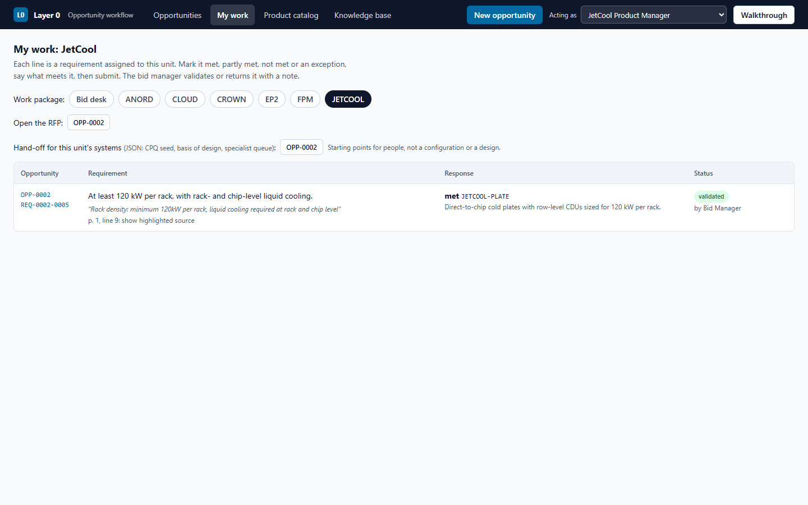

There is no custom "not found" page, error page or loading page (`not-found.tsx`, `error.tsx`, `loading.tsx` do not exist). An unknown route shows the default Next.js "404" page. An unknown opportunity ID (for example `/opportunities/OPP-9999`) still shows the opportunity shell: the title reads the ID, no status badge is shown and no step is ticked. The page body shows the API's message "OPP-9999 not found".

### 3.4 Deep links into Traceability

Many screens link to one requirement in Traceability with an address of the form `/opportunities/{id}/trace#REQ-0001-0039`. The part after `#` is the requirement ID.

When Traceability loads (`web/app/opportunities/[id]/trace/page.tsx`), it chooses the requirement to select in this order:

1. The requirement whose ID equals the hash.
2. Otherwise, the requirement group that contains a sub-requirement with that ID (links from Changes can name a sub-requirement).
3. Otherwise, the first requirement that has a page.

Selecting a requirement shows its page in pane 1 (and switches to the change document when the requirement's current version comes from an addendum), scrolls its rows into view, and rewrites the hash with `history.replaceState` (the address changes but no history entry is added). Screenshots `51-trace-OPP-0001-after-addendum.png` (`#REQ-0001-0977`) and `54-trace-OPP-0001-modified-REQ-0039.png` (`#REQ-0001-0039`) were opened this way. Section 11 describes the selection model.

| Screen | Deep link element |
|---|---|
| Requirements | Source cell of each row (a sub-requirement links to its group) |
| Bid decision | Requirement IDs listed under evidence and checks |
| Final response | Requirement IDs in the open-reason groups and in the table |
| Response outline | Requirement IDs cited by each paragraph and in the open lists |
| Changes | The added and modified requirement IDs in the result of an applied change set, and the target requirement of each change row (a removed requirement is shown as plain text with the tooltip "Removed in baseline {n}: see its history on the Requirements page") |
| My work | Opportunity and requirement ID cell; "{source}: show highlighted source" |

### 3.5 Links that download from the API

These are plain links to `/api/...` addresses. The browser downloads or opens the file. The request carries the `actor` cookie (not the `X-Actor` header), and the back end reads the acting person from that cookie.

| Screen | Label | Address | Result |
|---|---|---|---|
| Final response | "CSV" | `/api/opportunities/{id}/compliance-matrix.csv` | Compliance matrix as CSV |
| Final response | "Download compliance matrix (Excel)" | `/api/opportunities/{id}/compliance-matrix.xlsx` | Compliance matrix as an Excel workbook |
| Response outline | "Download outline (Markdown)" | `/api/opportunities/{id}/response-outline.md` | The outline as a Markdown file (shown only when the outline has loaded) |
| My work (a unit's page, not the bid desk) | One button per opportunity after "Hand-off for this unit's systems (JSON: CPQ seed, basis of design, specialist queue):" | `/api/opportunities/{id}/handoff/{bu}` | The unit's hand-off file as JSON |

Page images are also loaded straight from the API: `` in Traceability pane 1, the line picker on Requirements, and the change document on Changes.

### 3.6 The route handler `/tour-session`

`GET /tour-session` is served by Next.js itself (`web/app/tour-session/route.ts`), not by the FastAPI back end. It returns `{"id": "<random UUID>"}` with the header `Cache-Control: no-store`.

- The ID is created once when the web server process starts (`crypto.randomUUID()`), and kept on a global object so that pages compiled later by the development server get the same ID.
- The route is marked `force-dynamic`, so Next.js never caches the answer at build time.
- The walkthrough fetches it once per page load and compares it with the session saved in the browser (`localStorage` key `layer0.tour`). A different ID means a new server run: saved progress is reset and the welcome dialog opens. The same ID means the person already answered (skipped or finished) or is in the middle of the walkthrough (it resumes). If the fetch fails, the session ID is taken as `"no-session"`.

Section 20 describes the walkthrough itself.

### 3.7 Navigation made by the walkthrough

While the walkthrough runs, it can move the browser itself: a step that belongs to another route makes the walkthrough push that route (`router.push`), and a step that needs another person writes the `actor` cookie, saves its progress and reloads the page. Section 20 lists these steps.

---

## 4. Global Shell (Top Bar)

### 4.1 Overview

Files: `web/app/layout.tsx` (root layout), `web/components/shell/TopNav.tsx`, `web/components/shell/ActorPicker.tsx`, `web/components/shell/PageHead.tsx`, `web/components/tour/TourLauncher.tsx` (the Walkthrough button), `web/components/ui/Toast.tsx` (the toast region).

The root layout wraps every route. It sets the browser tab title to "Layer 0" (description "Opportunity workflow PoC") on every page; pages do not set their own titles. The document language is English (`<html lang="en">`).

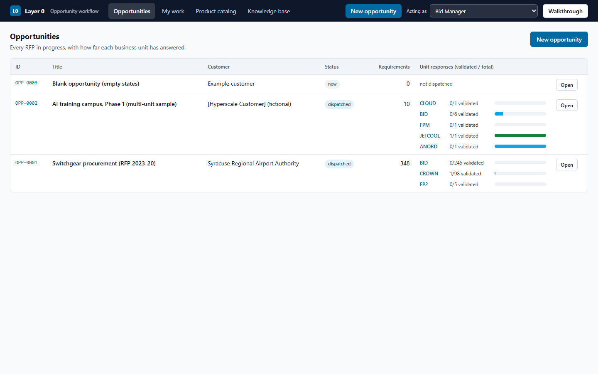

Wireframe at desktop width (one row, 52 px high, navy background; drawn on two lines here only to fit the page):

```text
+---------------------------------------------------------------------------------------------+
| [L0] Layer 0  Opportunity workflow  | Opportunities | My work | Product catalog | Knowledge base |
|                          ... [New opportunity]  Acting as [Bid Manager        v]  [Walkthrough] |
+---------------------------------------------------------------------------------------------+
| <main>: the current page                                                                      |
|                                                                                               |
|                                                          toast stack, bottom right  [ ... x ] |
+---------------------------------------------------------------------------------------------+
```

Order of the elements in the code:

```text
<ToastProvider>                     toasts for every page (section 4.7)
  <TourProvider>                    walkthrough state (section 20)
    <header class="topbar">
      brand link                    section 4.2
      <TopNav/>                     section 4.3
      <div class="topbar-right">
        "New opportunity" link      section 4.2
        <ActorPicker/>              section 4.4
        <WalkthroughButton/>        section 4.5
    <main> page </main>
    <TourOverlay/>                  walkthrough bubble and spotlight (section 20)
    <TourLauncher/>                 welcome dialog and launcher (section 20)
```

### 4.2 Brand and "New opportunity"

| Element | Exact content | Action | Walkthrough anchor (`data-tour`) |
|---|---|---|---|
| Brand link | A 26 x 26 px blue square with "L0" (decorative, hidden from screen readers), the text "Layer 0" in bold white, and the sub-text "Opportunity workflow" in smaller, lighter type | Goes to `/portfolio` | `shell-brand` |
| "New opportunity" | Primary (blue) button-styled link | Goes to `/opportunities/new`. Always enabled, for every acting person. It has no active state. | `shell-new-opportunity` |

### 4.3 Main navigation (`TopNav`)

A `<nav>` landmark labelled "Main" (`aria-label="Main"`, `data-tour="shell-nav"`) holds four links, in this order:

| Label | Goes to | Highlighted when the address starts with | Walkthrough anchor |
|---|---|---|---|
| Opportunities | `/portfolio` | `/portfolio` or `/opportunities/` | `shell-nav-opportunities` |
| My work | `/inbox` (which redirects to the acting person's unit, section 3.3) | `/inbox` | `shell-nav-mywork` |
| Product catalog | `/catalog` | `/catalog` | `shell-nav-catalog` |
| Knowledge base | `/knowledge` | `/knowledge` | `shell-nav-knowledge` |

Active state rules:

- The highlighted link gets the class `active` (white, bold text on a lighter band) and `aria-current="page"`. The others are light grey and turn white on hover.
- No link is highlighted on `/opportunities/new`, although that address starts with `/opportunities/` (`02-new-opportunity.png`).
- On every opportunity page (any step, the outline and Changes), "Opportunities" is highlighted (`03-rfp-step-OPP-0001.png`).
- On `/inbox/{bu}`, "My work" is highlighted for every unit, not only for the acting person's own unit (`13-inbox-EMS-empty.png`).

### 4.4 "Acting as" picker (`ActorPicker`)

Layer 0 has no sign-in in this build. The person acting is chosen in this picker. Real sign-in is Proposed (not built): `SUGGESTIONS.md` ("Authentication for a pilot") proposes sign-in through the enterprise identity provider (OpenID Connect), a user table with roles, and the audit actor taken from the sign-in token, with the picker kept behind a flag for demonstrations.

Elements (`data-tour="shell-actor"`):

| Element | Exact content |
|---|---|
| Label | "Acting as" (linked to the select by `for="actor-select"`) |
| Select | One option per person. The option text is the person's name only. Tooltip: "Switch the person acting in this PoC". |

The list of people comes from `GET /api/people` (`app/modules/catalog/controller.py`). The back end builds it as the Bid Manager followed by the product manager and the design engineer of each active business unit, in the order of the unit catalogue. There are no groups or separators in the select, and the unit is not shown. The list in the demonstration data (17 people):

| # | Name shown | Unit code returned (`bu`) |
|---|---|---|
| 1 | Bid Manager | none (`null`): the bid desk |
| 2 | EP² Product Manager | EP2 |
| 3 | EP² Design Engineer | EP2 |
| 4 | Crown Product Manager | CROWN |
| 5 | Crown Design Engineer | CROWN |
| 6 | Anord Mardix Product Manager | ANORD |
| 7 | Anord Mardix Design Engineer | ANORD |
| 8 | Flex Power Modules Product Manager | FPM |
| 9 | Flex Power Modules Design Engineer | FPM |
| 10 | JetCool Product Manager | JETCOOL |
| 11 | JetCool Design Engineer | JETCOOL |
| 12 | Cloud Product Manager | CLOUD |
| 13 | Cloud Design Engineer | CLOUD |
| 14 | Flex Manufacturing Services Product Manager | EMS |
| 15 | Flex Manufacturing Services Design Engineer | EMS |
| 16 | Flex Aftermarket Services Product Manager | AFS |
| 17 | Flex Aftermarket Services Design Engineer | AFS |

These names are role placeholders, not people.

Behaviour:

| Moment | What happens |
|---|---|
| Page load | The select starts at "Bid Manager", then shows the name stored in the `actor` cookie as soon as the page runs in the browser. Until `GET /api/people` answers, the select holds a single option with that name. |
| Return to the tab | The list of people is fetched again when the browser tab regains focus or becomes visible (the shared data-loading rule, section 19). |
| A person is chosen | The new name is written to the cookie `actor` (URL-encoded, `path=/`, `max-age=31536000`, so it lasts one year for the whole site), then the page is fully reloaded (`location.reload()`). Every screen therefore loads its data again as that person. No API call is made to "switch"; there is no confirmation and no toast. |
| Every API request | `web/lib/api.ts` reads the cookie (default "Bid Manager" when there is none) and sends it URL-encoded in the request header `X-Actor`. |
| Back end | `app/core/web.py` reads `X-Actor`, or the `actor` cookie when the header is missing (plain links, downloads and page images), URL-decodes it, drops non-printable characters, trims it, cuts it to 80 characters, and uses "Bid Manager" when it is empty. This name is written to the audit trail and to fields such as `created_by`, `decided_by`, `responded_by` and `validated_by`. |

Any name in the cookie is accepted. The back end does not check that it belongs to the list. What each person may do is described in section 6.

The walkthrough can also change the acting person (for example to answer as a unit and then validate as the Bid Manager). It writes the same cookie, saves its progress and reloads the page (section 20).

At widths of 1100 px and under, the select stretches to fill the second row of the top bar. At phone width (390 px) the select shrinks to little more than its arrow, so the chosen name is not visible (`26-portfolio-phone.png`).

### 4.5 "Walkthrough" button

| Element | Exact content | Action | Walkthrough anchor |
|---|---|---|---|
| Button | "Walkthrough" (white secondary button). Tooltip "Guided walkthrough of every screen". Announced as opening a dialog (`aria-haspopup="dialog"`). | Opens the walkthrough launcher (`30-walkthrough-launcher.png`) with the chapter list and the buttons Close, Restart, and Resume (when there is progress to resume) or Start walkthrough. While a walkthrough runs, the button is raised above the dimmed backdrop so it stays clickable. | `shell-help` |

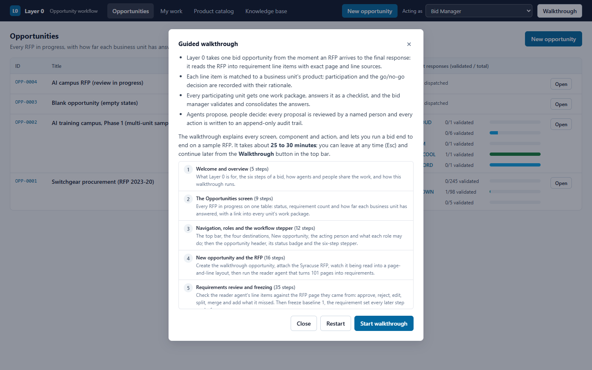

On the first page visit after the web server starts, the welcome dialog opens by itself over the current page (`00-welcome-dialog.png`). Section 20 describes both dialogs, the chapters and the steps.

### 4.6 Page head (`PageHead`)

Every screen starts its content with the same page head (`web/components/shell/PageHead.tsx`):

```text
+----------------------------------------------------------------------------+
| [breadcrumb, optional]                                                       |
| Title (h1 outside an opportunity, h2 inside)           [right-hand actions] |
| Help text in grey (lines at most 80 characters wide)                        |
+----------------------------------------------------------------------------+
```

| Part | Rule |
|---|---|
| Breadcrumb | Optional `nav` labelled "Breadcrumb", for pages outside an opportunity. No screen in this build passes one; the opportunity header has its own breadcrumb (section 5). |
| Title | `h1` (18 px) on Opportunities, New opportunity, My work, Product catalog and Knowledge base. `h2` on every opportunity page, because the opportunity title is the `h1` there. |
| Help | Optional grey paragraph under the title. |
| Actions | Optional buttons and links, right-aligned and wrapping. At 1100 px and under, the head stacks: title, help, then the actions below. |

### 4.7 Toast region

Toasts are short messages that confirm an action or report an error. They replace browser alert boxes. The provider (`web/components/ui/Toast.tsx`) is mounted once by the root layout, so every page shares one toast stack.

| Property | Value |
|---|---|
| Position | Fixed, bottom right, 16 px from the edges, above everything else (also above the walkthrough) |
| Width | At most 420 px (or the screen width minus 32 px) |
| Kinds | success (green edge), info (blue edge), error (red edge) |
| Time shown | success and info: 5 seconds; error: 8 seconds |
| Maximum shown | Four; a fifth pushes out the oldest |
| Dismiss | Click anywhere on the toast, or its "×" button (labelled "Dismiss" for screen readers) |
| Screen readers | Two hidden live regions: a polite one reads success and info texts, an assertive one reads error texts |

The exact toast texts belong to each screen and are listed there (sections 7 to 18).

### 4.8 Landmarks and keyboard access

| Item | State in this build |
|---|---|
| Landmarks | `<header>` (top bar), `<nav aria-label="Main">`, `<main>` (the page). Opportunity pages add `<nav aria-label="Breadcrumb">` and `<nav aria-label="Workflow steps">`. |
| Skip link | None. There is no "skip to content" link. |
| Footer | None. |
| Focus | Every focusable element shows a 2 px blue outline when reached by keyboard (`:focus-visible`); in the top navigation the outline is white. |

### 4.9 Responsive behaviour

| Width | Top bar |
|---|---|
| Over 1100 px | One row, 52 px high: brand, navigation, then the right-hand group (`01-portfolio.png`). |
| 1100 px and under | The bar grows and wraps. Row 1: brand and navigation; the navigation does not wrap but scrolls sideways. Row 2: the right-hand group across the full width ("New opportunity", "Acting as" with a stretched select, "Walkthrough"). |
| 640 px and under | Side padding drops from 24 px to 16 px. At 390 px the navigation shows "Opportunities" and the start of "My work"; the rest is reached by scrolling the navigation sideways (`26-portfolio-phone.png`). |

---

## 5. Opportunity Shell (Header and Step Bar)

### 5.1 Overview

Files: `web/app/opportunities/[id]/layout.tsx` and `web/components/shell/OppSteps.tsx`.

Every page under `/opportunities/{id}` (RFP, Requirements, Traceability, Bid decision, Final response, Response outline, Changes) is wrapped by this layout. It shows the opportunity header first and then the page content. `/opportunities/new` is a separate route and has no opportunity header.

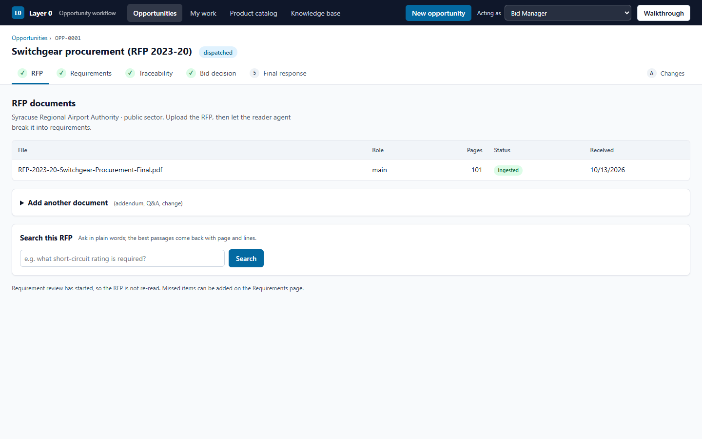

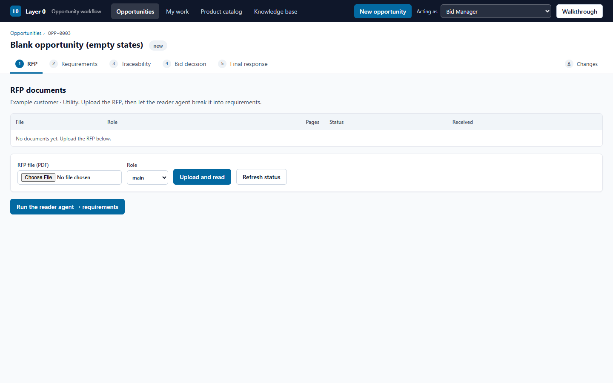

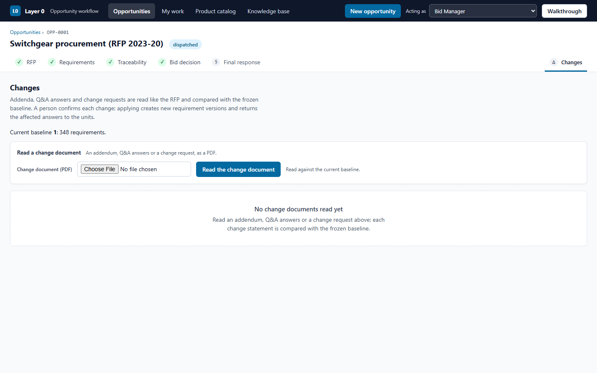

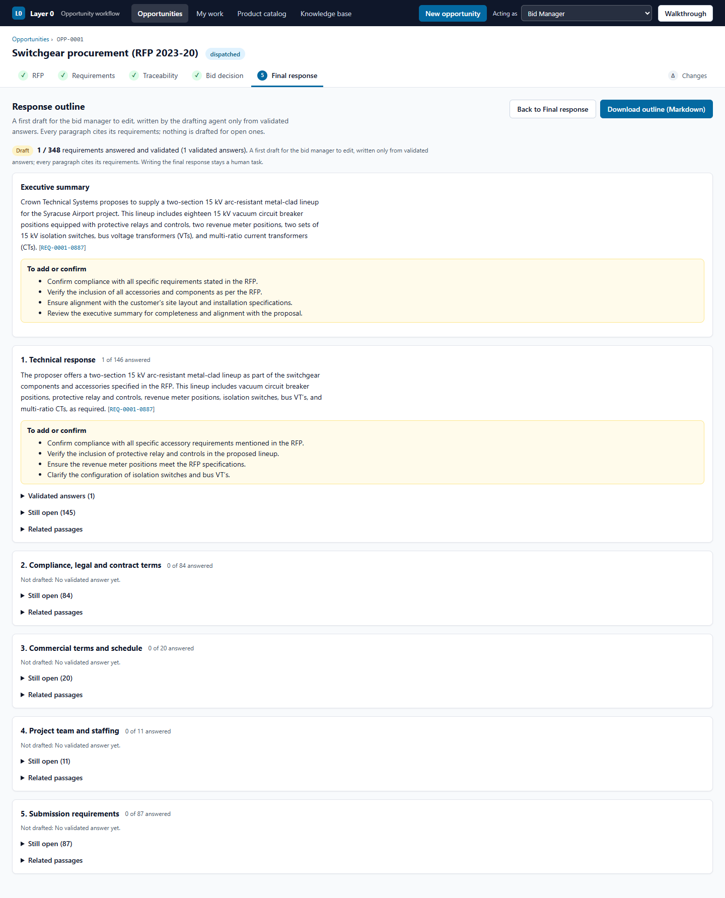

Wireframe (white band with a bottom border, `data-tour="opp-head"`):

```text
+------------------------------------------------------------------------------------------------+
| Opportunities > OPP-0001                                                (breadcrumb)             |
| Switchgear procurement (RFP 2023-20)  (dispatched)                      (h1 + status badge)      |
|                                                                                                  |
| (v) RFP  (v) Requirements  (v) Traceability  (v) Bid decision  (5) Final response   (D) Changes |
| ======                                                                                           |
+------------------------------------------------------------------------------------------------+
  (v) green tick = step done; (5) = step number; (D) = delta symbol; ====== = blue underline of the current step
```

### 5.2 Elements in order

| # | Element | Exact content | Behaviour | Walkthrough anchor |
|---|---|---|---|---|
| 1 | Breadcrumb (`nav`, "Breadcrumb") | Link "Opportunities", the separator "›" (hidden from screen readers), then the opportunity ID in monospace | "Opportunities" goes to `/portfolio`. The ID is plain text. | (inside `opp-head`) |
| 2 | Title (`h1`) | The opportunity title. While the data loads (or if loading fails) the ID is shown instead. | None | (inside `opp-head`) |
| 3 | Status badge | A large pill after the title, shown only once the data has loaded. Text: the status with its underscore replaced by a hyphen (so `no_go` reads "no-go"). | Colour by status (section 5.4) | `opp-status` |
| 4 | Step bar (`nav` "Workflow steps" with an ordered list) | Five numbered steps (section 5.3) | Each step is a link to its route | `stepper`; per step `step-rfp`, `step-requirements`, `step-trace`, `step-decisions`, `step-consolidation` |
| 5 | "Changes" | A link with a "Δ" (delta) bubble at the right end of the step-bar row | Goes to `/opportunities/{id}/changes` | `step-changes` |

### 5.3 The five steps and when a step is done

| # | Label | Route | Ticked (done) when the status is at or past | In practice, ticked from |
|---|---|---|---|---|
| 1 | RFP | `/opportunities/{id}` | `reading` | `review`: the reader agent has run |
| 2 | Requirements | `/opportunities/{id}/requirements` | `frozen` | The baseline is frozen |
| 3 | Traceability | `/opportunities/{id}/trace` | `go` | Go or no-go is recorded |
| 4 | Bid decision | `/opportunities/{id}/decisions` | `go` | Go or no-go is recorded |
| 5 | Final response | `/opportunities/{id}/consolidation` | `submitted` | Never in this build (see below) |

The status order used for ticking is `new`, `reading`, `review`, `frozen`, `go`, `no_go`, `dispatched`, `consolidating`, `submitted`. The status `no_go` counts as `go`, so a no-go bid ticks steps 1 to 4.

What the back end actually sets: `review` when the reader agent proposes requirements, `frozen` when the baseline is frozen, `go` or `no_go` when the decision is recorded, and `dispatched` when work is sent to the units. The status only moves forward, except that `no_go` can stop a bid and `go` can resume it. No code sets `reading`, `consolidating` or `submitted`. As a result:

- A new opportunity with an uploaded RFP stays `new` until the reader agent runs, so step 1 is not ticked yet. OPP-0004 stays `new` even with requirements added by hand (`40-rfp-step-OPP-0004-before-reading.png`).
- Step 5 "Final response" is never ticked in the current build.
- Applying a change set (section 15) freezes a new baseline but does not change the opportunity status.

Display rules for each step:

| State | Look | Accessibility |
|---|---|---|
| Done | Green tick "✓" in a pale green circle, dark grey label | Tooltip "{label}: done"; screen readers hear "{label} (done)" |
| Not done | The step number (1 to 5) in a grey circle, grey label | None |
| Current | Blue circle with a white number (or tick), bold dark label, blue 3 px underline | `aria-current="step"` |

A step is current when the address equals its route. Steps 2 to 5 also stay current on their sub-pages, so "Final response" is current on `/consolidation/outline`. "RFP" is current only on the opportunity's own address.

The "Changes" link looks like a step but is never ticked. It is current (bold, blue underline, `aria-current="page"`) only on `/opportunities/{id}/changes`. It is reachable at any status; the Changes page itself explains when no baseline exists yet (`24-changes-OPP-0003-no-baseline.png`).

### 5.4 Status badge colours

The badge uses the shared status colours (section 19), with the opportunity rule that a submitted final response is green.

| Status value | Text shown | Colour (tone) |
|---|---|---|
| new | new | Grey (neutral) |
| reading | reading | Amber (pending) |
| review | review | Amber (pending) |
| frozen | frozen | Blue (info) |
| go | go | Blue (info) |
| no_go | no-go | Red (bad) |
| dispatched | dispatched | Blue (info) |
| consolidating | consolidating | Blue (info) |
| submitted | submitted | Green (ok) |

### 5.5 Data and refresh

The header loads `GET /api/opportunities/{id}`. The RFP page calls the same endpoint separately; the two calls share no cache. The header loads again:

| Trigger | Why |
|---|---|
| On first display, and on every change of address within the opportunity | Moving between steps shows the latest status |
| Every 5 seconds while an opportunity page is open | A status changed elsewhere appears within 5 seconds |
| On the browser event `opp-status-changed` | Pages that change the status send it right after their own reload: Requirements after "Freeze baseline", Bid decision after go/no-go and dispatch, Changes after apply or discard. The header then updates at once. |
| When the browser tab regains focus or becomes visible | Shared data-loading rule (section 19) |

Errors from this call are not shown in the header. The page below shows its own error.

### 5.6 Narrow screens

| Width | Behaviour |
|---|---|
| 1100 px and under | The step list and "Changes" stack: the steps first (wrapping onto more lines when needed), then "Changes" below them on the left. |
| Any width | Labels never wrap inside a step. |
| 640 px and under | Side padding drops to 16 px. |

---

## 6. Roles in the User Interface

### 6.1 How roles work in this build

There is no sign-in. The person acting is whoever is chosen in "Acting as" (section 4.4). Roles are checked by comparing that name with fixed names:

| Role | How the code recognises it | Where it is checked |
|---|---|---|
| Bid Manager | The name equals "Bid Manager" | My work (validate, return, answer the bid desk), Changes (apply, discard), Knowledge base (approve, reject) |
| A unit's product manager | The name equals the unit's `product_manager` in the unit catalogue (for example "Crown Product Manager") | My work (answer that unit's items) |
| A unit's design engineer | The name equals the unit's `design_engineer` (for example "Crown Design Engineer") | My work (answer that unit's items). The code gives the design engineer exactly the same rights as the product manager. |
| Knowledge curator | The name equals the curator name sent by `GET /api/knowledge`, which is "Bid Manager" in this build | Knowledge base (approve, reject) |

Two kinds of check work together:

- **Screen check.** The screen hides or disables what the acting person may not do and shows an explanation.
- **API check.** The API refuses the request with HTTP 403 and a message. The screen shows that message in a toast or an inline alert. A person normally sees a 403 only when the acting person was changed in another browser tab after this page loaded: the cookie (and so the `X-Actor` header) changes for every tab, but the old tab still shows the buttons of the earlier person.

Everything not listed in section 6.4 has no role check, in the screens or in the API. Any acting person can, for example, create an opportunity, upload an RFP, run the reader agent, review and freeze requirements, run and decide product matches, record participation and go/no-go, dispatch work, read change documents and confirm change proposals, and send items to the knowledge base. The acting person's name is recorded in the audit trail for each of these actions. Named roles with sign-in are Proposed (not built); see section 4.4.

### 6.2 Role types and what they see

| Acting person | Typical names | What changes in the screens |
|---|---|---|
| Bid Manager | "Bid Manager" | Sees and can use every action. On My work: answers the bid desk (`/inbox/BID`) and validates or returns every submitted answer in any unit. Sees "{n} to validate" counts on the unit chips. Applies or discards change sets. Approves or rejects knowledge items (as curator). |
| A unit's product manager | "Crown Product Manager", "EP² Product Manager", ... | On the own unit's My work page: answer forms on open rows, "Submit" per row and "Submit all answered rows". No Validate or Return. On other units and on the bid desk: read-only notice. On Changes: Apply and Discard disabled with "switch with Acting as". On Knowledge base: curator notice, no review form. Everything else as the Bid Manager. |
| A unit's design engineer | "Crown Design Engineer", "EP² Design Engineer", ... | Same as the unit's product manager. |
| People of units without work | "Flex Manufacturing Services Product Manager" or "... Design Engineer" (EMS), "Flex Aftermarket Services Product Manager" or "... Design Engineer" (AFS) in the demonstration data | "My work" opens the own unit's page with the empty state "Nothing assigned" and the hint "Requirements appear here once the bid manager dispatches an opportunity to this unit." The own unit has no chip in the "Work package:" row, because only units with work (and the bid desk) are listed. Elsewhere they have the same rights as any unit person. |
| Knowledge reviewer (curator) | "Bid Manager" (the curator in this build; a separate curator role is Proposed (not built), as the comment in `app/modules/knowledge/service.py` says it comes with sign-in) | The review form on each waiting knowledge item: "Response to keep", "Note", "Approve into the knowledge base", "Reject". |

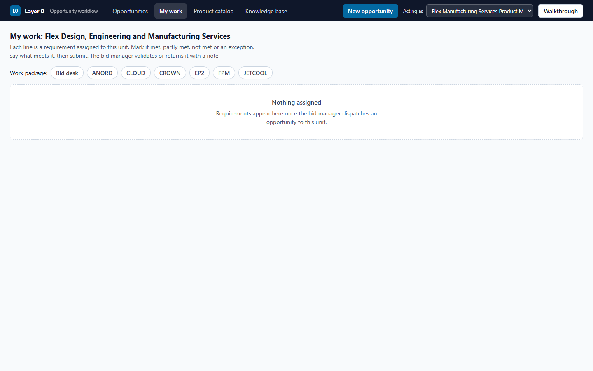


### 6.3 Screen by screen

| Screen | Bid Manager | Unit product manager or design engineer (own unit) | Unit person (other unit or bid desk) | Check |
|---|---|---|---|---|
| Opportunities | Read; all links | Same | Same | None |
| New opportunity | Create | Same | Same | None |
| RFP | Upload, read, run reader agent, search | Same | Same | None |
| Requirements | Review, edit, split, merge, add, freeze, history | Same | Same | None |
| Traceability | Run matching, accept, reject or change a match, send to knowledge base | Same | Same | None |
| Bid decision | Participation, go/no-go, dispatch, send rationale to knowledge base | Same | Same | None |
| Final response | Read, filter, download CSV and Excel | Same | Same | None |
| Response outline | Read, download Markdown, send to knowledge base | Same | Same | None |
| Changes | Read a change document, decide items, "Confirm all proposals", "Apply to requirements", "Discard" | Read a change document, decide items, "Confirm all proposals". "Apply to requirements" and "Discard" are disabled. | Same as own unit | Screen and API |
| My work | Bid desk: answer and validate. Any unit: validate or return submitted answers; open rows read only | Answer open rows and submit; no validation | Read only, with a notice | Screen and API |
| Product catalog | Read and search | Same | Same | None |
| Knowledge base | Approve or reject waiting items | Read only, with a notice | Same | Screen and API |

### 6.4 Exact messages when an action is not allowed

| Screen | Where | Exact text | When |
|---|---|---|---|
| My work | Blue information alert above the table (`data-tour="inbox-readonly"`) | "You are acting as {name}: you can read this work package but not answer it. Switch with “Acting as” in the top bar." | The acting person can neither answer nor validate on this page: a unit person on another unit's page or on the bid desk |
| My work | API 403, shown as an error toast | "Only {unit code}'s product manager or design engineer can answer this item." | An answer is sent by someone who may not answer that unit's item (for the bid desk, anyone other than the Bid Manager) |
| My work | API 403, shown as an error toast | "Only the Bid Manager validates or returns answers." | "Validate" or "Return with note" sent by anyone other than the Bid Manager |
| Changes | Grey note in the action area of a change set under review | "Only the Bid Manager applies or discards; switch with Acting as. Applying creates the new versions, freezes a new baseline and returns the affected answers to the units." For the Bid Manager the words "; switch with Acting as" are left out. When proposals are still unconfirmed, the note starts with "{n} change(s) still need a person's confirmation. " | Always shown while a change set is in review. For anyone other than the Bid Manager, "Apply to requirements" and "Discard" are disabled. |
| Changes | API 403, shown in the red alert of the change set | "Only the Bid Manager applies a change set." | Apply sent by anyone other than the Bid Manager |
| Changes | API 403, shown in the red alert of the change set | "Only the Bid Manager discards a change set." | Discard sent by anyone other than the Bid Manager |
| Knowledge base | Blue information alert under the page head (`data-tour="kb-curator-note"`) | "Only the curator (Bid Manager) approves or rejects; switch with “Acting as” in the top bar." | The acting person is not the curator. The review form is not shown; waiting items show only what was asked. |
| Knowledge base | API 403 | "Only the knowledge curator (in the PoC, the Bid Manager) approves knowledge." | A review sent by anyone other than the curator; shown in the red alert of the review form |

The API answers 403 for these refusals because the controllers of `changes`, `knowledge` and `workpackages` turn a permission error into HTTP 403. Wrong-state refusals use 409 and are described with each screen.

---

## 7. Screen: Opportunities

### 7.1 Summary

| Item | Value |
|---|---|
| Route | `/portfolio` (also the target of `/` and of the brand link) |
| File | `web/app/portfolio/page.tsx` |
| Purpose | Every opportunity on one table: status, number of requirements, and how far each business unit has answered. The entry point to every opportunity and every unit work package. |
| Who uses it | Mainly the Bid Manager. Every acting person sees the same screen; there is no role check. |
| Data loaded on open | `GET /api/portfolio` |
| Actions that change data | None. The screen only reads and links. |

### 7.2 Screenshots


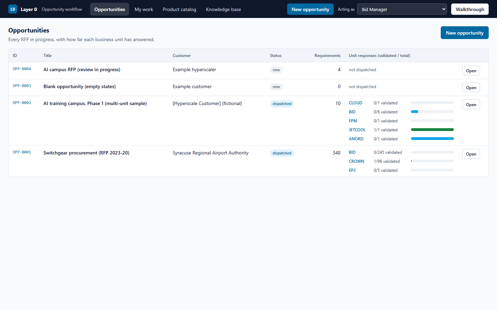

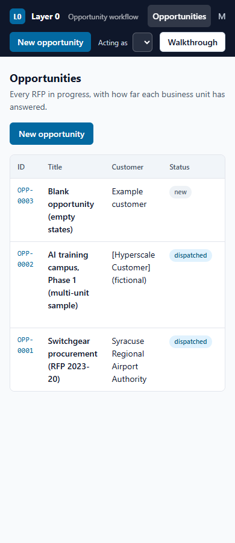

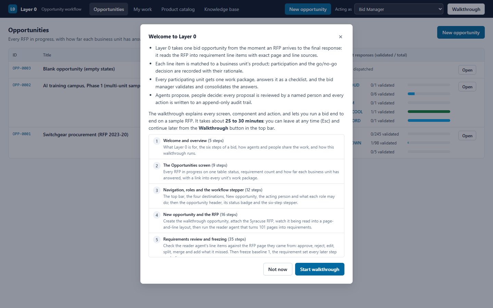

The welcome dialog opens over this screen (or whichever screen is opened first) on the first visit after the web server starts. Its content and buttons ("Not now", "Start walkthrough") are described in section 20.

### 7.3 Layout

```text
+----------------------------------------------------------------------------------------------------+
| TOP BAR (section 4)                                                                                  |
+----------------------------------------------------------------------------------------------------+
| Opportunities                                                                  [New opportunity]    |
| Every RFP in progress, with how far each business unit has answered.                                |
|                                                                                                      |
| [error alert, when loading failed]                                                                   |
| [grey loading lines, while loading]                                                                  |
| [empty state, when there is no opportunity]                                                          |
|                                                                                                      |
| +--------+---------------------+------------+------------+--------------+---------------------+----+ |
| | ID     | Title               | Customer   | Status     | Requirements | Unit responses      |    | |
| |        |                     |            |            |              | (validated / total) |    | |
| +--------+---------------------+------------+------------+--------------+---------------------+----+ |
| |OPP-0002| AI training campus, | [Hyperscale| dispatched |           10 | CLOUD 0/1 validated [====]  |[Open]| |
| |        | Phase 1 (...)       |  Customer] |            |              | BID   0/6 validated [=   ]  |    | |
| |        |                     |            |            |              | ...                         |    | |
| +--------+---------------------+------------+------------+--------------+---------------------+----+ |
+----------------------------------------------------------------------------------------------------+
```

### 7.4 Elements in screen order

**Page head (level 1).**

| Element | Exact content | Behaviour | Walkthrough anchor |
|---|---|---|---|
| Title (`h1`) | "Opportunities" | None | |
| Help | "Every RFP in progress, with how far each business unit has answered." | None | |
| Button-styled link | "New opportunity" (primary, blue) | Goes to `/opportunities/new`. The same action as the top-bar button. | `portfolio-new` |

**Error alert.** A red alert (`role="alert"`) that shows the error text when `GET /api/portfolio` fails. It is not dismissible. The text is the API's message, or "Request failed ({status})" followed by up to 200 characters of the response when the API sent no message.

**Loading.** Four grey shimmering lines (`aria-busy="true"`, label "Loading") while the first load runs.

**Empty state.** Shown when the API returns an empty list (a dashed box):

| Part | Exact content |
|---|---|
| Title | "No opportunities yet" |
| Hint | "Create one, or run `python -m scripts.seed_demo` for the demo data." (the command in monospace) |
| Action | Button-styled link "New opportunity", to `/opportunities/new` |

**Opportunities table** (`data-tour="portfolio-table"`), shown when there is at least one opportunity. One row per opportunity, newest ID first (the API sorts by ID, descending). Each row has `data-tour="portfolio-row-{id}"`.

| # | Column header (exact) | Cell content | Link | Walkthrough anchors |
|---|---|---|---|---|
| 1 | ID | The opportunity ID in blue monospace (for example "OPP-0001") | To `/opportunities/{id}`, the RFP step | Header `portfolio-col-id` |
| 2 | Title | The title in bold dark text; turns blue on hover | To `/opportunities/{id}/trace`, Traceability | Header `portfolio-col-title` |
| 3 | Customer | The customer name, or grey "not set" when it is empty | None | Header `portfolio-col-customer` |
| 4 | Status | Status pill (`StatusBadge` with the opportunity colours of section 5.4). The text keeps the underscore replaced by a space (for example "no go"). | None | Header `portfolio-col-status`; cell `portfolio-status-{id}` |
| 5 | Requirements (right-aligned) | The number of current requirements: the latest version of each top-level requirement, without rejected, split, merged, duplicate or removed ones and without sub-requirements of a group. Proposed requirements that are not yet decided are counted. | None | Header `portfolio-col-requirements`; cell `portfolio-reqs-{id}` |
| 6 | Unit responses (validated / total) | Per-unit progress (below) | Unit codes link to `/inbox/{unit}` | Header `portfolio-col-units`; cell `portfolio-units-{id}` |
| 7 | (no visible header; named "Open" for screen readers) | Small white button "Open", announced as "Open {id}" | To `/opportunities/{id}/trace`, Traceability | `portfolio-open-{id}` |

So the ID opens step 1 (RFP), while the title and "Open" open step 3 (Traceability).

**Unit responses cell.** When the opportunity has no assignment yet (not dispatched), the cell reads "not dispatched" in grey. Otherwise it shows one line per business unit, in the order the units first received an assignment:

| Part | Content |
|---|---|
| Unit code | Bold blue link (for example "CROWN", "BID") to that unit's work package `/inbox/{unit}`. Screen readers hear "{unit} work package: {note}". |
| Count | "{validated}/{total} validated" |
| Bar | An 8 px pill (decorative). Green part: validated / total. Sky-blue part: answers submitted but not yet validated / total. Grey rest: not answered. |
| Tooltip on the whole line | "{validated} validated, {waiting} awaiting validation, {not answered} not answered" |

How the numbers are counted (`app/modules/workpackages/service.py`, `progress`): every assignment of the opportunity except withdrawn ones counts in "total"; "submitted" counts submitted and validated assignments; "validated" counts validated ones. "Waiting" is submitted minus validated. "BID" is the bid desk: requirements answered by the Bid Manager rather than a product unit.

Examples from the screenshots:

| Opportunity | Lines shown |
|---|---|
| OPP-0004, OPP-0003 | "not dispatched" |
| OPP-0002 | CLOUD 0/1 validated (empty bar); BID 0/6 validated (small sky-blue part: one answer waiting); FPM 0/1 validated; JETCOOL 1/1 validated (full green); ANORD 0/1 validated (full sky blue: answered, waiting for validation) |
| OPP-0001 (before the addendum) | BID 0/245 validated; CROWN 1/98 validated (a thin green start); EP2 0/5 validated |

After the addendum was applied (live data on 13 Oct 2026), OPP-0001 reads 349 requirements and CROWN 0/99 validated with one answer waiting, because applying a change set returns the affected answers to the units and dispatches the new requirements.

### 7.5 States

| State | What is shown |
|---|---|
| Loading | Page head, then four grey loading lines |
| Error | Page head, then the red error alert. A later successful reload (for example on returning to the tab) replaces it with the table. |
| Empty | Page head, then the "No opportunities yet" empty state |
| Populated | Page head, then the table |
| Opportunity not dispatched | "not dispatched" in the unit column |
| Opportunity dispatched | One progress line per unit |

There is no busy state and no confirmation: the screen does not change data. The list is not polled. It is loaded again when the browser tab regains focus or becomes visible.

### 7.6 Responsive behaviour

| Width | Behaviour |
|---|---|
| Over 1100 px | As in `01-portfolio.png`. The unit column is at least 260 px wide; each unit line uses 64 px for the code, 100 px for the count, and the rest for the bar. |
| 1100 px and under | The page head stacks: title and help, then "New opportunity" below. The table becomes a horizontally scrolling box inside the page. |
| 390 px (phone) | ID, Title, Customer and Status are visible; Requirements, Unit responses and Open are reached by scrolling the table sideways (`26-portfolio-phone.png`). Side padding is 16 px. |

### 7.7 Proposed (not built)

`SUGGESTIONS.md` lists two ideas for this screen: a per-unit workload bar across all opportunities (open work against capacity, drawn as inline graphics) and due dates with an "overdue" filter for assignments. Neither is built.

---

## 8. Screen: New Opportunity

### 8.1 Summary

| Item | Value |
|---|---|
| Route | `/opportunities/new` |
| File | `web/app/opportunities/new/page.tsx` |
| Purpose | Create one opportunity per RFP. The RFP itself is uploaded on the next page (the RFP step). |
| Who uses it | The Bid Manager. There is no role check: any acting person can create an opportunity, and that person is recorded as `created_by`. |
| Data loaded on open | None |
| API call | `POST /api/opportunities` |
| Navigation after success | To `/opportunities/{new id}` (the RFP step, section 9) |

### 8.2 Screenshots

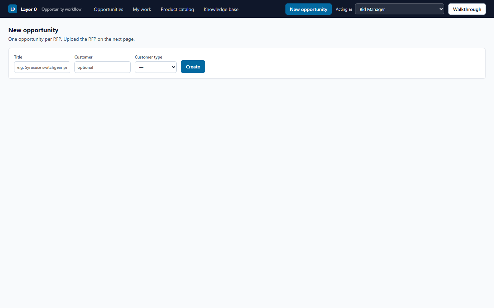

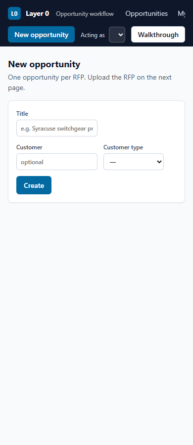

This page has no opportunity header and no step bar. No top navigation link is highlighted (section 4.3).

### 8.3 Layout

```text
+----------------------------------------------------------------------------------------+
| TOP BAR (no navigation link highlighted)                                                 |
+----------------------------------------------------------------------------------------+
| New opportunity                                                                          |
| One opportunity per RFP. Upload the RFP on the next page.                                |
| +--------------------------------------------------------------------------------------+ |
| | Title                    Customer           Customer type                             | |
| | [e.g. Syracuse switch..] [optional        ] [ —            v]  [Create]  (Creating…)  | |
| +--------------------------------------------------------------------------------------+ |
| [red error alert, when there is a message]                                               |
+----------------------------------------------------------------------------------------+
```

### 8.4 Elements in screen order

**Page head (level 1).**

| Element | Exact content |
|---|---|
| Title (`h1`) | "New opportunity" |
| Help | "One opportunity per RFP. Upload the RFP on the next page." |

**Form** (a white card, `data-tour="intake-form"`). The labels sit above their fields. All fields are disabled while the form is being sent.

| # | Label | Control | Field name sent | Placeholder | Default | Required | Rules | Walkthrough anchor |
|---|---|---|---|---|---|---|---|---|
| 1 | Title | Text input | `title` | "e.g. Syracuse switchgear procurement" | Empty | Yes | The browser blocks an empty field (HTML `required`). The page also trims the text and stops with "A title is required." when only spaces were typed; the field is then marked invalid (red border). No maximum length is set in the form; the database column is declared as 200 characters. | `intake-title` |
| 2 | Customer | Text input | `customer` | "optional" | Empty | No | Sent as typed (not trimmed). The database column is declared as 120 characters. | `intake-customer` |
| 3 | Customer type | Select | `customer_type` | None | "—" (empty value) | No | Options in order: "—" (sends an empty value), "utility", "hyperscaler", "neocloud", "colocation", "silicon provider", "public sector". The option text is the value sent. | `intake-customer-type` |

| # | Element | Exact label | Enabled when | Action | Walkthrough anchor |
|---|---|---|---|---|---|
| 4 | Submit button | "Create" | Not busy | Sends the form (also by pressing Enter in a text field) | `intake-create` |
| 5 | Busy indicator | Spinner and "Creating…" (`role="status"`) | Shown only while busy | None | |

**Error alert** under the form: a red alert (`role="alert"`) with the current message. It is not dismissible. It is empty (not shown) until a message exists.

### 8.5 What "Create" does

1. The page stops the browser's own form submission and reads the three fields.
2. It trims the title. If the result is empty, it shows "A title is required." and stops. No request is sent.
3. It clears any earlier message, marks the form busy (fields and button disabled, "Creating…" shown), and sends:

```text
POST /api/opportunities
X-Actor: Bid%20Manager            (the acting person, URL-encoded)
Content-Type: application/json

{"title": "Example switchgear RFP", "customer": "Example utility", "customer_type": "utility"}
```

4. The API (`app/modules/opportunities/controller.py`, `service.py`) checks that the title is not blank, allocates the next free ID (`OPP-` plus four digits, one more than the highest existing number; it retries up to 20 times when two people create at the same moment), stores the opportunity with status `new` and `created_by` set to the acting person, and writes the audit event `created` on the entity `opportunity`. It answers with the new row, for example:

```text
{"id": "OPP-0005", "title": "Example switchgear RFP", "customer": "Example utility",
 "customer_type": "utility", "status": "new", "created_by": "Bid Manager",
 "created_at": "2026-10-13T08:00:00.000000"}
```

(The values are illustrative. The fields are the columns of the `opportunity` table.)

5. On success the browser goes to `/opportunities/{id}`, the RFP step, where the RFP is uploaded (section 9). No toast is shown. The form stays disabled until the new page opens.

### 8.6 States

| State | What is shown |
|---|---|
| Initial | Empty fields, "—" selected, "Create" enabled, no alert |
| Title missing | The browser's own "fill in this field" prompt on Title; nothing is sent |
| Title only spaces | Red alert "A title is required."; Title marked invalid; nothing is sent |
| Busy | Fields and "Create" disabled; spinner with "Creating…"; the form is marked `aria-busy` |
| API error | Red alert with the API's message; the form is enabled again and keeps the typed values so the person can retry. Messages the API can send: "A title is required." (HTTP 422) and "Could not allocate an opportunity ID; try again." (HTTP 422). A network or server failure shows "Request failed ({status})…" or, when nothing else is known, "Something went wrong. Please try again." |
| Success | The browser leaves the page for the new opportunity's RFP step |

### 8.7 Responsive behaviour

The form is a wrapping row. At desktop width the three fields and "Create" sit on one line (`02-new-opportunity.png`). When the width is too small, the items wrap: at 390 px, Title takes the first row, Customer and Customer type share the second, and "Create" is on the third (`49-new-opportunity-phone.png`). The page head is the same at every width.

### 8.8 Notes

- The customer type list in the form is fixed in the page code. The back end stores any text in this field. Seeded opportunities can therefore show values outside the list or with other capitals (for example "Utility" for OPP-0003 and "Hyperscaler" for OPP-0004).
- An opportunity cannot be renamed or deleted from the user interface; there is no edit screen for these fields.

## 9. Screen: RFP (Step 1)

Status: Implemented. Everything in this section describes what the code at commit 4c6d866 does (13 Oct 2026). Items marked "Proposed (not built)" or "Needs confirmation" are called out where they occur.

### 9.1 Route, File and Purpose

| Item | Value |
|---|---|
| Route | `/opportunities/{id}`, for example `/opportunities/OPP-0001` |
| Page file | `web/app/opportunities/[id]/page.tsx` (React component `DocumentsPage`, a client component) |
| Frame | Rendered inside `web/app/opportunities/[id]/layout.tsx`: the global top bar (section 4) and the opportunity header with the step bar (section 5) sit above it; the page itself is placed in the `content` area |
| Step | Step 1, "RFP", of the step bar |
| Page heading | "RFP documents" (a level-2 heading; inside an opportunity the opportunity title is the level-1 heading) |
| Shared parts used | `PageHead` (`web/components/shell/PageHead.tsx`); `Alert`, `Busy`, `Skeleton`, `StatusBadge`, `useToast` (`web/components/ui/`, see section 19); `api`, `post`, `useApi`, `errorMessage` (`web/lib/api.ts`) |
| Stylesheets | `web/app/globals.css` (tables, cards, forms, `.passages`, `input.wide`) and `web/app/styles/overview.css` (the search box on a phone) |

Purpose. This is the first screen of an opportunity and the screen a new opportunity opens on (section 8). It does four things:

1. It receives the files of the bid: the RFP itself and, later, addenda, question-and-answer documents and other files.
2. It shows whether each file has been read into the **layout model**. The layout model is the server's record of every text line of a document, with its page number, its line number on the page and its position box on the page. All later anchoring (the "page and lines" shown for every requirement) uses it.
3. It lets a person search the read RFP in plain words and get passages back with page and line numbers.
4. It starts the **reader agent**: the AI step that reads the main RFP page by page and proposes requirement **line items** (one line item per obligation found, each with a short text, a category and a verbatim quote). A second AI step, the **grouping agent**, then gathers related line items of a page into groups. The result is reviewed on the Requirements screen (section 10).

### 9.2 Who Uses It

The Bid Manager. Neither the page nor the API checks the role: whoever is selected in "Acting as" (section 4) can upload, search and run the reader agent. The name is sent with every request in the `X-Actor` header and recorded by the server: as the actor of the `uploaded` audit event of a document, and inside the creator name of the reader's drafts ("reader agent (Bid Manager)"). Section 6 describes the roles.

### 9.3 Screenshots


*Figure 9-1. OPP-0003 ("Blank opportunity (empty states)"), status new, no document yet. The help line reads "Example customer · Utility. Upload the RFP, then let the reader agent break it into requirements."*

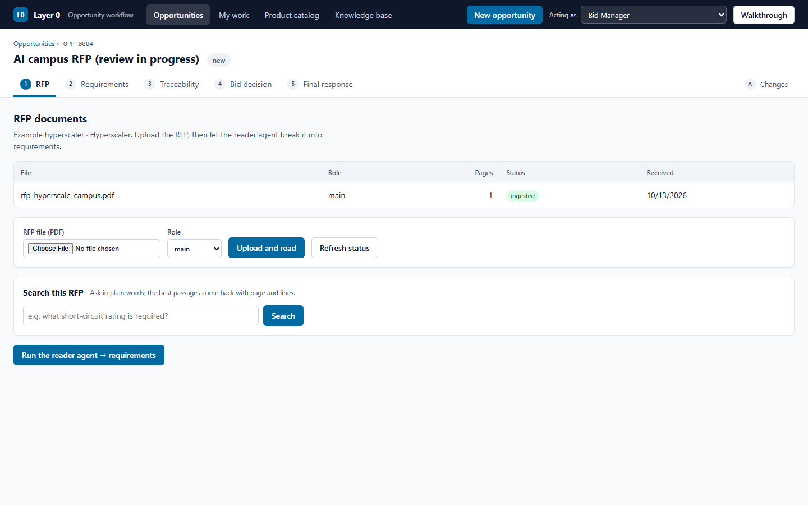

*Figure 9-2. OPP-0004 ("AI campus RFP (review in progress)"), status new: the main RFP `rfp_hyperscale_campus.pdf` (1 page) is ingested, the reader agent has not been run. The upload form is still the primary card and "Search this RFP" is available.*


*Figure 9-3. OPP-0001 (Syracuse switchgear RFP), status dispatched, captured before the addendum was read: one main document of 101 pages, the upload form folded into "Add another document", the search card, and the note that the RFP is not re-read.*

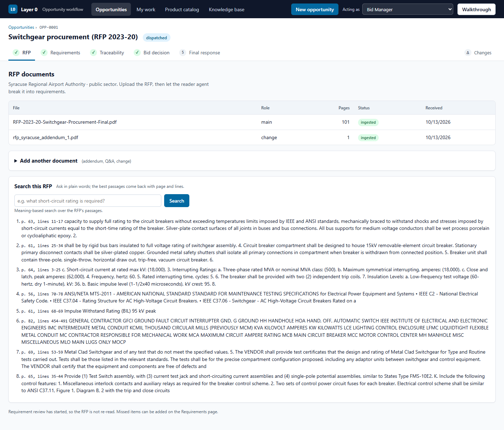

*Figure 9-4. OPP-0001 after a search for "short-circuit rating of the switchgear": "Meaning-based search over the RFP's passages." and eight passages. The table now also lists `rfp_syracuse_addendum_1.pdf` with role change, attached later from the Changes step (section 15). The query box is empty again after the search (see 9.12).*

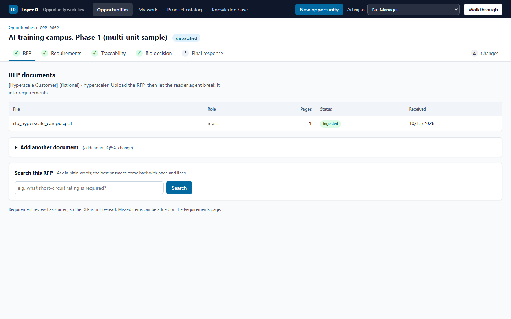

*Figure 9-5. OPP-0002 ("AI training campus, Phase 1 (multi-unit sample)"), status dispatched: one main document of 1 page, ingested.*

### 9.4 Layout

```text
+----------------------------------------------------------------------------------------+
| Global top bar (section 4)                                                             |
| Opportunities > OPP-0001                                                               |
| Switchgear procurement (RFP 2023-20)  (dispatched)        header (section 5)           |
| (1) RFP  2 Requirements  3 Traceability  4 Bid decision  5 Final response  Changes     |
+----------------------------------------------------------------------------------------+
| A  RFP documents                                                                       |
|    <customer> · <customer type>. Upload the RFP, then let the reader agent ...         |
| B  [ error alert, only when something failed                            (x) ]          |
| C  +------------------------------------------------------------------------+          |
|    | File                     | Role | Pages | Status     | Received        |          |
|    | RFP-2023-20-...Final.pdf | main |   101 | (ingested) | 10/13/2026      |          |
|    +------------------------------------------------------------------------+          |
| D  +------------------------------------------------------------------------+          |
|    | RFP file (PDF)            Role                                         |          |
|    | [Choose File] No file..   [main v] [Upload and read] [Refresh status]  |          |
|    +------------------------------------------------------------------------+          |
|    ...or, once review has moved on:                                                    |
|    +------------------------------------------------------------------------+          |
|    | > Add another document  (addendum, Q&A, change)                        |          |
|    +------------------------------------------------------------------------+          |
| E  +------------------------------------------------------------------------+          |
|    | Search this RFP  Ask in plain words; the best passages come back ...   |          |
|    | [e.g. what short-circuit rating is required?        ] [Search]         |          |
|    | Meaning-based search over the RFP's passages.                          |          |
|    | 1. p. 63, lines 11-17  capacity to supply full rating to the ...       |          |
|    +------------------------------------------------------------------------+          |
| F  [Run the reader agent -> requirements]  <busy text or waiting note>                 |
|    ...or: "Requirement review has started, so the RFP is not re-read. ..."             |
+----------------------------------------------------------------------------------------+
```

| Region | Element | Shown when |
|---|---|---|
| A | Page heading "RFP documents" and help line | Always |
| B | Error alerts (load error; action error) and the loading skeleton | Only when relevant |
| C | RFP documents table | Once the opportunity has loaded |
| D | Upload form as a card, or folded into "Add another document" | Once loaded; folded when review has moved on (9.10) |
| E | "Search this RFP" card | Only when the main RFP has status `ingested` |
| F | Reader agent row, or the review-started note | Row while the opportunity status is `new` or `review`; note otherwise |

### 9.5 Data Loaded on Open

The page makes one request when it opens:

| Request | Purpose | Re-sent when |
|---|---|---|
| `GET /api/opportunities/{id}` | The opportunity and its documents | After every successful upload; when "Refresh status" is pressed; whenever the browser tab regains focus or becomes visible again (behaviour of the shared `useApi` hook) |

There is no timed polling on this page. The opportunity header polls the same endpoint every 5 seconds for its own status badge and step ticks (section 5), but that does not refresh this page's table: a document that finishes reading shows as `ingested` here only after "Refresh status", a return to the tab, or another upload.

The answer has two parts. `opportunity` carries `id`, `title`, `customer`, `customer_type`, `status`, `created_by` and `created_at`. `documents` lists the files in order of receipt, each with `id`, `sha256`, `opportunity_id`, `filename`, `role`, `status`, `page_count` and `received_at`. The server never returns the stored file path. Real answer for OPP-0001 (the second document is the addendum read on the Changes step; hashes shortened here):

```json
{"opportunity": {"id": "OPP-0001", "title": "Switchgear procurement (RFP 2023-20)",
                 "customer": "Syracuse Regional Airport Authority", "customer_type": "public sector",
                 "status": "dispatched", "created_by": "Bid Manager", "created_at": "2026-10-13T05:50:59.097134"},
 "documents": [{"id": "OPP-0001-893403680eda", "sha256": "893403680eda487a…", "opportunity_id": "OPP-0001",
                "filename": "RFP-2023-20-Switchgear-Procurement-Final.pdf", "role": "main", "status": "ingested",
                "page_count": 101, "received_at": "2026-10-13T05:50:59.127038"},
               {"id": "OPP-0001-180eb141aec2", "sha256": "180eb141aec27c6c…", "opportunity_id": "OPP-0001",
                "filename": "rfp_syracuse_addendum_1.pdf", "role": "change", "status": "ingested",
                "page_count": 1, "received_at": "2026-10-13T06:40:09.579061"}]}
```

From this answer the page derives four values that decide what it shows:

| Value | Rule | Effect |
|---|---|---|
| Opportunity status | `opportunity.status` | Drives the next three values |
| Can read | Status is `new` or `review` | The reader agent row (region F) is shown; the upload form is the primary card |
| Unread main RFP | A document with role `main` exists and its status is not `ingested` | The reader button is disabled and the waiting note is shown |
| Review has moved on | Data loaded and status is neither `new` nor `review` (in practice `frozen`, `go`, `no_go`, `dispatched`, `consolidating` or `submitted`) | The upload form folds into "Add another document" with role `addendum` preselected, and the review-started note replaces the reader row |

The status vocabulary also contains `reading`, but no code sets it: an opportunity goes straight from `new` to `review` when the reader agent runs. The step bar ticks "RFP" from `reading` onwards, so in practice the tick appears once the reader has run (section 5).

### 9.6 Page Heading and Help Line (Region A)

| Element | Text | Notes |
|---|---|---|
| Heading | "RFP documents" | Level-2 heading (`PageHead level={2}`) |
| Help line | "{customer} · {customer type}. Upload the RFP, then let the reader agent break it into requirements." | An empty customer shows "Customer not set"; an empty customer type shows "customer type not set". Both values are shown exactly as stored (the form in section 8 offers lower-case types; OPP-0003 and OPP-0004 were seeded with "Utility" and "Hyperscaler") |

Real help lines: OPP-0001 "Syracuse Regional Airport Authority · public sector. Upload the RFP, then let the reader agent break it into requirements."; OPP-0002 "[Hyperscale Customer] (fictional) · hyperscaler. …"; OPP-0003 "Example customer · Utility. …"; OPP-0004 "Example hyperscaler · Hyperscaler. …".

While the first request is still in flight the help line briefly reads "Customer not set · customer type not set. Upload the RFP, then let the reader agent break it into requirements.", because the opportunity has not arrived yet. The heading has no buttons on its right on this screen.

### 9.7 Messages and Loading (Region B)

| Element | When | Appearance and text | Dismissal |
|---|---|---|---|
| Load error | `GET /api/opportunities/{id}` fails | Red error alert with the API's message, for example "OPP-0099 not found" (HTTP 404 for an unknown ID). When the first load fails nothing else is rendered below it: no table, no form. When a later reload fails, the alert appears above the table and form still shown from the last good load | No close button; it clears on the next successful load (a return to the tab, "Refresh status" if the form is shown, or a reload of the browser page) |
| Action error | An upload, a search or a reader run fails, or the reader run returns unread pages | Red error alert with a paragraph and, for unread pages, a bullet list (9.13) | "×" button (accessible name "Dismiss"); also cleared when a new upload or reader run starts |
| Loading | First load still in flight | Three grey shimmering skeleton lines in place of the table (`aria-busy="true"`, `aria-label="Loading"`) | Replaced by the content |

Error alerts have `role="alert"`, so screen readers announce them at once.

### 9.8 RFP Documents Table (Region C)

| Column | Content | Notes |
|---|---|---|
| File | The original file name, as uploaded | For example `RFP-2023-20-Switchgear-Procurement-Final.pdf` |
| Role | `main`, `addendum`, `qa`, `change` or `other`, as plain text | See the role list in 9.9 |
| Pages | Number of pages, right-aligned with tabular figures | `0` until the file has been read |
| Status | Status badge (section 19) | `uploaded` (amber), `ingesting` (amber), `ingested` (green), `failed` (red), `unsupported` (grey: the neutral colour, as the badge has no colour of its own for it) |
| Received | Date of receipt in the browser's short date format, for example "10/13/2026" | Hovering shows the tooltip "SHA-256 {64 hexadecimal characters}". If a document had no receipt time, the first 12 characters of the hash would be shown in monospace instead; the current API always sends the time |

Rows appear in order of receipt. With no document, a single muted row spans the five columns: "No documents yet. Upload the RFP below." (Figure 9-1).

What each document status means (set by the server's ingestion service):

| Status | Meaning |
|---|---|
| `uploaded` | Stored, waiting to be read |
| `ingesting` | Being read into the layout model |
| `ingested` | Read: the layout model is written, the page count is set and the RFP's search index is rebuilt |
| `failed` | Reading raised an error (for example a damaged or encrypted PDF). It is reported, never skipped silently |
| `unsupported` | The file name does not end in `.pdf` (for example a Word or CAD file). It is stored and recorded but never read |

Document identity. The server stores the bytes once under their SHA-256 fingerprint and never modifies them. The document ID is `<opportunity>-<first 12 hexadecimal characters of the hash>`, for example `OPP-0001-893403680eda`. The same file sent to two opportunities becomes two documents; the same file sent twice to one opportunity adds nothing (the API answers with the existing document and `"existing": true`, which this page does not show).

Received date. The receipt time is stored in UTC without a time-zone marker, and this page reads it as a local time. The date shown is therefore the UTC calendar date, which near midnight can differ by one day from the viewer's local date. (The History panel on the Requirements screen treats the same kind of timestamp as UTC and converts it; see 10.13.)

### 9.9 Upload Form (Region D)

While the opportunity status is `new` or `review`, the upload form is a card of its own under the table (Figures 9-1 and 9-2). Once review has moved on it folds into "Add another document" (9.10).

| Element | Label on screen | Control and rules | Default | What it does |
|---|---|---|---|---|
| File input | "RFP file (PDF)" | File input, field name `file`, required. There is no file-type filter: any file can be chosen. Disabled while the page is busy | "No file chosen" | The browser refuses to submit the form without a file |
| Role select | "Role" | Drop-down, field name `role`, options in this order: `main`, `addendum`, `qa`, `change`, `other` (shown as these lower-case values). Disabled while busy | `main` while the status is `new` or `review`; `addendum` once review has moved on | Tells the server what the document is to this bid |
| Primary button | "Upload and read" | Submit button. Disabled while busy | | Uploads the file (flow below) |
| Secondary button | "Refresh status" | Plain button. Disabled while busy | | Sends `GET /api/opportunities/{id}` again and redraws the table, the search card and the reader row. No toast |
| Busy indicator | Spinner and busy text | `role="status"` | | Inside the form only when the form is folded (9.10); otherwise the busy text appears next to the reader button (9.13) |

Roles: `main` is the RFP itself (exactly one per opportunity); `addendum` an addendum issued by the customer; `qa` a questions-and-answers document; `change` a change request or change document; `other` anything else.

Upload flow:

1. The person chooses a file and a role and presses "Upload and read".
2. The page captures the file and role first, then disables the file input, the role select and both buttons, marks the form `aria-busy`, clears any earlier error and shows the busy text "Uploading and reading the RFP… (about a minute for a 100-page RFP)".
3. The page sends `POST /api/opportunities/{id}/documents` as `multipart/form-data` with the fields `file` and `role`.
4. The server computes the SHA-256 fingerprint. If the same bytes are already attached to this opportunity, it returns that document unchanged. Otherwise it refuses a second `main` document, stores the file once under its hash, creates the document with status `uploaded` (or `unsupported` for a name not ending in `.pdf`), records the audit event `uploaded`, and answers at once. Reading then runs on the server as a background task after the answer has been sent: `uploaded` → `ingesting` → `ingested` (or `failed`).
5. On success the form is cleared, the documents are loaded again and a green toast says "Document received and read." (section 19 describes toasts).
6. On failure a red alert shows the API's message, and the chosen file stays in the input so the person can correct the role and press the button again.
7. The busy state ends and the controls are enabled again.

The answer of the upload is the document row (without the stored path) plus `"existing": true` or `false`; the page uses neither. A code comment explains why the form uses a submit handler and not a React form action: with an action, React would hold the busy text and the disabled button until the request ended, so a second click could upload again; with the handler they appear at once, and a failure keeps the chosen file.

Reading after the toast. Because reading continues in the background after the answer, the table right after an upload usually still shows `uploaded` or `ingesting`, although the toast says "received and read". Press "Refresh status" (or leave the tab and come back) to see `ingested` and the page count. For the bundled Syracuse RFP the layout is frozen in `data/layout_cache`, so reading takes a few seconds; another PDF is parsed (native text layer, OCR for pages without a text layer where Tesseract is installed, ruled tables), which takes longer. 02-technical-architecture.md describes the ingestion pipeline.

### 9.10 Add Another Document (Folded Upload Form)

Once review has moved on (status `frozen`, `go`, `no_go`, `dispatched`, `consolidating` or `submitted`), the upload form is placed inside a collapsed card (Figures 9-3, 9-4 and 9-5):

| Element | Text | Behaviour |
|---|---|---|
| Card summary | "Add another document" (bold) followed by "(addendum, Q&A, change)" (muted) | A native disclosure (`details`/`summary`): a click or the Enter key opens and closes it |
| Form inside | The same fields and buttons as 9.9, without a card border of its own | Role preselected as `addendum`; the busy text appears inside the form |

A document added here is stored and read into its own layout model like any other, and listed in the table. It does not compare anything with the frozen baseline and does not change any requirement: that is done by reading the change document on the Changes step (section 15), which also attaches its file to this table with role `change` (as `rfp_syracuse_addendum_1.pdf` in Figure 9-4). A second `main` document is refused here as everywhere ("This opportunity already has a main RFP; upload this file as an addendum, Q&A or other.").

### 9.11 Attaching a Bundled Sample

The screen itself has no sample button and no sample list (Figure 9-1 shows only the file input). Three sample documents are bundled with the application, and there are two ways to use them:

1. Manually: choose the PDF from the repository's `data/RFP/` folder in the file input, for example `data/RFP/RFP-2023-20-Switchgear-Procurement-Final.pdf` (role `main`) or `data/RFP/samples/rfp_hyperscale_campus.pdf`.
2. Through the walkthrough (section 20): in the chapter "New opportunity and the RFP", the step "Attach the Syracuse RFP" offers the button "Use example: syracuse_rfp" in the walkthrough panel. The step is offered only while the opportunity has no main document. The button sends `POST /api/opportunities/{id}/documents/from-sample` with the body `{"name": "syracuse_rfp"}` and then presses "Refresh status" on the page. The following step ("Reading the RFP (about a minute)") checks the document status every half second and presses "Refresh status" again when it reads `ingested`.

The sample route stores and reads the file exactly as an upload does (same storage, same background reading, same answer, same status changes), always with role `main`. Its refusals: an unknown opportunity gives HTTP 404 "Opportunity {id} not found."; an unknown name gives HTTP 409 "Unknown sample '{name}'; see /api/samples."; a change-document sample gives HTTP 409 "Sample 'syracuse_addendum_1' is a change document, not an RFP."; a second main RFP gives the same 409 as an upload.

`GET /api/samples` lists the bundled samples. No screen calls it; it serves as a reference for the walkthrough and for API users. Its real answer:

| `name` | `filename` | `kind` | `pages` | Description (from the API, shortened) |
|---|---|---|---|---|
| `syracuse_rfp` | `RFP-2023-20-Switchgear-Procurement-Final.pdf` | `rfp` | 101 | The public RFP behind the demo opportunity. Read offline from frozen answers: about 810 line items grouped into about 350 requirements, each anchored to its page and lines |
| `hyperscale_rfp` | `rfp_hyperscale_campus.pdf` | `rfp` | 1 | Fictional one-page RFP for a 48 MW hyperscale AI training campus: the multi-unit case. It has no frozen reader answers, so reading it needs the model connection |
| `syracuse_addendum_1` | `rfp_syracuse_addendum_1.pdf` | `change` | 1 | Illustrative Addendum No. 1, written for the PoC; its frozen change-agent answers match the demo opportunity's requirement set only. Used on the Changes step (section 15), not here |

In the offline (mock) mode of the demo, only the Syracuse RFP has frozen reader answers. Any other PDF is stored and laid out the same way, but the reader agent then reports its pages as not read (9.13) instead of guessing.

### 9.12 Search This RFP (Region E)

The card appears only when the main RFP has status `ingested` (Figures 9-2 to 9-5). It searches the RFP's **short-term index**: the main RFP cut into passages of about 500 characters of consecutive body lines of one page, each with its page and line range. Page headers and footers are left out. The index is rebuilt every time the main RFP is read. It covers the main RFP only, not addenda or other documents.

| Element | Text or label | Control and behaviour |
|---|---|---|
| Card heading | "Search this RFP" | Level-2 heading in the card head |
| Hint | "Ask in plain words; the best passages come back with page and lines." | Muted text beside the heading |
| Question field | Placeholder "e.g. what short-circuit rating is required?"; visually hidden label "Question" | Search input, field name `q`, required (the browser refuses an empty search), at least 420 pixels wide on a desktop |
| Button | "Search" | Disabled while a search runs |
| Busy text | "Searching…" | Spinner with text, `role="status"`, while the request runs |
| Mode line | "Meaning-based search over the RFP's passages." or "Keyword search (no embedding service: offline) over the RFP's passages." | Muted line above the results; the first when the API answers `"mode": "embeddings"`, the second for any other mode (the API's other value is `"keywords"`) |
| Results | Numbered list. Each entry: "p. {page}, lines {start}-{end}" in monospace, then the passage text | Best passage first. The range is always written "lines a-b", also for a single line. The relevance score is not shown |
| No result | "Nothing found." | Muted list entry |

Request: `GET /api/opportunities/{id}/rfp-search?q={question}`. The page does not send `k`, so the server returns at most 8 passages (the server accepts `k` from 1 to 25). If the main RFP is not read the API answers HTTP 404 "The main RFP has not been read yet."; the card is hidden in that case, so this is seen only on a page left open from an earlier state. A failed search shows its message in the error alert of region B.

After a search the question field is empty again while the results stay on screen (Figure 9-4): the form uses a React form action, and React clears the form's fields when the action ends. The results stay until the next search or until the person leaves the page.

Real example (Figure 9-4): the question "short-circuit rating of the switchgear" on OPP-0001 returned mode `embeddings` and 8 passages; the first three are p. 63, lines 11-17 ("capacity to supply full rating to the circuit breakers …", score 0.234), p. 61, lines 25-34, and p. 64, lines 3-25 ("c. Short-circuit current at rated max kV: (18,000) …"). Meaning-based search works offline for the Syracuse RFP because its passage vectors are frozen in `data/vector_cache`; without vectors the server falls back to keyword search.

### 9.13 Reading the RFP into Requirements (Region F)

While the opportunity status is `new` or `review`, region F is a row with one button:

| Element | Text | Rules |
|---|---|---|
| Button | "Run the reader agent → requirements" | Disabled while the page is busy (an upload or a reader run) and while a main document exists that is not yet `ingested`. Enabled when there is no main document at all (Figure 9-1): pressing it then returns the API's refusal (below) |
| Busy text | "Reader agent running… (about a minute for a 100-page RFP)" (during a reader run) or the upload busy text (during an upload) | Spinner with text beside the button |
| Waiting note | "Waiting for the main RFP to be read; use Refresh status." | Muted, `role="status"`; shown beside the disabled button while the main RFP is not yet read and nothing is busy |

Flow of a reader run:

1. The person presses "Run the reader agent → requirements". The button is disabled, any earlier error is cleared and the busy text appears.
2. The page sends `POST /api/opportunities/{id}/requirements/extract` with an empty JSON body. The request stays open until both agents have finished; the web server's proxy allows such a request up to 30 minutes (`web/next.config.ts`).
3. The server checks, in this order: the requirements are not frozen ("Requirements are frozen in baseline {n}; later changes go through the changes module."); the main RFP is read ("Upload the main RFP and wait until it has been read."); no review action has been recorded yet ("Review has started ({n} review actions); re-reading would lose that work. Add what is missing with 'Add a requirement' instead."). Review actions are approve, reject, edit, split and merge.
4. The reader agent reads the layout model in chunks of consecutive pages; contents pages and page headers and footers are left out. Earlier drafts that the agents created and that are still `proposed` or `duplicate` are discarded (audit event `discarded`, reason "re-read replaced the draft"); line items added by a person are kept. Each proposal's quote is located on its page: found, it is `EXTRACTED` with page, lines and highlight boxes; not found, it is kept as `UNANCHORED` for a person to check. Items whose quote repeats an earlier one (the same or almost the same text) are marked `duplicate`. The grouping agent then gathers related items of each page into groups with sub-requirements. The opportunity status becomes `review`.
5. The server answers `{"proposed": n, "duplicates": n, "groups": n, "requirements": n, "problems": [...]}`.
6. If `problems` is empty, the browser moves to the Requirements step, `/opportunities/{id}/requirements` (section 10). There is no toast.
7. If `problems` is not empty, the page stays and shows the red alert "{proposed} line items proposed, but some pages were not read:" with one bullet per problem. A reader problem reads "pages {first}-{last}: {reason}", a grouping problem "page {n}: not grouped ({reason})"; in offline mode the reason is "No cached answer for read_requirements/{key}; set LLM_PROVIDER=azure to generate it." (or the same for `group_requirements`). The line items that were read are stored and the status is already `review`, but this page does not reload its data after the run; the Requirements step in the step bar opens them.
8. If the request fails, the API's message is shown in the red alert.

For the Syracuse RFP the reader proposes 814 line items with no unread pages; 21 are marked duplicates and the grouping agent forms 162 groups, so the Requirements screen starts with 348 requirements to decide (figures from the walkthrough and from the seeded data).

Once review has moved on (any status other than `new` and `review`), region F shows only a muted note instead of the button: "Requirement review has started, so the RFP is not re-read. Missed items can be added on the Requirements page." (Figures 9-3 to 9-5). The wording says review "has started", but the note appears only from `frozen` onwards. While the status is `review` the button is still shown and the server decides: a re-run is accepted until the first review action and refused after it.

OPP-0004 shows a related case (Figure 9-2). Its four requirements were added by hand on the Requirements screen and one of them was approved, but only a reader run moves the status to `review`, so the opportunity is still `new`: the RFP step shows the enabled reader button and the step bar shows no tick on "RFP". Pressing the button would return "Review has started (1 review actions); re-reading would lose that work. Add what is missing with 'Add a requirement' instead." (from the code; not run on the demo data, which must stay unchanged).

### 9.14 States of the Screen

| State | Condition | What the screen shows | Figure |
|---|---|---|---|
| Loading | First request in flight | Heading with "Customer not set · customer type not set. …", three skeleton lines | — |
| Load failed | Request failed (for example an unknown ID) | Heading and the red alert only | — |
| New, no document | Status `new`, no document | Empty-table row "No documents yet. Upload the RFP below."; upload card with role `main`; no search card; reader button enabled | 9-1 |
| Main RFP being read | Main document `uploaded` or `ingesting` | Amber badge, Pages `0`; reader button disabled with "Waiting for the main RFP to be read; use Refresh status."; no search card | — |
| Main RFP read, reader not run | Status `new`, main document `ingested` | Green badge and page count; upload card (role `main`); search card; reader button enabled | 9-2 |
| Uploading | Upload request running | All upload controls disabled; busy text beside the reader button (or inside the folded form) | — |
| Reader running | Reader request running | Reader and upload controls disabled; reader busy text | — |
| Reader finished with unread pages | Answer with problems | Red alert with the problem list; the page stays | — |
| Review in progress | Status `review` | Upload card (role `main` preselected), search card, reader button still shown (a re-run is refused once a review action exists) | — |
| Review moved on | Status `frozen` or later | "Add another document" fold (role `addendum`), search card, review-started note | 9-3, 9-4, 9-5 |
| Main RFP failed or unsupported | Main document `failed` or `unsupported` | Red or grey badge; reader button stays disabled with the waiting note; a second main RFP is refused; the screen offers no way to remove or replace a document | — |
| Search results | After a search | Mode line and numbered passages, or "Nothing found." | 9-4 |

### 9.15 Texts, Toasts and Errors

| Trigger | Kind | Exact text |
|---|---|---|
| Upload running | Busy text | "Uploading and reading the RFP… (about a minute for a 100-page RFP)" |
| Upload succeeded | Green toast (5 seconds) | "Document received and read." |
| Second main RFP | Red alert (API, HTTP 409) | "This opportunity already has a main RFP; upload this file as an addendum, Q&A or other." |
| Upload to an unknown opportunity | Red alert (API, HTTP 404) | "Opportunity {id} not found." |
| Search running | Busy text | "Searching…" |
| Search without result | List entry | "Nothing found." |
| Search before the RFP is read | Red alert (API, HTTP 404) | "The main RFP has not been read yet." |
| Reader running | Busy text | "Reader agent running… (about a minute for a 100-page RFP)" |
| Main RFP not yet read | Status note | "Waiting for the main RFP to be read; use Refresh status." |
| Reader with no read main RFP | Red alert (API, HTTP 409) | "Upload the main RFP and wait until it has been read." |
| Reader after a review action | Red alert (API, HTTP 409) | "Review has started ({n} review actions); re-reading would lose that work. Add what is missing with 'Add a requirement' instead." |
| Reader after the freeze | Red alert (API, HTTP 409) | "Requirements are frozen in baseline {n}; later changes go through the changes module." (not reachable from the page, which hides the button from `frozen` onwards) |
| Reader with unread pages | Red alert with list | "{proposed} line items proposed, but some pages were not read:" followed by the problems |
| Review moved on | Muted note | "Requirement review has started, so the RFP is not re-read. Missed items can be added on the Requirements page." |
| Unknown opportunity on load | Red alert (API, HTTP 404) | "{id} not found" |
| A request failed without an API message | Red alert | "Request failed ({HTTP status}): {first 200 characters of the answer}" (built by `web/lib/api.ts`) |

### 9.16 Responsive Behaviour and Accessibility

| Width | What changes |
|---|---|
| Above 1100 px | Layout as in the figures; the search field is at least 420 px wide |
| 1100 px and below | The documents table, a direct child of the content area, becomes a horizontally scrollable box of its own instead of widening the page; the page heading block stacks; the header and step bar wrap (section 5) |
| 640 px and below | Side margins shrink to 16 px; the search field drops its 420 px minimum and takes the full width, with the "Search" button on the next line |
| Any width | The upload form and the reader row wrap their fields and buttons onto new lines as needed |

Accessibility: the search form has `role="search"` and a visually hidden label "Question"; busy texts and the waiting note have `role="status"`; error alerts have `role="alert"`; the upload form is marked `aria-busy` while busy; the fold is a native disclosure that works with the keyboard; the SHA-256 tooltip is a `title` attribute, so it is available to mouse users only. Section 23 covers the design system.

### 9.17 Limits and Proposed Changes

| Item | Status |
|---|---|
| The page does not poll document status; "Refresh status" or a return to the tab updates it | Implemented (by design in this PoC) |
| The success toast says "Document received and read." although reading continues in the background | Implemented (observed wording) |
| The `existing` flag (identical file already attached) is not shown; re-uploading the same file shows the same success toast and adds nothing | Implemented |
| No screen or API operation removes or replaces a document, so a main RFP that `failed` or is `unsupported` cannot be replaced on this screen | Implemented (limit) |
| The reader run is one long synchronous request. The code notes and SUGGESTIONS.md propose background jobs with progress polling | Proposed (not built) |
| "Ask the RFP": a short answer with cited passages instead of passages only (SUGGESTIONS.md, section 1.8) | Proposed (not built) |
| Reading an addendum into draft line items before the freeze (SUGGESTIONS.md) | Proposed (not built) |

## 10. Screen: Requirements (Step 2)

Status: Implemented. Everything in this section describes what the code at commit 4c6d866 does (13 Oct 2026). Items marked "Proposed (not built)" or "Needs confirmation" are called out where they occur.

### 10.1 Route, Files and Purpose

| Item | Value |
|---|---|
| Route | `/opportunities/{id}/requirements`, for example `/opportunities/OPP-0004/requirements` |
| Page file | `web/app/opportunities/[id]/requirements/page.tsx`: the page component `RequirementsPage` and, in the same file, the `History` panel component |
| Component file | `web/components/requirements/LinePicker.tsx`: the line picker used in "Add a requirement the agent missed" |
| Frame | Rendered inside the opportunity layout: global top bar (section 4), opportunity header and step bar (section 5) |
| Step | Step 2, "Requirements", of the step bar |
| Page heading | "Requirements" (level-2 heading) |
| Shared parts used | `PageHead`; `Alert`, `Busy`, `EmptyState`, `Skeleton`, `StatusBadge`, `useConfirm` (confirm dialog), `useToast` (section 19); `errorMessage`, `post`, `useApi`, `api` (`web/lib/api.ts`) |
| Stylesheets | `web/app/globals.css` (requirement table, filters, bulk bar, groups, history, line picker) and `web/app/styles/requirements.css` |

Purpose. On this screen a person turns the reader agent's proposals into the opportunity's requirements and then freezes them. Terms used in this section:

| Term | Meaning |
|---|---|
| Line item | One proposed obligation: a short text (at most 200 characters), a category, a verbatim **quote** from the RFP and its **source** (page and lines) |
| Requirement | A line item or group that is part of the review list (not a sub-requirement); the help line counts these |
| Group | A requirement made of several related line items of the same page, with a title as its short text; created by the grouping agent |
| Sub-requirement | A line item that belongs to a group; shown indented under its group when the group is expanded |
| Provenance | `EXTRACTED` when the quote was located on its page (page, lines and highlight boxes are known); `UNANCHORED` when it was not located (no source; a person must check it) |
| Baseline | The frozen set of approved requirements that every later step works from. Baseline 1 is frozen on this screen; later baselines are created only by change documents on the Changes step (section 15) |
| Inactive | A line item whose status is `rejected`, `split`, `merged`, `duplicate` or `removed`: kept for the record, greyed, never sent to the business units |

The screen offers: approve, reject, edit (short text and category), split, merge, ungroup, add a missed requirement (by selecting its lines on the RFP page or by pasting its quote), the history of each line item, and the freeze of the baseline. After the freeze it becomes a read-only view of the current baseline.

### 10.2 Who Uses It

The Bid Manager. Neither the page nor the API checks the role: whoever is selected in "Acting as" (section 4) can review, add and freeze, and the server records that name in the audit log (glossary: the audit log is the append-only record of every action with who, when and what) and as `frozen_by` of the baseline. Section 6 describes the roles.

### 10.3 Screenshots

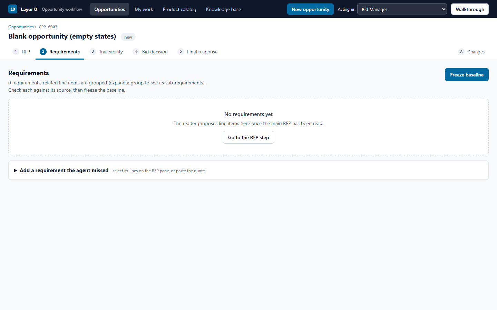

*Figure 10-1. OPP-0003, no requirements: the empty state "No requirements yet" with "Go to the RFP step". The heading still shows "Freeze baseline" (enabled) and the collapsed card "Add a requirement the agent missed".*

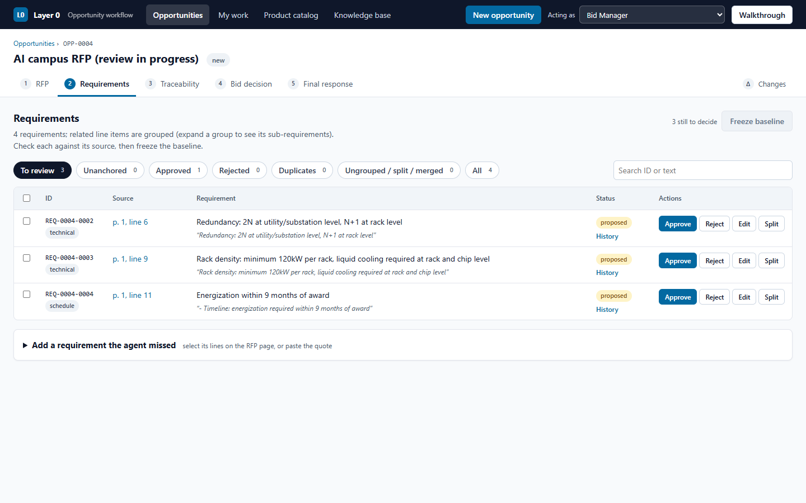

*Figure 10-2. OPP-0004, review in progress: help line "4 requirements; …", "3 still to decide", "Freeze baseline" disabled, the "To review" chip selected (To review 3, Unanchored 0, Approved 1, Rejected 0, Duplicates 0, Ungrouped / split / merged 0, All 4), and three proposed rows with Approve, Reject, Edit and Split.*

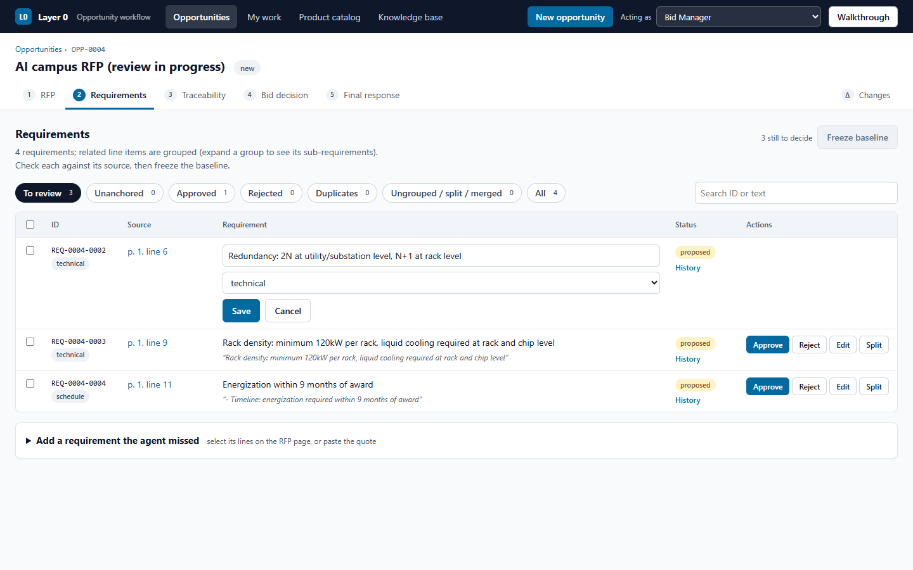

*Figure 10-3. The inline Edit form open on REQ-0004-0002: the short text field, the category drop-down ("technical"), "Save" and "Cancel". The row's action buttons are hidden while the form is open.*

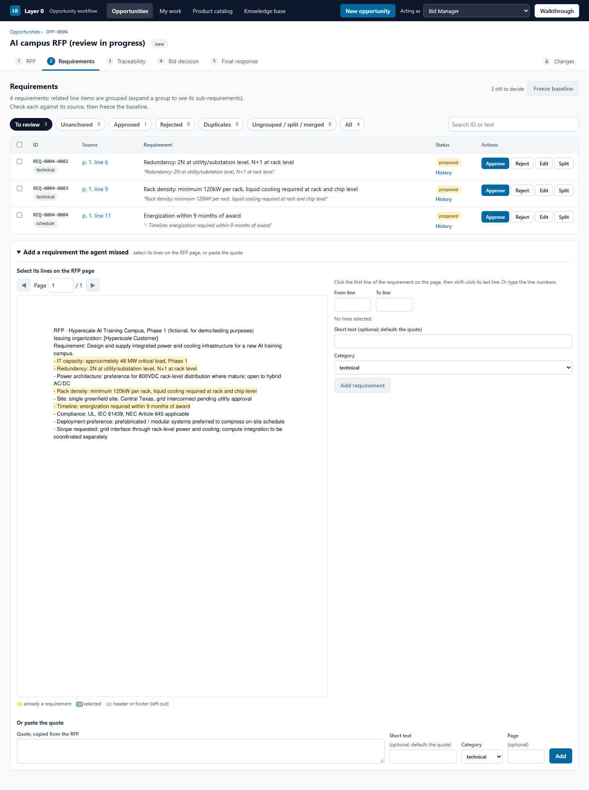

*Figure 10-4. "Add a requirement the agent missed" opened on OPP-0004: the line picker on page 1 of 1 of `rfp_hyperscale_campus.pdf`, with lines 5, 6, 9 and 11 highlighted in yellow because they are already requirements; the side form with "From line", "To line", "No lines selected.", "Short text (optional; default: the quote)", "Category" and the disabled "Add requirement"; and below, "Or paste the quote" with "Quote, copied from the RFP", "Short text", "Category", "Page" and "Add".*

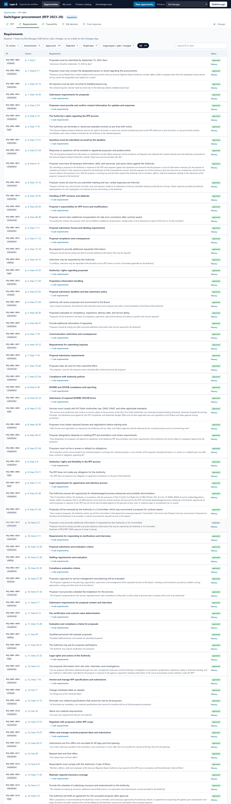

*Figure 10-5. OPP-0001 after the freeze of baseline 1 and before the addendum (page cut at 5,000 pixels): "Baseline 1 frozen by Bid Manager (348 items). Later changes run as a delta on the Changes step.", the "All 369" chip selected, no checkboxes and no Actions column. The duplicate REQ-0001-0072 is greyed with "Duplicate of REQ-0001-0043: approve to keep it anyway".*

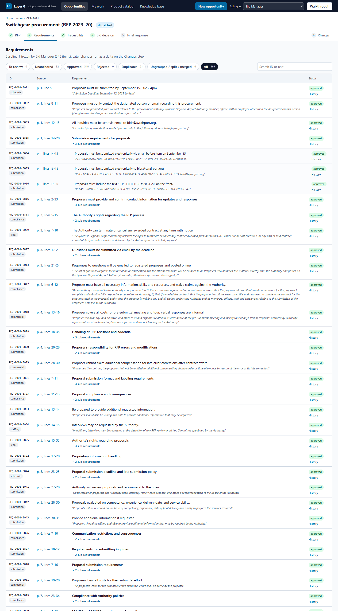

*Figure 10-6. OPP-0001, baseline 1: the group REQ-0001-0815 "Submission requirements for proposals" (p. 1, lines 14-20) expanded to show its sub-requirements REQ-0001-0004, -0005 and -0006, indented on a lighter background.*

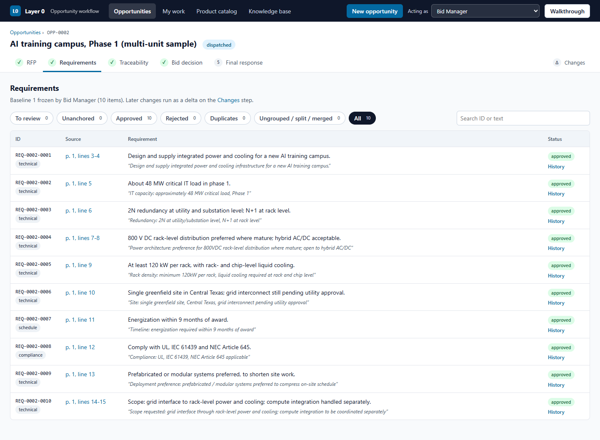

*Figure 10-7. OPP-0002: "Baseline 1 frozen by Bid Manager (10 items).", ten approved items REQ-0002-0001 to -0010, no groups.*

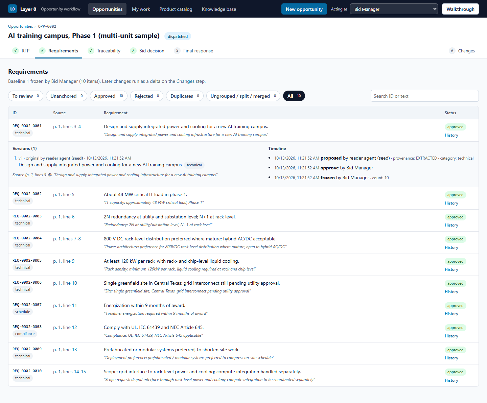

*Figure 10-8. The History panel of REQ-0002-0001 open under its row: "Versions (1)" on the left, "Timeline" with proposed, approve and frozen on the right.*

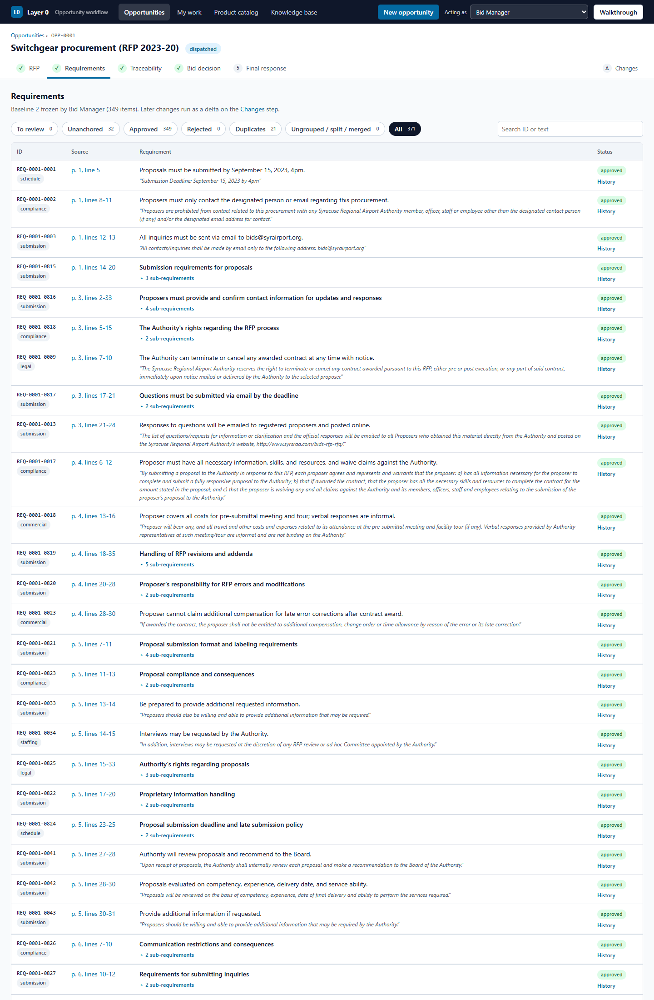

*Figure 10-9. OPP-0001 after the illustrative Addendum No. 1 was applied: "Baseline 2 frozen by Bid Manager (349 items).", chips Unanchored 32, Approved 349, Duplicates 21, All 371.*

### 10.4 Layout

Review mode (not frozen):

```text
+-------------------------------------------------------------------------------------------+
| Global top bar; opportunity header; step bar with "2 Requirements" current                |
+-------------------------------------------------------------------------------------------+
| A  Requirements                                        (Saving...)  3 still to decide     |
|    4 requirements; related line items are grouped ...               [Freeze baseline]     |
| B  (To review 3) (Unanchored 0) (Approved 1) (Rejected 0) (Duplicates 0)                  |
|    (Ungrouped / split / merged 0) (All 4)                      [Search ID or text     ]   |
| C  +-- bulk bar, only with a selection ---------------------------------------------+     |
|    | 2 selected  [Approve] [Reject] [Merge into one] [Clear]                         |    |
|    | One-line text for the merged requirement (2 items) [..........] [Merge][Cancel] |    |
|    +---------------------------------------------------------------------------------+    |
| D  +---+---------------+--------------+-----------------------+----------+----------+     |
|    |[ ]| ID            | Source       | Requirement           | Status   | Actions  |     |
|    +---+---------------+--------------+-----------------------+----------+----------+     |
|    |[ ]| REQ-0004-0002 | p. 1, line 6 | Redundancy: 2N at ... |(proposed)| [Approve]|     |
|    |   | (technical)   |              | "Redundancy: 2N ..."  | History  | [Reject] |     |
|    |   |               |              |                       |          | [Edit]   |     |
|    |   |               |              |                       |          | [Split]  |     |
|    |   ...a History row, or the Edit or Split form, can open in place...             |    |
|    +---------------------------------------------------------------------------------+    |
| E  +---------------------------------------------------------------------------------+    |
|    | > Add a requirement the agent missed  select its lines on the RFP page, or ...  |    |
|    |   Select its lines on the RFP page                                              |    |
|    |   [<] Page [1] / 1 [>]            | Click the first line ... From / To line     |    |
|    |   +-- page image with lines --+   | Quote that will be stored ...               |    |
|    |   +---------------------------+   | Short text, Category                        |    |
|    |   legend                          | [Add requirement]                           |    |
|    |   Or paste the quote                                                            |    |
|    |   Quote ...  | Short text | Category | Page | [Add]                             |    |
|    +---------------------------------------------------------------------------------+    |
+-------------------------------------------------------------------------------------------+
```

Frozen mode (after the freeze):

```text
+----------------------------------------------------------------------------------------+
| A  Requirements                                                                        |
|    Baseline 2 frozen by Bid Manager (349 items). Later changes run as a delta on       |
|    the Changes step.          ("Changes" is a link to the Changes step)                |
| B  (To review 0) (Unanchored 32) (Approved 349) (Rejected 0) (Duplicates 21)           |
|    (Ungrouped / split / merged 0) (All 371)              [Search ID or text     ]      |
| D  +------------------------------------------------------------------------+          |
|    | ID            | Source       | Requirement                | Status     |          |
|    | REQ-0001-0001 | p. 1, line 5 | Proposals must be ...      | (approved) |          |
|    | (schedule)    |              | "Submission Deadline: ..." | History    |          |
|    +------------------------------------------------------------------------+          |
|    (no checkboxes, no Actions column, no bulk bar, no "Add a requirement" card)        |
+----------------------------------------------------------------------------------------+
```

| Region | Element | Shown when |
|---|---|---|
| A | Heading, help line, busy text, "still to decide", "Freeze baseline" | Always; the counter and the button only while not frozen |
| B | Filter chips and search box | When at least one requirement exists |
| C | Bulk bar | Not frozen and at least one row selected |
| D | Requirements table, or the empty state | Table when at least one requirement exists; empty state otherwise |
| E | "Add a requirement the agent missed" card | Not frozen |

### 10.5 Data Loaded on Open

| Request | When | Purpose |
|---|---|---|
| `GET /api/opportunities/{id}/requirements` | On open; after every successful action; whenever the tab regains focus or becomes visible | Every requirement and the latest baseline |
| `GET /api/requirements/{req_id}/history` | When a History panel is opened (each opening fetches again) | The history of one line item (10.13) |
| `GET /api/opportunities/{id}`, `GET /api/documents/{doc}/pages/{n}` and the image `GET /api/documents/{doc}/pages/{n}.png` | Only while the "Add a requirement the agent missed" card is open | The line picker's document, page lines and page image (10.17) |

The main request returns the latest version of every line item of the opportunity, including inactive ones and sub-requirements, each with its computed `source`, and the latest baseline or `null`. An unknown opportunity is answered with HTTP 404 "Opportunity {id} not found.". Real row of OPP-0004:

```json
{"id": 988, "req_id": "REQ-0004-0002", "version": 1, "opportunity_id": "OPP-0004",
 "document_id": "OPP-0004-c7749ef1bfc9",
 "text": "Redundancy: 2N at utility/substation level, N+1 at rack level",
 "quote": "Redundancy: 2N at utility/substation level, N+1 at rack level",
 "category": "technical", "section": "", "page": 1, "line_start": 6, "line_end": 6,
 "bboxes": [[72.0, 135.71, 354.74, 150.14]], "provenance": "EXTRACTED", "status": "proposed",
 "derived_from": [], "kind": "item", "parent_id": null, "baseline": null,
 "created_by": "Bid Manager", "created_at": "2026-10-13T06:39:57.531804", "source": "p. 1, line 6"}
```

Real baseline of OPP-0002: `{"id": 2, "opportunity_id": "OPP-0002", "number": 1, "count": 10, "frozen_by": "Bid Manager", "frozen_at": "2026-10-13T05:51:52.763458"}`.

The `source` is "p. {page}, line {n}" for one line, "p. {page}, lines {first}-{last}" for several, and "not found in source" when the page is unknown. Rows arrive in **document order**: first everything anchored in the main RFP, then everything anchored in change documents in the order they were received, each by page and then line; a group comes just before its own sub-requirements; line items not found in their source come last.

Real contents of the demo data (13 Oct 2026):

| Opportunity | Rows returned | Top-level rows | Groups | Sub-requirements | Baseline |
|---|---|---|---|---|---|
| OPP-0001 | 978 | 371: 349 approved, 21 duplicate, 1 removed | 162 | 607 (all approved) | 2, 349 items |
| OPP-0002 | 10 | 10 approved | 0 | 0 | 1, 10 items |
| OPP-0003 | 0 | 0 | 0 | 0 | none |
| OPP-0004 | 4 | 4: 1 approved, 3 proposed (all added by hand) | 0 | 0 | none |

Values the page derives:

| Value | Rule |
|---|---|
| Top-level rows | Rows without a parent group; only these are listed, filtered and counted |
| Sub-requirements of a group | Rows whose `parent_id` is that group, in the order received |
| Frozen | A baseline exists |
| Still to decide | Top-level rows with status `proposed` |
| Active requirements | Top-level rows whose status is not inactive (`proposed` or `approved`) |
| Default filter | "All" when frozen, "To review" otherwise, until the person clicks a chip |
| Selectable rows | Rows in the current view (chip and search) that are not inactive and not in a baseline |

A load failure replaces the whole page below the header with a red alert titled "Requirements could not be loaded." followed by the API's message. While the first load runs, six skeleton lines are shown.

### 10.6 Page Heading (Region A)

| Element | Text | Shown when | Behaviour |
|---|---|---|---|
| Heading | "Requirements" | Always | |
| Help line, not frozen | "{n} requirements; related line items are grouped (expand a group to see its sub-requirements). Check each against its source, then freeze the baseline." | No baseline | `{n}` is the number of active requirements: "0 requirements; …" on OPP-0003, "4 requirements; …" on OPP-0004 |
| Help line, frozen | "Baseline {number} frozen by {frozen_by} ({count} items). Later changes run as a delta on the Changes step." | A baseline exists | "Changes" is a link to `/opportunities/{id}/changes` (section 15). `{count}` counts top-level requirements (a group counts once): "Baseline 1 frozen by Bid Manager (348 items)." on OPP-0001 before the addendum, "Baseline 2 frozen by Bid Manager (349 items)." after it |
| Busy text | "Saving…" | While any action runs | Spinner with text, `role="status"` |
| Counter | "{n} still to decide" | Not frozen and at least one top-level row is `proposed` | Muted, kept on one line; "3 still to decide" on OPP-0004 |
| Button | "Freeze baseline" | Not frozen | Disabled while an action runs or while anything is still to decide; then its tooltip reads "{n} line items still need a decision". Opens the confirm dialog (10.15) |

### 10.7 Filter Chips and Search (Region B)

Seven chips filter the top-level rows. Each chip shows its label and, in smaller text, its count. The count is taken over all top-level rows, whatever chip is active and whatever is typed in the search box. The active chip is dark (white text); the others are white with a border.

| Chip | Shows the top-level rows whose | OPP-0004 | OPP-0002 | OPP-0001, baseline 1 | OPP-0001, baseline 2 |
|---|---|---|---|---|---|
| To review | status is `proposed` | 3 | 0 | 0 | 0 |
| Unanchored | provenance is `UNANCHORED` and status is not inactive | 0 | 0 | 32 | 32 |
| Approved | status is `approved` | 1 | 10 | 348 | 349 |
| Rejected | status is `rejected` | 0 | 0 | 0 | 0 |
| Duplicates | status is `duplicate` | 0 | 0 | 21 | 21 |
| Ungrouped / split / merged | status is `split` or `merged` (the originals replaced by a split, a merge or an ungroup; an ungrouped group has status `split`) | 0 | 0 | 0 | 0 |
| All | any status | 4 | 10 | 369 | 371 |

The default chip is "To review" while not frozen (Figure 10-2) and "All" once frozen (Figures 10-5 to 10-9); a click on a chip overrides the default for as long as the page stays open. A row with status `removed` (deleted by a change document) appears only under "All": OPP-0001's 371 = 349 approved + 21 duplicates + 1 removed. Sub-requirements are not filtered on their own: they follow their group.

Search box: placeholder "Search ID or text", accessible name "Search line items". It filters as the person types, without a button. A row matches when the typed text occurs, ignoring case, in its requirement ID, short text or quote; a group also matches when one of its sub-requirements matches (the group is shown, but not expanded). The search applies within the active chip and does not change the chip counts or the selection. Example from the walkthrough: "C37.20.7" finds the arc-resistance item on page 55 of the Syracuse RFP.

### 10.8 Requirements Table: Columns (Region D)

| Column | Shown | Content | Width |
|---|---|---|---|
| (checkbox) | Not frozen | Header: select-all checkbox (10.14). Rows: a checkbox on active top-level rows only | 36 px |
| ID | Always | The requirement ID in monospace (for example `REQ-0004-0002`) and under it a grey tag with the category | 120 px |
| Source | Always | A link with the source ("p. 1, line 6"), or the amber badge "unanchored" (10.9) | 150 px |
| Requirement | Always | Short text, then the quote or the group toggle, then notes; or an inline form (10.11, 10.12) | The remaining width |
| Status | Always | Status badge and the "History" link | 112 px |
| Actions | Not frozen | Row buttons (10.10) | 250 px (180 px at 640 px and below) |

The table therefore has six columns while reviewing and four once frozen. Requirement IDs read `REQ-{opportunity number}-{running number}`. They are issued in reading order and never reused: a split, merge, grouping, addition or change gets the next free number, even after a re-read discarded drafts, so a unit's answer can never land on a different requirement. Line items created later carry higher numbers than their place in the document suggests (the group REQ-0001-0815 stands on page 1, Figure 10-6).

When the current view is empty, one muted row spanning all columns says:

| Situation | Text |
|---|---|
| Search text entered and nothing matches | Nothing in “{chip label}” matches “{search text}”. |
| "To review" chip, nothing left | Nothing left to review. |
| Any other chip, nothing in it | No line items under “{chip label}”. |

When the opportunity has no requirement at all, the chips and the table are replaced by the empty state (Figure 10-1): title "No requirements yet", hint "The reader proposes line items here once the main RFP has been read.", and a secondary button-styled link "Go to the RFP step" to `/opportunities/{id}` (section 9).

### 10.9 A Requirement Row

Row types:

| Type | Appearance |
|---|---|
| Stand-alone line item | Short text, then the quote in italics within curly quotation marks |
| Group | Bold short text (the group title), a darker top border, and the toggle "▸ {n} sub-requirements" (collapsed) or "▾ {n} sub-requirements" (expanded) instead of a quote |
| Sub-requirement | Shown under its expanded group: lighter background, slightly smaller text, Source and Requirement cells indented, no checkbox |
| Inactive row | Muted text on a light grey background (`rejected`, `split`, `merged`, `duplicate`, `removed`) |

Cells, from left to right:

1. Checkbox (not frozen): only on active top-level rows; accessible name "Select {req_id}". Sub-requirements and inactive rows have an empty cell.
2. ID and category: `req_id` in monospace; the category tag below (`technical`, `compliance`, `commercial`, `schedule`, `submission`, `legal` or `staffing`).
3. Source:
   - provenance `UNANCHORED`: the amber badge "unanchored" with the tooltip "Quote not located on the page; check the source manually" (a group is `UNANCHORED` when any member could not be located);
   - otherwise, when the page is known: a link showing the source text, to `/opportunities/{id}/trace#{group or own ID}`. It opens Traceability (section 11) with that requirement selected; for a sub-requirement, its group;
   - otherwise the plain source text.
4. Requirement:
   - the short text (bold for a group);
   - for a group, the toggle button: it shows or hides the sub-requirement rows under the group (`aria-expanded`). Several groups can be open at once, and they stay open when the chip or the search changes;
   - for an item, the quote: “{quote}”;
   - for a duplicate, the muted note "Duplicate of {ID}: approve to keep it anyway";
   - for any other line item derived from others (the parts of a split, the result of a merge, and a duplicate that was approved), the muted note "From {IDs}".
5. Status: the status badge, then the link button "History" (`aria-expanded`), which opens or closes the History panel as a full-width row under this row (10.13). It is shown on every row, also on sub-requirements, inactive rows and in the frozen view.
6. Actions (not frozen): see 10.10.

Status badge colours (section 19 lists all tones):

| Status | Colour | Meaning |
|---|---|---|
| `proposed` | Amber | A draft waiting for a decision |
| `approved` | Green | Goes into the next baseline |
| `rejected` | Grey | Kept for the record; can be approved again until the freeze |
| `duplicate` | Grey | Same or almost the same quote as an earlier item; can be approved to keep it |
| `split` | Grey | Replaced by its parts (also an ungrouped group) |
| `merged` | Grey | Replaced by the merged item |
| `removed` | Red | Deleted by a change document (after a freeze) |

The source of a line item anchored in a change document (an item added or modified by an addendum, 10.19) is its page and lines in that change document. The Requirements screen does not name the document; Traceability does (section 11).

### 10.10 Per-Row Actions

The Actions column is present only while not frozen. Its buttons are hidden while the row's own Edit or Split form is open, and all of them are disabled while any action runs (one action at a time). Which buttons a row shows:

| Row | Approve | Reject | Edit | Split | Ungroup |
|---|---|---|---|---|---|
| Proposed item (top-level) | Yes | Yes | Yes | Yes | — |
| Proposed group | Yes | Yes | Yes | — | Yes |
| Proposed sub-requirement | Yes | Yes | Yes | — | — |
| Approved item | — | Yes | Yes | Yes | — |
| Approved group | — | Yes | Yes | — | Yes |
| Approved sub-requirement | — | Yes | Yes | — | — |
| Rejected (any kind) | Yes | — | — | — | — |
| Duplicate | Yes | — | — | — | — |
| Split, merged or removed | — | — | — | — | — |

"Approve" is the primary (blue) button; the others are secondary (white).

| Button | Request | On success | Server rules |
|---|---|---|---|
| Approve | `POST /api/requirements/{req_id}/review` with `{"action": "approve"}` | The list reloads; no toast | Status becomes `approved`. Approving a rejected item restores it; approving a duplicate keeps it as a requirement of its own. Approving a group also approves its undecided sub-requirements, and, when the group itself was rejected, its rejected ones. The same click twice changes nothing and records no event. Audit event `approve` with the status, text and category before and after |
| Reject | Same, with `{"action": "reject"}` | The list reloads; no toast | Status becomes `rejected`. Rejecting a group rejects every active sub-requirement. Audit event `reject` |
| Edit | None (opens the inline Edit form, 10.11) | | |
| Split | None (opens the inline Split form, 10.12) | | Items only; a group cannot be split ("{req_id} is a group; use Ungroup to release its sub-requirements.") |
| Ungroup | `POST /api/requirements/{req_id}/ungroup` (no body) | Green toast "{req_id} ungrouped: its {n} sub-requirements stand on their own." and reload | The group's status becomes `split` (it moves to "Ungrouped / split / merged") and each sub-requirement becomes a top-level requirement with its own status. Audit event `ungrouped` with the released IDs. Refused for an item that is not a group ("{req_id} is not a group.") |

The answer of a review is the updated row; of an ungroup, the released sub-requirements. Every successful action also clears the selection, closes any open Edit, Split or merge form and reloads the list. A failed Approve, Reject or Ungroup shows the API's message as a red toast (8 seconds), for example "Requirements are frozen in baseline 1; later changes go through the changes module." when the baseline was frozen in another tab, or "{req_id} is split; review its replacement instead." for a row that was replaced in the meantime.

### 10.11 Inline Edit Form

"Edit" replaces the Requirement cell of that row with a compact form (Figure 10-3). Only one Edit or Split form is open at a time: opening another closes the first.

| Element | Label | Control and rules |
|---|---|---|
| Short text | Accessible name "Requirement text" | Text field prefilled with the current short text; required; at most 200 characters; receives the focus |
| Category | Accessible name "Category" | Drop-down prefilled with the current category; options `technical`, `compliance`, `commercial`, `schedule`, `submission`, `legal`, `staffing` |
| Error line | — | Red text between the fields and the buttons, with `role="alert"`, when the save fails |
| Save | "Save" ("Saving…" while busy) | Submits; disabled while busy |
| Cancel | "Cancel" | Closes the form without saving |

Saving sends `POST /api/requirements/{req_id}/review` with `{"action": "edit", "text": "…", "category": "…"}`. On success a green toast says "{req_id} saved.", the form closes and the list reloads. The server trims the text (an empty text keeps the old one), refuses an unknown category ("Unknown category '{x}'."), and records the audit event `edit` with the text, category and status before and after. Only a change of text or category creates a new entry in the item's "Versions" (10.13); saving without a change records nothing, although the toast still appears. The quote cannot be edited: it is the RFP's own wording, and the anchoring and the agents' frozen answers depend on it. On failure the API's message is shown in the error line and the form stays open.

### 10.12 Inline Split Form

"Split" (stand-alone items only) replaces the Requirement cell with:

| Element | Label | Control and rules |
|---|---|---|
| Parts | "Put each part of the quote on its own line" | Text area of 4 rows, prefilled with the item's quote; receives the focus |
| Error line | — | Red text with `role="alert"` |
| Split | "Split" ("Splitting…" while busy) | Submits |
| Cancel | "Cancel" | Closes the form |

The person breaks the quote into lines, one part per line. Empty lines are ignored. With fewer than two parts the page itself shows "A split needs at least two parts: one quote per line." and sends nothing. Otherwise it sends `POST /api/requirements/{req_id}/split` with `{"parts": [{"quote": "…"}, {"quote": "…"}]}`. On success a green toast says "{req_id} split into {n} line items." and the list reloads.

What the server does: each part becomes a new line item with the next free ID, status `proposed`, the original's category, the part (first 200 characters) as its short text, and "From {original ID}" as its origin. Each part's quote is located again on the RFP, the original's page first; a part that is not found word for word is stored as `UNANCHORED`. The original gets status `split` (greyed, listed under "Ungrouped / split / merged"). Audit event `split` with the new IDs. The new parts appear under "To review" and must be decided before the freeze. Refusals: "A split needs at least two parts."; "{req_id} is a group; use Ungroup to release its sub-requirements."; "{req_id} is {status}; it can no longer be changed." (an inactive item). They are shown in the form's error line.

### 10.13 History Panel

"History" opens a full-width row under the requirement (Figure 10-8). Only one History panel is open at a time; pressing "History" again, or "History" on another row, closes it. The panel loads `GET /api/requirements/{req_id}/history` each time it opens; while it loads it shows three skeleton lines, and a failure shows a red alert with the API's message (HTTP 404 "{req_id} not found." for an unknown ID). The server rebuilds the history from the append-only audit log, which is the source of truth.

| Part | Content |
|---|---|
| Left column, heading | "Versions ({n})" |
| Each version | Muted line "v{n} · {label} by **{who}** · {date and time}", followed by " · reason: {reason}" when there is one; under it the short text and a category tag. Labels: `original` (the first wording), `edited` (an Edit that changed the text or category), `revised` (a new version created by a change document; the reason names the change document) |
| Source line | "Source ({source}): “{quote}”" in italics |
| Origin line | "Created from {IDs}", muted, for a line item derived from others |
| Right column, heading | "Timeline" |
| Each event | "{date and time} **{action}** by {who}", followed by " · {key}: {value}" for every non-empty detail; lists are joined with commas |

The events listed are those recorded on the line item itself, plus the `frozen` event of every baseline in which a version of it is included. Event names as shown (the first underscore of a name becomes a space): `proposed`, `approve`, `reject`, `edit`, `split`, `merged`, `merged into`, `discarded`, `duplicate of`, `grouped`, `ungrouped`, `revised`, `removed`, `frozen`. Detail keys are shown the same way (for example "derived from", "merged from"). The texts, quotes and before/after values are left out of the details.

Times: timestamps without a time-zone marker are treated as UTC and shown in the browser's local date and time format and time zone. The screenshots were taken in a browser at UTC+5:30, so the server time 05:51:52 UTC appears as "10/13/2026, 11:21:52 AM".

Real example, REQ-0002-0001 (Figure 10-8): "v1 · original by **reader agent (seed)** · 10/13/2026, 11:21:52 AM", text "Design and supply integrated power and cooling for a new AI training campus." with the tag `technical`; "Source (p. 1, lines 3-4): “Design and supply integrated power and cooling infrastructure for a new AI training campus.”"; Timeline: "proposed by reader agent (seed) · provenance: EXTRACTED · category: technical", "approve by Bid Manager", "frozen by Bid Manager · count: 10".

Real example after the addendum, REQ-0001-0039 (a sub-requirement of the group REQ-0001-0824):

| Part | Content (times omitted) |
|---|---|
| Versions (2) | v1 · original by reader agent (Bid Manager): "Submit proposals by 09/15/2023 at 4:00 PM via email." (`schedule`); v2 · revised by Bid Manager · reason: rfp_syracuse_addendum_1.pdf (change set 1): "Submit proposals by 09/29/2023 at 4:00 PM via email." (`schedule`) |
| Source | Source (p. 1, lines 12-13): “Section 1.9, Submission Due Date, page 5: replace "09/15/2023 by 4:00PM" with "09/29/2023 by 4:00PM".” |
| Timeline | proposed by reader agent (Bid Manager) · provenance: EXTRACTED · category: schedule; frozen by Bid Manager · count: 348; revised by Bid Manager · reason: rfp_syracuse_addendum_1.pdf (change set 1) · document: OPP-0001-180eb141aec2 · version: 2 · baseline: 2; frozen by Bid Manager · count: 349 · document: OPP-0001-180eb141aec2 · reason: rfp_syracuse_addendum_1.pdf (change set 1) · added: REQ-0001-0977, REQ-0001-0978 · modified: REQ-0001-0039, REQ-0001-0332 · removed: REQ-0001-0130 |

This example also shows that a sub-requirement approved through its group has no `approve` event of its own: the decision is recorded on the group.

### 10.14 Selection and the Bulk Bar (Region C)

Selecting rows (not frozen only):

| Control | Behaviour |
|---|---|
| Row checkbox | On active top-level rows only (not on sub-requirements or inactive rows). Adds or removes the row from the selection |
| Header checkbox | Accessible name "Select all line items in view". Disabled when the view has no selectable row. Checked when every selectable row in view is selected. A click when all are selected clears the whole selection; otherwise it replaces the selection with exactly the selectable rows in view |

The selection is not cleared when the chip or the search changes. Rows that left the view stay selected, are counted in "{n} selected" and are acted on by the bulk buttons. Any successful action, including a single-row Approve, clears the selection.

The bulk bar appears above the table as soon as one row is selected. It sticks to the top of the window while the table scrolls, on a light blue background, and is a region named "Selected line items".

| Element | Text | Rules and request | On success |
|---|---|---|---|
| Counter | "**{n} selected**" | | |
| Approve | "Approve" (primary) | One `POST /api/requirements/{req_id}/review` with `{"action": "approve"}` per selected row, all sent at once | Green toast "{n} line items approved."; selection cleared; list reloaded |
| Reject | "Reject" | The same with `{"action": "reject"}` | Green toast "{n} line items rejected." |
| Merge into one | "Merge into one" | Disabled while busy, when fewer than two rows are selected, or while the merge field is open. Opens the merge field | |
| Clear | "Clear" | Empties the selection and closes the merge field | |

If one request of a bulk Approve or Reject fails, a red toast shows that request's message; the other requests may already have been applied, and nothing is rolled back. The list is not reloaded in that case, so the screen shows the earlier state until the next reload.

Merge field (a second row of the bulk bar, shown while open and while at least two rows are selected):

| Element | Label | Control and rules |
|---|---|---|
| Text | "One-line text for the merged requirement ({n} items)" | Text field, required, at most 200 characters, receives the focus |
| Merge | "Merge" ("Merging…" while busy) | Submits |
| Cancel | "Cancel" | Closes the field |
| Error line | — | Red text with `role="alert"` under the buttons |

Merging sends `POST /api/opportunities/{id}/requirements/merge` with `{"req_ids": ["…", "…"], "text": "…"}`. On success a green toast says "{n} line items merged into one." and the list reloads. The API also accepts a `reason`, which the screen does not offer.

What the server does: it creates one new line item with the next free ID, status `proposed`, the given short text, the quotes of the originals joined with " … " in line order, the category and page of the first original, the lines from the first original's first line to the last original's last line, all highlight boxes, and "From {original IDs}" as its origin. It is `EXTRACTED` only if every original was. The originals get status `merged`. Audit events: `merged` on the new item and `merged into` on each original. Refusals, shown in the error line: "Give the merged requirement a short text."; "A merge needs at least two line items."; "Groups and sub-requirements cannot be merged; ungroup first." (a group row can be selected, but not merged); "Only line items on the same page can be merged; keep cross-page items separate."; "{req_id} is {status}; it can no longer be changed."; "Line items from another opportunity cannot be merged.".

### 10.15 Freeze Baseline

"Freeze baseline" (heading, region A) is enabled when nothing is still to decide and no action runs. A click opens the confirm dialog (section 19):

| Element | Text |
|---|---|
| Title | "Freeze the baseline?" |
| Message | "The {n} approved requirements become the baseline the units work from. Later changes to the RFP run as a delta against it." (`{n}` is the active-requirement count, which equals the approved count once nothing is undecided) |
| Buttons | "Cancel" and "Freeze baseline" (normal primary style). The focus starts on "Freeze baseline"; the Esc key or a click outside the dialog cancels; Tab stays inside the dialog |

On confirmation the page sends `POST /api/opportunities/{id}/baselines` without a body. The server checks that the requirements are not frozen yet, that the main RFP is read ("Upload the main RFP and wait until it has been read."), that every top-level line item is decided ("{n} line items still need approve or reject before freezing.") and that at least one is approved ("Nothing is approved; a baseline needs at least one requirement."). It then marks every approved top-level requirement, and every approved sub-requirement of an approved group, with baseline number 1; stores the baseline with the number of approved top-level requirements as its count and the actor as `frozen_by`; records the audit event `frozen` on the baseline; and sets the opportunity status to `frozen`. The answer is the baseline row.

On success a green toast says "Baseline frozen." and the list reloads into the frozen view (10.19). The page then signals the opportunity header to refresh at once (the browser event `opp-status-changed`), so the status badge shows `frozen` and the "Requirements" step gets its tick without waiting for the header's 5-second poll; the signal is sent even when the freeze failed, which only causes a harmless refresh. A refusal is shown as a red toast. A baseline is frozen once on this screen; baselines 2 and later come only from change documents on the Changes step (section 15).

On an opportunity without requirements (OPP-0003, Figure 10-1) the button is enabled, because nothing is undecided; confirming then returns "Upload the main RFP and wait until it has been read." (or, with a read RFP, "Nothing is approved; a baseline needs at least one requirement.") as a red toast.

### 10.16 Add a Requirement the Agent Missed (Region E)

A collapsed card under the table, shown only while not frozen (Figures 10-1, 10-2 and 10-4):

| Element | Text | Behaviour |
|---|---|---|
| Card summary | "Add a requirement the agent missed" (bold) and "select its lines on the RFP page, or paste the quote" (muted) | Native disclosure; a click or Enter opens and closes it |
| First heading | "Select its lines on the RFP page" | Followed by the line picker (10.17) |
| Second heading | "Or paste the quote" | Followed by the paste form (10.18) |

The line picker is created only while the card is open, so no page or image is loaded while it is closed; closing the card discards the picker's state. When the picker opens, it starts on the page of the first selected requirement that has a page, otherwise on the page of the first row in view that has a page, otherwise on page 1. The picker shows the lines of all active line items (including sub-requirements) as "already a requirement".

A line item added either way is a normal draft: status `proposed`, created by the acting person, listed under "To review" and counted in "still to decide". Both ways need the main RFP to be read, and both are refused after the freeze; a requirement missed before the freeze then comes in through a change document on the Changes step.

### 10.17 Line Picker

File `web/components/requirements/LinePicker.tsx`. The person selects the requirement's lines on the RFP page instead of retyping its quote; the stored quote is those lines word for word, so its source is exact. Page headers and footers inside the selection are left out of the quote, as the reader agent leaves them out.

Data it loads:

| Request | Purpose |
|---|---|
| `GET /api/opportunities/{id}` | Finds the main document (role `main`); the picker works only when it is `ingested`; its `page_count` is the number of pages |
| `GET /api/documents/{doc}/pages/{n}` | The layout of one page: `page`, `width`, `height`, `unreviewed`, and `lines` with `n` (line number), `text`, `bbox` (position box in PDF points) and `furniture` (true for a repeated header or footer). The answer also has `method`, `tables`, `toc` and, for an unread page, `reason`, which the picker does not use. Fetched again for every page change; an answer for a page that is no longer shown is ignored |
| `GET /api/documents/{doc}/pages/{n}.png` | The page image, rendered by the server at 110 dots per inch and kept for later requests (about 160 KB for page 1 of the Syracuse RFP) |

Real layout of page 1 of the Syracuse RFP: width 612, height 792, 23 lines; line 5 is `{"n": 5, "text": "Submission Deadline: September 15, 2023 by 4pm", "bbox": [72.0, 343.34, 361.25, 364.09], "furniture": false}`; lines 21 to 23 ("Syracuse Regional Airport Authority™", "Page | 1", "All Rights Reserved") are furniture.

States of the picker:

| State | What it shows |
|---|---|
| Opportunity loading | Three skeleton lines |
| Opportunity load failed | Red alert with the message |
| Main RFP missing or not read | Blue information alert "Upload the main RFP and wait until it has been read." |
| Page lines loading | Busy text "Loading the page lines…" in the pager; the page image is shown already |
| Page lines failed | Red alert under the page with the API's message (the server answers HTTP 404 for an unknown document or page, for example "Page {n} not found; the document has {pages} pages.") |
| Page without text layer | Warning in the pager "No text layer: this page was not read (needs OCR)" (`role="status"`); the page has no selectable lines |

Left side, the page viewer (up to 760 px wide):

| Element | Text or label | Behaviour |
|---|---|---|
| Previous page | "◀", accessible name "Previous page" | Disabled on page 1 |
| Page number | "Page [n] / {pages}"; the field's accessible name is "RFP page number" | Number field, 1 to the page count; typing a number jumps to that page (values outside the range are held to the first or last page) |
| Next page | "▶", accessible name "Next page" | Disabled on the last page |
| Page image | Alternative text "RFP page {n}" | Not draggable; text on it cannot be selected |
| Line overlays | One transparent box over each line; tooltip "Line {n}: {text}", or "Line {n} (header or footer: left out of the quote): {text}" | A click selects that one line and makes it the starting point; Shift and click selects from the starting point to the clicked line. Hidden from screen readers: the line-number fields are the keyboard way |
| Legend | "already a requirement" (yellow swatch), "selected" (blue swatch), "header or footer (left out)" (grey swatch) | |

Overlay colours: hovering a line tints it light blue with a thin outline; a line already covered by an active line item is yellow; a header or footer line is grey (normal pointer); a selected line is blue with a solid accent outline; a selected header or footer line is grey-hatched with a dashed outline. A page change clears the selection and any success message.

Right side, the side form (sticky beside the page; accessible name "Add a requirement from selected lines"):

| Element | Text or label | Behaviour |
|---|---|---|
| Instruction | "Click the first line of the requirement on the page, then shift-click its last line. Or type the line numbers." | Muted |
| From line | "From line" | Number field, 1 to the page's last line number. Typing sets the starting point for Shift and click |
| To line | "To line" | Number field; when empty its placeholder repeats From, and one line is meant |
| Clear | "Clear" | Shown once From has a value; empties the range, the starting point and any error |
| Preview | "Quote that will be stored (p. {page}, line {n})" or "(p. {page}, lines {first}-{last})", then the quote in a quoted block (scrolls beyond 240 px); or "No lines selected." | Announced politely to screen readers (`aria-live`). The quote is the text of the selected lines that are not header or footer and not empty, joined with spaces |
| Range problem | Red text instead of the preview | See the table below |
| Short text | "Short text (optional; default: the quote)" | Text field, at most 200 characters |
| Category | "Category" | Drop-down of the seven categories; default `technical` |
| Add | "Add requirement" ("Adding…" while busy) | Disabled while busy, when there is no quote, or when there is a range problem |
| Error | Red alert, dismissible | The API's message |
| Success | Green alert, dismissible: "{req_id} added ({source}); it is in the list, to review like the others." | Cleared by a new selection or a page change |

Range problems the picker shows before sending anything:

| Problem | Text |
|---|---|
| A number below 1 | Line numbers start at 1. |
| Last before first | The first line must come before the last line. |
| Beyond the page | Page {n} has {last} lines. |
| More than 40 lines | Select at most 40 lines; split a longer passage into several requirements. |
| Only header or footer lines | Only header or footer lines are selected; select the requirement's own lines. |

Pressing "Add requirement" sends `POST /api/opportunities/{id}/requirements/from-lines` with `{"page": n, "line_start": a, "line_end": b, "text": "…", "category": "…"}`. On success the range and the short text are cleared (the category stays), the success alert appears and the requirement list reloads, so the new lines turn yellow. There is no toast. The server repeats the checks and builds the quote itself from the selected lines; the new line item is anchored on exactly those lines (never on the same words elsewhere), its short text defaults to the quote's first 200 characters, and the audit event `proposed` is recorded. Server refusals: "Upload the main RFP and wait until it has been read."; "Unknown category '{x}'."; "Page {n} not found; the RFP has {pages} pages."; "Page {n} has no readable lines (not read; it needs OCR)."; "Choose lines between 1 and {last} on page {n}, the first line before the last."; "Select at most 40 lines; split a longer passage into several requirements."; "Only header or footer lines are selected; select the requirement's own lines."; and after a freeze "Requirements are frozen in baseline {n}; later changes go through the changes module. A requirement missed before the freeze now comes in through the Changes page.".

Figure 10-4 shows the picker on OPP-0004: page 1 of 1, lines 5, 6, 9 and 11 in yellow (the four requirements added by hand), no selection ("No lines selected."), and "Add requirement" disabled.

### 10.18 Paste-the-Quote Form

Under the heading "Or paste the quote" (accessible name of the form "Add a requirement from a pasted quote"):

| Label | Control | Rules |
|---|---|---|
| "Quote, copied from the RFP" | Text area, 2 rows, field `quote` | Required |
| "Short text" with the hint "(optional; default: the quote)" | Text field, field `text` | At most 200 characters |
| "Category" | Drop-down, field `category` | Seven categories; default `technical` |
| "Page" with the hint "(optional)" | Number field, field `page`, narrow (90 px) | At least 1 |
| "Add" ("Adding…" while busy) | Submit button | Disabled while busy |

Pressing "Add" sends `POST /api/opportunities/{id}/requirements` with `{"quote": "…", "text": "…", "category": "…", "page": n or null}`. On success a green toast says "Requirement added; it is in the list, to review like the others." and the list reloads. A refusal is shown in red under the form.

What the server does: it requires the main RFP to be read ("Upload the main RFP and wait until it has been read.") and a known category ("Unknown category '{x}'."), and refuses an empty quote ("A requirement needs a quote copied from the RFP."). The short text is the given text, or else the quote, cut to 200 characters. The quote is then located on the RFP: the comparison ignores case, spacing, typographic quotation marks and dash variants and tolerates a missing final full stop; the given page is searched first and then every page; a quote must lie on one page. Found, the line item is `EXTRACTED` with page, lines and boxes (the page given is a hint, not a constraint); not found, it is stored as `UNANCHORED` and shows the "unanchored" badge. Audit event `proposed`.

### 10.19 The Frozen View

Once a baseline exists (Figures 10-5 to 10-9) the screen is read-only:

| Element | Frozen view |
|---|---|
| Help line | "Baseline {number} frozen by {who} ({count} items). Later changes run as a delta on the Changes step.", with the link to the Changes step |
| Counter and "Freeze baseline" | Not shown |
| Chips and search | Shown; "All" is the default chip |
| Table | Four columns (ID, Source, Requirement, Status); no checkboxes, no Actions column |
| Bulk bar, Edit, Split, merge, "Add a requirement the agent missed" | Not shown |
| Group toggles, Source links, History | Still available |

The duplicate note still reads "Duplicate of {ID}: approve to keep it anyway" although no Approve button is shown (Figure 10-5). Every write on this screen is refused by the server after the freeze; requirements change only through change documents (section 15).

Baseline 1 on OPP-0001 (Figures 10-5 and 10-6): "Baseline 1 frozen by Bid Manager (348 items).", All 369 (348 approved, 21 duplicates), 32 unanchored, 162 groups.

Baseline 2 on OPP-0001 (Figure 10-9), after the illustrative Addendum No. 1 was applied on the Changes step:

| Line item | What the Requirements screen shows |
|---|---|
| REQ-0001-0977, REQ-0001-0978 (added) | Two new approved items ("The switchgear lineup must be seismically qualified for the site, …" and "The MANUFACTURER shall warrant the switchgear lineup … for sixty (60) months …"), anchored in the addendum (p. 1, lines 17-19 and p. 1, lines 20-22). They come after all items anchored in the main RFP and before the items not found in their source |
| REQ-0001-0039, REQ-0001-0332 (modified) | Sub-requirements of the groups REQ-0001-0824 and REQ-0001-0887, shown with their new short text (for example "Submit proposals by 09/29/2023 at 4:00 PM via email.") and their lines in the addendum; History shows version 2 "revised" |
| REQ-0001-0130 (removed) | "Submit final drawings in AutoCAD format.": greyed with a red `removed` badge, still at its place (p. 15, lines 17-18); listed only under "All" |
| Heading | "Baseline 2 frozen by Bid Manager (349 items)." (348 + 2 − 1) |
| Chips | To review 0, Unanchored 32, Approved 349, Rejected 0, Duplicates 21, Ungrouped / split / merged 0, All 371 |

### 10.20 States of the Screen

| State | Condition | What the screen shows | Figure |
|---|---|---|---|
| Loading | First request in flight | Heading area and six skeleton lines | — |
| Load failed | Request failed | Red alert "Requirements could not be loaded." with the message | — |
| No requirements | No top-level row | Help "0 requirements; …"; "Freeze baseline" enabled; empty state "No requirements yet" with "Go to the RFP step"; the "Add a requirement" card | 10-1 |
| Review in progress | Not frozen, rows exist | "{n} still to decide", "Freeze baseline" disabled with its tooltip, "To review" chip selected, checkboxes and actions | 10-2 |
| Everything decided | Not frozen, nothing proposed | Counter hidden; "Freeze baseline" enabled; "To review" shows "Nothing left to review." | — |
| Busy | An action runs | "Saving…" in the heading; all action buttons and "Freeze baseline" disabled; the form's button shows its busy label | — |
| Edit form open | After "Edit" | Inline form, row actions hidden | 10-3 |
| Split form open | After "Split" | Inline text area, row actions hidden | — |
| History open | After "History" | Full-width panel under the row | 10-8 |
| Group expanded | After the toggle | Sub-requirement rows under the group | 10-6 |
| Selection | One or more rows selected | Bulk bar; merge field after "Merge into one" | — |
| Add card open | Card expanded | Line picker and paste form | 10-4 |
| Filter or search empty | No row in view | The empty-view sentence of 10.8 | — |
| Frozen, baseline 1 | Baseline 1 | Read-only view | 10-5, 10-6, 10-7 |
| Frozen after a change document | Baseline 2 or later | Read-only view with added, revised and removed items | 10-9 |

### 10.21 Texts, Toasts and Errors

Success toasts are green and disappear after 5 seconds; error toasts are red and stay 8 seconds; at most four toasts are shown at once (section 19).

| Trigger | Where | Exact text |
|---|---|---|
| Any action running | Heading | "Saving…" |
| Approve or Reject (one row) | — | No toast; the list reloads |
| Bulk Approve | Green toast | "{n} line items approved." |
| Bulk Reject | Green toast | "{n} line items rejected." |
| Edit saved | Green toast | "{req_id} saved." |
| Split client check | Split form | "A split needs at least two parts: one quote per line." |
| Split done | Green toast | "{req_id} split into {n} line items." |
| Merge done | Green toast | "{n} line items merged into one." |
| Ungroup done | Green toast | "{req_id} ungrouped: its {n} sub-requirements stand on their own." |
| Freeze done | Green toast | "Baseline frozen." |
| Paste form done | Green toast | "Requirement added; it is in the list, to review like the others." |
| Line picker done | Green alert in the picker | "{req_id} added ({source}); it is in the list, to review like the others." |
| Freeze button tooltip | Tooltip | "{n} line items still need a decision" |
| Load failure | Red alert | "Requirements could not be loaded." followed by the message |
| Picker without a read RFP | Blue alert | "Upload the main RFP and wait until it has been read." |
| Picker page without text | Pager warning | "No text layer: this page was not read (needs OCR)" |
| Picker loading a page | Busy text | "Loading the page lines…" |
| Any write after the freeze | Toast or form error (API, HTTP 409) | "Requirements are frozen in baseline {n}; later changes go through the changes module." |
| Unknown requirement | Toast or form error (API, HTTP 404) | "{req_id} not found." |
| Review of a replaced item | Toast (API, HTTP 409) | "{req_id} is {split or merged}; review its replacement instead." |
| Split, merge or ungroup of an inactive item | Form error or toast (API, HTTP 409) | "{req_id} is {status}; it can no longer be changed." |
| Unknown category | Form error (API, HTTP 409) | "Unknown category '{x}'." |
| Freeze with items undecided | Red toast (API, HTTP 409) | "{n} line items still need approve or reject before freezing." |
| Freeze with nothing approved | Red toast (API, HTTP 409) | "Nothing is approved; a baseline needs at least one requirement." |
| Request rejected by the API's input validation (HTTP 422) | Toast or form error | The validation messages joined with "; " |

The split, merge, line-picker and paste refusals are listed in 10.12, 10.14, 10.17 and 10.18.

### 10.22 Responsive Behaviour and Accessibility

| Width | What changes |
|---|---|
| Above 1100 px | Layout as in the figures; the History panel has two columns (versions wider than the timeline) |
| 1100 px and below | The requirements table, a direct child of the content area, scrolls sideways in its own box instead of widening the page; the heading block stacks and the busy text takes a full line; the History panel becomes one column |
| 1000 px and below | The line picker stacks: page viewer above, side form below (no longer sticky) |
| 640 px and below | Side margins shrink to 16 px; the search box may take the full width; the hint of the "Add a requirement" summary moves to its own line; the Actions column narrows to 180 px |
| Any width | Chips, bulk-bar buttons, row buttons and form fields wrap onto new lines; the bulk bar stays at the top of the window while scrolling |

Accessibility: the chip bar is a tab list named "Filter line items" with `aria-selected` on the active chip; the search box is named "Search line items"; every checkbox has a name ("Select {req_id}", "Select all line items in view"); the group toggle and "History" report `aria-expanded`; the bulk bar is a region named "Selected line items"; the inline forms are named "Edit {req_id}", "Split {req_id}", "Merge the selected line items", "Add a requirement from a pasted quote" and "Add a requirement from selected lines"; form errors use `role="alert"`; the picker's preview is a polite live region; the page image has the alternative text "RFP page {n}"; the line overlays are hidden from screen readers, and the From line and To line fields are the keyboard way to select; the confirm dialog moves the focus to its confirm button, keeps Tab inside and closes on Esc. Section 23 covers the design system.

### 10.23 Limits and Proposed Changes

| Item | Status |
|---|---|
| A bulk Approve or Reject sends one request per row; a partial failure is not rolled back | Implemented |
| The selection survives chip and search changes, so hidden rows are included in a bulk action | Implemented |
| The merge `reason` accepted by the API is not offered on screen | Implemented (not exposed) |
| Merging needs line items on the same page, and a quote must lie on one page; multi-page anchors are mentioned in the code as a possible later step | Proposed (not built) |
| The source of an item anchored in a change document does not name that document on this screen | Implemented (Traceability names it) |
| No chip lists `removed` items on their own; they appear under "All" | Implemented |
| After a failed Edit, Split, merge or paste, React may clear or reset the form's fields when the action ends (as seen with the search box on the RFP step), so typed text could be lost | Needs confirmation |
| Word-level difference between versions in the History panel (SUGGESTIONS.md) | Proposed (not built) |
| Bulk review by page range or category, keyboard shortcuts for approve, reject and next (SUGGESTIONS.md) | Proposed (not built) |
| A "possible duplicate / related" filter based on embeddings (SUGGESTIONS.md, section 1.4) | Proposed (not built) |
| Using review decisions (rejects, additions, splits, merges) to tune the reader agent (SUGGESTIONS.md, section 1.1) | Proposed (not built) |

## 11. Screen: Traceability (Step 3)

The Traceability screen follows one requirement from the words in the customer's RFP to the business unit and product that will answer it, and on to that unit's answer. It shows three linked panes side by side: the original RFP page with the requirement's lines highlighted, the list of requirements, and the product mapping with the unit responses. Selecting a requirement in any pane selects it in all three. The same screen is where product matching is run and reviewed, and where a requirement or a validated answer is sent to the knowledge base.

Terms used in this section:

- **Requirement**: one line item that the RFP asks for, with an ID such as `REQ-0001-0977`, a short text, the verbatim quote from the RFP and its source (page and lines). A **group** is a requirement that bundles several **sub-requirements** from the same page.
- **Anchored / unanchored**: a requirement is anchored when its quote was found on the page, so its lines can be highlighted. An unanchored requirement has no page and no highlight.
- **Match**: the link from a requirement to zero, one or several business units, each with one product and an offering type. A match with no unit means the bid manager answers the item (the **bid desk**, unit code `BID`).
- **Offering type**: how a product is offered: **CTO** (configure-to-order), **Semi-custom**, or **ETO** (engineered-to-order). The legend on the screen explains them (section 11.9).
- **Assignment**: one work item sent to one unit for one requirement by the dispatch step on the Bid decision screen (section 12.11).
- **Change document**: an addendum, Q&A answers or a change request read on the Changes screen (section 15). Its new and changed requirements are anchored in that document.

All elements described in this section are Implemented unless a line says otherwise.

### 11.1 Route, files and purpose

| Item | Value |
|---|---|
| Route | `/opportunities/{id}/trace`. A requirement can be named in the URL fragment: `/opportunities/{id}/trace#REQ-0001-0977` |
| Page file | `web/app/opportunities/[id]/trace/page.tsx` (client component) |
| Components on the page | `web/components/matching/MatchActions.tsx` (the per-match actions in pane 3), `web/components/knowledge/SendToKnowledge.tsx` (the "Send to knowledge base" link and form), `web/components/shell/PageHead.tsx` (title, help text, header action), UI kit `Alert`, `Busy`, `EmptyState`, `Skeleton`, `StatusBadge`, `useToast` (section 19) |
| Styles | The Traceability block of `web/app/globals.css` (three-pane grid, rows, highlight boxes, legend, document chips) and `web/app/styles/trace.css` (match actions, column widths, phone rules) |
| Shell | Rendered inside the opportunity shell (section 5): breadcrumb, title, status badge and step bar, with step "3 Traceability" marked current |
| Walkthrough | Chapter "Traceability and product matching" (section 20); the walkthrough anchors on this screen are listed in Appendix B |

Purpose, in the words of the page's help text: "Original RFP, requirement breakdown and product mapping side by side. Select a requirement in any pane to follow it across all three."

### 11.2 Who uses it

| Acting as (section 6) | Typical use of this screen | Restrictions |
|---|---|---|
| Bid Manager | Runs **Match products**, reviews each match (**Accept**, **Reject**, **Change**), watches the unit responses, sends requirements and validated answers to the knowledge base | None |
| A unit's Product Manager or Design Engineer | Reads a requirement next to its highlighted RFP lines, reached from My work ("Open the RFP" buttons, requirement ID links, "show highlighted source" links; section 16) | None: the match buttons are visible and work for every acting person |
| Knowledge curator (in this proof of concept, the Bid Manager) | Opens the source opportunity from a knowledge item ("from OPP-…" link on the Knowledge Base screen; section 18) | None |

There is no role check on this screen, in the page code or in the API it calls. The acting person's name (sent in the `X-Actor` request header, section 4) is recorded: as `decided_by` on an accepted or rejected match, in the rationale "Set by {name}." of a match set with **Change**, as "matching agent ({name})" for a matching run, as the sender of a knowledge item, and in the audit log.

### 11.3 How the screen is reached

| From | Element | Target |
|---|---|---|
| Opportunity step bar (section 5) | "3 Traceability" | `/opportunities/{id}/trace` |
| Opportunities (section 7) | Opportunity title link and the **Open** button of each row | `/opportunities/{id}/trace` |
| Requirements (section 10) | The source link of an anchored requirement ("p. N, lines a-b") | `/trace#{group ID or requirement ID}` (a sub-requirement links to its group) |
| Bid decision (section 12) | Requirement IDs in the engineering checks and in "Per requirement (n)" | `/trace#{requirement ID}` (plain links: a full page load) |
| Final response and Response outline (sections 13 and 14) | Requirement IDs | `/trace#{requirement ID}` |
| Changes (section 15) | Requirement IDs on a change set (titled "Open in Traceability") | `/trace#{requirement ID}` |
| My work (section 16) | "Open the RFP" buttons (one per opportunity), the opportunity / requirement ID cell, "{source}: show highlighted source" | `/opportunities/{opp}/trace` or `/trace#{requirement ID}` |
| Knowledge Base (section 18) | "from {OPP-ID}" on an item | `/opportunities/{opp}/trace` |

### 11.4 Screenshot

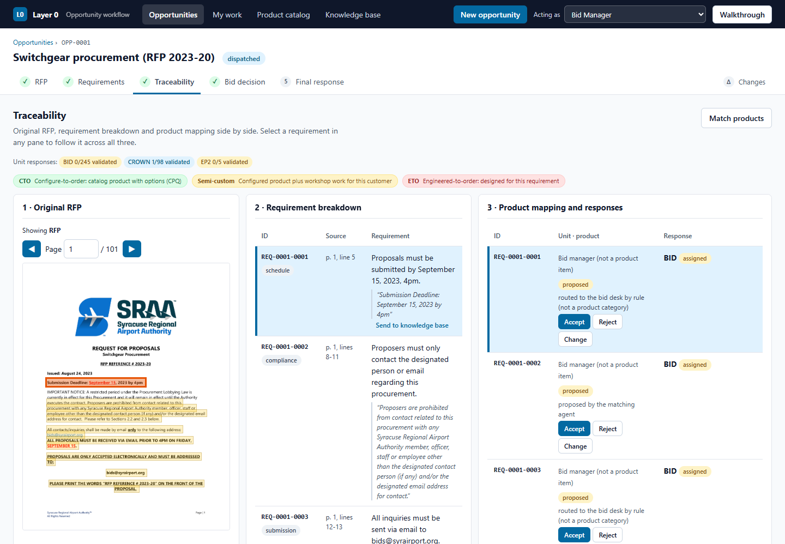

The screenshot shows OPP-0001 (the Syracuse switchgear RFP) at 1440 px wide, acting as Bid Manager, before the illustrative addendum was applied. Requirement REQ-0001-0001 ("Proposals must be submitted by September 15, 2023, 4pm.") is selected: its line is highlighted in orange on page 1 of 101, its row is shaded light blue with a dark blue bar in panes 2 and 3, and pane 3 shows "Bid manager (not a product item)", the match status "proposed", the method "routed to the bid desk by rule (not a product category)", the buttons **Accept**, **Reject** and **Change**, and the response "BID assigned".

### 11.5 Layout (wireframe)

```text
+-------------------------------------------------------------------------------------------+
| Opportunity shell: breadcrumb, title, status badge, step bar (3 Traceability current)     |
+-------------------------------------------------------------------------------------------+
| Traceability                                                     [Matching…] [Match products]
| Original RFP, requirement breakdown and product mapping side by side. Select a ...       |
| Unit responses: [BID 0/245 validated] [CROWN 0/99 validated] [EP2 0/5 validated]          |
| [CTO Configure-to-order: ...] [Semi-custom Configured product plus ...] [ETO Engineered...]|
+-----------------------------+------------------------------+------------------------------+
| 1 · Original RFP            | 2 · Requirement breakdown    | 3 · Product mapping and      |
|                             |                              |     responses                |
| Showing RFP  [Change doc.]  | ID        Source  Requirement| ID        Unit · product  Response
| [RFP] [addendum.pdf]        |                              |                              |
| [◀] Page [ 5 ] / 101 [▶]    | REQ-...   p. 1,   Text       | REQ-...   Unit name      BID |
| (No text layer: ... OCR)    | category  line 5  "quote"    |           Product [ETO]  [assigned]
| +-------------------------+ |                   Send to    |           rationale ...  answer
| | page image              | |                   knowledge  |           > Bill of materials
| |   [yellow box]          | |                   base       |           [proposed] method
| |   [ORANGE selected box] | |------------------------------|           [Accept][Reject]
| |   [yellow box]          | | REQ-...  (selected row:      |           [Change]
| +-------------------------+ |  light blue, bar on left)    |------------------------------|
|  (pane scrolls on its own)  |  (pane scrolls on its own)   |  (pane scrolls on its own)   |
+-----------------------------+------------------------------+------------------------------+
```

At desktop width the three panes form one row. Pane 1 is at least 360 px wide and shares the space 1 : 1 : 1.3 with panes 2 and 3 (pane 3 carries the most content). The row's height is the window height minus 290 px, at least 420 px, and each pane scrolls on its own with its heading kept visible at the top (a sticky heading). Narrow screens stack the panes (section 11.18).

### 11.6 Data loaded on open, and when it refreshes

| Request | When | Used for |
|---|---|---|
| `GET /api/opportunities/{id}/trace` | On open; again after **Match products**, **Accept**, **Reject** and **Save**; again whenever the browser window regains focus or the tab becomes visible | Everything on the page except the knowledge state |
| `GET /api/opportunities/{id}/knowledge` | On open; again after a successful send; on focus or tab visible | A map from `"{kind}:{ref}"` to the knowledge-item status (`queued`, `approved`, `rejected`), which decides whether a "Send to knowledge base" link or a "sent" badge is shown |
| `GET /api/documents/{document id}/pages/{n}.png` | Each time pane 1 shows a page | The page image |
| `GET /api/catalog` | The first time **Change** is opened on a row (once per row) | The unit and product lists of the Change editor |
| `GET /api/opportunities/{id}` | Made by the opportunity shell, not by this page (section 5) | Header title, status badge, step ticks |

The trace response holds, for the opportunity: `opp` (the opportunity), `doc` (the main RFP document), `pages` (the main RFP's page sizes), `docs` (the documents pane 1 can show), `progress` (per-unit answer counts) and `rows`. Each row holds `req` (the requirement), `match` (its current match or null), `unit` and `product` (catalog records for the match's first unit and product, or null), `bom` (the product's bill of materials), `assignments` (its active work items) and `children` (a group's sub-requirements). The exact payload is described in 04-api-view.md.

Which requirements appear as rows (Implemented in `app/modules/trace/service.py` and `app/modules/requirements/service.py`):

- The current version of every top-level requirement of the opportunity whose status is active. Both approved and still-proposed requirements appear: OPP-0004, whose review is in progress, shows all 4 of its requirements. Rejected, merged, split, duplicate and removed requirements are left out.
- Sub-requirements do not get their own row; they are listed inside their group.
- Order: requirements of the main RFP by page and line (a group before its own sub-requirements), then requirements anchored in change documents in the order those documents arrived, then requirements without a page (unanchored) last.
- The match shown is the newest match of the requirement, unless a person rejected it (then no match is sent; see section 11.13).
- Assignments shown are the active ones: withdrawn work is left out.
- `progress` counts the active assignments per unit: `total`, `submitted` (answers submitted or already validated) and `validated`.

Data on the demo opportunities as served on 13 Oct 2026:

| Opportunity | Rows | Documents in pane 1 | Matches | Units of the matches | Assignments |
|---|---|---|---|---|---|
| OPP-0001 (after the addendum, baseline 2) | 349 (162 groups, 32 unanchored, 104 with a bill of materials) | Main RFP (101 pages) and `rfp_syracuse_addendum_1.pdf` (1 page, role "change") | 349, all `proposed`: 214 by the matching agent, 135 by rule | Bid desk 245, CROWN 99, EP2 5; offering types ETO 98, CTO 5, Semi-custom 1 | 349: 347 assigned, 1 submitted (REQ-0001-0889), 1 returned (REQ-0001-0887) |
| OPP-0002 | 10 | Main RFP (1 page) | 10, all `proposed` (9 agent, 1 rule); one match with two units (REQ-0002-0005) | Bid desk 6, CLOUD, FPM, JETCOOL, ANORD 1 each | 10: 7 assigned, 2 submitted, 1 validated (JETCOOL) |
| OPP-0003 | 0 | None | None | None | None |
| OPP-0004 | 4 (1 approved, 3 proposed) | Main RFP (1 page) | None ("not matched yet") | None | None |

The page keeps the current selection, the shown document and page, and any open Change editor across a refresh; only the data under them changes.

### 11.7 Page header: title, help text and Match products

| Element | Exact text or label | Behaviour |
|---|---|---|
| Heading (level 2 inside the opportunity) | "Traceability" | Static |
| Help text | "Original RFP, requirement breakdown and product mapping side by side. Select a requirement in any pane to follow it across all three." | Static |
| Busy indicator | Spinner and "Matching…" | Shown left of the button while a matching run is in progress; announced to screen readers (`role="status"`) |
| Button (secondary style) | **Match products** | Always shown, whatever the opportunity status; disabled only while a matching run is in progress. No confirmation dialog |

What **Match products** does:

1. Sends `POST /api/opportunities/{id}/match` with an empty JSON body. The request is synchronous: it returns only when every requirement has been processed, which can take minutes on a large RFP with live model calls.
2. The server proposes a new match for every **approved** current requirement whose newest match is still `proposed` or that has no match yet. Requirements that a person decided (accepted, set by hand with **Change**, or rejected) keep their match: "accepted, manual and rejected stay". Requirements still in review (status proposed) are not matched.
3. Requirements whose category is not `technical` or `compliance` (for example `schedule`, `submission`, `legal`, `commercial`, `staffing`) go to the bid desk by rule, with no model call. Their rationale reads "A {category} requirement, not a product item: the bid manager answers it." and their method is `rule`.
4. Product requirements are sent to the matching agent one page at a time (up to 15 requirements per call, up to 4 calls in parallel), with the whole catalog in the prompt. A model answer that names no catalog product, or no model answer at all, falls back to the closest catalog entry by retrieval score (method `retrieval_only`), or to the bid desk when nothing scores high enough. In offline mode (the demo copy) the matching agent answers only from the committed frozen answers.
5. Each new proposal is stored as a new match row with status `proposed` (earlier rows stay as history; the newest wins) and an audit event `proposed`. The acting person is recorded as "matching agent ({acting person})".
6. The response is `{matched, kept, calls, ...}` plus a count per method. The page shows the success toast "Matching done: {matched} requirement(s) matched, {kept} kept as decided." and reloads the trace data. On failure it shows the API's message in an error toast.

Example (a new, empty opportunity created for this document): the response was `{"matched":0,"kept":0,"calls":0}`, so the toast reads "Matching done: 0 requirement(s) matched, 0 kept as decided."

A matching run does not change work already sent to the units. New or changed matches reach the units only when the Bid Manager dispatches again (section 12.11).

### 11.8 Unit responses line

Directly under the header, a muted line starts with "Unit responses:" and shows one badge per unit that has active work on this opportunity.

| Part | Content |
|---|---|
| Badge text | "{unit code} {validated}/{total} validated", for example "CROWN 0/99 validated" |
| Badge tooltip | "{submitted} of {total} answers submitted" (submitted includes the validated ones) |
| Badge colour | Green (`validated` tone) when every answer is validated; blue (`submitted` tone) when at least one answer is submitted or validated; amber (`assigned` tone) when nothing has been answered |
| No work sent yet | The line reads "Unit responses: not sent to units yet" |

Live examples: OPP-0001 after the addendum shows "BID 0/245 validated" (amber), "CROWN 0/99 validated" (blue: one answer submitted) and "EP2 0/5 validated" (amber). Before the addendum (screenshot in section 11.4) Crown read "CROWN 1/98 validated" (blue). OPP-0002 shows "CLOUD 0/1 validated" (amber), "BID 0/6 validated" (blue), "FPM 0/1 validated" (amber), "JETCOOL 1/1 validated" (green) and "ANORD 0/1 validated" (blue). OPP-0003 and OPP-0004 show "not sent to units yet".

### 11.9 Offering-type legend

A static legend (`aria-label="Offering type legend"`) is always shown under the unit responses line, including on an empty opportunity. Each entry is a rounded tag with a coloured border; the badges in pane 3 use the same colours.

| Tag (bold part, then text) | Colour | Meaning |
|---|---|---|
| **CTO** "Configure-to-order: catalog product with options (CPQ)" | Green | A standard catalog product configured with options, typically in a configure-price-quote tool |
| **Semi-custom** "Configured product plus workshop work for this customer" | Amber | A configured product with some customer-specific workshop work |
| **ETO** "Engineered-to-order: designed for this requirement" | Red | A product designed for this requirement |

The stored value of the middle type is `SEMI_CUSTOM`; the screen always shows it as "Semi-custom". A match with no unit has the offering type `NONE` (bid desk); it has no legend entry and no badge in pane 3.

### 11.10 Pane 1: Original RFP

Pane 1 shows one page of one document as an image, with a box over every requirement that is anchored on that page. Its elements, top to bottom:

| # | Element | Exact text or label | Behaviour |
|---|---|---|---|
| 1 | Pane heading | "1 · Original RFP" | Stays at the top of the pane while it scrolls. The heading keeps this text even when a change document is shown |
| 2 | Document line | "Showing **RFP**" for the main RFP; "Showing **{file name}**" followed by a tag for any other document | The tag names the document's upload role: "Change document" (role `change`), "Addendum" (`addendum`), "Q&A" (`qa`), otherwise "Document". In the current system only documents read on the Changes screen carry requirements, and they have the role `change`, so the tag in practice reads "Change document" |
| 3 | Document switch | One chip button per document: "RFP" for the main RFP, the file name for the others; tooltip = file name | Shown only when more than one document is listed (`role="group"`, `aria-label="Document shown"`). The chip of the shown document is dark (`aria-pressed="true"`). A click shows that document from page 1. Long file names are cut with an ellipsis at 200 px |
| 4 | Previous page | "◀" (`aria-label="Previous page"`) | Goes back one page; stays on page 1 at the start. Never disabled |
| 5 | Page number | "Page [number box] / {page count}" (`aria-label="Page number"`, minimum 1, maximum the page count) | Typing a number jumps to that page; values below 1 or above the page count are clamped to the nearest valid page |
| 6 | Next page | "▶" (`aria-label="Next page"`) | Goes forward one page; stays on the last page. Never disabled |
| 7 | Page warning | "No text layer: page not read (needs OCR)" (red) | Shown only when the shown page is marked unreviewed: it has no text layer and was not read (optical character recognition was not available). No seeded page is in this state |
| 8 | Page image | Alt text "{RFP or file name} page {n}" | The image `GET /api/documents/{document id}/pages/{n}.png`, scaled to the pane width, with a thin border |
| 9 | Highlight boxes | Tooltip = requirement ID; accessible name "Select {requirement ID}" | One box per highlighted region of every requirement on this page of this document. A click, or Enter or Space when focused, selects that requirement in all three panes |

Which documents can be shown (`docs` in the trace response): the main RFP first, then each change document that a current requirement version is anchored in, provided that document has been read. Before any change document is applied, only the main RFP is listed and no chips appear (screenshot in section 11.4).

How the highlight boxes are drawn:

- Positions come from the requirement's stored boxes in PDF points and are applied as percentages of the page's width and height (612 × 792 points for every seeded page), so they scale with the image.
- A normal box is translucent yellow with a thin amber outline. The selected requirement's boxes are orange with a 3 px dark-orange outline, drawn above the others.
- Only the first box of each requirement can receive keyboard focus, so Tab moves once per requirement.
- A group's boxes are recomputed by the server from its active sub-requirements on the group's own page and document. A group that was itself revised by a change document, or a group with no recorded sub-requirement, keeps its stored boxes. Consequence: when a change document replaces a sub-requirement with a new version anchored in the change document, the old lines on the RFP page are no longer highlighted for that group (see section 11.16).
- Unanchored requirements have no page and no box.

Empty pane: when the opportunity has no main RFP, the RFP has not been read yet (no pages), or the requested page does not exist, the pane shows the muted text "No RFP page available." and neither the document line nor the pager (screenshot in section 11.17).

### 11.11 Pane 2: Requirement breakdown

Pane 2 lists every requirement row (section 11.6) in a fixed-layout table.

| Column | Width (desktop / phone) | Cell content |
|---|---|---|
| ID | 118 px / 108 px | The requirement ID in monospace, on one line, and under it the category as a small grey tag (for example "schedule", "compliance", "submission", "legal", "commercial", "staffing", "technical") |
| Source | 22% / 26% | For a requirement anchored in a change document: first a tag with that document's file name (it wraps inside the cell). Then either the source text, such as "p. 1, line 5" or "p. 1, lines 8-11", or, for an unanchored requirement, an amber badge "unanchored" with the tooltip "Quote not located on the page; check the source manually" (the same badge as on the Requirements screen) |
| Requirement | Remaining width | The requirement's short text. Under it, for a group: a bulleted list of its sub-requirements, each "{text} ({source})" with the source muted, and "{file name}, " placed before the source when the sub-requirement's current version is anchored in a change document. For an item: the verbatim quote in italics between curly quotes, with a grey rule on its left. On the selected row only: the "Send to knowledge base" control (section 11.14) |

Row behaviour (the same for pane 3, section 11.15): the pointer shows a hand; hovering shades the row; the selected row has a light-blue background and a 4 px dark-blue bar on its first cell; every row can take keyboard focus and shows a blue focus outline.

Empty pane: `EmptyState` with the title "No requirements yet" and the hint "Nothing has been extracted from the RFP for this opportunity."

Examples from the demo data:

- REQ-0001-0001, tag "schedule", source "p. 1, line 5", text "Proposals must be submitted by September 15, 2023, 4pm.", quote "“Submission Deadline: September 15, 2023 by 4pm”".
- REQ-0001-0824, tag "schedule", source "p. 5, lines 23-25", group text "Proposal submission deadline and late submission policy" with two sub-requirements: "Late proposals will not be considered. (p. 5, line 25)" and "Submit proposals by 09/29/2023 at 4:00 PM via email. (rfp_syracuse_addendum_1.pdf, p. 1, lines 12-13)".
- REQ-0001-0977, tag "technical", source: the tag "rfp_syracuse_addendum_1.pdf", then "p. 1, lines 17-19". It is a requirement added by the addendum.

### 11.12 Pane 3: Product mapping and responses

Pane 3 has one row per requirement, in the same order as pane 2. The rows are not aligned in height across the panes: each pane scrolls on its own, and selection brings the matching rows into view (section 11.15).

| Column | Cell content |
|---|---|
| ID | The requirement ID in monospace |
| Unit · product | The match (variants below), then the match actions block (section 11.13) |
| Response | One block per active assignment (below); "not dispatched" (muted) when the requirement has none |

Variants of the "Unit · product" cell:

| Case | What the cell shows first |
|---|---|
| The match names at least one unit | The unit's name in bold (for example "Crown Technical Systems"; the unit code if the unit is not in the catalog). Then the product's name (the product ID if unknown) followed by an offering-type badge: "CTO" green, "Semi-custom" amber, "ETO" red. Then the match's rationale in muted text. Then, when the product has a bill of materials, a collapsed section "Bill of materials ({n} lines)"; opening it lists each line as "{item} — {quantity}" |
| The match names no unit (bid desk) | Muted text "Bid manager (not a product item)" |
| No match | Muted text "not matched yet" |
| A rejected match | The code contains the text "rejected: choose a unit with Change", but the API never sends a rejected match (once the newest match of a requirement is rejected, no match is sent for it), so this text is not reachable today; the cell shows "not matched yet" instead |

Only the first unit of a match is shown in this way; further units appear in the "Also:" line of the match actions block. The bill of materials is the catalog's list for the first product (the demo catalog uses illustrative quantities such as "per position").

Each assignment block in the "Response" column shows, in order:

1. The unit code in bold (for example "CROWN", "BID").
2. The assignment status as a badge, in lower case: "assigned" (amber), "submitted" (blue), "validated" (green), "returned" (red). Withdrawn work is not listed.
3. When the unit has answered: the compliance as a badge: "met" (green), "partial" (amber), "not met" (red), "exception" (blue).
4. When the unit has answered: the answer text, muted.
5. When the status is `validated`: the "Send to knowledge base" control for that answer (section 11.14).

The note written when an answer is returned (for example after a change document) is not shown here; the unit sees it on My work (section 16).

Examples from the demo data:

| Requirement | Unit · product | Response |
|---|---|---|
| REQ-0001-0001 | "Bid manager (not a product item)"; status "proposed"; "routed to the bid desk by rule (not a product category)" | "BID" "assigned" |
| REQ-0002-0001 | "Cloud (in-house)", "Rack-scale integration" with "Semi-custom", the rationale, "Bill of materials (1 lines)"; "proposed"; "proposed by the matching agent" | "CLOUD" "assigned" |
| REQ-0002-0005 | "JetCool", "Direct-to-chip cold plates" with "CTO", the rationale, "Also: JETCOOL · JETCOOL-CDU" | "JETCOOL" "validated" "met" "Direct-to-chip cold plates with row-level CDUs sized for 120 kW per rack." and "Send to knowledge base" |
| REQ-0001-0887 (after the addendum) | "Crown Technical Systems", "Arc-resistant metal-clad MV switchgear" with "ETO" | "CROWN" "returned" "met" "Two-section 15 kV arc-resistant metal-clad lineup offered." |
| REQ-0004-0001 | "not matched yet" | "not dispatched" |

Empty pane: `EmptyState` with the title "Nothing to map yet" and the hint "Product mappings and unit responses appear here once requirements exist."

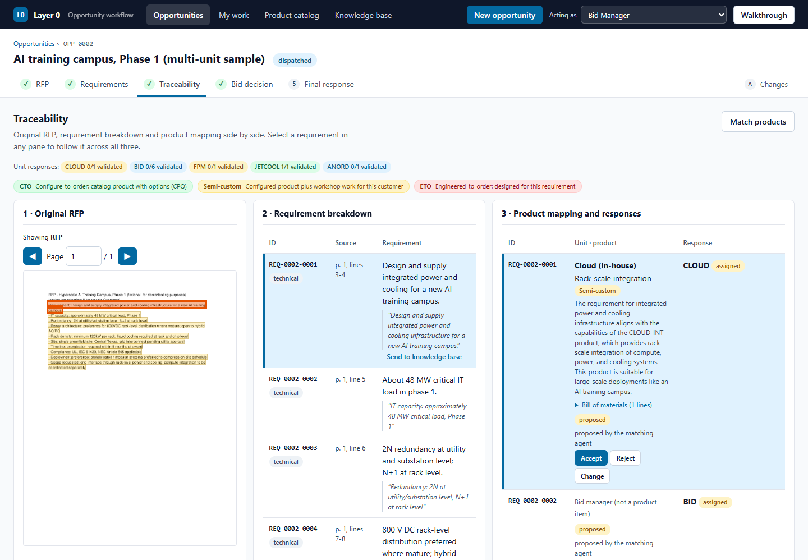

### 11.13 Match actions: Accept, Reject and Change

Every row of pane 3 ends with a match actions block (`MatchActions`). It lets a person confirm, refuse or replace the match. Clicks and key presses inside its buttons and its editor do not change the row selection; a click on its text lines (the "Also:" line and the status line) does select the row, like any other part of the row.

Elements of the block, in order:

| # | Element | Shown when | Content and behaviour |
|---|---|---|---|
| 1 | "Also:" line (muted) | The match names more than one unit | "Also: {unit code} · {product ID}, …" for the second and further units, for example "Also: JETCOOL · JETCOOL-CDU" |
| 2 | Status line (muted) | A match exists | A badge with the match status ("proposed" amber, "accepted" green) followed by how the match came about (table below) |
| 3 | **Accept** (primary) | The match status is `proposed` | Confirms the match |
| 4 | **Reject** (secondary) | The match status is `proposed` | Refuses the match |
| 5 | **Change** (secondary) | Always, also when there is no match | Opens the Change editor in place of the buttons |
| 6 | Spinner "Saving…" | While a request of this block is running | All buttons of the block are disabled meanwhile |

How the match came about (the method stored with the match):

| Method | Text shown |
|---|---|
| `manual` | "set by a person" |
| `agent` | "proposed by the matching agent" |
| `rule` | "routed to the bid desk by rule (not a product category)" |
| `retrieval_only` | "closest catalog entry (no agent answer)" |
| Any other value | The value itself |

**Accept** and **Reject**:

1. Send `POST /api/matches/{match id}/decide` with `{"action": "accept"}` or `{"action": "reject"}`.
2. The server sets the match status to `accepted` or `rejected`, stores the acting person as `decided_by` and writes the audit event `accept` or `reject`. An unknown match ID gives the error "Match {id} not found.".
3. The page reloads the trace data and shows the toast "{requirement ID}: match accepted." or "{requirement ID}: match rejected. Use Change to pick a unit.". A failure shows the API's message in an error toast.
4. After **Accept**, the status line reads "accepted" with the same method text, and **Accept** and **Reject** disappear; **Change** stays.
5. After **Reject**, the API stops sending a match for that requirement: the cell reads "not matched yet", the status line disappears and only **Change** remains. A later **Match products** run does not propose a new match for it (a rejection is a person's decision). On the Bid decision screen the requirement then counts as "Not yet matched", and a later dispatch routes it to the bid desk.

Accepted matches also stop counting in "Product matches nobody has accepted or changed yet" on the Bid decision screen (section 12.6), and in its criterion "Matches reviewed".

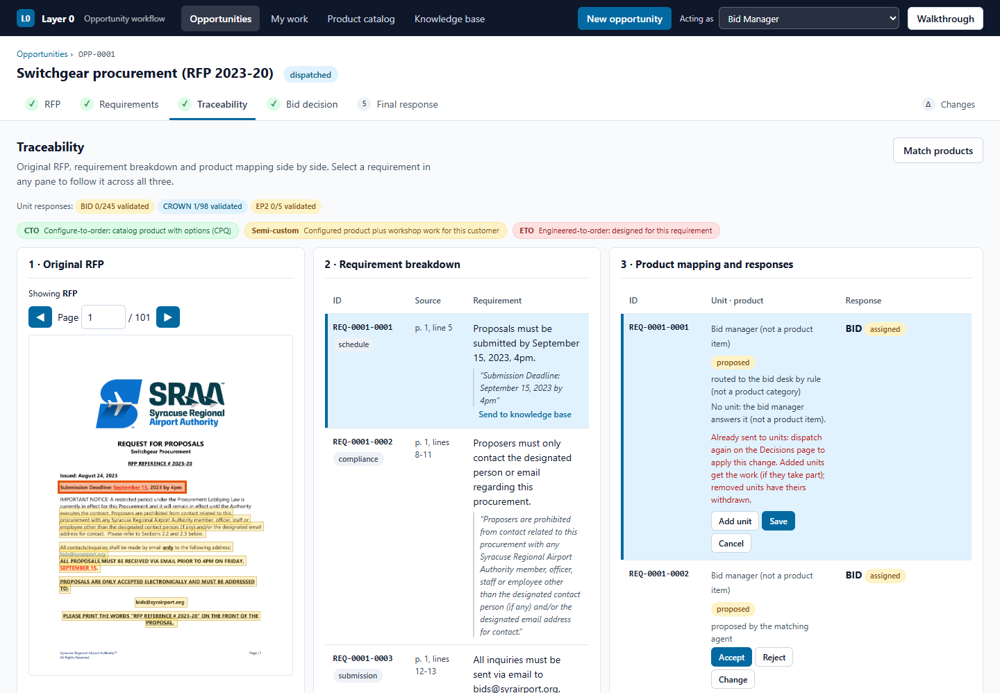

The **Change** editor:

| # | Element | Content and behaviour |
|---|---|---|
| 1 | Loading indicator | "Loading catalog…" until the catalog has arrived. The first opening on a row calls `GET /api/catalog`; the editor keeps only units whose status is `active`, so a unit still pending (EPC Power in the demo catalog) cannot be offered |
| 2 | One row per unit of the draft | The draft starts as a copy of the match's current units (empty for a bid-desk match or no match) |
| 2a | Product list (screen-reader label "Product") | One option group per active unit (label = unit name, for example "Crown Technical Systems"), listing that unit's products by name. Choosing a product sets the row's unit to the product's unit and its offering type to the product's default type. The demo catalog has 8 active units and 60 products |
| 2b | Offering type list (screen-reader label "Offering type") | "CTO", "Semi-custom", "ETO". Overrides the product's default for this match |
| 2c | **Remove** (secondary; accessible name "Remove {product ID}") | Removes the row from the draft |
| 3 | Empty draft text | "No unit: the bid manager answers it (not a product item)." when the draft has no row |
| 4 | Warning (red) | Shown when the requirement already has active assignments: "Already sent to units: dispatch again on the Decisions page to apply this change. Added units get the work (if they take part); removed units have theirs withdrawn." |
| 5 | **Add unit** (secondary) | Adds a row with the first product of the catalog whose unit is active (in the demo catalog: "Relay and protection panel" of Electrical Power Products (EP²), ETO). Disabled until the catalog has loaded |
| 6 | **Save** (primary) | Disabled while saving or before the catalog has loaded |
| 7 | **Cancel** (secondary) | Closes the editor and discards the draft; nothing is sent |
| 8 | Spinner "Saving…" | While the save request runs |

**Save**:

1. Sends `POST /api/opportunities/{id}/requirements/{requirement ID}/match` with `{"units": [{"product_id": …, "offering_type": "CTO" | "SEMI_CUSTOM" | "ETO"}, …]}`. An empty list means "not a product item: the bid manager answers it".
2. The server takes each unit from its product, ignores a product listed twice, and stores a new match with method `manual`, status `accepted`, confidence 1.0, the rationale "Set by {acting person}." and `decided_by` = the acting person, plus the audit event `manual`.
3. Server errors: "{requirement ID} is not a requirement of {opportunity ID}." (404), "{product ID} is not a product of an active business unit." (422), "{offering type} is not an offering type." (422).
4. On success the editor closes, the trace data reloads and the toast "{requirement ID}: match saved." appears. The row now shows the chosen unit and product, the rationale "Set by {name}.", the status "accepted" and "set by a person". On failure the editor stays open with the draft and the API's message appears in an error toast.

A saved change does not alter work already sent to the units. As the warning says, the Bid Manager must dispatch again on the Bid decision screen (section 12.11): newly matched units that take part receive the work, and units no longer matched have their work withdrawn.

### 11.14 Send to knowledge base on this screen

The shared `SendToKnowledge` control (section 19) appears in two places on this screen:

| Place | What is sent | Knowledge kind and reference |
|---|---|---|
| Pane 2, in the "Requirement" cell of the selected row only | The requirement | `requirement`, reference = requirement ID |
| Pane 3, in each assignment block whose status is `validated` | That validated answer | `response`, reference = assignment ID |

The control has three states:

| State | Shown when | What is shown |
|---|---|---|
| Sent | The opportunity's knowledge map holds this item with status `queued` or `approved` | A badge: "sent to knowledge base" (amber, while queued) or "in knowledge base" (green, once approved) |
| Closed | Never sent, or sent and rejected by the curator (it may then be sent again) | A link-style button "Send to knowledge base" |
| Open | After a click on the link | An inline form (below) |

The form, in order: a text field (placeholder "Why keep it? (optional)", accessible name "Note for the curator", at most 2000 characters, focused on open), a small **Send** button (reads "Sending…" and is disabled while sending), a small **Cancel** button (closes the form), and, after a failure, the API's message in red (`role="alert"`) inside the form. Clicks and keys inside the form do not change the row selection.

**Send** calls `POST /api/knowledge` with `{"kind", "ref", "note"}`. On success the form closes, the knowledge map reloads (the badge "sent to knowledge base" replaces the link) and the toast "Sent to the knowledge base for curation." appears. Server rules: an unknown requirement gives "Requirement {ref} not found."; an answer that is not validated gives "Only validated answers go to the knowledge base."; an item already queued or approved gives "Already {status} as {KB-ID}.". The new item gets the next ID (`KB-0001`, `KB-0002`, …) and waits on the Knowledge Base screen (section 18) for the curator.

Because the form is a React form action, React resets the form's field after the action completes. Code-derived (not observed in a browser): a note typed before a failed send is expected to be cleared while the error stays visible.

In the demo data REQ-0001-0002 is queued (map `{"requirement:REQ-0001-0002": "queued"}`), so selecting it shows "sent to knowledge base" instead of the link. On OPP-0002 the validated JetCool answer on REQ-0002-0005 shows the link in pane 3.

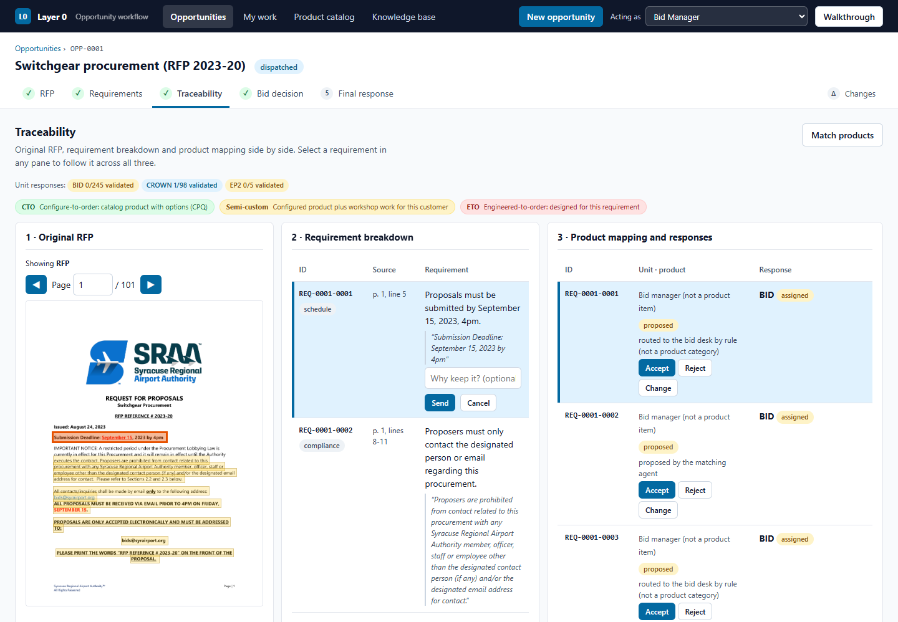

### 11.15 Synchronised selection and deep links

One requirement is selected at a time. Selecting it from any of the three panes does the same things:

| Trigger | Where |
|---|---|
| Click anywhere on a row (outside its buttons, links and forms) | Pane 2 or pane 3 |
| Enter or Space while the row itself has keyboard focus | Pane 2 or pane 3 |
| Click, or Enter or Space, on a highlight box | Pane 1 |
| The requirement named in the URL fragment when the page first loads | Page load |

What selecting a requirement does, in order:

1. Marks it as selected: both of its rows (panes 2 and 3) get the selected styling and `aria-current="true"`.
2. If the requirement is anchored in a document that pane 1 can show, switches pane 1 to that document (for example to the addendum for a requirement added by it).
3. If the requirement has a page, switches pane 1 to that page. Its boxes turn orange. An unanchored requirement leaves pane 1 where it was.
4. Replaces the URL fragment with `#{requirement ID}` without adding a browser-history entry, so the address can be copied as a deep link and the browser's Back button still leaves the page.
5. Scrolls its rows in panes 2 and 3 into view (smoothly, only as far as needed).
6. Shows the "Send to knowledge base" control in its pane 2 row.

On first load, once the data has arrived, the page selects: the requirement named in the URL fragment; or, when the fragment names a sub-requirement (links from the Changes screen can), its group; or else the first row that has a page. A fragment that names nothing on the page (for example the removed REQ-0001-0130) falls back to the first row with a page. The fragment is read only once: changing it later by hand does not change the selection.

Changing the page or the document by hand in pane 1 does not change the selection.

### 11.16 Traceability across documents (after an addendum)

When a change document has been applied on the Changes screen (section 15), the new and changed requirement versions are anchored in that document, and pane 1 can show it. The demo opportunity OPP-0001 is in this state: the illustrative Addendum No. 1 (`rfp_syracuse_addendum_1.pdf`, one page) was applied as baseline 2, adding REQ-0001-0977 and REQ-0001-0978, modifying the sub-requirements REQ-0001-0039 and REQ-0001-0332, and removing REQ-0001-0130.


Opening `/opportunities/OPP-0001/trace#REQ-0001-0977`:

- The unit responses line reads "BID 0/245 validated", "CROWN 0/99 validated" (blue) and "EP2 0/5 validated".
- Pane 1 shows "Showing **rfp_syracuse_addendum_1.pdf**" with the tag "Change document", the chips "RFP" and "rfp_syracuse_addendum_1.pdf" (the second pressed), "Page 1 / 1", and lines 17 to 19 of the addendum in orange. Item 4 of the addendum (lines 20 to 22, REQ-0001-0978) is in yellow.
- Pane 2 shows REQ-0001-0977 ("technical") after the last anchored requirement of the main RFP (REQ-0001-0814, page 100), with the tag "rfp_syracuse_addendum_1.pdf" and "p. 1, lines 17-19" in the Source column, its text and its quote from the addendum.
- Pane 3 shows "Crown Technical Systems", "Arc-resistant metal-clad MV switchgear" with "ETO", the rationale, "Bill of materials (5 lines)", "proposed", "proposed by the matching agent", **Accept**, **Reject**, **Change**, and in the Response column "CROWN" "assigned". The addendum's new requirements were matched and dispatched automatically when the change set was applied.

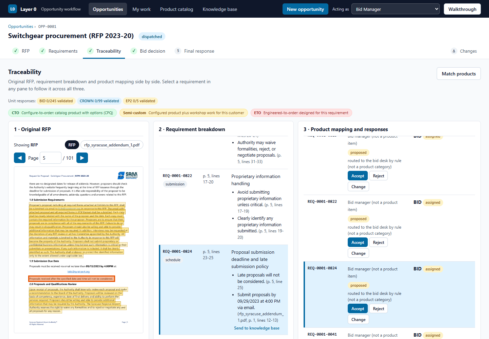

Opening `/opportunities/OPP-0001/trace#REQ-0001-0039`:

- REQ-0001-0039 is a sub-requirement, so its group REQ-0001-0824 is selected.
- Pane 1 shows the main RFP ("Showing **RFP**", with both chips, "RFP" pressed) at page 5 of 101. Only line 25 ("Proposals received after the specified date and time will not be considered.") is in orange: the group's box now comes from its unchanged sub-requirement REQ-0001-0040, because the new version of REQ-0001-0039 lives in the addendum.
- Pane 2 lists the group's sub-requirements: "Late proposals will not be considered. (p. 5, line 25)" and "Submit proposals by 09/29/2023 at 4:00 PM via email. (rfp_syracuse_addendum_1.pdf, p. 1, lines 12-13)".
- Pane 3 shows the bid-desk match and the BID assignment "assigned". Because it had not been answered yet, the assignment kept its status when the change was applied and received the note "Changed by rfp_syracuse_addendum_1.pdf: sub-requirement REQ-0001-0039 now reads: …", which is visible on My work, not here. An answered item is returned instead: REQ-0001-0887, whose sub-requirement REQ-0001-0332 changed from eighteen to twenty breaker positions, shows "CROWN" "returned" "met" in pane 3.
- Removed requirements (REQ-0001-0130) no longer appear on this screen.

### 11.17 States of the screen

| State | When | What the screen shows |
|---|---|---|
| Loading | Until the first trace response arrives | Four grey shimmer lines (`Skeleton`, `aria-label="Loading"`) under the opportunity shell; no heading |
| Load error | The trace request fails, including a later re-fetch (for example on window focus) | Only an error box titled "Could not load the traceability view." with the API's message, for example "Opportunity OPP-9999 not found." for an unknown opportunity. Data already shown is replaced by the error box |
| No document, no requirements (OPP-0003) | Nothing uploaded or read | Header and **Match products**; "Unit responses: not sent to units yet"; the legend; pane 1 "No RFP page available."; pane 2 "No requirements yet"; pane 3 "Nothing to map yet" (screenshot below) |
| RFP read, review in progress (OPP-0004) | Requirements exist but are not all approved and nothing is frozen | All active requirements as rows, including those still to decide; "not matched yet" and only **Change** in pane 3; "not dispatched"; "not sent to units yet". **Match products** matches only the approved ones |
| Matched, not dispatched | After **Match products**, before dispatch | Units, products, offering badges, rationales, bills of materials, "proposed" with **Accept**, **Reject**, **Change**; "not dispatched"; "not sent to units yet" |
| Dispatched (OPP-0001, OPP-0002) | After the Bid decision dispatch | As above plus one badge per unit in the responses line and one assignment block per unit in pane 3 |
| Answers coming in | Units submit, the Bid Manager validates or returns | Assignment badges change ("submitted", "validated", "returned"), compliance badges and answer texts appear, the unit badge turns blue then green, "Send to knowledge base" appears under validated answers |
| Match decided | After **Accept** or **Save** | "accepted" with "set by a person" (after **Save**) or the original method (after **Accept**); no **Accept** / **Reject** |
| Match rejected | After **Reject** | "not matched yet", only **Change** |
| Matching in progress | During **Match products** | Spinner "Matching…"; **Match products** disabled; the rest of the page stays usable |
| Saving a match decision | During **Accept**, **Reject** or **Save** | Spinner "Saving…" in that row's block; its buttons disabled |
| Change editor open | After **Change** | "Loading catalog…", then the unit rows and buttons; the red "Already sent to units…" warning when the requirement has active assignments |
| Knowledge form open | After "Send to knowledge base" | Note field, **Send** / **Sending…**, **Cancel**, error text after a failure |
| Several documents (OPP-0001 after the addendum) | A change document was applied | Document chips in pane 1, file-name tags in pane 2's Source column and in group sub-requirement lists (section 11.16) |
| Page without a text layer | The shown page is marked unreviewed | The red warning "No text layer: page not read (needs OCR)" next to the pager |
| Frozen or not frozen | Any | The screen looks the same before and after the baseline is frozen; freezing matters on the Requirements and Bid decision screens, not here |

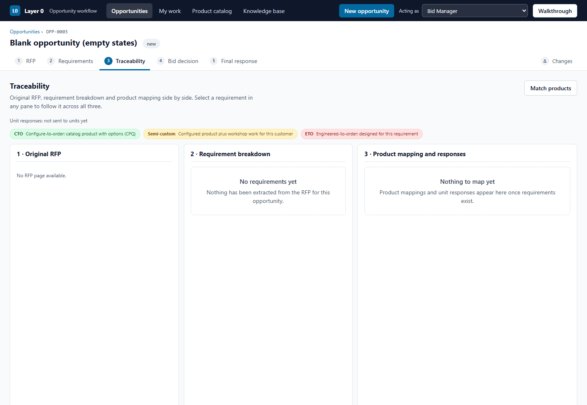

### 11.18 Phone and narrow-screen layout

| Width | Behaviour |
|---|---|
| Up to 1100 px | The three panes stack in one column, in the order 1, 2, 3. The pane block loses its fixed height; each pane is at most 70% of the window height and scrolls on its own. The page header stacks, so **Match products** moves under the help text |
| Up to 640 px (phone) | Page side margins become 16 px. Each pane is at most 60% of the window height. Legend tags wrap onto several lines. Column widths: ID 108 px, Source 26%. Table cells use tighter side padding. Buttons in pane rows (**Accept**, **Reject**, **Change**, editor buttons) stretch to share the row, which in a narrow cell puts them one under the other |

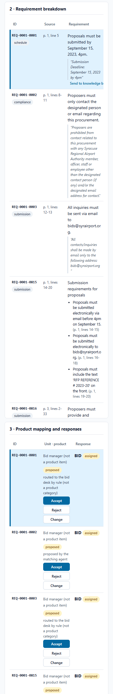

In the phone capture the "Send to knowledge base" link of the selected row is cut at the edge of the narrow Requirement cell.

### 11.19 Keyboard and screen-reader support

- Every row of panes 2 and 3 is in the tab order. Enter or Space selects the focused row; inside a row, buttons, links, the bill-of-materials summary and form fields keep their own keys.
- Each requirement's first highlight box in pane 1 is a focusable button named "Select {requirement ID}"; Enter or Space selects it.
- The selected rows carry `aria-current="true"`.
- The pager buttons are named "Previous page" and "Next page"; the page box is named "Page number".
- The document chips form a group named "Document shown" and report the shown one as pressed.
- The product and offering-type lists of the Change editor have hidden labels "Product" and "Offering type"; each **Remove** button is named "Remove {product ID}".
- The busy indicators ("Matching…", "Saving…", "Loading catalog…", "Sending…" on the button) are announced; toasts are announced through the live regions of the toast area (section 19).

### 11.20 API calls made by this screen

| User action or moment | Request | Body | Result on screen |
|---|---|---|---|
| Open, focus, after actions | `GET /api/opportunities/{id}/trace` | none | All three panes, the responses line |
| Open, focus, after a send | `GET /api/opportunities/{id}/knowledge` | none | Link or badge of each "Send to knowledge base" control |
| Show a page | `GET /api/documents/{document id}/pages/{n}.png` | none | Pane 1 image |
| **Match products** | `POST /api/opportunities/{id}/match` | `{}` | Toast "Matching done: …", reload |
| **Accept** / **Reject** | `POST /api/matches/{match id}/decide` | `{"action": "accept"}` or `{"action": "reject"}` | Toast, reload |
| **Change** (first time on a row) | `GET /api/catalog` | none | Editor lists |
| **Save** in the Change editor | `POST /api/opportunities/{id}/requirements/{requirement ID}/match` | `{"units": [{"product_id", "offering_type"}]}` | Toast "{ID}: match saved.", reload |
| **Send** in the knowledge form | `POST /api/knowledge` | `{"kind": "requirement" or "response", "ref", "note"}` | Toast, badge |

Every request carries the acting person in the `X-Actor` header. The calling sequences that involve this screen (match, review, dispatch again) are described in 04-api-view.md.

### 11.21 Limitations and proposed improvements

Observed in the code (Implemented as described, worth knowing):

- **Match products** runs inside one request with no progress display. Moving long agent runs to background jobs with progress is Proposed (not built) in `SUGGESTIONS.md`, section 4.5 (described there for reading and change documents; matching has the same shape).
- A rejected match is not sent to the screen, so the text "rejected: choose a unit with Change" is never shown and a rejected requirement looks like one that was never matched.
- The page-number box accepts a number with decimals; such a value does not match a page, and pane 1 then shows "No RFP page available." without the pager until a requirement is selected again. Code-derived; not observed in a browser.
- A failed re-fetch (for example a short network loss while the window regains focus) replaces the whole screen with the error box; reloading the page restores it.
- The return note of a returned answer is not shown in pane 3.
- If the catalog cannot be loaded when **Change** is opened, an error toast appears and the editor keeps showing "Loading catalog…" until **Cancel** is pressed.
- The Change editor offers every product of every active unit; it does not check whether the unit takes part in the bid. Units that do not take part receive no work at dispatch, and the requirement then goes to the bid desk.
- The trace response includes the main RFP's server-side file path in its `doc` object, which the screen does not use; see 04-api-view.md.

Proposed (not built), from `SUGGESTIONS.md`:

- Zoom and find-on-page in pane 1 (section 3, item 13).
- "Ask the RFP": questions answered with citations that open the cited page in pane 1 with the lines highlighted (section 1.8).
- Matches learned from earlier accept, reject and manual decisions, shown as "learned from OPP-…" in pane 3 (section 1.2).
- Reading addenda into draft requirements before the freeze, anchored in the addendum; the screen already supports several documents (section 3, item 4).

## 12. Screen: Bid Decision (Step 4)

The Bid decision screen is where a person decides whether to bid and who takes part. It first shows the evidence that Layer 0 has gathered (counts, engineering checks, deviations from standard products, workload), then three numbered steps: choose the participating business units, record go or no-go with a judgement per criterion, and send each unit its work. Layer 0 gives advice; it never decides.

Terms used in this section:

- **Evidence pack**: the counts and checks shown at the top of the screen. A copy is stored with every decision as it was shown.
- **Participation**: the decision naming the business units that take part in this bid.
- **Go / no-go**: the decision to bid (go) or not (no-go), with a rationale and a judgement per **criterion** (a question such as "Scope fit").
- **Frozen baseline**: the numbered, approved set of requirements created on the Requirements screen (section 10). Go / no-go and dispatch need it.
- **Dispatch**: creating the work items (**assignments**) that the units answer on My work (section 16). One click sends a **work package** to each unit.

All elements described in this section are Implemented unless a line says otherwise.

### 12.1 Route, files and purpose

| Item | Value |
|---|---|
| Route | `/opportunities/{id}/decisions` |
| Page file | `web/app/opportunities/[id]/decisions/page.tsx` (client component). It defines three internal parts: `EngineeringChecks`, `PortfolioChecks` and `GoNoGoSummary` |
| Components on the page | `PageHead`, `SendToKnowledge` (for decision rationales), UI kit `Alert`, `Busy`, `Skeleton`, `StatusBadge`, `offeringLabel`, `useConfirm` (confirmation dialog), `useToast` (section 19) |
| Styles | Decisions rules in `web/app/styles/trace.css` (unit checkboxes, layers list, rules table, criteria table) and the foundation classes of `web/app/globals.css` (cards, dense tables, the 320 px scroll box of the per-requirement list) |
| Shell | Inside the opportunity shell (section 5), with step "4 Bid decision" marked current. The page tells the shell to refresh its status badge and step ticks after go / no-go and after dispatch (browser event `opp-status-changed`) |
| Walkthrough | Chapter "The bid decision and dispatch" (section 20); anchors in Appendix B |

Purpose, in the words of the page's help text: "Review the evidence, choose the participating business units, decide go or no-go, then send each unit its work."

### 12.2 Who uses it

The Bid Manager uses this screen. There is no role check in the page or in the API for recording participation, recording go / no-go or dispatching: any acting person can do them, and the acting person's name is stored on the decision (`decided_by`, shown as "Recorded by …" and "by …") and in the audit log. The walkthrough says the same: these actions are open to anyone in this proof of concept. Restricting them to the Bid Manager is part of the sign-in and roles work that is Proposed (not built) in `SUGGESTIONS.md`, section 2 ("Authentication for a pilot").

### 12.3 Screenshots and layout


The screenshot shows the whole page for OPP-0001 at 1440 px wide (3631 px tall), acting as Bid Manager, with participation and go recorded and the work dispatched, before the addendum was applied.

```text
+-----------------------------------------------------------------------------------------+
| Opportunity shell: breadcrumb, title, status badge, step bar (4 Bid decision current)   |
+-----------------------------------------------------------------------------------------+
| Bid decision                                                                            |
| Review the evidence, choose the participating business units, decide go or no-go, ...  |
| +-------------------------------------------------------------------------------------+ |
| | Evidence   349 requirements · schedule 9, compliance 67, ...                        | |
| | Offering mix: [NONE 245] [ETO 98] [CTO 5] [Semi-custom 1]                            | |
| | Suggested units: CROWN (99) EP2 (5)                                                  | |
| | > Unanchored: 32 requirement(s) without a place in the RFP                           | |
| | Not yet matched: n          Product matches nobody has accepted or changed yet: 104  | |
| | [! Requirements are not frozen yet: ...]            (only before the freeze)         | |
| +-------------------------------------------------------------------------------------+ |
| | Engineering checks  (only after the freeze): layers, rules, tiers, low-voltage solver | |
| +-------------------------------------------------------------------------------------+ |
| | Bid and portfolio checks (only after the freeze): deviations, workload vs capacity   | |
| +-------------------------------------------------------------------------------------+ |
| | 1. Which business units take part?     Recorded by Bid Manager: CROWN, EP2           | |
| | rationale  [Send to knowledge base]                                                  | |
| | [x] Electrical Power Products (EP²) [x] Crown Technical Systems [ ] Anord Mardix ... | |
| | Rationale [__________]  [Record participation]                                       | |
| +-------------------------------------------------------------------------------------+ |
| | 2. Go / no-go                           Decision [go] by Bid Manager                 | |
| | rationale  [Send to knowledge base]                                                  | |
| | [i Advice from Layer 0: 6 of 9 assessable criteria met; ...]  (after the freeze)     | |
| | How the requirements are satisfied: Category | Fully | Partly | Not | Bid desk       | |
| | > Per requirement (349): ...                                                         | |
| | Criterion | Layer 0's assessment | Your judgement [met v] | Note [optional]          | |
| | Rationale [______________________________________________]                          | |
| | [Go] [No-go]   (Freeze the requirements first.)                                      | |
| +-------------------------------------------------------------------------------------+ |
| | 3. Send the work to the units  (only when the latest decision is go)                 | |
| | Repeat after changing matches or participation: ...                                  | |
| | [Dispatch work packages to units]                                                    | |
| +-------------------------------------------------------------------------------------+ |
+-----------------------------------------------------------------------------------------+
```

### 12.4 Data loaded on open, and when it refreshes

| Request | When | Used for |
|---|---|---|
| `GET /api/opportunities/{id}/decisions` | On open; after each successful action; whenever the window regains focus or the tab becomes visible | Everything on the page |
| `GET /api/opportunities/{id}/knowledge` | On open; after a successful send; on focus | Whether each decision rationale shows "Send to knowledge base" or a "sent" badge |
| `GET /api/opportunities/{id}` | Made by the opportunity shell (every 5 seconds, on step change, and at once after go / no-go and dispatch) | Header status badge and step ticks |

The decisions response holds:

| Field | Content |
|---|---|
| `evidence` | The evidence pack: requirement count, `frozen` (true when a baseline exists), counts by category, unanchored IDs, suggested units with counts, offering mix, unmatched IDs, number of product matches not reviewed, `checks` (engineering checks), `deviations`, `workload` |
| `summary` | The go / no-go summary (per-requirement levels, counts by category, coverage, the criteria with Layer 0's assessment, the advice line). `null` until the requirements are frozen |
| `units` | The active business units of the catalog, in catalog order (a pending unit such as EPC Power is left out) |
| `participation` | The latest participation decision, or `null` |
| `go_no_go` | The latest go / no-go decision, or `null` |

The evidence counts cover the current top-level requirements in any active status (so a not-yet-frozen opportunity counts its still-proposed requirements too); the engineering checks and the summary cover only approved requirements of the frozen baseline. The payload is detailed in 04-api-view.md.

### 12.5 Page header

| Element | Exact text |
|---|---|
| Heading (level 2 inside the opportunity) | "Bid decision" |
| Help text | "Review the evidence, choose the participating business units, decide go or no-go, then send each unit its work." |

The header has no buttons.

### 12.6 Evidence card

Always shown. Elements in order:

| # | Element | Exact text | Shown when |
|---|---|---|---|
| 1 | Card heading and counts | "Evidence", then muted "{N} requirements · {category} {n}, {category} {n}, …" (categories in the order the API sends them) | Always. With no requirements the line reads "0 requirements ·" |
| 2 | Offering mix | "Offering mix:" followed by one badge per offering type with its count, labelled "{type} {n}": "NONE" (grey; matches that go to the bid desk), "ETO" (red), "CTO" (green), "Semi-custom" (amber) | Always; nothing after the colon when no requirement is matched |
| 3 | Suggested units | "Suggested units:" followed by "{unit code} ({n})" in bold for each unit named by at least one match (n = number of requirements whose match names that unit, each unit counted once per requirement); "none yet: run matching" when there is none | Always |
| 4 | Unanchored | A collapsed section whose summary reads, in red, "Unanchored: {n} requirement(s) without a place in the RFP"; opening it lists the IDs in monospace, separated by commas (not links) | When at least one requirement is unanchored |
| 5 | Not yet matched | Muted "Not yet matched: {n}" | When at least one current requirement has no match (never matched, or its match was rejected) |
| 6 | Not reviewed | Muted "Product matches nobody has accepted or changed yet: {n} (Traceability, pane 3)" | When at least one match that names a unit is still `proposed`. Plain text, not a link |
| 7 | Not frozen | Amber warning box "Requirements are not frozen yet: freeze them on the Requirements page before deciding go or no-go." | When no baseline exists |

The suggested units are the per-unit totals of the matching result. The per-requirement view (which unit answers which requirement, and how well) is in "Per requirement (n)" under go / no-go (section 12.10), and in Traceability pane 3.

Live values:

| Opportunity | Counts line | Offering mix | Suggested units | Other lines |
|---|---|---|---|---|
| OPP-0001 before the addendum (screenshot above) | "348 requirements · schedule 9, compliance 66, submission 87, legal 18, commercial 11, staffing 11, technical 146" | NONE 245, ETO 97, CTO 5, Semi-custom 1 | CROWN (98) EP2 (5) | Unanchored 32; not reviewed 103 |
| OPP-0001 after the addendum | "349 requirements · schedule 9, compliance 67, submission 86, legal 18, commercial 11, staffing 11, technical 147" | NONE 245, ETO 98, CTO 5, Semi-custom 1 | CROWN (99) EP2 (5) | Unanchored 32; not reviewed 104 |
| OPP-0002 | "10 requirements · technical 8, schedule 1, compliance 1" | Semi-custom 2, NONE 6, CTO 2 | CLOUD (1) FPM (1) JETCOOL (1) ANORD (1) | Not reviewed 4 |
| OPP-0003 | "0 requirements ·" | (empty) | none yet: run matching | Not-frozen warning |
| OPP-0004 | "4 requirements · technical 3, schedule 1" | (empty) | none yet: run matching | "Not yet matched: 4"; not-frozen warning |

### 12.7 Engineering checks card

Shown only after the requirements are frozen. These checks were ported from an earlier code line and are evidence for the bid manager, never a decision. Their logic is described in 02-technical-architecture.md (matching module).

| # | Element | Exact text and behaviour |
|---|---|---|
| 1 | Card heading | "Engineering checks", then muted "Over {n} frozen requirements. Illustrative rules ported from the earlier code line; to be confirmed with SpinCo engineering." (n = approved requirements of the baseline) |
| 2 | Sub-heading | "Scope: layers this RFP covers" |
| 3 | Layer list | One line per layer of the six-layer power and cooling model: a badge "in scope" (green) or "not in scope" (grey), then "{n}. {layer name}", then the reason in muted brackets, for example "(decisive term)", "(5 hits (threshold 3))", "(2 distinct terms)", "(0 hits (threshold 3))". When terms were found, a muted line follows: "“{term}” ×{count} in {requirement ID links}; " for each term, with up to three example requirement IDs per term. The IDs of one term are printed next to each other without a separator. Each ID links to Traceability |
| 4 | Outside-scope warning | Amber box "Suggested although nothing in the RFP points to their layers: {unit} ({n}), …. Check these matches." Shown when a suggested unit belongs only to layers that are not in scope |
| 5 | Sub-heading and rules table | "Rules", then a table without a header row: rule ID in monospace (R-001 to R-004), a status badge ("pass" green, "warn" amber, "fail" red, "n/a" grey), and the finding with the rule's own text in muted type under it |
| 6 | Sub-heading and tier flags | "Offering type against each unit's default tier", then either muted "No flags." or a collapsed section "{n} item(s) need an engineer's confirmation" listing "{requirement ID link} {unit} · {product ID}: {note}" |
| 7 | Low-voltage solver | Sub-heading "Low-voltage solver"; a badge with the solver status in lower case: "not solvable" (grey), "solved" or "solved with warnings" (green); the reasons as a muted list; when solved, a table of working steps ("{step}", "{expression} = {result} {unit}", muted reference); warnings as red lines |

The six layers are: 1 Grid Interface, 2 Utility / Facility Electrical, 3 Power Distribution (Room to Row to Rack), 4 Rack & Board Power, 5 Thermal Management, 6 Compute + Integration. When no layer reaches its threshold, every layer is shown "in scope" with the reason "no layer met the threshold; full scope assumed".

Live values for OPP-0001 (after the addendum):

- Layers: 1 Grid Interface not in scope "(1 hits (threshold 3))", "“interconnect” ×1 in REQ-0001-0931"; 2 Utility / Facility Electrical in scope "(decisive term)", "switchgear" ×68, "metal clad switchgear" ×19, "protective relay" ×7, "medium voltage" ×4, "substation" ×3; 3 Power Distribution in scope "(5 hits (threshold 3))", "prefabricated" ×5; layers 4, 5 and 6 not in scope "(0 hits (threshold 3))".
- Rules: R-001 pass "Voltage architecture 125 vdc (REQ-0001-0953) needs no 800 V DC check."; R-002 n/a "Cooling (layer 5) is not in scope and no rack density is stated."; R-003 warn "Redundancy class is not stated: the layer-2 selection cannot be verified. Clarify before quoting."; R-004 pass "No match depends on EPC Power.". Rule texts underneath, for example R-001 "If any selected layer specifies 800VDC, all layers in the power path (1, 3, 4) must be 800VDC-compatible.".
- Tier flags: "5 item(s) need an engineer's confirmation", each "CROWN · CROWN-ACC: CTO is below CROWN's default ETO_GUIDED: an engineer must confirm this part is genuinely standard." (REQ-0001-0888, -0913, -0480, -0570, -0934).
- Solver: "not solvable", reason "Medium-voltage equipment (REQ-0001-0887) needs protection coordination and an arc-flash study, not arithmetic.".

Live values for OPP-0002: layers 1, 3 and 4 in scope "(2 distinct terms)", "(2 distinct terms)", "(3 distinct terms)"; the outside-scope warning "Suggested although nothing in the RFP points to their layers: CLOUD (1), JETCOOL (1). Check these matches."; R-001 warn, R-002 pass, R-003 warn, R-004 pass; "No flags."; solver "not solvable" with "Required input(s) not stated: ups_kva, rack_count. The solver does not assume values.".


### 12.8 Bid and portfolio checks card

Shown only after the requirements are frozen. Heading "Bid and portfolio checks", with the muted note "Evidence for the bid manager, never a decision." The values compared are placeholders, and the screen says so.

**Deviations from the standard product** (sub-heading). Layer 0 reads the data-sheet tables of the main RFP (ruled tables found when the RFP was read) and compares each rating with the standard rating of every product the matches name, where a standard is configured (`data/knowledge_base/portfolio.json`; only CROWN-ARMV has standard ratings in the demo data).

| Case | What is shown |
|---|---|
| Deviations found | A dense table: Product (monospace) / Rating / RFP asks / Standard / Severity (badge: "high" red, "medium" amber, "low" grey) / Source |
| Ratings compared, none deviates | Green text "{n} data-sheet ratings are within the standard products." |
| Nothing to compare | Green text "No data-sheet rating to compare." |
| Always, under the table or text | Muted note "Standard ratings are PLACEHOLDERS ported from the v1.1 demo; to be confirmed." |

A rating above the standard is a deviation (frequency must be equal). Voltage, current and frequency deviations are "high"; momentary rating and basic impulse level are "medium". Live OPP-0001: one row "CROWN-ARMV | Rated continuous current | 2000/1200 A, rms | 600 A | high | p. 74, data sheet row 8" (5 ratings compared). Live OPP-0002: "No data-sheet rating to compare.".

**Workload across opportunities** (sub-heading). A dense table, one row per unit that has work on this opportunity (active assignments, or matches not yet dispatched), sorted by unit code:

| Column | Content |
|---|---|
| Unit | Unit code (`BID` for the bid desk) |
| This opportunity (right-aligned) | Open work here (assigned, submitted or returned; validated work is not open) plus matched requirements not yet dispatched |
| Other opportunities | Open work of the unit on other opportunities, followed by the muted list of those opportunities, for example "6 (OPP-0002)" |
| Total open (right-aligned) | The sum |
| Capacity | The unit's capacity in open work items, or "—" when none is configured; a red "over" badge when the total exceeds it |

Muted note under the table: "Capacity is a PLACEHOLDER count of open work items per unit; to be confirmed with each unit." Configured capacities (placeholders): BID 400, CROWN 150, ANORD 100, FPM 100, JETCOOL 80, CLOUD 80, EP2 60.

Live OPP-0001 after the addendum: BID 246 / 6 (OPP-0002) / 252 / 400; CROWN 99 / 0 / 99 / 150; EP2 5 / 0 / 5 / 60. Before the addendum: BID 245 / 6 / 251, CROWN 97 / 0 / 97. Live OPP-0002: ANORD 1 / 0 / 1 / 100; BID 6 / 245 (OPP-0001) / 251 / 400; CLOUD 1 / 0 / 1 / 80; FPM 1 / 0 / 1 / 100; JETCOOL 0 / 0 / 0 / 80 (its only item is validated).

### 12.9 Card 1: Which business units take part?

Always shown, before and after the freeze. Elements in order:

| # | Element | Exact text and behaviour |
|---|---|---|
| 1 | Card heading | "1. Which business units take part?" |
| 2 | Recorded line (muted, right of the heading) | "Recorded by **{name}**: {unit codes, comma-separated}", for example "Recorded by **Bid Manager**: CROWN, EP2". Shown when a participation has been recorded |
| 3 | Recorded rationale | The latest participation's rationale as a paragraph, followed by the "Send to knowledge base" control (kind `decision`, section 12.12) when the rationale is not empty. Shown when a participation has been recorded |
| 4 | Unit checkboxes | One checkbox per active business unit, labelled with the unit's name, in catalog order: "Electrical Power Products (EP²)", "Crown Technical Systems", "Anord Mardix", "Flex Power Modules", "JetCool", "Cloud (in-house)", "Flex Design, Engineering and Manufacturing Services", "Flex Fulfillment, Logistics and Aftermarket Services". A pending unit (EPC Power) is not offered. The group has the hidden legend "Business units". Ticked by default: the units of the latest participation when one exists, otherwise the suggested units of the evidence card |
| 5 | Rationale | Label "Rationale" and an empty text field (no placeholder). Optional |
| 6 | **Record participation** (primary) | Disabled while any action of the page is running. Pressing Enter in the Rationale field also submits |
| 7 | Busy indicator | "Recording…" while the request runs |

**Record participation**:

1. Sends `POST /api/opportunities/{id}/participation` with `{"units": [ticked unit codes], "rationale": "{text}"}`.
2. The server checks that at least one unit is given and that every unit is active, stores a new participation decision (kind `participation`, outcome `units`) with the evidence pack as shown, the acting person as `decided_by` and the time, and writes the audit event `decided`. It does not need the requirements to be frozen, and it does not change the opportunity's status.
3. On success: toast "Participation recorded." and the page reloads (the recorded line and rationale update; the ticks follow the recorded units).
4. With no unit ticked the API answers "Choose at least one active business unit; not active: []." (422), shown in an error toast. There is no check in the page before sending.

The form is a React form action, so React resets the form when the action function returns: the Rationale field empties straight after the click and the ticks return to their defaults, which after the reload are the units just recorded. Code-derived (not observed in a browser).

Live values: OPP-0001 "Recorded by **Bid Manager**: CROWN, EP2", rationale "Suggested by matching; confirmed.", "Electrical Power Products (EP²)" and "Crown Technical Systems" ticked. OPP-0002 "Recorded by **Bid Manager**: CLOUD, FPM, JETCOOL, ANORD", the same rationale, four boxes ticked. OPP-0003 and OPP-0004: no recorded line and no box ticked (no suggested units).

Changing the participation after work was dispatched takes effect on the units only at the next dispatch (card 3): units added receive their work, units removed have theirs withdrawn.

### 12.10 Card 2: Go / no-go

Always shown. Its contents depend on whether the requirements are frozen and on whether a decision was recorded.

Elements in order:

| # | Element | Shown when | Exact text and behaviour |
|---|---|---|---|
| 1 | Card heading | Always | "2. Go / no-go" |
| 2 | Recorded line (muted) | A go / no-go was recorded | "Decision {badge} by **{name}**": the badge reads "go" (blue) or "no-go" (red) |
| 3 | Recorded rationale | A go / no-go was recorded | The rationale; then, if judgements were recorded with the decision, muted " Criteria judged: {n} met, {n} not met, {n} not known."; then the "Send to knowledge base" control (kind `decision`) when the rationale is not empty |
| 4 | Advice | Frozen | Blue information box with bold text, for example "Advice from Layer 0: 6 of 9 assessable criteria met; 3 cannot be assessed yet (data not available). A person decides." |
| 5 | "How the requirements are satisfied" | Frozen | Sub-heading and a dense table: Category / Fully / Partly / Not / Bid desk (counts, right-aligned), one row per category |
| 6 | "Per requirement ({n}): from the unit's answer where there is one, otherwise estimated from the match" | Frozen | A collapsed section; opened, a list in a box of at most 320 px height that scrolls. Each line: the requirement ID as a link to Traceability, the level in bold ("fully", "partly", "not", "bid desk"), the basis in muted brackets with the units when there are any, then the requirement text. Example: "REQ-0001-0887 **fully** (answer, not yet validated: CROWN) Switchgear components and accessories" |
| 7 | Criteria table | Frozen | Columns Criterion / Layer 0's assessment / Your judgement / Note (details below). Scrolls sideways on its own on a narrow screen |
| 8 | Rationale | Always | Label "Rationale" and an empty text field across the card. Optional. Pressing Enter does nothing (the form does not submit) |
| 9 | **Go** (primary) | Always | Disabled until the requirements are frozen and while any action runs |
| 10 | **No-go** (red outline) | Always | Disabled until the requirements are frozen and while any action runs |
| 11 | Busy indicator | While recording | "Recording…" |
| 12 | Hint (muted) | Not frozen | "Freeze the requirements first." |

How each requirement's level is worked out (the summary; approved requirements of the baseline only):

| Situation | Level | Basis shown |
|---|---|---|
| A unit has answered (assignment with a compliance value) | From the answer: met = fully, partial = partly, not met or exception = not. With several units, the weakest answer | "validated answer" when every answer is validated, otherwise "answer, not yet validated" |
| No answer; the match names units | From the offering type: CTO = fully, Semi-custom or ETO = partly. With several units, the weakest | "match" |
| No answer; the match names no unit | bid desk | "match" |
| No match | not | "no match" |

**The criteria table.** Each criterion row shows:

- Criterion: the name in bold and the question in muted type.
- Layer 0's assessment: a badge "met" (green), "not met" (red) or "not known" (grey), and the detail in muted type. Criteria for which no data exists are always "not known" with "Data not yet available.".
- Your judgement: a list with "met", "not met" and "not known" (hidden label "Your judgement on {name}"). It starts at the judgement recorded for this criterion on the latest go / no-go decision, or else at Layer 0's assessment.
- Note: a text field with the placeholder "optional" (hidden label "Note on {name}"). It starts empty; recorded notes are not shown again.

The twelve criteria (configuration file `data/knowledge_base/go_no_go.json`), with the live assessment of OPP-0001 after the addendum:

| Criterion | Question | Assessment | Detail (live) |
|---|---|---|---|
| Scope fit | Do the suggested units fit the RFP's scope (no unit outside the layers the RFP covers)? | met | Suggested units fit the layers in scope [2, 3]. |
| Every requirement routed | Does every frozen requirement have a match (a unit, or the bid desk)? | met | Every requirement is routed. |
| Coverage | Are enough product requirements fully or partly satisfied (at least the coverage threshold)? | met | 100% of 104 product requirements fully or partly satisfied (threshold 80%, placeholder). |
| Engineering rules | Does no engineering rule fail (R-001..R-004)? | met | No engineering rule fails. |
| Open questions | Are there no open questions (rule warnings, unanchored requirements)? | not met | Rule warnings: R-003; unanchored requirements: 32. |
| Matches reviewed | Has a person accepted or changed every product match? | not met | 104 product match(es) not yet accepted or changed by a person. |
| No pending-acquisition dependency | Does nothing depend on a unit whose acquisition has not closed (EPC Power)? | met | No match depends on EPC Power. |
| Deviations from the standard product | Does the RFP's data sheet stay within the standard ratings of the products offered (…)? | not met | Rated continuous current: RFP 2000/1200 A, rms vs standard 600 A (CROWN-ARMV, high, p. 74, data sheet row 8). Standards are placeholders. |
| Capacity and portfolio conflicts | Do the units have capacity for this work, given their open work on other opportunities (…)? | met | Open work vs capacity: BID 252/400 (also in OPP-0002); CROWN 99/150; EP2 5/60. Capacity is a placeholder. |
| Cost against budget | Is the product cost within the customer's budget and our margin target? | not known | Data not yet available. |
| Delivery against the RFP schedule | Can we deliver by the dates the RFP asks for? | not known | Data not yet available. The RFP's schedule requirements: REQ-0001-0001, REQ-0001-0824, REQ-0001-0108, REQ-0001-0857, REQ-0001-0899, REQ-0001-0908, REQ-0001-0613, REQ-0001-0669, REQ-0001-0969. |
| Competitor information | Who else is bidding and how do we compare? | not known | Data not yet available. |

The live question text of "Deviations from the standard product" and "Capacity and portfolio conflicts" ends with an internal work-item reference in brackets (shown above as "…"). It comes from the configuration file, not from the page, and should be removed before the screen is shown to a client.

For OPP-0002 the same advice line appears; "Scope fit" is "not met" ("Units outside the RFP's scope: CLOUD, JETCOOL"), "Open questions" is "not met" ("Rule warnings: R-001, R-003; unanchored requirements: 0."), "Matches reviewed" is "not met" (4), and "Deviations" is "met" ("No data-sheet rating found to compare with a standard product. Standards are placeholders.").

**Go**:

1. Sends `POST /api/opportunities/{id}/go-no-go` with `{"outcome": "go", "rationale": "{text}", "criteria": [{"id", "status": "met" | "not_met" | "unknown", "note"}, …]}`, one entry per criterion shown (none before the freeze).
2. The server refuses unknown criterion IDs ("Unknown criteria: [...]." 422) and a decision before the freeze ("Freeze the requirements before deciding go or no-go (review page)." 409). It stores a new decision (kind `go_no_go`) with the units of the latest participation (none if no participation was recorded), the rationale, the judgements, the acting person, and a copy of the evidence pack and of the summary as shown. It writes the audit event `decided` and sets the opportunity's status (rules below).
3. On success: toast "Decision recorded: go.", the page reloads, the header refreshes its status badge and step ticks, and card 3 appears.

**No-go**:

1. First opens a confirmation dialog: title "Record no-go?", message "The opportunity is marked no-go. Nothing is sent to the units; a later go decision can still overrule it.", buttons **Cancel** (secondary) and **Record no-go** (red, focused when the dialog opens). Esc or a click outside the dialog cancels; Tab stays inside the dialog.
2. On **Record no-go**: the same request with `"outcome": "no_go"`; toast "Decision recorded: no-go."; reload and header refresh. Card 3 disappears.

Status rules applied by the server (the opportunity status moves forward only, with a stop-and-resume exception):

| Status before | Decision | Status after |
|---|---|---|
| frozen | go | go |
| frozen, go, dispatched, consolidating | no-go | no-go |
| dispatched or consolidating | go | unchanged (a forward-only status is not moved back to go) |
| no-go | go | the status the opportunity had before the no-go (for example dispatched), or go |
| submitted | no-go | unchanged |

Recording no-go does not withdraw work already sent: the units keep their items on My work until a dispatch withdraws them. Changing the criteria judgements or the rationale alone records a new decision of the same outcome; the page always shows the latest one.

### 12.11 Card 3: Send the work to the units

Shown only when the latest go / no-go decision is "go".

| Element | Exact text and behaviour |
|---|---|
| Card heading | "3. Send the work to the units" |
| Note (muted) | "Repeat after changing matches or participation: new work is sent, work that no longer fits is withdrawn." The text is the same before and after a dispatch |
| **Dispatch work packages to units** (primary) | Disabled only while an action of the page runs. No confirmation dialog |
| Busy indicator | "Dispatching…" |

**Dispatch work packages to units**:

1. Sends `POST /api/opportunities/{id}/dispatch` with an empty JSON body.
2. The server needs a frozen baseline and a latest decision of "go". For every approved requirement of the baseline, it wants one assignment for each participating unit among the units of the requirement's match (with that unit's first product as the product reference); when none of the match's units takes part, or there is no match, it wants one assignment for the bid desk (`BID`). The owner of a unit's assignment is the unit's design engineer; the bid desk's owner is "Bid Manager".
3. It then compares with the existing assignments: a wanted assignment that does not exist is created (status `assigned`, audit event `assigned`); a wanted one that was withdrawn is reopened (status back to `assigned`, the earlier answer kept for reference, audit event `reopened`); an existing one that is no longer wanted is withdrawn (audit event `withdrawn`). It sets the opportunity status to dispatched (forward only).
4. The response is `{"created": n}` (new assignments only; reopened and withdrawn ones are not counted). The toast reads "{n} new assignment(s) sent to the units." or, when n is 0, "Nothing new to send: every unit already has its work.". The page reloads and the header refreshes.
5. Errors (error toast): "Freeze the requirements before dispatch (review page).", "Dispatch needs a 'go' decision first (decisions page).", and, when two dispatches of the same opportunity run at once, "Dispatch is already running for this opportunity; refresh and try again.".

What the screen shows after a dispatch: the toast; the header badge "dispatched" and the ticked steps; card 3 unchanged. The work appears on Traceability (unit responses line, Response column), on My work for each unit, and in the workload table of this screen.

After a change document is applied on the Changes screen (section 15), Layer 0 re-matches the new and changed requirements and, when work had been dispatched before and the latest decision is "go", dispatches again by itself. This screen then shows the new counts without any message of its own (screenshot below); the outcome is reported on the Changes screen. When no work had been dispatched before, or the latest decision is not "go", the Changes screen's result reads "Not dispatched: no work was dispatched before this change; dispatch from the decisions page." or "Not dispatched: the latest go/no-go is not 'go'. New work is created and removed work withdrawn at the next dispatch.", and the Bid Manager uses this card.

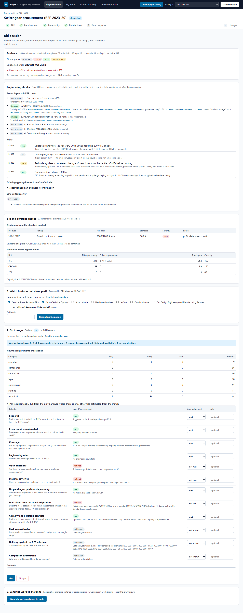

### 12.12 Decision history and knowledge

There is no decision-history list on this screen. Every **Record participation**, **Go** and **No-go** stores a new decision record, with the evidence pack (and for go / no-go the summary) exactly as shown, the judgements, the rationale, the person and the time, and writes the audit event `decided`. The screen shows only the latest participation and the latest go / no-go. No API endpoint lists earlier decisions. An audit-log page per opportunity is Proposed (not built) in `SUGGESTIONS.md`, section 3, item 6, and recording bid outcomes so that stored evidence packs become a decision history is Proposed (not built) in section 1.6.

A decision's rationale can be kept as knowledge. The "Send to knowledge base" control after each recorded rationale (kind `decision`, reference = decision ID) works as in section 11.14, with these server rules: "Decision {ref} not found." and "This decision has no rationale to keep."; the stored item reads "Participation decision ({OPP-ID})" or "Go/no-go decision ({OPP-ID})", "{units or outcome}: {rationale}", with the source "{OPP-ID}, decided by {name}".

### 12.13 Links into Traceability

| Where on this screen | Link text | Target |
|---|---|---|
| Engineering checks, layer terms | Requirement IDs (up to three per term) | `/opportunities/{id}/trace#{requirement ID}` |
| Engineering checks, tier flags | The requirement ID of each flag | Same |
| Go / no-go, "Per requirement (n)" | The requirement ID of each line | Same |

These are plain links: following one loads the Traceability page afresh, which then selects that requirement in all three panes and shows its RFP page (section 11.15). The evidence card's "(Traceability, pane 3)" and the outside-scope warning are text, not links.

### 12.14 States of the screen

| State | When | What the screen shows |
|---|---|---|
| Loading | Until the first response arrives | Five shimmer lines; no heading |
| Load error | The decisions request fails, including a later re-fetch | Only an error box titled "Could not load the bid decision." with the API's message, for example "Opportunity OPP-9999 not found." |
| Nothing read (OPP-0003) | No requirements, not frozen | Evidence "0 requirements ·", empty offering mix, "Suggested units: none yet: run matching", the amber not-frozen warning; no checks cards; card 1 with all boxes unticked; card 2 with only the Rationale field, **Go** and **No-go** disabled and "Freeze the requirements first."; no card 3 (screenshot below) |
| Review in progress (OPP-0004) | Requirements exist, not frozen | As above, with "4 requirements · technical 3, schedule 1" and "Not yet matched: 4" |
| Frozen, no decision | Baseline exists, nothing recorded | All evidence and checks cards; card 1 with suggested units ticked; card 2 with advice, summary, criteria (judgements at Layer 0's assessment) and enabled **Go** / **No-go**; no card 3 |
| Participation recorded | After **Record participation** | Recorded line and rationale in card 1 |
| Go recorded (OPP-0001, OPP-0002) | After **Go** | Recorded line "Decision go by …" and rationale in card 2; card 3 shown |
| No-go recorded | After **No-go** confirmed | Recorded line with a red "no-go" badge; no card 3 |
| Dispatched | After a dispatch | As "Go recorded"; header badge "dispatched"; workload table updated |
| After a change document | A change set was applied | New counts and checks over the new baseline (section 12.11) |
| Busy | While one action runs | That action's "Recording…" or "Dispatching…"; all action buttons of the page disabled (one action at a time, so a double click cannot record two decisions or start two dispatches) |

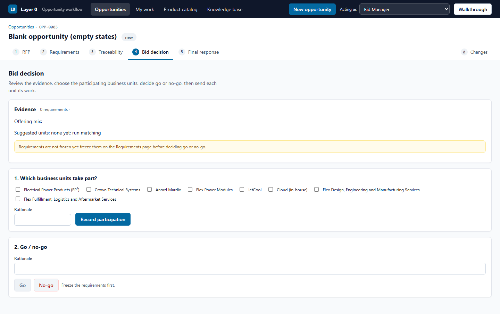

### 12.15 Messages

| Trigger | Message | Kind |
|---|---|---|
| Participation recorded | "Participation recorded." | Success toast (5 seconds) |
| Go recorded | "Decision recorded: go." | Success toast |
| No-go recorded | "Decision recorded: no-go." | Success toast |
| Dispatch with new work | "{n} new assignment(s) sent to the units." | Success toast |
| Dispatch with nothing new | "Nothing new to send: every unit already has its work." | Success toast |
| No unit ticked | "Choose at least one active business unit; not active: []." | Error toast (8 seconds) |
| Go / no-go before the freeze (only reachable from an outdated page) | "Freeze the requirements before deciding go or no-go (review page)." | Error toast |
| Dispatch without a frozen baseline or without go (only reachable from an outdated page) | "Freeze the requirements before dispatch (review page)." / "Dispatch needs a 'go' decision first (decisions page)." | Error toast |
| Two dispatches at once | "Dispatch is already running for this opportunity; refresh and try again." | Error toast |
| No-go clicked | Dialog "Record no-go?" with "The opportunity is marked no-go. Nothing is sent to the units; a later go decision can still overrule it." | Confirmation dialog |
| Not frozen | "Requirements are not frozen yet: freeze them on the Requirements page before deciding go or no-go." and "Freeze the requirements first." | Amber warning box; muted hint |
| Knowledge sent | "Sent to the knowledge base for curation." | Success toast |

### 12.16 Phone layout and accessibility

- Up to 1100 px wide: the page header stacks; tables placed directly in a card (rules, deviations, workload, "How the requirements are satisfied") scroll sideways inside the card instead of widening the page. The criteria table scrolls sideways in its own box at every width.
- Up to 640 px: page side margins become 16 px; the unit checkboxes wrap onto several lines.
- The unit checkboxes form a group with the hidden legend "Business units"; every judgement list and note field has a hidden label naming its criterion; the busy indicators are announced; the confirmation dialog takes focus, keeps Tab inside, and closes with Esc.

### 12.17 API calls made by this screen

| User action or moment | Request | Body | Result on screen |
|---|---|---|---|
| Open, focus, after actions | `GET /api/opportunities/{id}/decisions` | none | All cards |
| Open, focus, after a send | `GET /api/opportunities/{id}/knowledge` | none | Knowledge link or badge after each rationale |
| **Record participation** | `POST /api/opportunities/{id}/participation` | `{"units": [...], "rationale": "..."}` | Toast, reload |
| **Go** / **No-go** (after the dialog) | `POST /api/opportunities/{id}/go-no-go` | `{"outcome": "go" or "no_go", "rationale": "...", "criteria": [{"id", "status", "note"}]}` | Toast, reload, header refresh |
| **Dispatch work packages to units** | `POST /api/opportunities/{id}/dispatch` | `{}` | Toast, reload, header refresh |
| **Send** in the knowledge form | `POST /api/knowledge` | `{"kind": "decision", "ref": "{decision ID}", "note": "..."}` | Toast, badge |

The order in which these calls depend on each other (freeze, then go, then dispatch; re-dispatch after match or participation changes) is described in 04-api-view.md.

### 12.18 Limitations and proposed improvements

Observed in the code (Implemented as described, worth knowing):

- Anyone acting in the shell can record participation, go / no-go and dispatch (section 12.2).
- A go / no-go can be recorded without a participation; a later dispatch then sends every requirement to the bid desk.
- The dispatch toast counts only new assignments; reopened and withdrawn work is not reported on this screen.
- "Suggested units" counts the latest match of every requirement ID, including matches of requirements later merged, split or rejected, while the offering mix counts only current requirements.
- Two criteria questions carry an internal reference from the configuration file (section 12.10).
- A failed re-fetch replaces the whole screen with the error box.

Proposed (not built), from `SUGGESTIONS.md`:

- Bid / no-bid risk scoring from recorded outcomes, shown beside the advice with its sample size (section 1.6). Go / no-go scoring must not be a language-model judgement (section 1.9).
- A customer clarification list built from unanchored items and rule warnings (section 3, item 2).
- Due dates set at dispatch from the RFP's schedule requirements (section 3, item 5).
- Workload versus capacity shown once across all opportunities on the Opportunities screen (section 3, item 14).
- Scope derived from accepted matches instead of keywords, and "scope unknown" instead of "full scope assumed" (section 4.3).
- One thresholds file with a source per value, shown wherever a placeholder value drives a message (section 4.4).

## 13. Screen: Final Response (Step 5)

### 13.1 Route, File and Purpose

| Item | Value |
|---|---|
| Route | `/opportunities/{id}/consolidation` (for example `/opportunities/OPP-0001/consolidation`) |
| File | `web/app/opportunities/[id]/consolidation/page.tsx` (client component) |
| Shell | Rendered inside the opportunity shell (header, step bar and "Changes" link, see section 5). Step "5 Final response" is the current step. |
| Styles | `web/app/styles/consolidation.css` (section "Final response") and the "Final response (consolidation page)" block of `web/app/globals.css` |
| Status | Implemented |

The Final response screen is the coverage check. A coverage check asks one question for every requirement: has each business unit that holds it answered, and has the Bid Manager validated that answer? A requirement counts as **answered** only when every one of its unit assignments has the status `validated`. Everything else blocks the response.

The screen shows:

- how many requirements are answered out of the total;
- why each open requirement is still open, grouped by reason;
- every requirement with its units, their compliance, product and assignment status;
- the two exports of the compliance matrix (CSV and Excel);
- a link to the Response outline (the drafting agent's first draft, section 14).

The screen is read-only. It makes no change through the API (no POST request).

### 13.2 Who Uses It

The Bid Manager uses this screen to see what is still missing before the response can go out, and to download the compliance matrix. The screen has no role-dependent content: every person chosen in "Acting as" (section 4) sees the same page and the same buttons. Business-unit users normally work in My work (section 16), not here.

### 13.3 Screenshots

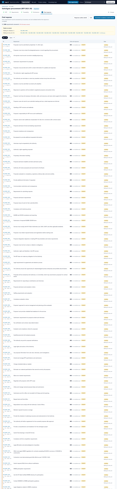

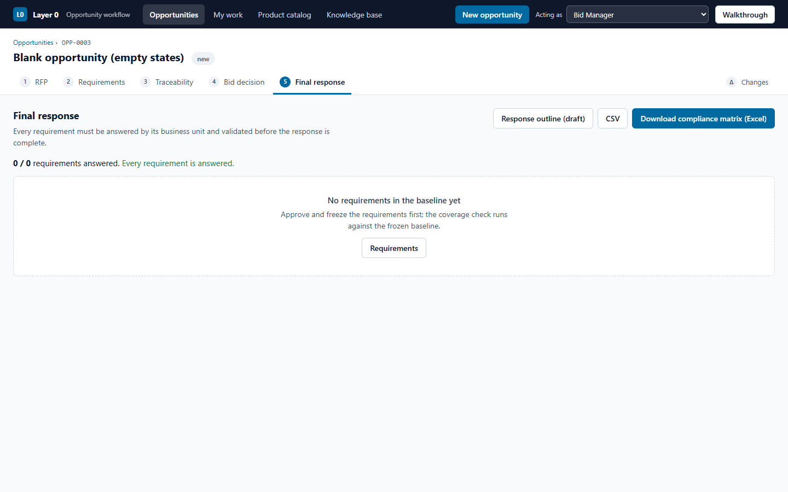

Screenshot 07 was taken before Addendum No. 1 was applied (baseline 1, 348 requirements). Section 13.11 describes the same screen with the live data after the addendum (baseline 2, 349 requirements).

### 13.4 Wireframe

```text
+------------------------------------------------------------------------------------------+
| Opportunity shell: breadcrumb, title, status badge, steps 1-5 (5 current), Changes link  |
+------------------------------------------------------------------------------------------+
| Final response (h2)                     [Response outline (draft)] [CSV] [Download        |
| Every requirement must be answered by its       compliance matrix (Excel)]               |
| business unit and validated before the response is complete.                             |
|                                                                                          |
| 1 / 348 requirements answered. 347 still need an answer.      <- summary line            |
|                                                                                          |
| +-- Needs an answer --------------------------------------------------------------+     |
| | Waiting for validation (1)   REQ-0001-0889                                       |     |
| | Waiting for the unit (346)   REQ-0001-0001 REQ-0001-0002 ... (10 links) > 336 more|     |
| | Returned (n)                 ...                                                 |     |
| | Not assigned (n)             ...                                                 |     |
| +---------------------------------------------------------------------------------+     |
|                                                                                          |
| (All 348) (Open 347)                                           <- filter chips           |
|                                                                                          |
| +---------------+---------------------------+-----------------------------+-----------+ |
| | ID            | Requirement               | Units and responses         | State     | |
| +---------------+---------------------------+-----------------------------+-----------+ |
| ||REQ-0001-0001 | Proposals must be ...     | BID no compliance yet       | pending   | |
| || p. 1, line 5 |                           |     [assigned]              | Waiting   | |
| |               |                           |                             | for the   | |
| |               |                           |                             | unit      | |
| | ...           |                           |                             |           | |
| +---------------+---------------------------+-----------------------------+-----------+ |
|  | = amber stripe on rows that still block                                               |
+------------------------------------------------------------------------------------------+
```

### 13.5 Data Loaded on Open

| Call | When | Used for |
|---|---|---|
| `GET /api/opportunities/{id}/consolidation` | On open; again when the browser tab regains focus or becomes visible (the shared `useApi` hook, section 19) | Everything on the page |

There is no other call. The three header actions are plain links: the browser opens or downloads them itself.

The response has four fields:

| Field | Meaning |
|---|---|
| `rows` | One entry per current requirement in document order: `requirement` (the requirement row with its `source`, for example "p. 1, line 5"), `match` (the product match without its evidence, or null), `assignments` (every unit assignment of the requirement except withdrawn ones) and `state` |
| `total` | Number of rows |
| `answered` | Rows whose `state` is `answered` |
| `blocking` | IDs of every row that is not answered |

`state` per row is `not_assigned` (no assignment), `answered` (every assignment validated) or `pending` (anything else).

Which requirements are rows: the current version of every active requirement of the opportunity (status not rejected, split, merged, duplicate or removed), groups and stand-alone line items, but not sub-requirements. The order is the main RFP first, then change documents in the order they came in; inside a document by page and line; requirements not found in the source come last; a group comes before its own sub-requirements.

### 13.6 Elements in Order

| # | Element | Exact text or content | Behaviour |
|---|---|---|---|
| 1 | Page title (`h2.page-title`) | "Final response" | Shown in every state, including loading and error. It is an `h2` because the opportunity title above it is the page's `h1`. |
| 2 | Help line (`p.page-help`) | "Every requirement must be answered by its business unit and validated before the response is complete." | Shown in every state. |
| 3 | Button-styled link (secondary) | "Response outline (draft)" | Opens `/opportunities/{id}/consolidation/outline` (section 14) in the same tab. Shown once the data has loaded, also when there are no requirements. |
| 4 | Button-styled link (secondary) | "CSV" | Plain link to `/api/opportunities/{id}/compliance-matrix.csv`. The server answers with an attachment, so the browser downloads `{id}-compliance-matrix.csv` and the page stays. See 13.9. |
| 5 | Button-styled link (primary, blue) | "Download compliance matrix (Excel)" | Plain link to `/api/opportunities/{id}/compliance-matrix.xlsx`; the browser downloads `{id}-compliance-matrix.xlsx`. See 13.9. |
| 6 | Summary line (`p.cons-summary`, large type) | Bold "{answered} / {total}" + " requirements answered." then either a red "{n} still need an answer." or a green "Every requirement is answered." | `n` is the number of blocking rows. |
| 7 | "Needs an answer" panel (`section.cons-blockers`) | Heading "Needs an answer", then one line per reason group | Shown only when at least one row is open. See 13.7. |
| 8a | Empty state (only when there are no rows) | Title "No requirements in the baseline yet"; hint "Approve and freeze the requirements first; the coverage check runs against the frozen baseline."; button-styled link (secondary) "Requirements" | The link opens `/opportunities/{id}/requirements` (section 10). Elements 9 to 11 are not shown. |
| 9 | Filter chips (`div.filters`, `role="group"`, `aria-label="Show"`) | "All {total}" and "Open {open count}" | "All" is pressed by default. "Open" shows only the rows that still block. The choice is held in the page only (not saved, not in the URL) and resets when the page is opened again. The pressed chip is dark (`aria-pressed="true"`). |
| 10 | Coverage table (`table.cons-table`) | Columns "ID", "Requirement", "Units and responses", "State" | See 13.8. |
| 11 | Empty table row | "Every requirement is answered." (muted, across all four columns) | Shown when the current filter shows no row, that is when "Open" is pressed and nothing is open. |

The page shows no confirm dialog and no toast message, because it performs no action.

### 13.7 The "Needs an Answer" Panel: Reasons and Rules

The page works out a reason for every open row from the row's assignments. The backend contract has no reason field; the reason is derived in the page:

| Order of checks | Condition on the row | Reason (group label) |
|---|---|---|
| 1 | `state` is `answered` | None (the row is not open) |
| 2 | No assignment at all | "Not assigned" |
| 3 | At least one assignment has status `returned` | "Returned" |
| 4 | Otherwise, at least one assignment has status `assigned` | "Waiting for the unit" |
| 5 | Otherwise (every assignment is `submitted` or `validated`, but not all validated) | "Waiting for validation" |

So a returned answer outranks an unanswered one, which outranks a submitted one.

The groups appear in this fixed order, and only when they contain at least one requirement:

1. "Waiting for validation" - a unit has submitted; the Bid Manager has not yet validated (validation happens in My work, section 16).
2. "Waiting for the unit" - the unit has not yet answered.
3. "Returned" - the Bid Manager returned the answer for rework, or a change document returned it for review (section 15.15).
4. "Not assigned" - the requirement has no unit assignment (work not dispatched, or the requirement was never assigned).

Each group line shows:

| Part | Content | Behaviour |
|---|---|---|
| Label | "{reason} ({count})", for example "Waiting for the unit (346)"; the count in lighter text | Fixed 200 px label column on wide screens |
| ID links | Up to 10 requirement IDs in monospace, in table order | Each opens Traceability with the requirement selected: `/opportunities/{id}/trace#{REQ-ID}` (section 11). Tooltip "Open in Traceability". |
| "more" disclosure | A `details` element whose summary reads "{n} more" (for example "336 more") | Shown only when the group has more than 10 IDs. Opening it lists the remaining IDs as links of the same kind; the opened list takes the full width. |

The panel has `aria-label="Requirements that still need an answer"`, a light amber background and an amber border.

### 13.8 The Coverage Table

| Column | Header class and width | Cell content |
|---|---|---|
| ID | `col-id`, 130 px | The requirement ID as a monospace link to `/opportunities/{id}/trace#{REQ-ID}` (tooltip "Open in Traceability"); below it, in muted text, the requirement's source: "p. {page}, line {n}" or "p. {page}, lines {a}-{b}", or "not found in source" for a requirement that could not be anchored |
| Requirement | free width | The short requirement text approved in the review |
| Units and responses | `col-units`, 30 % | One line per assignment (lines separated by a dashed rule), each with: the unit code in bold (for example "BID", "CROWN"); the compliance as a coloured badge (`met` green, `partial` amber, `not met` red, `exception` blue) or the muted text "no compliance yet"; the product reference in muted text when one is set (for example "CROWN-ARMV"); the assignment status badge (`assigned` amber, `submitted` blue, `validated` green, `returned` red). Withdrawn assignments (work withdrawn at a later dispatch, for example for a removed requirement) are not part of the check and are not shown. With no assignment the cell shows the muted text "not assigned". |
| State | `col-state`, 150 px | The row state as a badge: "answered" (green), "pending" (amber) or "not assigned" (grey; the API value `not_assigned` shown with a space). For an open row, the reason label from 13.7 in muted text below the badge (for example "Waiting for the unit"). |

Rows that still block carry the class `blocking`: a 3 px amber stripe on the left edge of the first cell. Answered rows have no stripe.

The table has no sorting, no paging and no search: it lists every row (349 rows for OPP-0001 today).

### 13.9 Downloads (CSV and Excel)

Both downloads are computed on request from the stored requirements, matches and assignments. Neither uses the model.

| Button | Request | File | Content |
|---|---|---|---|
| "CSV" | `GET /api/opportunities/{id}/compliance-matrix.csv` | `{id}-compliance-matrix.csv`, `text/csv`, starting with a UTF-8 byte order mark so that Excel reads the accents correctly | One row per assignment (a requirement without assignment still gets one row with empty unit columns), in the same order as the table. 14 columns: Requirement ID, Source, Category, Requirement, Quote, Business unit, Product, Offering type, Compliance, Response, Validated by, State, Assignment status, Responded by. A cell that starts like a spreadsheet formula (=, +, -, @, tab, carriage return) is prefixed with an apostrophe so that it cannot run. Sub-requirements are not listed. |
| "Download compliance matrix (Excel)" | `GET /api/opportunities/{id}/compliance-matrix.xlsx` | `{id}-compliance-matrix.xlsx` | Two sheets. "Compliance matrix" is the customer-facing sheet: a title row "Compliance matrix: {opportunity title}", a line "Customer: {customer}    Prepared {date}    Every requirement traces to its page and lines in the RFP.", then one row per requirement in RFP order with its approved sub-requirements indented below it; columns Requirement ID, RFP reference, Requirement, RFP wording, Compliance, Response, Offered by. Compliance is written in customer words (Comply, Partially comply, Does not comply, Exception, or Open until every unit's answer is validated) with a coloured fill. "Tracking" is the internal sheet with the same 14 columns as the CSV. Every cell is written as text, so nothing can run as a formula. |

In both exports, a requirement anchored in a change document names that document first, for example "rfp_syracuse_addendum_1.pdf, p. 1, lines 17-19" for REQ-0001-0977. The screen itself shows only "p. 1, lines 17-19" (see 13.13).

The downloads are offered in every loaded state, also when there are no requirements; the CSV then holds the header line only. The full file formats are in 04-api-view.md (consolidation endpoints).

### 13.10 States

| State | When | What the screen shows |
|---|---|---|
| Loading | Before the first response arrives | Title and help line, no action buttons, a 4-line shimmering placeholder (`aria-busy="true"`, `aria-label="Loading"`) |
| Error | The request failed (for example an unknown opportunity: "Opportunity OPP-9999 not found.") | Title and help line, then a red error box with the server's message. The error box replaces the page body; it also appears if a later automatic refresh (tab focus) fails. |
| Empty | The opportunity has no active requirement (OPP-0003, screenshot 23) | The three actions; "0 / 0 requirements answered." followed by the green "Every requirement is answered." (the empty list counts as fully answered); no panel; the empty state "No requirements in the baseline yet" with the "Requirements" button; no filter and no table |
| Requirements present but not frozen | Requirements exist but the baseline is not frozen and nothing is dispatched (OPP-0004 today: 4 requirements, 1 approved and 3 still proposed) | The check runs on the current active requirements, frozen or not: "0 / 4 requirements answered. 4 still need an answer.", one group "Not assigned (4)", four rows with "not assigned" in both the units cell and the state badge |
| Open work | Some rows are open (OPP-0001, OPP-0002) | Summary with the red count, the "Needs an answer" panel, the filter chips, the table with amber stripes on open rows |
| Open filter on | The "Open" chip is pressed | Only the open rows. If none is open: the single row "Every requirement is answered." |
| Complete | Every row is answered | Summary "{n} / {n} requirements answered. Every requirement is answered." in green; no panel; "Open 0"; no amber stripe |

The opportunity's status is not changed by this screen. The opportunity statuses `consolidating` and `submitted` are never set by the current code (see section 5), so the step "5 Final response" never shows a tick.

### 13.11 Live Data Before and After the Addendum

| Opportunity | Summary line | "Needs an answer" groups | Notes |
|---|---|---|---|
| OPP-0001, before the addendum (screenshot 07) | "1 / 348 requirements answered. 347 still need an answer." | "Waiting for validation (1)": REQ-0001-0889; "Waiting for the unit (346)": 10 links and "336 more" | Answered row REQ-0001-0887: CROWN, met, CROWN-ARMV, validated. Every other row has one BID or unit assignment in status `assigned`. |
| OPP-0001, after Addendum No. 1 was applied (baseline 2, live today) | "0 / 349 requirements answered. 349 still need an answer." | "Waiting for validation (1)": REQ-0001-0889; "Waiting for the unit (347)": 10 links and "337 more"; "Returned (1)": REQ-0001-0887 | The addendum changed sub-requirement REQ-0001-0332 of group REQ-0001-0887, so the validated CROWN answer was returned for review (its note starts "Changed by rfp_syracuse_addendum_1.pdf: sub-requirement REQ-0001-0332 now reads: ..."). The added requirements REQ-0001-0977 (CROWN) and REQ-0001-0978 (BID) appear after the main RFP's anchored requirements with new assignments in status `assigned`. The removed requirement REQ-0001-0130 is no longer listed. |
| OPP-0002 | "1 / 10 requirements answered. 9 still need an answer." | "Waiting for validation (2)": REQ-0002-0007, REQ-0002-0009; "Waiting for the unit (7)" | Answered row REQ-0002-0005: JETCOOL, met, JETCOOL-PLATE, validated |
| OPP-0003 | "0 / 0 requirements answered. Every requirement is answered." | none | Empty state (screenshot 23) |
| OPP-0004 | "0 / 4 requirements answered. 4 still need an answer." | "Not assigned (4)" | Not frozen, not dispatched |

### 13.12 Responsive Behaviour and Accessibility

- Below 1100 px the page head stacks: the title and help line above, the three actions below. The coverage table, which sits directly in the page container, becomes a horizontally scrolling block, so the page itself does not scroll sideways.
- Below 640 px the side gutter becomes 16 px, and each reason label in the "Needs an answer" panel takes the full width, with its ID links on the lines below.
- The filter chips use `aria-pressed` so screen readers announce the active filter. The panel has its own label ("Requirements that still need an answer"). The error box uses `role="alert"`.
- Walkthrough anchors on this screen: `cons-outline-link`, `cons-csv`, `cons-xlsx`, `cons-summary`, `cons-blockers`, `cons-empty`, `cons-filter`, `cons-table`, `cons-col-units`, `cons-col-state` (full list in Appendix B; the walkthrough chapter is described in section 20).

### 13.13 Notes on Current Behaviour

| Observation | Status |
|---|---|
| With no requirements the summary still says "Every requirement is answered." in green above the empty state (screenshot 23), because zero blocking rows is treated as complete. | Implemented (as observed) |
| The empty-state hint says the check "runs against the frozen baseline", but the check reads the current active requirements whether or not a baseline is frozen (OPP-0004 shows 4 unfrozen rows). | Implemented (as observed) |
| The source under each ID is the page and lines only. For a requirement anchored in a change document the screen does not name that document (REQ-0001-0977 shows "p. 1, lines 17-19"); the CSV, Excel and Markdown exports and the Response outline do name it ("rfp_syracuse_addendum_1.pdf, p. 1, lines 17-19"). The walkthrough text for this table describes the export behaviour. | Implemented (as observed) |
| "Send to knowledge base" is not offered on this screen. It is offered for validated answers on the Response outline (section 14.9) and in Traceability (section 11), and for decision rationales on the Bid decision screen (section 12). | Implemented |
| The step bar never ticks "5 Final response", because no code sets the opportunity status `submitted`. Marking the response as submitted is not built. | Proposed (not built) |

## 14. Screen: Response Outline

### 14.1 Route, File and Purpose

| Item | Value |
|---|---|
| Route | `/opportunities/{id}/consolidation/outline` |
| File | `web/app/opportunities/[id]/consolidation/outline/page.tsx` (client component), using `web/components/knowledge/SendToKnowledge.tsx` |
| Shell | Inside the opportunity shell (section 5). It is a sub-page of the Final response step, so the step bar marks "5 Final response" as current. It is reached from the "Response outline (draft)" button on the Final response screen (or by its URL). |
| Styles | `web/app/styles/consolidation.css` (section "Response outline") and the "Response outline" block of `web/app/globals.css` |
| Status | Implemented |

The Response outline is a first draft of the written response, for the Bid Manager to edit. A drafting agent (a model call with fixed rules) writes it **only from validated answers**. It never writes about a requirement that is still open. Every drafted paragraph cites the requirements it rests on. Writing the final response stays a human task: the screen offers the draft as a Markdown file to paste into the proposal template and edit.

The outline follows the structure of a proposal, not the RFP's own headings. It has an executive summary and up to six chapters, each built from requirement categories:

| Chapter | Title shown | Requirement categories |
|---|---|---|
| 1 | Technical response | technical |
| 2 | Compliance, legal and contract terms | compliance, legal |
| 3 | Commercial terms and schedule | commercial, schedule |
| 4 | Project team and staffing | staffing |
| 5 | Submission requirements | submission |
| 6 | Other requirements | any other category |

A chapter with no requirement is left out, and the numbers on screen run 1, 2, 3 and so on over the chapters that exist. The executive summary is drafted from the first 40 validated answers in RFP order.

### 14.2 Who Uses It

The Bid Manager. The page has no role-dependent content. Any acting person can use "Send to knowledge base" on a validated answer; only the knowledge curator (in this version, the Bid Manager) later approves it on the Knowledge base screen (section 18).

### 14.3 Screenshot


The screenshot shows OPP-0001 before Addendum No. 1 was applied, when one answer (REQ-0001-0887) was validated. Section 14.13 describes the live state after the addendum, when no answer is validated and nothing is drafted.

### 14.4 Wireframe

```text
+------------------------------------------------------------------------------------------+
| Opportunity shell: breadcrumb, title, status badge, steps (5 Final response current)     |
+------------------------------------------------------------------------------------------+
| Response outline (h2)                       [Back to Final response] [Download outline   |
| A first draft for the bid manager to edit, written by          (Markdown)]               |
| the drafting agent only from validated answers. ...                                      |
|                                                                                          |
| [Draft] 1 / 348 requirements answered and validated (1 validated answers). <API note>    |
|                                                                                          |
| +-- Executive summary -------------------------------------------------------------+     |
| | Paragraph text ... [REQ-0001-0887]                                               |     |
| | +-- To add or confirm ---------------------------------------------------------+ |     |
| | | * gap 1   * gap 2   * gap 3   * gap 4                                        | |     |
| | +------------------------------------------------------------------------------+ |     |
| +----------------------------------------------------------------------------------+     |
|                                                                                          |
| +-- 1. Technical response            1 of 146 answered ---------------------------+     |
| | Paragraph text ... [REQ-0001-0887]                                               |     |
| | [To add or confirm box]                                                          |     |
| | [! Not full compliance: REQ-... Unit: Partially comply; ...]  (only if any)      |     |
| | > Validated answers (1)        (collapsed; table with Send to knowledge base)    |     |
| | > Still open (145)             (collapsed; first 8, then "and N more")           |     |
| | > Related passages             (collapsed; RFP index and past responses)         |     |
| +----------------------------------------------------------------------------------+     |
| +-- 2. Compliance, legal and contract terms   0 of 84 answered -------------------+     |
| | Not drafted: No validated answer yet.                                            |     |
| | > Still open (84)                                                                |     |
| | > Related passages                                                               |     |
| +----------------------------------------------------------------------------------+     |
| ... one card per chapter                                                                 |
+------------------------------------------------------------------------------------------+
```

### 14.5 Data Loaded on Open

| Call | When | Used for |
|---|---|---|
| `GET /api/opportunities/{id}/response-outline` | On open; again when the browser tab regains focus or becomes visible | The whole outline |
| `GET /api/opportunities/{id}/knowledge` | On open, on focus, and again after each successful "Send" | Which items were already sent to the knowledge base, as a map from "`<kind>:<ref>`" to status (OPP-0001 today: `{"requirement:REQ-0001-0002": "queued"}`) |

The outline request is synchronous and is computed again on every request; nothing is stored. It makes one model call (task `draft_outline`) per chapter that has validated answers, plus one for the executive summary when any validated answer exists. Chapters without validated answers make no call. In the offline demo the calls are answered only from the committed frozen answers (eight are committed). On OPP-0001 the response comes back in well under a second.

The response holds:

| Field | Content |
|---|---|
| `opportunity` | `id`, `title`, `customer` (not shown on the page; the title is used in the Markdown file) |
| `total`, `answered` | The same counts as the Final response coverage check (section 13) |
| `validated_answers` | Number of validated, non-empty unit answers across all chapters |
| `summary` | The executive summary draft |
| `chapters[]` | Per chapter: `id`, `title`, `total`, `answered`, `draft`, `material` (its validated answers), `exceptions` (validated answers whose compliance is not "Comply"), `open` (every requirement of the chapter that is not answered, with `req_id`, `source`, `text`, `state`), `references` |
| `note` | "A first draft for the bid manager to edit, written only from validated answers; every paragraph cites its requirements. Writing the final response stays a human task." |

A draft is `{drafted, paragraphs[{text, sources[]}], gaps[], dropped, note}`. A validated answer is `{assignment_id, req_id, source, bu, unit, compliance, product, requirement, wording, response}`: `compliance` is in customer words (Comply, Partially comply, Does not comply, Exception); `unit` is the unit's name ("Bid desk" for BID); `product` is the catalog name of the product reference. `bu`, `requirement` and `wording` are in the payload but not shown.

### 14.6 Elements in Order

The page body is wrapped in `div.outline`.

| # | Element | Exact text or content | Behaviour |
|---|---|---|---|
| 1 | Page title (`h2`) | "Response outline" | Shown in every state |
| 2 | Help line | "A first draft for the bid manager to edit, written by the drafting agent only from validated answers. Every paragraph cites its requirements; nothing is drafted for open ones." | Shown in every state |
| 3 | Button-styled link (secondary) | "Back to Final response" | Opens `/opportunities/{id}/consolidation` (section 13). Shown in every state, also while loading. |
| 4 | Button-styled link (primary) | "Download outline (Markdown)" | Plain link to `/api/opportunities/{id}/response-outline.md`; the browser downloads `{id}-response-outline.md` (see 14.12). Shown only after the outline has loaded. |
| 5 | Summary line (`p.outline-summary`) | Amber badge "Draft", bold "{answered} / {total}", " requirements answered and validated ({validated_answers} validated answers).", then the API `note` in muted text | For example "Draft 1 / 348 requirements answered and validated (1 validated answers). A first draft for the bid manager to edit, written only from validated answers; every paragraph cites its requirements. Writing the final response stays a human task." |
| 6 | Card "Executive summary" | Heading "Executive summary" and the summary's draft block (14.7) | Always shown once loaded |
| 7 | Empty state (only with no chapter) | Title "No chapters to draft yet"; hint "The outline follows the RFP's sections once the requirements are frozen." | No button |
| 8 | One card per chapter | See 14.8 | In chapter order |

There is no confirm dialog on this page, and the only toast is the one from "Send to knowledge base".

### 14.7 The Draft Block (Drafted or Not Drafted)

The same block renders the executive summary and each chapter's draft.

| Case | Condition | What is shown |
|---|---|---|
| Drafted | `drafted` is true (at least one paragraph kept) | One paragraph per drafted paragraph (`p.outline-para`, line height 1.6, at most 80 characters wide): the text, a space, then in muted text the cited requirement IDs in square brackets, comma-separated, each a monospace link to `/opportunities/{id}/trace#{REQ-ID}` (tooltip "Open in Traceability"). Then, when the agent listed gaps, an amber box (`div.outline-gaps`) with the bold title "To add or confirm" and a bullet list of up to 4 items. Then the draft's note in muted text, when there is one. |
| Not drafted | `drafted` is false | One muted line: "Not drafted: {note}" |

The notes the backend can send:

| Note | Meaning |
|---|---|
| "No validated answer yet." | The chapter (or, for the summary, the whole opportunity) has no validated answer. Nothing is drafted and no model call is made. |
| "Draft not refreshed: the model service is not connected in this demo, so the validated answers are shown as they are." | The model answer is not available offline: the set of validated answers changed since the frozen answers were recorded. The page then reads "Not drafted: Draft not refreshed: ..." and the validated answers stay visible in the "Validated answers" table. Nothing is guessed. |
| "{n} paragraph(s) without a valid citation removed." | The citation guard removed paragraphs whose citations were missing or pointed outside the numbered answers. Shown under a drafted block. If every paragraph was removed, the block reads "Not drafted: {n} paragraph(s) without a valid citation removed." |
| (empty) | A normal drafted block; no note line |

The drafting rules behind the text (model instructions, the citation guard, past responses used for tone only) are described in 02-technical-architecture.md and 04-api-view.md.

### 14.8 The Chapter Card

Each chapter is a `section.card` with these parts, in order:

| # | Part | Content | Shown when |
|---|---|---|---|
| 1 | Heading line | `h3` "{n}. {title}" (for example "1. Technical response") and, in muted text, "{answered} of {total} answered" | Always |
| 2 | Draft block | As in 14.7 | Always |
| 3 | "Not full compliance" warning | An amber warning box titled "Not full compliance" listing, separated by "; ", each validated answer whose compliance is not "Comply": the requirement ID link, the unit name, ": " and the compliance word (pattern "REQ-… Bid desk: Partially comply") | The chapter has at least one such answer |
| 4 | "Validated answers ({n})" | A collapsed `details` element; opening it shows the table in 14.9 | The chapter has at least one validated answer |
| 5 | "Still open ({n})" | A collapsed `details` element; see 14.10 | The chapter has at least one open requirement |
| 6 | "Related passages" | A collapsed `details` element; see 14.11 | The RFP search or the knowledge search returned at least one passage |

All `details` elements start closed; their summary text is bold and clickable.

### 14.9 Validated Answers Table and "Send to Knowledge Base"

The table (`table.outline-answers`, inside a horizontal scroll box) has one row per validated answer of the chapter:

| Column | Content |
|---|---|
| Requirement | The requirement ID as a link to Traceability (tooltip "Open in Traceability"); below it, in muted text, the source. A requirement anchored in a change document names the document first ("rfp_syracuse_addendum_1.pdf, p. 1, lines 17-19"). |
| Unit | The unit's name (for example "Crown Technical Systems", "JetCool", "Bid desk"); below it, in muted text, the product name when one is set (for example "Arc-resistant metal-clad MV switchgear") |
| Compliance | The customer word as a badge ("Comply", "Partially comply", "Does not comply", "Exception"). These words are not in the badge colour table, so the badge is grey. |
| Answer | The unit's answer text (column at least 320 px wide) |
| Knowledge base | The "Send to knowledge base" control for this answer (kind `response`, reference = the assignment ID) |

The "Send to knowledge base" control is a shared component (section 19). In this table it behaves as follows:

| State | What the cell shows | Action |
|---|---|---|
| Not sent (or sent and later rejected) | Link-styled button "Send to knowledge base" | Opens an inline form in the cell |
| Form open | Text input with placeholder "Why keep it? (optional)" (screen-reader label "Note for the curator", at most 2000 characters, focused on open), button "Send", button "Cancel" | "Send" posts `POST /api/knowledge` with `{"kind": "response", "ref": "<assignment id>", "note": "<note>"}`. While sending, the button reads "Sending…" and the controls are disabled. On success the form closes, the page reloads the sent-items map and the toast "Sent to the knowledge base for curation." appears. On failure the server's message appears in red next to the buttons ("Already {status} as {knowledge ID}." when the answer is already queued or approved, or "Only validated answers go to the knowledge base." when it is no longer validated). "Cancel" closes the form without a request. |
| Queued | Amber badge "sent to knowledge base" | None |
| Approved | Green badge "in knowledge base" | None |

Live examples: OPP-0001 before the addendum (inside the collapsed "Validated answers (1)" in screenshot 08): REQ-0001-0887 (p. 55, lines 7-65) | Crown Technical Systems / Arc-resistant metal-clad MV switchgear | Comply | "Two-section 15 kV arc-resistant metal-clad lineup offered." | "Send to knowledge base". OPP-0002 today: REQ-0002-0005 (p. 1, line 9) | JetCool / Direct-to-chip cold plates | Comply | "Direct-to-chip cold plates with row-level CDUs sized for 120 kW per rack." | "Send to knowledge base".

### 14.10 "Still Open" List and the "and N More" Rule

Opening "Still open ({n})" shows a bullet list of the chapter's open requirements in RFP order. Each item shows the requirement ID as a link to Traceability, the source in muted text (a change document is named first) and the requirement text.

Only the first 8 open requirements are listed. When a chapter has more than 8, a muted line follows: "and {n - 8} more: see Final response." in which "Final response" links to `/opportunities/{id}/consolidation`. For example, chapter 1 of OPP-0001 today lists 8 of 147 and then "and 139 more: see Final response.".

The Markdown download (14.12) lists every open requirement, without this limit.

### 14.11 Related Passages (Two Retrieval Indexes)

"Related passages" shows search results from the two retrieval indexes beside the draft, for the Bid Manager to read. They are never given to the drafting agent. The search query is the chapter title plus the texts of the chapter's first three requirements.

| Part | Heading (muted) | Items |
|---|---|---|
| Short-term index: the opportunity's own RFP | "In this RFP ({mode} search)" | Up to 3 passages of the main RFP, each "p. {page}, lines {a}-{b}" in monospace followed by the passage text (first 300 characters) |
| Long-term index: past responses and approved knowledge | "Past responses ({mode} search; illustrative)" | Up to 3 past responses, each its ID in monospace (for example "PAST-EP2-002") followed by its text (first 300 characters). The bundled past responses are illustrative demo data. Knowledge items approved by the curator join this index (section 18). |

`{mode}` is "embeddings" (semantic search) or "keywords" (the offline fallback when embeddings are not available). In the demo both indexes report "embeddings". When the main RFP has not been read, the RFP part is left out. A part with no result is left out; when both parts are empty the whole "Related passages" element is not shown.

Live example: OPP-0001 chapter 5 "Submission requirements" shows three RFP passages and one past response (PAST-EP2-002); chapters 1 to 4 show RFP passages only.

### 14.12 Markdown Download

"Download outline (Markdown)" requests `GET /api/opportunities/{id}/response-outline.md`. The server computes the whole outline again (the same model calls or frozen answers) and returns `text/markdown` as an attachment named `{id}-response-outline.md` (33,655 bytes for OPP-0001 today). The file layout:

```text
  # Response outline: <opportunity title>

DRAFT for the bid manager to edit. <answered> of <total> requirements answered and validated.

  ## Executive summary

<paragraph> [<REQ>, <REQ>]          (or: _Not drafted: <note>_)
- To add or confirm: <gap>

  ## <n>. <chapter title>

<answered> of <total> requirements answered.

<paragraphs, or _Not drafted: <note>_>

  ### Validated answers

- <REQ> (<source>), <unit name>, <compliance word>: <answer>

  ### Still open (<count>)

- <REQ> (<source>): <requirement text>
```

The live OPP-0001 file today starts with "# Response outline: Switchgear procurement (RFP 2023-20)", "DRAFT for the bid manager to edit. 0 of 349 requirements answered and validated.", "## Executive summary" and "_Not drafted: No validated answer yet._".

### 14.13 States

| State | When | What the screen shows |
|---|---|---|
| Loading | Before the outline arrives | Title, help line, "Back to Final response" (no download button), a spinner with the text "Drafting the outline…" (`role="status"`) and a 4-line placeholder |
| Error | The outline request failed (for example "Opportunity OPP-9999 not found.") | Title, help line, "Back to Final response", and a red error box with the server's message |
| No chapters | No active requirement (OPP-0003) | "Draft 0 / 0 requirements answered and validated (0 validated answers)." with the note; the "Executive summary" card with "Not drafted: No validated answer yet."; the empty state "No chapters to draft yet" |
| Chapters, nothing validated | Requirements exist but no answer is validated (OPP-0001 today, OPP-0004) | Every block "Not drafted: No validated answer yet."; each chapter shows "Still open ({n})" and, where found, "Related passages"; no "Validated answers" element. OPP-0001 today: "0 / 349 requirements answered and validated (0 validated answers).", chapters 1 Technical response (0 of 147), 2 Compliance, legal and contract terms (0 of 85), 3 Commercial terms and schedule (0 of 20), 4 Project team and staffing (0 of 11), 5 Submission requirements (0 of 86). OPP-0004 (not frozen): 1 Technical response (0 of 3), 2 Commercial terms and schedule (0 of 1). |
| Drafted | A frozen model answer exists for the chapter's validated answers (OPP-0001 before the addendum, screenshot 08) | Drafted paragraphs with citations, "To add or confirm" boxes, "Validated answers (1)", "Still open (145)", "Related passages"; chapters 2 to 5 not drafted |
| Model answer not available offline | Validated answers exist, but no frozen answer matches them (OPP-0002 today) | Executive summary and chapter 1 read "Not drafted: Draft not refreshed: the model service is not connected in this demo, so the validated answers are shown as they are."; chapter 1 (1 of 8 answered) still shows "Validated answers (1)" with the JetCool answer and its "Send to knowledge base" control, "Still open (7)" and "Related passages" (two RFP passages, two past responses) |
| Exceptions | A validated answer is not "Comply" | The amber "Not full compliance" box in that chapter (no such answer exists in the demo data today) |
| Paragraphs removed | The guard dropped paragraphs without a valid citation | The muted note "{n} paragraph(s) without a valid citation removed." under the draft |

The outline follows the Final response coverage: it changes when a unit's answer is validated in My work (section 16), or when a change document returns answers for review (section 15.15). There is nothing to save on this page.

### 14.14 Responsive Behaviour and Accessibility

- Below 1100 px the page head stacks (title and help above, the two buttons below). The validated-answers table scrolls sideways inside its own box; drafted paragraphs keep a readable width of at most 80 characters.
- Below 640 px the side gutter becomes 16 px.
- The collapsed parts are native `details` and `summary` elements, which work with the keyboard (Enter or Space toggles). The warning box uses `role="alert"`; the loading spinner uses `role="status"`; the "Send to knowledge base" input has the accessible label "Note for the curator".
- Walkthrough anchors on this screen: `outline-back`, `outline-download`, `outline-summary`, `outline-exec`, `outline-empty`, `outline-chapter-{n}` and, on the first block of each kind only, `outline-drafted`, `outline-gaps`, `outline-not-drafted`, `outline-exceptions`, `outline-answers`, `outline-open`, `outline-refs`; the "Send to knowledge base" control carries `kb-send-button`, `kb-send-form`, `kb-send-note`, `kb-send-submit` (Appendix B).

## 15. Screen: Changes

### 15.1 Route, Files and Purpose

| Item | Value |
|---|---|
| Route | `/opportunities/{id}/changes` |
| Page file | `web/app/opportunities/[id]/changes/page.tsx` (client component) |
| Components | `web/components/changes/ChangeSetCard.tsx` (one change set), `web/components/changes/ChangeDecision.tsx` (the per-statement decision), `web/components/changes/ChangeDocument.tsx` (the change document page with highlights) |
| Shell | Inside the opportunity shell (section 5). The screen is not a numbered step: it is reached from the separate link "Changes" (with the "Δ" marker) at the right of the step bar, which is marked current on this screen. |
| Styles | `web/app/styles/consolidation.css` (section "Changes") and the "Changes" block of `web/app/globals.css`; the page image and highlight boxes reuse the Traceability styles (`.pager`, `.page`, `.hl`) |
| Status | Implemented |

The Changes screen handles what a customer issues after the RFP: an addendum, answers to bidders' questions (Q&A) or a change request. Such a document is called a **change document**. It is read like the RFP and compared with the **frozen baseline** (the approved requirement list that was frozen on the Requirements screen, section 10).

The flow on this screen:

1. A person uploads the change document as a PDF.
2. The change agent lists every **change statement** in it (a verbatim quote with its page and lines) and proposes, for each statement, how it affects the baseline: Added, Modified, Removed, Unchanged or Not a requirement, with the baseline requirement it is about, a confidence and a rationale.
3. A person confirms or corrects every proposal.
4. The Bid Manager applies the confirmed set. Applying freezes the next baseline (new requirement versions, new IDs, removals), returns the affected unit answers for review, matches what is new or changed, and dispatches new work when work was dispatched before.

All proposals, decisions and the result stay visible on the screen as a **change set** (one card per change document read).

### 15.2 Who Uses It

| Action | Who may do it | How the screen enforces it |
|---|---|---|
| Open the screen, read change sets | Anyone | No restriction |
| Read a change document (upload) | Anyone acting in the application | No role check; the API checks the rules in 15.7 |
| Confirm or change a classification; "Confirm all proposals" | Anyone ("agents propose, a person confirms") | No role check |
| "Apply to requirements", "Discard" | Only the person acting as "Bid Manager" | Both buttons are disabled for anyone else, and the explanatory text adds "; switch with Acting as". The API also refuses with HTTP 403 ("Only the Bid Manager applies a change set." / "Only the Bid Manager discards a change set."). |

The role check compares the "Acting as" name (section 4 and section 6) with the exact text "Bid Manager". Real sign-in and roles are not built in this version.

### 15.3 Screenshots

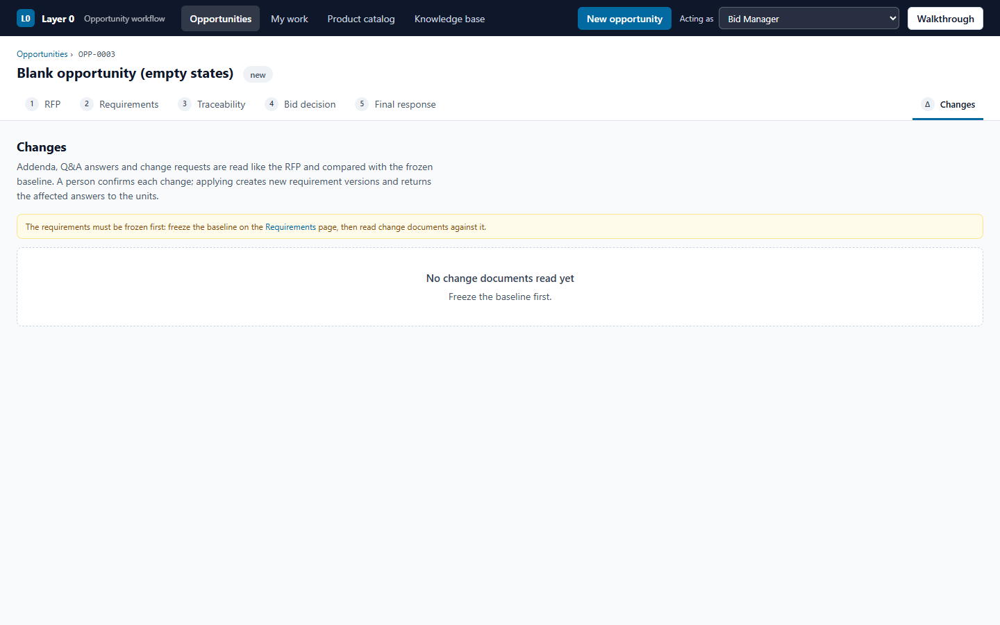


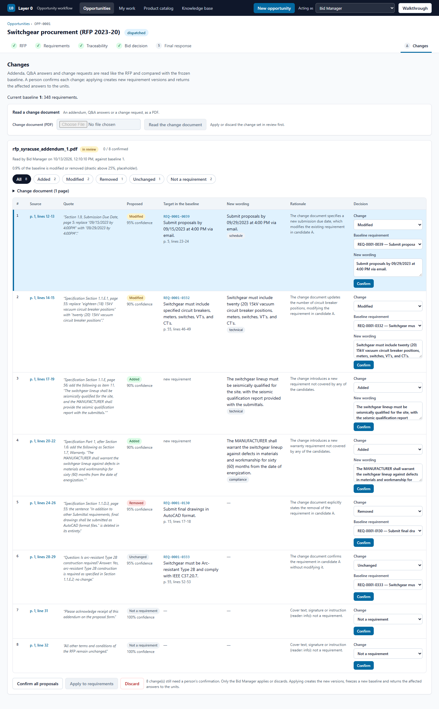

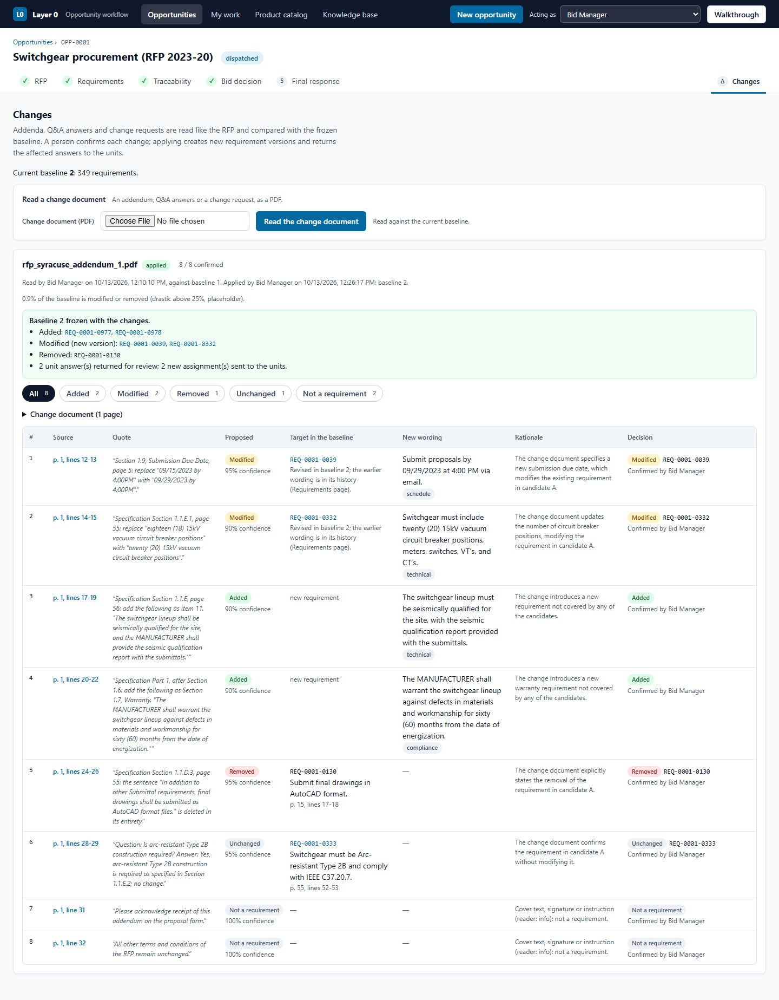

### 15.4 Wireframes

The page:

```text
+------------------------------------------------------------------------------------------+
| Opportunity shell: breadcrumb, title, status badge, steps 1-5   ...   [Δ Changes] current |
+------------------------------------------------------------------------------------------+
| Changes (h2)                                                                             |
| Addenda, Q&A answers and change requests are read like the RFP and compared with the     |
| frozen baseline. A person confirms each change; applying creates new requirement ...     |
|                                                                                          |
| Current baseline 1: 348 requirements.          (or the amber "must be frozen first" box) |
|                                                                                          |
| +-- Read a change document   An addendum, Q&A answers or a change request, as a PDF. --+ |
| | Change document (PDF) [Choose File | No file chosen] [Read the change document]       | |
| |                                                  Read against the current baseline.  | |
| | [error box, only after a failed upload]                                         [x]  | |
| +--------------------------------------------------------------------------------------+ |
|                                                                                          |
| Empty state "No change documents read yet"                                               |
|   - or -                                                                                 |
| [change set card, newest first]  (see below)                                             |
| [earlier change set cards]                                                               |
+------------------------------------------------------------------------------------------+
```

One change set card:

```text
+-- rfp_syracuse_addendum_1.pdf [in review]            0 / 8 confirmed -------------------+
| Read by Bid Manager on 10/13/2026, 12:10:10 PM, against baseline 1.                      |
| 0.9% of the baseline is modified or removed (drastic above 25%, placeholder).            |
| [green result box: Baseline 2 frozen with the changes. Added / Modified / Removed ...]   |
|   (only after apply)                                                                     |
| (All 8) (Added 2) (Modified 2) (Removed 1) (Unchanged 1) (Not a requirement 2)           |
| > Change document (1 page)        (collapsed: pager, page image with highlight boxes)    |
| +---+--------------+--------+------------+-------------+-----------+---------+---------+ |
| | # | Source       | Quote  | Proposed   | Target in   | New       | Ratio-  | Decision| |
| |   |              |        |            | the baseline| wording   | nale    |         | |
| +---+--------------+--------+------------+-------------+-----------+---------+---------+ |
| | 1 | p. 1, lines  | "Sect- | [Modified] | REQ-0001-   | Submit    | The     | Change  | |
| |   | 12-13 (link) | ion..."| 95% conf.  | 0039 + text | proposals | change  | [select]| |
| |   |              |        |            | p. 5, ...   | [schedule]| ...     | Baseline| |
| |   |              |        |            |             |           |         | [select]| |
| |   |              |        |            |             |           |         | New     | |
| |   |              |        |            |             |           |         | wording | |
| |   |              |        |            |             |           |         | [text]  | |
| |   |              |        |            |             |           |         |[Confirm]| |
| +---+--------------+--------+------------+-------------+-----------+---------+---------+ |
| [Confirm all proposals] [Apply to requirements] [Discard]  8 change(s) still need a      |
|   person's confirmation. Only the Bid Manager applies or discards. Applying creates ...  |
|   (action bar only while the set is in review)                                           |
+------------------------------------------------------------------------------------------+
```

### 15.5 Data Loaded on Open

| Call | When | Used for |
|---|---|---|
| `GET /api/opportunities/{id}/changes` | On open; on tab focus or visibility; after every upload, decision, "Confirm all proposals", "Apply to requirements" and "Discard" | The baseline line, the threshold and every change set |
| `GET /api/documents/{document id}/pages/{n}.png` | When the change document viewer is open and shows page `n` | The page image of the change document |

After every decision, "Confirm all proposals", "Apply to requirements" and "Discard", the page also sends the browser event `opp-status-changed`, so the opportunity header (section 5) refreshes at once instead of at its next 5-second poll.

The response:

| Field | Content |
|---|---|
| `baseline` | `{number, count}` of the latest frozen baseline, or null when none is frozen |
| `drastic_threshold` | 0.25 (a placeholder value in the code, marked there as needing confirmation) |
| `sets` | Every change set of the opportunity, newest first |

Each set carries `id`, `opportunity_id`, `document_id`, `filename`, `status` (`review`, `applied` or `discarded`), `created_by`, `created_at`, `applied_by`, `applied_at`, `baseline_from` (the baseline it was compared with), `baseline_to` (the baseline it created), `counts` (per kind, using the person's decision where there is one, else the proposal), `confirmed`, `total`, `share` (modified plus removed, divided by the size of `baseline_from`, rounded to 3 decimals), `drastic` (share above 0.25), `pages` (page sizes of the change document), `result` (after apply) and `items`.

Each item (change statement) carries `id`, `n` (its number in document order), `page`, `line_start`, `line_end`, `bboxes` (highlight boxes), `source` (for example "p. 1, lines 12-13"), `quote`, `text` (the requirement as it reads after the change), `category`, `action` (what the document says it does: add, modify, delete, clarify or info), `proposed_kind`, `proposed_target`, `rationale`, `confidence`, `kind` and `target` (the person's decision), `status` (`proposed` or `confirmed`), `decided_by`, `target_text` and `target_source` (the target's wording and source in the baseline the set was compared with) and `candidates` (the up to five baseline requirements shown to the agent).

### 15.6 Page Elements in Order

| # | Element | Exact text or content | Shown when |
|---|---|---|---|
| 1 | Page title (`h2`) | "Changes" | Always, also while loading and on error |
| 2 | Help line | "Addenda, Q&A answers and change requests are read like the RFP and compared with the frozen baseline. A person confirms each change; applying creates new requirement versions and returns the affected answers to the units." | Always |
| 3a | Baseline line | "Current baseline **{number}**: {count} requirements." (for example "Current baseline 1: 348 requirements.") | A baseline is frozen |
| 3b | No-baseline warning (amber box) | "The requirements must be frozen first: freeze the baseline on the Requirements page, then read change documents against it." "Requirements" is a link to `/opportunities/{id}/requirements`. | No baseline is frozen |
| 4 | "Read a change document" form | See 15.7 | A baseline is frozen |
| 5a | Empty state | Title "No change documents read yet"; hint "Read an addendum, Q&A answers or a change request above; each change statement is compared with the frozen baseline." (with a baseline) or "Freeze the baseline first." (without) | No change set exists |
| 5b | Change set cards | One card per change set, newest first (15.9 to 15.16) | At least one change set exists |

### 15.7 Read a Change Document (Upload Form)

The form is a card (`form.card.chg-upload`):

| Part | Exact text | Behaviour |
|---|---|---|
| Card heading | "Read a change document" | - |
| Card hint (muted) | "An addendum, Q&A answers or a change request, as a PDF." | - |
| Label | "Change document (PDF)" | Labels the file input |
| File input | Browser's own file chooser ("Choose File", "No file chosen" in an English browser) | Accepts `.pdf` / `application/pdf`; required (the browser shows its own message when nothing is chosen). Disabled while a set is in review or while a read is running. |
| Button | "Read the change document" | Submits the form. Disabled while a set is in review or while a read is running. |
| Hint next to the button | "Read against the current baseline." or, while a set is in review, "Apply or discard the change set in review first." | Replaced by a spinner with the text "Reading the change document…" while the read is running |
| Error box (red, dismissible with "×") | The server's message | Shown after a failed read; "×" (accessible name "Dismiss") clears it |

What happens on "Read the change document":

1. The page sends `POST /api/opportunities/{id}/changes` as a multipart form with the field `file`.
2. The request is synchronous: the server stores the file with the document role "change", reads its layout like the RFP, runs the change agent (model task `read_changes`) to list the statements, ranks up to five candidate baseline requirements per statement (TF-IDF text similarity, the same online and offline), and runs the classifier (model task `classify_change`). Statements the reader marks as information (cover text, signatures, "acknowledge receipt") are "Not a requirement" by rule, with no model call. In the offline demo both tasks are answered only from frozen answers.
3. On success the form is cleared, the page reloads, and the toast "Change document read. Confirm each change below." appears. The new set appears at the top of the list, in review.
4. On failure the chosen file stays selected (the form is handled on submit for this reason) and the error box shows the server's message.

The server refuses a read, and creates no change set, in these cases (HTTP 409 unless stated):

| Server message | Cause |
|---|---|
| "Opportunity {id} not found." (404) | Unknown opportunity |
| "Freeze the requirements first: a change document is compared with the frozen baseline." | No baseline (the form is hidden in that case, so this is reached only through the API) |
| "{file name} (change set {n}) is still in review: apply or discard it first." | Another set is in review (the form is disabled in that case) |
| "Upload the change document as a PDF." | The file name does not end in ".pdf" |
| "This file is the main RFP of {id}, not a change document." | The same file was uploaded as the main RFP |
| "{file name} was already applied (change set {n}, baseline {m})." | This file already has an applied change set (a discarded one may be read again) |
| "{file name} could not be read: {reason}" | The PDF could not be parsed |
| "The change agent found no statements in {file name}." | Nothing to compare |
| "No frozen answers exist for {file name} in this offline demo; connect the model service to read new documents." | Offline mode and no frozen answer for this document and baseline. In the demo only the bundled Addendum No. 1 read against OPP-0001's baseline 1 has frozen answers. |

When a read fails after the file was stored (for example for want of a frozen answer), the stored file, its layout and its "uploaded" audit event remain, although no change set is created.

### 15.8 Loading the Bundled Addendum Sample

The Changes screen itself does not offer the bundled sample: there is no sample button or list on the page. Two ways exist to read the illustrative Addendum No. 1:

| Way | How |
|---|---|
| File input | Choose `data/RFP/samples/rfp_syracuse_addendum_1.pdf` from the repository and click "Read the change document". |
| Guided walkthrough | Chapter "Addenda and change handling" (section 20) shows the button "Use example: Addendum No. 1 (Syracuse)" in the walkthrough panel. It calls `POST /api/opportunities/OPP-0001/changes/from-sample` with `{"name": "syracuse_addendum_1"}`, which goes through exactly the same read as an upload. The chapter always runs on OPP-0001 and skips this step when a set in review or an applied set already exists. |

The sample is a one-page illustrative addendum written for this proof of concept: two modifications (a new submission date; twenty instead of eighteen breaker positions), two additions (seismic qualification; a 60-month warranty), one deletion (AutoCAD drawings), one question and answer that confirms the RFP, and two lines of cover text. Its frozen answers match only the demo opportunity's requirement set; on any other opportunity the read fails with the "No frozen answers" message.

### 15.9 Change Set Card: Heading, Meta Line and Share of the Baseline

Each change set is a card (`section.card.chg-set`, labelled by its heading).

| # | Part | Exact text | Notes |
|---|---|---|---|
| 1 | Heading (`h3`) | "{file name}" followed by a status badge: "in review" (amber), "applied" (green) or "discarded" (grey) | For example "rfp_syracuse_addendum_1.pdf [in review]" |
| 2 | Confirmed count (muted, right of the heading) | "{confirmed} / {total} confirmed" | For example "0 / 8 confirmed", later "8 / 8 confirmed" |
| 3 | Meta line (muted) | "Read by {person} on {date and time}, against baseline {n}." | Followed, for an applied set, by " Applied by {person} on {date and time}: baseline {m}."; for a discarded set by " Discarded: nothing was applied." (the code would also name who discarded and when, but the server does not record them for a discard). Dates and times are shown in the browser's own format and time zone; in the screenshots "10/13/2026, 12:10:10 PM", that is 13 Oct 2026 at 12:10 local time. |
| 4a | Share line (muted), normal case | "{share} of the baseline is modified or removed (drastic above {threshold}, placeholder)." | For example "0.9% of the baseline is modified or removed (drastic above 25%, placeholder)." |
| 4b | Drastic warning (red box), when the share is above the threshold | Title "Drastic change", then bold "{share} of the baseline is modified or removed" and " (threshold {threshold}, placeholder): consider a new opportunity linked to this one. A person decides." | Layer 0 never decides this itself; linking a new opportunity is not built (Proposed (not built)). |

Percentages: a value above 0 and below 10 % is shown with one decimal (0.009 becomes "0.9%"); any other value is rounded to a whole number ("25%", "95%"). The same rule formats the confidence in the items table. The share counts the person's decision where there is one, else the proposal, so it can change while the set is reviewed.

### 15.10 Filter Chips

A row of chips (`role="group"`, accessible name "Filter the change statements of {file name}"):

| Chip | Count shown | Effect |
|---|---|---|
| "All" | `total` | Shows every statement (default) |
| "Added" | statements whose kind is added | Shows only those |
| "Modified" | modified | Shows only those |
| "Removed" | removed | Shows only those |
| "Unchanged" | unchanged | Shows only those |
| "Not a requirement" | not_a_requirement | Shows only those |

The kind used is the person's decision where there is one, else the agent's proposal. The pressed chip is dark (`aria-pressed="true"`). Clicking the pressed kind chip again returns to "All". The filter is held per card and is not saved. Live counts for Addendum No. 1: All 8, Added 2, Modified 2, Removed 1, Unchanged 1, Not a requirement 2.

### 15.11 Change Document Viewer

Below the chips, a collapsed `details` element "Change document ({n} page)" or "({n} pages)" (for example "Change document (1 page)") holds the change document. It is shown only when the document's layout is available (a set whose layout file is missing still shows its statements, without the viewer).

| Part | Content | Behaviour |
|---|---|---|
| Pager | "◀" (accessible name "Previous page"), "Page [number input] / {count}" (input accessible name "Page number"), "▶" ("Next page") | Moves between pages; values are kept between 1 and the page count; the buttons are never disabled |
| Page image | `GET /api/documents/{document id}/pages/{n}.png`, alternative text "{file name}, page {n}" | At most 760 px wide |
| Highlight boxes | One yellow box over each line area of each change statement on the page (the same boxes as Traceability pane 1, section 11); the selected statement's boxes turn orange with a thicker outline | Tooltip "Change {n}". Each statement's first box is keyboard-focusable (`role="button"`, accessible name "Select change {n}"); Enter, Space or a click selects the statement. |
| Fallback text | "No page to show." | The requested page is not in the layout |

Selection links the viewer and the table both ways:

| Action | Effect |
|---|---|
| Click a row in the items table | Selects the row (light blue background, blue bar on the left edge) and turns the viewer to that statement's page, without opening the viewer (screenshot 46) |
| Click the "Source" link of a row, or press Enter on a focused row | Selects the row, opens the viewer, turns to the page and scrolls the viewer into view |
| Click or press Enter / Space on a highlight box | Selects the statement; if the current kind filter hides its row, the filter returns to "All"; the row scrolls into view |

When the card first renders, the viewer is set to the page of the first statement that has a page (page 1 for the addendum).

### 15.12 Items Table

The table (`table.chg-items`) sits in its own horizontal scroll box. It has a fixed layout and a minimum width of 980 px, so narrow screens scroll it sideways. Every row is focusable and clickable.

| Column | Width | Cell content |
|---|---|---|
| # | 44 px | The statement number `n` |
| Source | 110 px | For a statement found on a page: a link-styled button with the source (for example "p. 1, lines 12-13"; tooltip "Show on the change document"); see 15.11. For a statement that could not be anchored: the muted text "not found in source". |
| Quote | free | The verbatim quote from the change document in italics and curly quotes |
| Proposed | 120 px | The agent's proposal as a badge ("Added" green, "Modified" amber, "Removed" red, "Unchanged" grey, "Not a requirement" grey) and, below it, "{confidence} confidence" in muted text (for example "95% confidence"). This column always shows the agent's proposal, also after a person overrode it. |
| Target in the baseline | free | The target requirement (the person's target once confirmed, else the agent's): its ID as a monospace link to `/opportunities/{id}/trace#{REQ-ID}` (tooltip "Open in Traceability"), then its wording in the baseline the set was compared with, then its source in muted text. With no target: the muted text "new requirement" for an added statement, else "—". After apply: a modified target shows, instead of its old wording, "Revised in baseline {m}; the earlier wording is in its history (Requirements page)."; a removed target is shown as plain text (not a link) with the tooltip "Removed in baseline {m}: see its history on the Requirements page", followed by its old wording and source. |
| New wording | free | For a statement whose kind is Added or Modified: the requirement as it reads after the change, and its category as a grey tag (for example "schedule", "technical", "compliance"). Otherwise the muted "—". |
| Rationale | free | The agent's rationale in muted text. For statements marked as information by the reader: "Cover text, signature or instruction (reader: info): not a requirement." |
| Decision | 250 px | The decision editor or the decided state (15.13) |

Empty table: when the current filter matches no statement, one muted row reads "No change statement classified as {kind in lower case}." (for example "No change statement classified as removed."); a set with no statements at all reads "No change statements found in this document.".

Live content of Addendum No. 1 (OPP-0001):

| # | Source | Proposed (confidence) | Target in the baseline | New wording (category) |
|---|---|---|---|---|
| 1 | p. 1, lines 12-13 | Modified (95%) | REQ-0001-0039 "Submit proposals by 09/15/2023 at 4:00 PM via email." p. 5, lines 23-24 | "Submit proposals by 09/29/2023 at 4:00 PM via email." (schedule) |
| 2 | p. 1, lines 14-15 | Modified (90%) | REQ-0001-0332 "Switchgear must include specified circuit breakers, meters, switches, VT's, and CT's." p. 55, lines 46-49 | "Switchgear must include twenty (20) 15kV vacuum circuit breaker positions, meters, switches, VT's, and CT's." (technical) |
| 3 | p. 1, lines 17-19 | Added (90%) | new requirement | Seismic qualification of the lineup, with the report provided with the submittals (technical) |
| 4 | p. 1, lines 20-22 | Added (90%) | new requirement | 60-month warranty from the date of energization (compliance) |
| 5 | p. 1, lines 24-26 | Removed (95%) | REQ-0001-0130 "Submit final drawings in AutoCAD format." p. 15, lines 17-18 | — |
| 6 | p. 1, lines 28-29 | Unchanged (95%) | REQ-0001-0333 "Switchgear must be Arc-resistant Type 2B and comply with IEEE C37.20.7." p. 55, lines 52-53 | — |
| 7 | p. 1, line 31 | Not a requirement (100%) | — | — |
| 8 | p. 1, line 32 | Not a requirement (100%) | — | — |

### 15.13 Per-Item Decision Editor

The Decision column shows one of three things:

| Situation | What the cell shows |
|---|---|
| The set is in review and the statement is still proposed, or the person clicked "Change" | The decision form (below) |
| The statement is confirmed | The decided kind as a badge, the target ID in monospace (not a link) when there is one, and below, in muted text, "Confirmed by {person}" followed, while the set is in review, by the link-styled button "Change" |
| The set is applied or discarded and the statement was never confirmed | The muted text "Not decided" (possible only for a discarded set) |

The decision form (`form.chg-decide`, accessible name "Decision for change {n}"):

| Field | Label | Shown when | Content and rules |
|---|---|---|---|
| Kind | "Change" | Always | A select with "Added", "Modified", "Removed", "Unchanged", "Not a requirement". It starts on the person's earlier decision, else the agent's proposal. |
| Target | "Baseline requirement" | The chosen kind is Modified, Removed or Unchanged | A select whose options read "{REQ-ID} — {first 70 characters of its text}…" for the agent's up to five candidates (the current target first if it is not among them), and a last option "Another requirement ID…". It starts on the current target, else the agent's target, else the first candidate (or on "Another requirement ID…" when there is no candidate). So a statement proposed as Added that a person changes to Modified starts on the top candidate. |
| Other requirement | "Requirement ID" | "Another requirement ID…" is chosen | A text input, required, at most 20 characters, placeholder "REQ-…"; marked invalid (`aria-invalid`) after a failed confirm. Any approved requirement of the baseline can be named, not only the candidates. |
| New wording | "New wording" | The chosen kind is Added or Modified | A 2-line text area (at most 2000 characters) pre-filled with the agent's wording. |
| Buttons | "Confirm" (small); "Cancel" (small, secondary) | "Cancel" only when the form was reopened with "Change" | "Confirm" reads "Confirming…" and both buttons are disabled while the request runs. "Cancel" closes the form without a request. |
| Error | - | After a failed confirm | The server's message in red (`role="alert"`) below the buttons; what was typed is kept |

"Confirm" sends `POST /api/changes/{set id}/items/{item id}` with:

| Body field | Value |
|---|---|
| `kind` | The chosen kind |
| `target` | For Modified, Removed or Unchanged: the chosen requirement ID (or the typed ID); otherwise null |
| `text` | For Added or Modified: the new wording, but only when it differs from the current wording; otherwise null |

On success the card reloads and shows the decided state; there is no toast. The server records the decision as "confirmed" when the kind and target equal the agent's proposal, and as "overridden" otherwise; the agent's proposal is kept beside the decision. A confirmed statement can be decided again with "Change" as long as the set is in review.

The server can refuse a decision with (HTTP 409 unless stated):

| Server message | Cause |
|---|---|
| "Change set {n} is {status}; only a set in review can be changed." | The set was applied or discarded |
| "Item {item} is not in change set {n}." (404) | Wrong item |
| "Name the baseline requirement this statement changes." / "... removes." / "... leaves unchanged." | Modified, Removed or Unchanged without a target |
| "{REQ-ID} is not an approved requirement of baseline {n}." | The typed or chosen ID is not an approved requirement of the compared baseline |
| "Change set {n} was applied or discarded meanwhile; refresh the page." | Another tab or person applied or discarded the set at the same moment |

### 15.14 Action Bar

The action bar (`div.chg-actions`) is shown only while the set is in review.

| Control | Style | Enabled when | Request | Busy text | Confirm dialog | Success toast |
|---|---|---|---|---|---|---|
| "Confirm all proposals" | Secondary | Not busy, and at least one statement is still proposed | `POST /api/changes/{set id}/confirm-all` (every still-proposed statement is confirmed exactly as the agent proposed; statements a person already decided keep their decision) | "Confirming…" | None | "Every proposal confirmed." |
| "Apply to requirements" | Primary | Not busy, acting as "Bid Manager", and every statement confirmed | `POST /api/changes/{set id}/apply` | "Applying: new versions, matching and dispatch…" | None: the button acts at once | "Changes applied: a new baseline is frozen and the affected answers are back with the units." |
| "Discard" | Danger (red outline) | Not busy and acting as "Bid Manager" | After confirmation, `POST /api/changes/{set id}/discard` | "Discarding…" | Title "Discard this change set?"; message "The changes read from {file name} are dropped; the baseline stays as it is."; buttons "Cancel" and "Discard" (red). The "Discard" button has the focus; Esc or a click outside cancels. | "Change set discarded; the baseline is unchanged." |
| Busy indicator | Spinner and the busy text | While a request runs | - | - | - | - |
| Explanatory text (muted) | "{n} change(s) still need a person's confirmation. " (only while some are unconfirmed) + "Only the Bid Manager applies or discards" + "; switch with Acting as" (only when acting as someone else) + ". Applying creates the new versions, freezes a new baseline and returns the affected answers to the units." | Always in the bar | - | - | - | - |
| Error box (red, dismissible with "×") | The server's message | After a failed action | - | - | - | - |

While any action runs, all three buttons are disabled. After a successful action the page reloads, the opportunity header refreshes, and the toast appears (success toasts close after 5 seconds).

The server refuses "Apply to requirements" (HTTP 409 unless stated, and the set stays in review) with:

| Server message | Cause |
|---|---|
| "Only the Bid Manager applies a change set." (403) | Acting as someone else (the button is disabled in that case) |
| "{n} classification(s) still need a person's confirmation (items [...])." | Unconfirmed statements (the button is disabled in that case) |
| "Items [...] all change {REQ-ID}: put the combined new wording in one of them and mark the others unchanged." | Two or more statements modify or remove the same requirement |
| "This set was read against baseline {n}, which is no longer the latest; discard it and upload the document again." | Another set was applied after this one was read |
| "Change set {n} is {status}; only a set in review can be changed." / "Change set {n} was applied or discarded meanwhile; refresh the page." | The set is no longer in review (for example a double click or a second tab) |

"Discard" can be refused with "Only the Bid Manager discards a change set." (403) and the same two "no longer in review" messages.

### 15.15 Applied Result

What "Apply to requirements" does on the server, in order:

1. In one transaction: every confirmed Added statement becomes a new approved requirement with a new ID, anchored in the change document; every Modified statement creates a new version of its target, anchored in the change document; every Removed statement creates a removed version of its target; the next baseline is frozen; the set is marked applied with who and when.
2. The unit answers of every changed requirement are returned to their units for review, with a note such as "Changed by rfp_syracuse_addendum_1.pdf: now reads: ..." (or "... sub-requirement {ID} now reads: ..." when the changed requirement is a sub-requirement; the answer belongs to its group).
3. Added and modified requirements are matched to products again (only those; untouched requirements keep their matches).
4. When work had been dispatched before and the latest go / no-go decision is "go", dispatch runs: new assignments go to the units and work for removed requirements is withdrawn.

A failure in steps 2 to 4 does not undo the new baseline; it is reported in the result note.

The card then shows a green box (`role="status"`):

| Line | Exact text | Notes |
|---|---|---|
| Title | "Baseline {m} frozen with the changes." | |
| Bullet | "Added: {IDs}" | Each ID links to Traceability; "none" (muted) when empty |
| Bullet | "Modified (new version): {IDs}" | Each ID links to Traceability; "none" when empty |
| Bullet | "Removed: {IDs}" | Plain IDs with the tooltip "Removed in baseline {m}: see its history on the Requirements page"; "none" when empty |
| Bullet | "{returned} unit answer(s) returned for review; {dispatched} new assignment(s) sent to the units." | |
| Note (muted) | The result note, when there is one | See below |

Possible result notes:

| Note | When |
|---|---|
| "Nothing changed: the baseline stays {n}." | Every statement was Unchanged or Not a requirement. The title then still reads "Baseline {n} frozen with the changes." with the unchanged baseline number. |
| "Not dispatched: no work was dispatched before this change; dispatch from the decisions page." | Nothing had been dispatched for the opportunity |
| "Not dispatched: the latest go/no-go is not 'go'. New work is created and removed work withdrawn at the next dispatch." | The latest go / no-go is not "go" |
| "Not dispatched: {reason}" | Dispatch refused |
| "Baseline {m} is applied, but the follow-up stopped ({error type}: {message}); new and changed requirements may still need matching and dispatch." | Returning, matching or dispatch failed |

After apply, the card changes as follows: the status badge reads "applied"; the meta line adds " Applied by {person} on {date and time}: baseline {m}."; the action bar disappears; every decision is shown read-only (no "Change" link); in the items table a modified target reads "Revised in baseline {m}; the earlier wording is in its history (Requirements page)." and a removed target becomes plain text. The page's baseline line shows the new baseline, and the upload form is enabled again for the next change document.

Effects on other screens: Requirements (section 10) shows the new baseline and the history of each revised requirement; Traceability (section 11) shows the change document beside the main RFP; the Final response (section 13) and the Response outline (section 14) count the returned answers as open again; My work (section 16) shows returned and new assignments to the units.

Live result for Addendum No. 1 on OPP-0001 (screenshot 50): "Baseline 2 frozen with the changes."; "Added: REQ-0001-0977, REQ-0001-0978"; "Modified (new version): REQ-0001-0039, REQ-0001-0332"; "Removed: REQ-0001-0130"; "2 unit answer(s) returned for review; 2 new assignment(s) sent to the units."; no note. The baseline line reads "Current baseline 2: 349 requirements.".

### 15.16 Discarded State and Earlier Change Sets

Discarded set: the badge reads "discarded" (grey); the meta line ends " Discarded: nothing was applied."; there is no result box and no action bar; decisions are read-only, and statements never confirmed read "Not decided". The baseline is unchanged. The same file may be read again later; it then creates a new set.

Earlier change sets: every set ever read for the opportunity stays on the page as its own card, newest first, each with its own chips, viewer and table. Only one set can be in review at a time, so older cards are always applied or discarded and read-only. The guided walkthrough points only at the newest card.

### 15.17 States

| State | When | What the screen shows |
|---|---|---|
| Loading | Before the first response | Title, help line and a 4-line placeholder |
| Error | The request failed (for example "Opportunity OPP-9999 not found.") | Title, help line and a red error box with the message |
| No baseline | No baseline frozen (OPP-0003, OPP-0004; screenshot 24) | The amber "must be frozen first" box; no upload form; the empty state with the hint "Freeze the baseline first." |
| Baseline, no change set | OPP-0002 today; OPP-0001 before the addendum (screenshot 09) | "Current baseline {n}: {count} requirements."; the enabled upload form with "Read against the current baseline."; the empty state with the hint "Read an addendum, Q&A answers or a change request above; ..." |
| Reading | After "Read the change document" until the server answers | File input and button disabled; spinner "Reading the change document…"; the form is marked busy |
| Read failed | The server refused the read | The red error box inside the form; the chosen file stays selected |
| Set in review, nothing confirmed | Just after a read (screenshot 45) | Upload form disabled with "Apply or discard the change set in review first."; card "in review", "0 / {n} confirmed"; every row with an open decision form; "Confirm all proposals" enabled; "Apply to requirements" disabled; "Discard" enabled for the Bid Manager; "{n} change(s) still need a person's confirmation." |
| Row selected | A row clicked (screenshot 46) | The row in light blue with a blue left bar; the viewer turned to its page |
| Partly confirmed | Some statements confirmed | Confirmed rows show the decided state with "Change"; the confirmed count and, where a decision changed the kind, the chip counts and the share update |
| All confirmed | Every statement confirmed | "Confirm all proposals" disabled; "Apply to requirements" enabled for the Bid Manager; the "still need" sentence disappears |
| Not the Bid Manager | Acting as anyone else | "Apply to requirements" and "Discard" disabled; the text adds "; switch with Acting as" |
| Drastic | Share above 25 % | The red "Drastic change" box instead of the muted share line |
| Applying or discarding | While the request runs | All three buttons disabled; spinner with "Applying: new versions, matching and dispatch…" or "Discarding…" |
| Action failed | The server refused | Red error box in the action bar |
| Applied | After apply (screenshot 50) | See 15.15 |
| Discarded | After discard | See 15.16 |

### 15.18 The Addendum on Live Data: Before, During and After

| Moment | Screenshot | Baseline line | Card |
|---|---|---|---|
| Before | 09 | "Current baseline 1: 348 requirements." | None; empty state |
| Read, in review | 45 | "Current baseline 1: 348 requirements." | "rfp_syracuse_addendum_1.pdf [in review]  0 / 8 confirmed"; "Read by Bid Manager on 10/13/2026, 12:10:10 PM, against baseline 1."; "0.9% of the baseline is modified or removed (drastic above 25%, placeholder)."; chips All 8, Added 2, Modified 2, Removed 1, Unchanged 1, Not a requirement 2; "Change document (1 page)"; 8 rows with open forms; "8 change(s) still need a person's confirmation. Only the Bid Manager applies or discards. Applying creates the new versions, freezes a new baseline and returns the affected answers to the units." |
| Row selected | 46 | as above | Row 1 selected |
| Applied | 50 | "Current baseline 2: 349 requirements." | "[applied]  8 / 8 confirmed"; meta adds "Applied by Bid Manager on 10/13/2026, 12:26:17 PM: baseline 2."; the green result box; every decision "Confirmed by Bid Manager"; rows 1 and 2 "Revised in baseline 2; ..."; row 5 target REQ-0001-0130 as plain text |

The share 0.9 % is (2 modified + 1 removed) / 348. The baseline grows from 348 to 349 requirements: two added, one removed; the modified ones keep their IDs with a new version.

### 15.19 Responsive Behaviour and Accessibility

- Below 1100 px the page head stacks. The items table keeps its minimum width of 980 px and scrolls sideways inside its own box (the fixed columns take 524 px, and the four free columns would otherwise shrink to a letter wide); the page itself does not scroll sideways.
- Below 640 px the side gutter becomes 16 px, and every part of the upload form (label, file input, button, hint) takes the full width, one under the other.
- The change document page image is at most 760 px wide and scales down with the screen; the highlight boxes are positioned in percentages, so they stay on their lines.
- Keyboard: every table row is focusable (focus outline in the accent colour) and Enter selects it and opens the viewer; the row's own controls keep their keys. Highlight boxes are reachable with Tab and act on Enter or Space. The confirm dialog traps Tab, focuses its confirm button and closes on Esc.
- Screen readers: the upload form and the action bar set `aria-busy` while busy; error boxes use `role="alert"`, the result box `role="status"`; the file input is described by the hint text (`aria-describedby`); the chips use `aria-pressed`; the decision form and the chips group have their own accessible names.
- Walkthrough anchors: on the page `chg-baseline`, `chg-no-baseline`, `chg-upload`, `chg-file`, `chg-upload-button`, `chg-empty`; on the newest card only `chg-set`, `chg-set-head`, `chg-set-meta`, `chg-set-share`, `chg-set-result`, `chg-set-filters`, `chg-doc`, `chg-doc-pager`, `chg-doc-page`, `chg-items`, the column anchors `chg-col-source`, `chg-col-quote`, `chg-col-proposed`, `chg-col-target`, `chg-col-wording`, `chg-col-rationale`, `chg-col-decision`, on its first shown row `chg-row-1`, `chg-decision`, `chg-decide-form`, `chg-decide-kind`, `chg-decide-target`, `chg-decide-other`, `chg-decide-text`, `chg-decide-confirm`, `chg-decided`, `chg-decided-change`, and in the action bar `chg-actions`, `chg-confirm-all`, `chg-apply`, `chg-discard` (Appendix B).

### 15.20 Notes on Current Behaviour

| Observation | Status |
|---|---|
| "Apply to requirements" has no confirmation dialog: one click applies the set. Only "Discard" asks for confirmation. | Implemented (as observed) |
| The page offers no sample addendum button; the bundled sample is loaded through the file input or the walkthrough's "Use example" button (15.8). | Implemented |
| A discard does not record who discarded the set or when, so the meta line reads only " Discarded: nothing was applied."; the audit log records the discard with the person's name. | Implemented (as observed) |
| The style sheet holds two classes for a drastic box and a result box (`.chg-drastic`, `.chg-result`) that the current components do not use; they use the shared message box instead. | Implemented (unused styles) |
| The drastic threshold (25 %) is a placeholder value awaiting confirmation; creating a linked new opportunity from a drastic change is not built. | Needs confirmation / Proposed (not built) |
| Roles are taken from the "Acting as" name; real sign-in is not built. | Proposed (not built) |

## 16. Screen: My Work (Work Package Inbox)

"My work" is where a business unit answers the requirements it has been given. A **work package** is the set of requirement lines (one **assignment** per requirement and unit) that the bid manager sends to a unit at dispatch (see section 12). The screen gathers a unit's work across every opportunity. The unit's product manager or design engineer answers each line as a checklist item, and the bid manager then validates each answer or returns it with a note. The bid manager has a work package too: the **bid desk** (code `BID`) holds the lines that are not a product item (for example submission rules and commercial terms), and the bid manager answers those personally.

The screen has two routes: a redirect (`/inbox`) and the inbox itself (`/inbox/{bu}`). Both are Implemented.

| Item | Value |
|---|---|
| Routes | `/inbox` (redirect) and `/inbox/{bu}`, where `{bu}` is a unit code (`EP2`, `CROWN`, `ANORD`, `FPM`, `JETCOOL`, `CLOUD`, `EMS`, `AFS`, `EPC`) or `BID` for the bid desk |
| Files | `web/app/inbox/page.tsx` (redirect), `web/app/inbox/[bu]/page.tsx` (inbox) |
| Reached from | "My work" in the top bar (section 4); the unit links in the Opportunities table (section 7); the work-package chips on this screen; the walkthrough, chapter 8 (section 20) |
| Who uses it | Bid Manager (bid desk answers, validation of every unit); each unit's product manager and design engineer (answers for their unit); everyone else may read it |
| Data loaded on open | `GET /api/inbox/{bu}` (the unit, the compliance values and the assignments) and `GET /api/portfolio` (only to build the work-package chips and their "to validate" counts) |
| Writes | `POST /api/assignments/{id}/respond` (answer) and `POST /api/assignments/{id}/validate` (validate or return); the hand-off links call `GET /api/opportunities/{opp}/handoff/{bu}` |

### 16.1 The /inbox redirect

`/inbox` is not a page a person reads. It finds the work package of the person in "Acting as" and moves there.

1. On open it calls `GET /api/people`. This returns every selectable person with their unit code (`bu`). The Bid Manager has no unit (`bu` is `null`).
2. It looks up the current acting person (the `actor` cookie, see section 4) in that list.
3. It replaces the address (no extra history entry) with `/inbox/{bu}` of that person. If the person has no unit, or is not in the list, it goes to `/inbox/BID`.

| State | What is shown |
|---|---|
| While the people list loads | The busy indicator "Opening your work package…" (spinner and text, announced to screen readers) |
| People list cannot be read | Red error alert: "Could not find your work package: {error}. Refresh to try again." |
| Success | Nothing stays on screen; the browser is at `/inbox/{bu}` |

Examples: Bid Manager goes to `/inbox/BID`; Crown Product Manager and Crown Design Engineer go to `/inbox/CROWN`; JetCool Product Manager goes to `/inbox/JETCOOL`.


### 16.2 Layout of the inbox

```text
+------------------------------------------------------------------------------------------+
| Top bar (section 4)                                                                       |
+------------------------------------------------------------------------------------------+
| My work: <unit name> | My work: Bid desk (bid manager)          [Submit all answered rows]|
| Each line is a requirement assigned to this unit. Mark it met, ...      (Sending...)      |
|                                                                                           |
| Work package: (Bid desk 1 to validate) (ANORD) (CLOUD) (CROWN) (EP2) (FPM) (JETCOOL)      |
| Open the RFP: [OPP-0001] [OPP-0002]                                                       |
|   | Hand-off for this unit's systems (JSON: ...): [OPP-0001]  Starting points for ...     |
| (i) You are acting as X: you can read this work package but not answer it. ...            |
| 96 open row(s). "Submit all answered rows" sends every open row where ... is filled in.   |
| 1 submitted answer(s) waiting for validation.                                             |
+-------------+-------------------------------+------------------------------+--------------+
| Opportunity | Requirement                   | Response                     | Status       |
+-------------+-------------------------------+------------------------------+--------------+
| OPP-0001    | Provide one 15kV two-section  | [met            v]           | (assigned)   |
| REQ-0001-.. | "quoted RFP text"             | [Product / configuration ]   |              |
|             | p. 57, line 34: show high...  | [How it is met           ]   |              |
|             |                               | [Submit]                     |              |
+-------------+-------------------------------+------------------------------+--------------+
| OPP-0002    | ...                           | met JETCOOL-PLATE            | (submitted)  |
| REQ-0002-.. |                               | Direct-to-chip cold plates.. | [Validate]   |
|             |                               |                              | [Return]     |
+-------------+-------------------------------+------------------------------+--------------+
```

The order of the parts below follows the page from top to bottom.

### 16.3 Page heading, help line and the "Submit all answered rows" action

| Element | Exact text or behaviour |
|---|---|
| Heading (level 1) | "My work: {unit name}" for a unit, for example "My work: Crown Technical Systems", "My work: Electrical Power Products (EP²)", "My work: JetCool", "My work: Flex Design, Engineering and Manufacturing Services". For the bid desk: "My work: Bid desk (bid manager)" |
| Help line | "Each line is a requirement assigned to this unit. Mark it met, partly met, not met or an exception, say what meets it, then submit. The bid manager validates or returns it with a note." |
| "Submit all answered rows" (primary button, right of the heading) | Shown only when the acting person may answer this work package (section 16.10) and at least one row is open (status `assigned` or `returned`). Disabled while any save on the page is running. See section 16.8 for what it does |
| "Sending…" | Busy indicator next to the button while "Submit all answered rows" runs |

### 16.4 The work-package switcher (unit chips)

A row labelled "Work package:" holds one chip per work package. It is a navigation landmark named "Work packages".

| Aspect | Behaviour |
|---|---|
| Which chips | "Bid desk" (always present and always first), then every unit code that has at least one assignment in any opportunity, in alphabetical order (for example ANORD, CLOUD, CROWN, EP2, FPM, JETCOOL). The list is built from the `progress` of every opportunity in `GET /api/portfolio`. A unit with no work at all (for example EMS, AFS and EPC on the demo data) has no chip, even on its own page |
| Chip text | "Bid desk" for `BID`; otherwise the unit code |
| "N to validate" | Shown inside a chip only when the acting person is the Bid Manager and the unit has answers waiting for validation. N is the sum over all opportunities of (submitted minus validated) for that unit. On the demo data: "Bid desk 1 to validate", "ANORD 1 to validate", "CROWN 1 to validate" |
| Current chip | The chip of the page's own unit is dark (class `on`) and carries `aria-current="page"` |
| Click | Client-side link to `/inbox/{code}` |
| While the portfolio loads | Only the "Bid desk" chip is shown until the portfolio arrives |

### 16.5 Opportunity links: "Open the RFP" and the hand-off files

This row is shown only when the work package has at least one assignment.

| Element | Exact text | What it does |
|---|---|---|
| Label | "Open the RFP:" | - |
| One small secondary button per opportunity in the package | The opportunity ID, for example "OPP-0001" | Opens `/opportunities/{opp}/trace` (Traceability, section 11), where the RFP page and its highlights are shown |
| Separator | (a thin vertical rule, hidden from screen readers) | Shown only on a unit page, not on the bid desk |
| Label | "Hand-off for this unit's systems (JSON: CPQ seed, basis of design, specialist queue):" | Shown only on a unit page (the bid desk has no downstream system) |
| One small secondary button per opportunity | The opportunity ID | A plain link to `GET /api/opportunities/{opp}/handoff/{bu}`. The API answers with `Content-Disposition: attachment`, so the browser downloads the file `{opp}-{bu}-handoff.json` (for example `OPP-0001-CROWN-handoff.json`). The file holds the opportunity, the document, the unit, the bid decision, `requires_human_completion: true`, stated facts and the routes (a CPQ seed for configure-to-order items, a basis of design for semi-custom and engineer-to-order items, and a specialist queue where the unit's tier asks for it); see 04-api-view.md for the payload |
| Muted note | "Starting points for people, not a configuration or a design." | - |

On the bid desk the API refuses a hand-off ("The bid desk answers its items itself; it has no downstream system to hand off to."); the page therefore does not offer the link there.

### 16.6 Notices above the table

| Notice | When it is shown | Exact text |
|---|---|---|
| Read-only notice (blue info alert) | The acting person may neither answer nor validate this package | "You are acting as {person}: you can read this work package but not answer it. Switch with “Acting as” in the top bar." |
| Open count (muted) | The acting person may answer and at least one row is open | "{n} open row(s). “Submit all answered rows” sends every open row where “How it is met” is filled in." |
| Validation count (muted) | The acting person is the Bid Manager and at least one row in this package is `submitted` | "{n} submitted answer(s) waiting for validation." |

### 16.7 The assignments table

The table has four columns. Rows come from the API in opportunity order, then requirement ID order. Withdrawn assignments (taken back when a unit stopped taking part or a match changed) are never listed. While the walkthrough runs, the rows of the walkthrough's own opportunity provide the spotlight targets (the page reads the `data-tour-opp` attribute on the page root; see section 20).

| Column | Content |
|---|---|
| Opportunity | Two lines in monospace: the opportunity ID and the requirement ID (for example "OPP-0001" / "REQ-0001-0324"). The whole cell is a link to `/opportunities/{opp}/trace#{req_id}`, which opens Traceability with that requirement selected |
| Requirement | The requirement's short text; below it the verbatim quote in quotation marks (italic `.quote` style); below that either (a) a muted link "{source}: show highlighted source" (for example "p. 57, line 34: show highlighted source"), which opens the same Traceability address so the quote is shown highlighted on the RFP page, or (b) for a requirement whose quote was not located on the page (provenance `UNANCHORED`) the amber badge "unanchored" with the tooltip "Quote not located on the page; check the source manually" and no link. If the requirement has been deleted from the opportunity since dispatch, the cell reads (red text) "This requirement no longer exists in the opportunity." |
| Response | Either the answer form (section 16.8) or the read-only answer (section 16.9); under either, the "Submit all" outcome for that row ("sent" in green, or "not sent: {error}" in red) after a "Submit all answered rows" run |
| Status | The assignment's status badge (section 16.11); "by {validator}" under a validated row; the bid manager's validation controls on a submitted row (section 16.10) |

### 16.8 The answer form (one per open row)

The form is shown in the Response cell when both conditions hold: the acting person may answer this package (section 16.10) and the row is open (status `assigned` or `returned`). Field labels are present for screen readers only; the visible hints are the placeholders.

| Part | Exact label or text | Behaviour |
|---|---|---|
| Returned note | Amber alert titled "Returned" with the text "by {validated_by}: {validation_note}" | Shown only on a `returned` row, so the unit sees why the answer came back. A requirement changed by an addendum also comes back this way, with the change note (see section 15) |
| Compliance (select) | Screen-reader label "Compliance"; options exactly as the API lists them: `met`, `partial`, `not_met`, `exception` | Default: the row's earlier compliance, else `met` |
| Product or configuration (text field) | Screen-reader label "Product or configuration"; placeholder "Product / configuration" | Pre-filled with the product reference set at dispatch from the accepted match (for example `CROWN-ARMV`, `CROWN-ACC`, `EP2-RPP`), else empty. If the field is sent empty, the API keeps the earlier product reference |
| How it is met (text area, 2 rows) | Screen-reader label "How it is met"; placeholder "How it is met" | Pre-filled with any earlier response |
| "Submit" (small primary button) | "Submit" | Sends this one row: `POST /api/assignments/{id}/respond` with `{compliance, product_ref, response}`. The page does not require text in "How it is met" for a single-row submit. Disabled while any save on the page runs; "Sending…" appears beside it while this row is saved |

Outcomes of "Submit":

| Outcome | What the person sees |
|---|---|
| Success | Green toast "{req_id} submitted for validation." The table reloads; the row now shows the read-only answer and the blue badge "submitted"; it leaves the open count |
| Failure | Red toast with the API's message; the typed values stay in the form. Possible messages: "Only {bu}'s product manager or design engineer can answer this item." (another person; HTTP 403), "This item is {status}; only assigned or returned items can be answered." (already submitted or validated, for example in another tab; HTTP 409), "Assignment {id} not found." (HTTP 404) |

"Submit all answered rows" goes through every open row in page order. It skips a row whose "How it is met" is blank, and sends each other row with the same call as "Submit", one after the other. Then it reloads the table and writes the outcome under each row it tried ("sent" or "not sent: {error}"). The toast is one of:

- "Nothing to send: type an answer in at least one row first." (blue information toast; no row had text)
- "{sent} row(s) sent, {failed} not sent; see the rows." (red toast)
- "{sent} row(s) submitted for validation." (green toast)

### 16.9 The read-only answer

A row that is not open, or any row seen by a person who may not answer, shows the answer as text in three separate blocks: the compliance value in bold (for example **met**), the product reference in monospace (for example `JETCOOL-PLATE`), and the response text in muted grey underneath. If no compliance has been recorded yet it shows the product reference set at dispatch, if any, and the muted text "not answered yet" (see the EP² screenshot below).

### 16.10 Who may answer and who may validate

The page decides what to show from the acting person. The API applies the same rules, so a request from a person who should not act is refused there too.

| Acting person | On a unit's package (`/inbox/{unit}`) | On the bid desk (`/inbox/BID`) |
|---|---|---|
| The unit's product manager (for example "Crown Product Manager") | Answers: answer forms and "Submit all answered rows". Cannot validate | Reads only (blue read-only notice) |
| The unit's design engineer (for example "Crown Design Engineer") | Answers, exactly like the product manager | Reads only |
| Another unit's product manager or design engineer | Reads only (blue read-only notice) | Reads only |
| Bid Manager | Cannot answer (rows show the read-only answer) but validates: "Validate" and "Return" on every `submitted` row; no read-only notice; "N to validate" on the chips | Answers (answer forms and "Submit all answered rows") and validates |

Exact rules in the code: on a unit page the person may answer when their name equals the unit's `product_manager` or `design_engineer` (from the catalog); on the bid desk only "Bid Manager" may answer. Only "Bid Manager" may validate. The names come from the catalog seed and are role placeholders (see section 17 and section 6).

Validation controls (Status column, Bid Manager only, on a `submitted` row):

| Control | Exact label | Behaviour |
|---|---|---|
| "Validate" (small primary button) | "Validate" | `POST /api/assignments/{id}/validate` with `{ok: true, note: ""}`. Success: green toast "{req_id} validated."; the badge turns green "validated" with "by Bid Manager" under it |
| "Return" (small secondary button) | "Return" | Opens the return form in place of the two buttons |
| Return note (text area, 2 rows, focused on open) | Screen-reader label "Why is it returned?"; placeholder "Why is it returned? The unit sees this note." | Required |
| "Return with note" (small red button) | "Return with note" | Disabled until the note has non-blank text. Sends `POST /api/assignments/{id}/validate` with `{ok: false, note}`. Success: green toast "{req_id} returned to the unit."; the badge turns red "returned"; the unit's form reopens with the "Returned" note |
| "Cancel" (small secondary button) | "Cancel" | Closes the return form and clears the note; nothing is sent |
| "Saving…" | Busy indicator | Shown beside the buttons while the call runs; every action button on the page is disabled meanwhile, so nothing is sent twice |

Validation errors from the API arrive as a red toast: "Only the Bid Manager validates or returns answers." (HTTP 403), "This item is {status}; only submitted answers can be validated or returned." (HTTP 409), and for an empty return note, which the page itself prevents, the request-validation message "Value error, Say why the answer is returned (note)." (HTTP 422). An unknown assignment gives "Assignment {id} not found." (HTTP 404).

### 16.11 Assignment status badges

| Status | Badge text | Colour group | Meaning on this screen |
|---|---|---|---|
| `assigned` | assigned | pending (amber) | Sent to the unit, not answered yet; the row is open |
| `returned` | returned | bad (red) | Sent back by the bid manager with a note, or reopened by an applied change; the row is open again |
| `submitted` | submitted | info (blue) | Answered by the unit; waiting for the bid manager |
| `validated` | validated | ok (green) | Accepted by the bid manager; "by {name}" under the badge |
| `withdrawn` | (never shown here) | neutral (grey) | Taken back; the inbox API leaves these out |

The status life cycle seen from this screen:

```text
 dispatch (section 12)                       Submit (unit)                Validate (Bid Manager)
 -------------------->  assigned  ------------------------->  submitted  ------------------------>  validated
                           ^                                     |    ^                                 |
                           |                                     |    |                                 |
                           |        Return with note             |    |  Submit again (unit)            |
                           +------------ returned <--------------+    |                                 |
                                         |  ------------------------->+                                 |
                                         ^                                                              |
                                         +-------- an applied change document (section 15) ------------+
```

### 16.12 Every state of the screen

| State | What is shown |
|---|---|
| Loading | Heading "My work" and a four-line grey skeleton |
| Unknown unit code (for example `/inbox/NOPE`) or API error | Heading "My work" and the red alert "Could not load this work package: {error}", for example "Could not load this work package: Unit NOPE not found." |
| Nothing assigned | Heading, help line and chips, then the empty-state block "Nothing assigned" with the hint "Requirements appear here once the bid manager dispatches an opportunity to this unit." No opportunity links, notices or table |
| Populated, person may answer | Answer forms on open rows, read-only answers on the others, open count, "Submit all answered rows" |
| Populated, Bid Manager on a unit package | Read-only answers; "Validate" / "Return" on submitted rows; validation count; "to validate" counts on the chips |
| Populated, read-only person | Blue read-only notice; every row read-only; no buttons |
| Package with no open rows | No "Submit all answered rows" button and no open count (for example the JetCool screenshot: one validated row) |
| Busy | The button in use shows "Sending…" or "Saving…"; every action button on the page is disabled |
| After "Submit all answered rows" | Each tried row shows "sent" or "not sent: {error}" under its Response cell until the next page load |

### 16.13 Screenshots

The bid desk, acting as Bid Manager: heading "My work: Bid desk (bid manager)", chips with "to validate" counts, "Open the RFP" for OPP-0001 and OPP-0002, "250 open row(s)…" and "1 submitted answer(s) waiting for validation.", and the answer forms (the Bid Manager answers the bid desk lines). There are no hand-off links on the bid desk.

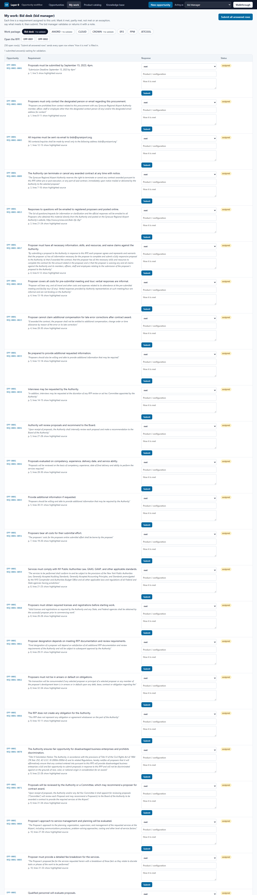

Crown's package seen by its product manager: answer forms with the product reference pre-filled from the accepted match (`CROWN-ARMV`, `CROWN-ACC`), the hand-off link for OPP-0001, "96 open row(s)…", "unanchored" badges where the quote was not located on the page, and no "to validate" counts on the chips (the product manager does not validate).

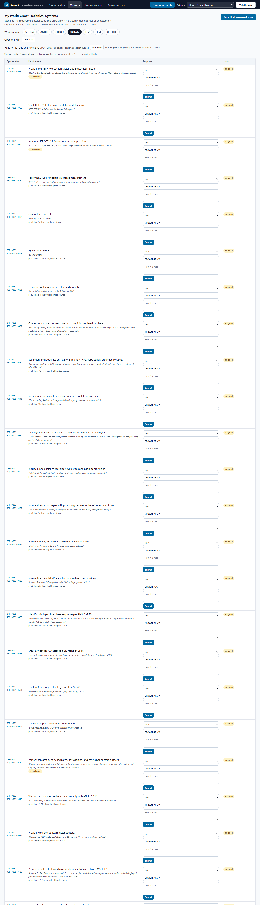

The same package seen by Crown's design engineer is identical: both named people of a unit may answer.


The EP² package in its read-only form: each row shows the product reference set at dispatch and "not answered yet", and the blue read-only notice is displayed. In this capture the acting name was set directly in the browser rather than through the "Acting as" picker, so it was not decoded as "EP² Design Engineer" (the notice reads "EP² Design Engineer" and the picker falls back to its first entry). The page therefore treated the person as someone other than the unit's design engineer and showed the read-only state. Choosing "EP² Design Engineer" in the picker stores the name encoded and gives the answer forms, as in the Crown design engineer screenshot. This screenshot is the reference for the read-only state.

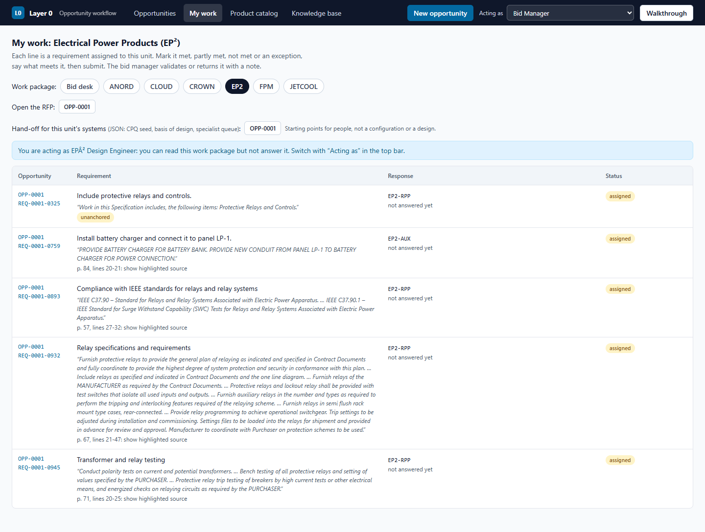

A unit with nothing assigned, acting as the Flex Manufacturing Services product manager: the empty state, and no EMS chip because the unit has no work in any opportunity.


## 17. Screen: Product Catalog

The Product catalog is the reference list the matcher and the units work from: the business units, their product families with an offering type, the published models of each family, and a search box over the long-term retrieval index (products, models, past responses and curator-approved knowledge). The page only reads; it writes nothing. Implemented.

| Item | Value |
|---|---|
| Route | `/catalog` |
| File | `web/app/catalog/page.tsx` |
| Reached from | "Product catalog" in the top bar (section 4); the "product catalog" link on the Knowledge base (section 18); the walkthrough, chapter 10 (section 20) |
| Who uses it | Everyone (no role check). Typical use: the bid manager checks why a requirement was matched to a unit; a unit checks its own entry |
| Data loaded on open | `GET /api/catalog?q=` (units including pending ones, products, catalog items, and empty search results) |
| Data loaded on search | `GET /api/catalog?q={query}`: the same lists plus up to ten search results |
| Data source | The JSON seed files in `data/knowledge_base/` read by the catalog module; approved knowledge from the Knowledge base joins the search index (see 02-technical-architecture.md) |

### 17.1 Layout

```text
+------------------------------------------------------------------------------------------+
| Product catalog                                                                           |
| Business units, their product families and models, and the past responses used for ...   |
| Families and models from public Flex web pages (retrieved 12 Oct 2026); to be confirmed.. |
| [Search products, models and past responses ] [Search] [Clear]                            |
+------------------------------------------------------------------------------------------+
| Results for "metal-clad switchgear"                        10 match(es), best first       |
| Score | Kind                | Unit  | ID              | Text                              |
| 0.458 | product             | CROWN | CROWN-MCSG      | Non-arc metal-clad and MV ...     |
+------------------------------------------------------------------------------------------+
| Crown Technical Systems CROWN     Critical Power                               (active)   |
| Medium-voltage metal-clad switchgear 4.16-38 kV (...). source                             |
| Product manager Crown Product Manager · Design engineer Crown Design Engineer             |
|  - CROWN-ARMV Arc-resistant metal-clad MV switchgear (ETO) source                         |
|      > 1 model / series                                                                   |
|  - CROWN-ACC MV switchgear accessories (CTO)                                              |
+------------------------------------------------------------------------------------------+
| ... one card per business unit ...                                                        |
+------------------------------------------------------------------------------------------+
```

### 17.2 Elements in order

| Element | Exact text or behaviour |
|---|---|
| Heading (level 1) | "Product catalog" |
| Help line | "Business units, their product families and models, and the past responses used for matching." |
| Provenance line (muted) | "Families and models from public Flex web pages (retrieved 12 Oct 2026); to be confirmed with each unit." |
| Search form | A form with the search role. Field: type "search", screen-reader label "Search the knowledge base", placeholder "Search products, models and past responses". Button "Search" (primary). Button "Clear" (secondary), shown only while a query is active |
| "Search" | Trims the typed text and makes it the active query. The page then calls `GET /api/catalog?q={query}` (URL-encoded). An empty or blank query shows no results card |
| "Clear" | Sets the active query back to empty; the results card disappears and the plain catalog remains |
| Error alert | Red alert with the request's error text when the catalog cannot be loaded; nothing when there is no error |
| Loading | A four-line grey skeleton before the first answer arrives |

### 17.3 The results card (after a search)

| Part | Exact text or behaviour |
|---|---|
| Card heading | "Results for “{query}”" |
| Count (muted, beside the heading) | "{n} match(es), best first" |
| No match | "Nothing matches. Try another wording; the index holds product families, their models and past responses." |
| Table (dense) | Columns: **Score** (right-aligned number used for ranking; higher is closer), **Kind**, **Unit** (unit code), **ID** (monospace), **Text** (the first 160 characters of the indexed text) |
| Kind values | `product` (a product family), `past_response` (a seeded past answer, or an item approved on the Knowledge base page), and for a model "model of {family}" with the family ID in monospace (API kind `catalog_item`) |
| Number of results | At most ten (the API is called with `k=10`) |
| Ranking | By meaning when embeddings are available (cosine similarity on cached vectors), otherwise by keyword score; see 02-technical-architecture.md |

Example from the demo data: the query "metal-clad switchgear" returns ten matches, led by `CROWN-MCSG` (product, score 0.458), `CROWN-ARMV` (product, 0.407) and `PAST-CROWN-001` (past_response, 0.379), then the model "Arc-Resistant Switchgear" of `CROWN-ARMV`.

### 17.4 Business unit cards

One card per business unit, in catalog order. If the API returns no units, the page shows the empty state "No business units" with the hint "The catalog seed has not been loaded."

| Part of a card | Exact content |
|---|---|
| Card heading | The unit name, then its code in muted monospace (for example "Crown Technical Systems CROWN") |
| Pillar (muted) | For example "Critical Power", "Embedded Power", "Thermal Management", "Cloud", "Critical or Embedded Power", "Flex group (outside SpinCo, needs confirmation)" |
| Status badge | `active` (green) or `pending` (amber). A pending unit (EPC Power) is listed but takes no part in matching, dispatch or the "Acting as" list |
| Focus | One paragraph describing the unit, followed by a "source" link when the seed gives a source address. Every "source" link opens the public web page in a new tab (`target="_blank"`, `rel="noopener noreferrer"`) |
| People line (muted) | "Product manager {name} · Design engineer {name}", for example "Product manager Crown Product Manager · Design engineer Crown Design Engineer". These two names are the people who may answer the unit's work package (section 16.10) |
| Products | "No products listed." when the unit has none (EPC Power). Otherwise a list; each entry shows the product ID in monospace (for example `CROWN-ARMV`), the name, the offering-type badge and a "source" link |
| Offering-type badge | `CTO` (green, configure-to-order), "Semi-custom" (amber; stored value `SEMI_CUSTOM`), `ETO` (red, engineer-to-order) |
| Models | When a product has published models, a collapsed disclosure "{n} model / series" or "{n} models / series". Opened, it lists each model: the model name in bold, the full name followed by a full stop when it differs from the model name, the specifications in muted text, and a "source" link |

Catalog content on the demo data (seed as of 13 Oct 2026):

| Code | Unit | Pillar | Status |
|---|---|---|---|
| EP2 | Electrical Power Products (EP²) | Critical Power | active |
| CROWN | Crown Technical Systems | Critical Power | active |
| ANORD | Anord Mardix | Critical Power | active |
| FPM | Flex Power Modules | Embedded Power | active |
| JETCOOL | JetCool | Thermal Management | active |
| CLOUD | Cloud (in-house) | Cloud | active |
| EPC | EPC Power | Critical or Embedded Power | pending |
| EMS | Flex Design, Engineering and Manufacturing Services | Flex group (outside SpinCo, needs confirmation) | active |
| AFS | Flex Fulfillment, Logistics and Aftermarket Services | Flex group (outside SpinCo, needs confirmation) | active |

In total there are 9 units (8 active, 1 pending), 60 product families (22 CTO, 16 Semi-custom, 22 ETO) and 73 models. The families and models are illustrative and are marked on the page as to be confirmed with each unit. The walkthrough text in `web/tour/chapters/knowledge.ts` still speaks of seven units and 16 products; the page and the API show the larger seed above.

### 17.5 States

| State | What is shown |
|---|---|
| Loading (first fetch) | Heading, help, provenance, search form, then the skeleton |
| Error | Red alert with the error text |
| No units | Empty state "No business units" / "The catalog seed has not been loaded." |
| Populated, no query | The unit cards |
| Query with matches | The results card above the unit cards |
| Query without matches | The results card with "Nothing matches. …" |

### 17.6 Screenshots

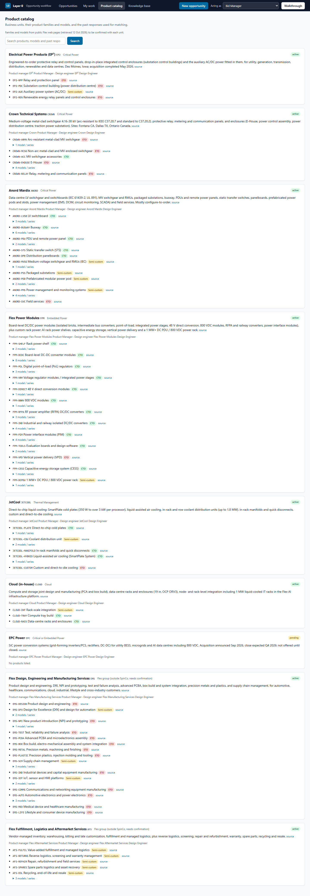

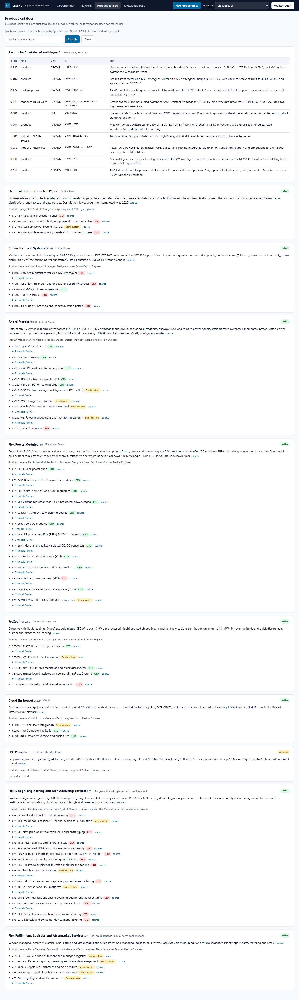

## 18. Screen: Knowledge Base

The Knowledge base is the curator's queue. People send three kinds of item from an opportunity with "Send to knowledge base" (section 19.12): a requirement, a validated unit answer, or a bid-decision rationale. The curator approves an item (optionally tidying the response to keep) or rejects it with a note. Approved items join the long-term retrieval index that matching evidence, the response outline and the catalog search use. In this proof of concept the curator is the Bid Manager. Implemented.

| Item | Value |
|---|---|
| Route | `/knowledge` |
| File | `web/app/knowledge/page.tsx` |
| Reached from | "Knowledge base" in the top bar (section 4); the walkthrough, chapter 10 (section 20) |
| Who uses it | Everyone may read the queue. Only the curator (the API's `curator` value, "Bid Manager" in this proof of concept) approves or rejects |
| Data loaded on open | `GET /api/knowledge`: `{items, curator, learned, index}` (`index` names the index type, for example `embeddings`; the page does not display it) |
| Writes | `POST /api/knowledge/{kb_id}/review` with `{approve, note, response}` |

### 18.1 Layout

```text
+------------------------------------------------------------------------------------------+
| Knowledge base                                                                            |
| Requirements, validated answers and decision rationales that people sent from an ...     |
| 0 approved item(s) in the long-term index, next to the illustrative past responses of    |
| the product catalog.                                                                      |
| (i) Only the curator (Bid Manager) approves or rejects; switch with "Acting as" ...       |
| (Waiting 1) (Approved 0) (Rejected 0)                                                     |
+------------------------------------------------------------------------------------------+
| KB-0001 Requirement   from OPP-0001, REQ-0001-0002, p. 1, lines 8-11          (queued)   |
| Sent by Bid Manager: "Standard restricted-contact clause; reuse the wording ..."         |
| Asked: Proposers must only contact the designated person or email regarding ...          |
| Response to keep (tidy it if needed)                                                      |
| [                                                     ]                                   |
| Note (required to reject)                                                                 |
| [                                                     ]                                   |
| [Approve into the knowledge base] [Reject]                                                |
+------------------------------------------------------------------------------------------+
```

### 18.2 Elements in order

| Element | Exact text or behaviour |
|---|---|
| Heading (level 1) | "Knowledge base" |
| Help line | "Requirements, validated answers and decision rationales that people sent from an opportunity. The curator approves what the next bids should learn from; approved items are found by matching, the response outline and catalog search." |
| Learned count | "{learned} approved item(s) in the long-term index, next to the illustrative past responses of the product catalog." The words "product catalog" link to `/catalog` (section 17) |
| Curator notice (blue info alert) | Shown when the acting person is not the curator: "Only the curator ({curator}) approves or rejects; switch with “Acting as” in the top bar." |
| Status filter | A group of three chip buttons labelled for screen readers "Filter by status": "Waiting {n}", "Approved {n}", "Rejected {n}" (statuses `queued`, `approved`, `rejected`). The chosen chip is dark and carries `aria-pressed="true"`. "Waiting" is chosen when the page opens; the choice is not remembered between visits. Filtering happens in the browser; no call is made |
| Item cards | One card per item of the chosen status (section 18.3) |
| Empty state | "Waiting" with no items: "Nothing waiting" with the hint "Use “Send to knowledge base” in Traceability, the response outline or the bid decision to queue an item." "Approved" or "Rejected" with no items: "No approved items" or "No rejected items" (no hint) |

### 18.3 An item card

| Part | Exact content |
|---|---|
| Heading (level 3) | The knowledge ID in monospace (`KB-0001`, numbered in order) and the kind label: "Requirement" (`requirement`), "Validated answer" (`response`) or "Decision rationale" (`decision`); an unknown kind shows its raw value |
| Source line (muted) | "from {opportunity ID}, {source}". The opportunity ID links to `/opportunities/{opp}/trace` (Traceability). `source` is text built by the API, for example "REQ-0001-0002, p. 1, lines 8-11" |
| Status badge | `queued` (amber), `approved` (green) or `rejected` (grey) |
| Sender line (muted) | "Sent by {sent_by}", then ": “{note}”" when the sender wrote a note, then " · unit {bu}" when the item belongs to a unit (not the bid desk) |
| "Asked:" | Bold label, then the requirement text |
| Review form | Only on a `queued` item and only for the curator (section 18.4) |
| "Answer:" | For everything else: bold label, then the response, shown when there is one (a requirement item has none) |
| Review result (muted) | On a reviewed item: "Approved by {reviewer}" or "Rejected by {reviewer}", then ": {review note}" when there is one |

The sending time and review time are stored but not shown on this page.

### 18.4 The review form (curator only, queued items)

| Part | Exact label | Behaviour |
|---|---|---|
| "Response to keep" (text area, 3 rows) | "Response to keep" with the hint "(tidy it if needed)" | Pre-filled with the response as sent. The curator may edit it; the edited text is what the index keeps |
| "Note" (text field) | "Note" with the hint "(required to reject)" | Optional for approval; required for rejection. Turns red (`aria-invalid`) after a refused rejection |
| "Approve into the knowledge base" (primary, the form's submit) | "Approve into the knowledge base" | `POST /api/knowledge/{kb_id}/review` with `{approve: true, note, response}`. Success: green toast "{kb_id} approved into the knowledge base."; the list reloads and the item moves to "Approved" |
| "Reject" (red outline) | "Reject" | First checks the note in the browser: an empty note shows "Give a note so the sender knows why it was rejected." under the form and nothing is sent. Otherwise `POST /api/knowledge/{kb_id}/review` with `{approve: false, note, response}`. Success: green toast "{kb_id} rejected."; the item moves to "Rejected" |
| Busy indicator | "Approving…" or "Rejecting…" | Both buttons are disabled while the call runs |
| Error alert (red, under the buttons) | The API's message | For example "Only the knowledge curator (in the PoC, the Bid Manager) approves knowledge." (HTTP 403), "{kb_id} is already {status}." (HTTP 409), "A rejection needs a note saying why." (HTTP 409), "{kb_id} not found." (HTTP 404). The typed text stays |

What approval does on the server (summary; see 04-api-view.md): the item is marked approved with the reviewer, note and kept response, and the entry is added to the learned-knowledge file and the long-term index, so the catalog search (section 17), the matching evidence and the response outline can find it. Approval never changes the matcher's fixed prompt part (the catalog and the seeded past responses). Both send and review are written to the audit trail (`sent`, and `approved` or `rejected`, on entity `knowledge`).

### 18.5 States

| State | What is shown |
|---|---|
| Loading | Heading "Knowledge base" and a four-line skeleton |
| Error | Heading "Knowledge base" and a red alert with the error text |
| Nothing queued (curator) | Learned count, chips "Waiting 0", "Approved 0", "Rejected 0", empty state "Nothing waiting" |
| Queued items, curator | Each card with the review form |
| Queued items, not the curator | The blue curator notice; each card read-only (no form) |
| Approved tab | Cards with "Answer:" and "Approved by …" |
| Rejected tab | Cards with "Answer:" (if any) and "Rejected by …: {note}" |
| Busy | "Approving…" / "Rejecting…"; the form's buttons disabled |

### 18.6 Screenshots

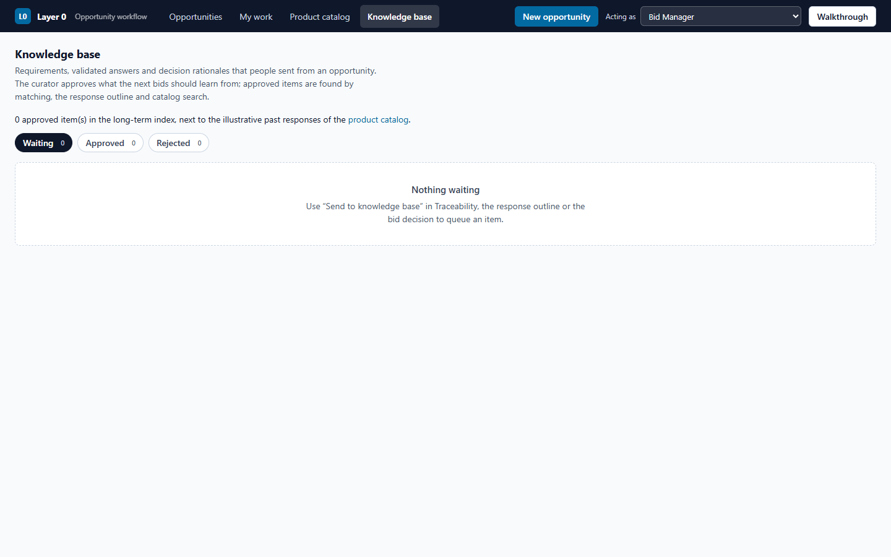

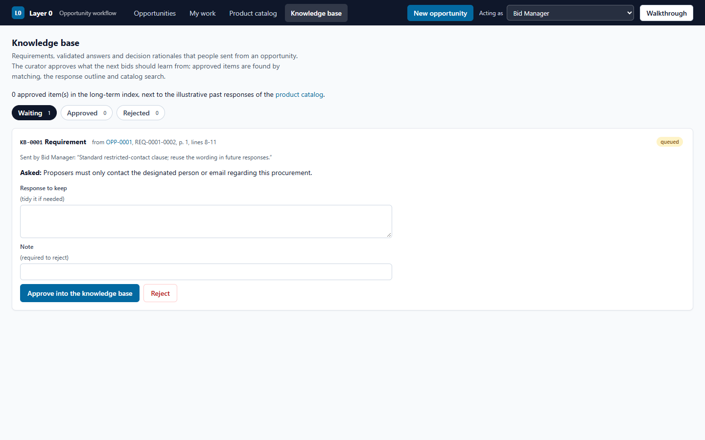

## 19. Shared User-Interface Components

The screens are built from a small set of shared React components with no third-party user-interface library: plain React plus the stylesheet `web/app/globals.css` and the page-group stylesheets in `web/app/styles/`. This section describes each shared component once: its inputs (props), behaviour, states, accessibility, and the screens that use it. The screen sections (7 to 18) describe what each screen passes to them. All components listed here are Implemented.

### 19.1 Component overview

| Group | Component (export) | File | Purpose |
|---|---|---|---|
| Primitives | `Alert` | `web/components/ui/Alert.tsx` | Inline message block: info, success, warning, error |
| Primitives | `ConfirmDialog`, `useConfirm` | `web/components/ui/ConfirmDialog.tsx` | Modal confirmation that replaces the browser's `window.confirm` |
| Primitives | `EmptyState` | `web/components/ui/EmptyState.tsx` | Dashed block for a list with nothing in it |
| Primitives | `Spinner`, `Busy`, `Skeleton` | `web/components/ui/Spinner.tsx` | Loading and busy indicators |
| Primitives | `StatusBadge`, `toneOf`, `offeringLabel` | `web/components/ui/StatusBadge.tsx` | One coloured pill for every status string in the app |
| Primitives | `ToastProvider`, `useToast` | `web/components/ui/Toast.tsx` | Short confirmations and errors that replace `window.alert` |
| Primitives | (barrel) | `web/components/ui/index.ts` | Re-exports every primitive and its types from `@/components/ui` |
| Primitives | (conventions) | `web/components/ui/README.md` | Tokens, class names, status colour scheme and usage rules |
| Shell | `TopNav` | `web/components/shell/TopNav.tsx` | The four main destinations in the top bar |
| Shell | `ActorPicker` | `web/components/shell/ActorPicker.tsx` | "Acting as" person picker |
| Shell | `OppSteps`, `STATUS_EVENT` | `web/components/shell/OppSteps.tsx` | Opportunity header: breadcrumb, title, status, step bar, Changes link |
| Shell | `PageHead` | `web/components/shell/PageHead.tsx` | Page title, one help line and right-hand actions |
| Feature | `LinePicker` | `web/components/requirements/LinePicker.tsx` | Add a missed requirement by selecting lines on the RFP page |
| Feature | `MatchActions` | `web/components/matching/MatchActions.tsx` | Accept, reject or change one requirement's product match |
| Feature | `SendToKnowledge` | `web/components/knowledge/SendToKnowledge.tsx` | Queue an item for the knowledge-base curator |
| Feature | `ChangeSetCard` | `web/components/changes/ChangeSetCard.tsx` | One change set: counts, warning, statements, document, apply or discard |
| Feature | `ChangeDecision`, `KindBadge`, `KINDS`, `NEEDS_TARGET` | `web/components/changes/ChangeDecision.tsx` | A person's decision on one change statement |
| Feature | `ChangeDocument` | `web/components/changes/ChangeDocument.tsx` | A change document page with its statements highlighted |
| Walkthrough | `TourProvider`, `TourOverlay`, `TourLauncher`, `WalkthroughButton` | `web/components/tour/` | The guided walkthrough engine (section 20) |

### 19.2 Alert

| Aspect | Detail |
|---|---|
| Props | `kind`: `"info"` (default), `"success"`, `"warn"` or `"error"`; `title` (optional, shown bold before the text); `children` (the message); `onClose` (optional; adds a close button); `className` |
| Behaviour | Renders nothing when there is neither a title nor a message, so a page can always write `<Alert kind="error">{error}</Alert>` and it appears only when an error exists |
| Close button | "×" with the accessible name "Dismiss"; present only when `onClose` is given |
| Colours | info: blue tint; success: pale green; warn: amber tint; error: red tint (CSS classes `alert info`, `alert success`, `alert warn`, `alert error`) |
| Accessibility | `error` and `warn` use `role="alert"` (announced at once); `info` and `success` use `role="status"` (announced politely) |
| Used by | Every screen: load errors (all pages), the read-only notice in My work (section 16.6), the "Returned" note in an answer form (section 16.8), the curator notice and review errors in the Knowledge base (section 18), the line picker's success and error (section 19.10), the drastic-change warning and the apply result in a change set (section 19.13), and other notices listed per screen |

### 19.3 ConfirmDialog and useConfirm

| Aspect | Detail |
|---|---|
| Props of `ConfirmDialog` | `open`, `title`, `message` (text or rich content), `confirmLabel` (default "Confirm"), `cancelLabel` (default "Cancel"), `danger` (red confirm button), `busy` (disables both buttons), `onConfirm`, `onCancel` |
| `useConfirm()` | Returns `[ask, dialog]`. The page renders `dialog` once; `await ask({title, message, confirmLabel, cancelLabel, danger})` shows the dialog and resolves `true` (confirm) or `false` (cancel) |
| Layout | Dimmed full-screen backdrop; a centred box (up to 440 px wide) with the title (level 2 heading), the message, then the buttons right-aligned: the cancel button (secondary) on the left, the confirm button on the right |
| Keyboard and focus | Focus moves to the confirm button when the dialog opens; Tab and Shift+Tab cycle inside the dialog; Esc cancels; a click on the backdrop cancels |
| Accessibility | `role="dialog"`, `aria-modal="true"`, labelled by the title |
| Layering | Backdrop at z-index 40: above the walkthrough's dimmed backdrop (30), below the walkthrough bubble (45) and the toasts (50), so a confirmation asked for during the walkthrough stays usable |

Every confirmation dialog in the application:

| Screen | Title | Message | Confirm button |
|---|---|---|---|
| Requirements (section 10) | "Freeze the baseline?" | "The {n} approved requirements become the baseline the units work from. Later changes to the RFP run as a delta against it." | "Freeze baseline" |
| Bid Decision (section 12) | "Record no-go?" | "The opportunity is marked no-go. Nothing is sent to the units; a later go decision can still overrule it." | "Record no-go" (red) |
| Changes, in a change set card (section 15 and 19.13) | "Discard this change set?" | "The changes read from {filename} are dropped; the baseline stays as it is." | "Discard" (red) |

The cancel button reads "Cancel" in all three.

### 19.4 EmptyState

| Aspect | Detail |
|---|---|
| Props | `title` (required), `hint` (optional text under the title), `children` (optional actions, centred in a row), `className` |
| Look | Centred grey text in a white block with a dashed border; the title in a larger, darker font |
| Rule | Inside a table, pages use a plain table cell spanning all columns instead (for example the "No change statement classified as …" row in a change set) |

Every empty state built with this component:

| Screen | Title | Hint |
|---|---|---|
| Opportunities (section 7) | "No opportunities yet" | See section 7 |
| Requirements (section 10) | "No requirements yet" | See section 10 |
| Traceability (section 11) | "No requirements yet"; "Nothing to map yet" | See section 11 |
| Final Response (section 13) | "No requirements in the baseline yet" | See section 13 |
| Response Outline (section 14) | "No chapters to draft yet" | See section 14 |
| Changes (section 15) | "No change documents read yet" | See section 15 |
| My Work (section 16) | "Nothing assigned" | "Requirements appear here once the bid manager dispatches an opportunity to this unit." |
| Product Catalog (section 17) | "No business units" | "The catalog seed has not been loaded." |
| Knowledge Base (section 18) | "Nothing waiting"; "No approved items"; "No rejected items" | "Use “Send to knowledge base” in Traceability, the response outline or the bid decision to queue an item." (Waiting only) |

### 19.5 Spinner, Busy and Skeleton

| Component | Props | Look and behaviour | Accessibility | Used by |
|---|---|---|---|---|
| `Spinner` | `size`: `"md"` (16 px, default) or `"sm"` (12 px); `label` (optional) | A rotating ring in the accent colour | Decorative (`aria-hidden`) unless a label is given; with a label it is `role="status"` with that accessible name | Inside `Busy`; no page uses it on its own |
| `Busy` | `label` (default "Working…"), `className` | Spinner followed by the label in small grey text | `role="status"`, so the change is announced | Every action that waits on the API, for example "Sending…", "Saving…", "Opening your work package…", "Approving…", "Rejecting…", "Loading the page lines…", "Loading catalog…", "Applying: new versions, matching and dispatch…" |
| `Skeleton` | `lines` (default 3), `className` | Grey shimmering bars, cycling through full, 75 % and 50 % width | `aria-busy="true"`, `aria-label="Loading"` | The first fetch of every page: 3 lines (RFP step, Requirements history), 4 lines (Opportunities, Traceability, Final Response, Response Outline, Changes, My Work, Product Catalog, Knowledge Base), 5 lines (Bid Decision), 6 lines (Requirements); 3 lines inside the line picker |

### 19.6 StatusBadge, toneOf and offeringLabel

`StatusBadge` draws every status in the application as a small rounded pill. Its colour comes from one of five **tones** (colour groups) defined as tokens in `globals.css`.

| Prop | Meaning |
|---|---|
| `status` | The status string (may be empty; then the text is "unknown") |
| `kind` | `"status"` (default), `"opp"`, `"severity"`, `"offering"` or `"compliance"`. Only two kinds change behaviour: `"opp"` makes `submitted` green (a submitted final response is done), and `"offering"` shows the offering label ("Semi-custom" for `SEMI_CUSTOM`). `"severity"` and `"compliance"` only document intent |
| `label` | Text to show instead of the status |
| `className` | Extra classes, for example `lg` for the larger badge in the opportunity header |
| `title` | Tooltip (for example "Quote not located on the page; check the source manually" on the "unanchored" badge) |

Text shown: `label` if given; otherwise, for kind `"offering"`, the offering label; otherwise the status with underscores replaced by spaces (`not_met` shows "not met", `no_go` shows "no go"). How the tone is found (`toneOf`): the status is trimmed and every run of spaces or hyphens becomes an underscore (so "no-go" and "not met" are recognised); kind `"opp"` is checked first; then the exact value; then its lower-case form; anything unknown is neutral.

| Tone (CSS class) | Colours (text on tint) | Status values in the code |
|---|---|---|
| ok, green (`t-ok`) | `--ok-ink` #166534 on `--ok-bg` #dcfce7 | `approved`, `accepted`, `applied`, `confirmed`, `validated`, `ingested`, `active`, `pass`, `answered`, `met`, `added`, `CTO`; `submitted` when kind is `"opp"` |
| info, blue (`t-info`) | `--info-ink` #075985 on `--info-bg` #e0f2fe | `submitted` (a unit answer), `frozen`, `go`, `dispatched`, `consolidating`, `exception` |
| pending, amber (`t-pending`) | `--pending-ink` #854d0e on `--pending-bg` #fef3c7 | `proposed`, `review`, `queued`, `assigned`, `reading`, `uploaded`, `ingesting`, `medium`, `warn`, `pending`, `partial`, `partially_met`, `modified`, `SEMI_CUSTOM` |
| bad, red (`t-bad`) | `--bad-ink` #991b1b on `--bad-bg` #fee2e2 | `returned`, `blocked`, `no_go`, `failed`, `high`, `fail`, `over`, `not_met`, `removed`, `ETO` |
| neutral, grey (`t-neutral`) | `--neutral-ink` #475569 on `--neutral-bg` #eef2f6 | `rejected`, `merged`, `split`, `duplicate`, `discarded`, `withdrawn`, `new`, `low`, `n/a`, `unknown`, `unchanged`, `not_a_requirement`, `NONE`, and any value not in the list |

The status groups in the code, with where each family of values is shown:

| Family | Values | Shown on |
|---|---|---|
| Requirements, matches, change sets, knowledge items | proposed, approved, accepted, rejected, merged, split, duplicate, review, applied, discarded, queued, confirmed | Requirements, Traceability, Changes, Knowledge Base |
| Assignments | assigned, submitted, validated, returned, withdrawn, blocked | My Work, Traceability, Final Response |
| Opportunities, documents, units | new, reading, frozen, go, no_go, dispatched, consolidating, submitted (kind opp), uploaded, ingesting, ingested, failed, active (and pending) | Opportunities, opportunity header, RFP step, Product Catalog |
| Severities, rule outcomes, consolidation states | high, medium, low, pass, warn, fail, n/a, answered, pending, over | Bid Decision, Final Response, the "unanchored" badge |
| Offering types | CTO, SEMI_CUSTOM (shown "Semi-custom"), ETO, NONE | Traceability, Bid Decision, Product Catalog |
| Compliance | met, partial, partially_met, not_met, exception, unknown | Traceability, Final Response, Response Outline, Bid Decision |
| Change kinds | added, modified, removed, unchanged, not_a_requirement | Changes |

`offeringLabel(value)` returns "Semi-custom" for `SEMI_CUSTOM` and the value itself otherwise (`NONE` when empty); every offering badge and offering select uses it. `toneOf(status, kind)` returns the tone name and is also exported for pages that colour other elements. Two small differences from the README: the README lists "in scope" as green, but the code has no such entry (it would be grey); and a label such as "Semi-custom" passed as a status (rather than `SEMI_CUSTOM`) is not recognised and would be grey.

Screens that use `StatusBadge` and which kinds: Opportunities and the opportunity header (`opp`), Requirements (status; the "unanchored" badge as `severity` medium), Traceability (status, `offering`, `compliance`, the "unanchored" badge), Bid Decision (`severity`, `offering`, `opp` for the recorded outcome, `compliance` for criteria), Final Response and Response Outline (`compliance` and status), My Work (assignment status; the "unanchored" badge), Product Catalog (unit status; `offering`), Knowledge Base (item status), and inside `MatchActions`, `SendToKnowledge`, `ChangeSetCard` and `ChangeDecision`.

### 19.7 Toast, ToastProvider and useToast

| Aspect | Detail |
|---|---|
| Mounting | `ToastProvider` is mounted once, around the whole application, in `web/app/layout.tsx` |
| Page API | `const toast = useToast()` gives `toast.success(text)`, `toast.error(text)`, `toast.info(text)` and `toast.show(kind, text)`. Outside the provider (tests, server rendering) the calls do nothing |
| Lifetime | Success and information toasts disappear after 5 seconds, errors after 8 seconds. A click on the toast or on its "×" (accessible name "Dismiss") closes it at once |
| Stack | At most four at a time: a new toast pushes the oldest out. They stack in the bottom-right corner, at most 420 px wide, above everything else (z-index 50) |
| Colours | A coloured left edge: green for success, red for error, light blue for information |
| Accessibility | Two hidden live regions: a polite one that reads success and information texts, and an assertive one that reads errors at once |
| Error text | Pages pass API errors through `errorMessage(e)` from `web/lib/api.ts`: the API's `detail` text, without an "Error:" or "409:" prefix, with the fallback "Something went wrong. Please try again." |
| Used by | RFP step, Requirements, Traceability, Bid Decision, Changes, My Work, Knowledge Base, and the components `MatchActions`, `SendToKnowledge` and `ChangeSetCard`. The exact toast texts are listed with each screen |

### 19.8 The primitives barrel and the README conventions

`web/components/ui/index.ts` re-exports `Alert` (and type `AlertKind`), `ConfirmDialog` and `useConfirm` (type `ConfirmProps`), `EmptyState`, `Spinner`, `Busy`, `Skeleton`, `StatusBadge`, `toneOf` and `offeringLabel` (types `Tone`, `BadgeKind`), and `ToastProvider` and `useToast` (type `ToastKind`), so pages import them from `@/components/ui`.

`web/components/ui/README.md` sets the conventions the screens follow:

| Topic | Convention |
|---|---|
| Stylesheets | Plain CSS: `app/globals.css` (foundation), then one stylesheet per page group in `app/styles/` (`overview.css`, `requirements.css`, `trace.css`, `consolidation.css`; the walkthrough's `tour.css` is also loaded from `app/layout.tsx`) |
| Tokens | Neutrals (`--bg`, `--card`, `--ink`, `--ink-2`, `--muted`, `--muted-2`, `--line`, `--line-2`, `--surface-2`, `--surface-3`); brand (`--nav`, `--nav-ink`, `--accent`, `--accent-hover`, `--accent-ink`, `--accent-soft`, `--sel`, `--hl-sel`); status tones (`--ok`, `--info`, `--pending`, `--bad`, each with `-ink`, `-bg`, `-line`; `--neutral-ink/-bg/-line`; `--warn` and `--danger` are aliases of `--bad`); spacing `--s1` 4 px to `--s6` 32 px; radii `--radius` 8, `--radius-sm` 6, `--radius-pill`; shadows `--shadow-1`, `--shadow-2`; `--focus`; type sizes `--fs-xs` 11 to `--fs-2xl` 20, `--font`, `--font-mono`; layout `--page-x`, `--content-max` 1600, `--topbar-h` 52. New status colours must use the tokens, never new hex values |
| Classes | Page (`.content`, `.page-head`, `.crumbs`); cards (`.card`, `.card-head`, `.card-actions`); tables (`table.dense`, `table.zebra`, `table.sticky-head`, `td.num`, `.table-scroll`; row states `tr.rejected`, `tr.inactive`, `tr.selected`); forms (`.form`, `.form.compact`, `.check`, `.inline`, `.grow`, `.narrow`, `.wide`, `.field-hint`, `aria-invalid="true"` turns a field red); buttons (primary, `.secondary`, `.danger`, `.danger.secondary`, `.link`, sizes `.sm` 28 px and `.lg`, grey when disabled); badges (`.badge`, `.tag`, `.badge.lg`, tones `.t-ok .t-info .t-pending .t-bad .t-neutral`, legacy status classes mapped to the same tones); chips (`.chip`, `.chip.on` or `aria-pressed="true"`); messages (`.alert`, `.notice`, `.empty`, `.skeleton`, `.spinner`, `.busy`, `.toasts`, `.dialog`); text (`.muted`, `.mono`, `.quote`, `.warn`, `.ok`); utilities (`.row`, `.stack`, `.grid-2`, `.right`, `.text-right`, `.nowrap`, `.truncate`, `.sr-only`, `.per-req`) |
| Status colour scheme | One scheme for the whole application: green = done, blue = handed over or moving, amber = waiting on someone, red = needs action, grey = inactive (section 19.6) |
| Responsive rules | Under 1100 px the three Traceability panes stack, the top bar wraps onto two rows, the step bar wraps, and a table directly inside `.content`, `.card` or `.form` scrolls sideways inside its box; under 640 px the side gutter is 16 px (see section 23) |
| Header refresh | After an action that changes the opportunity status (freeze, go or no-go, dispatch, apply or discard a change set), the page fires the browser event `opp-status-changed` after its own reload, so the opportunity header and step bar update at once |

### 19.9 Shell components

The shell components are described in full in section 4 (top bar) and section 5 (opportunity header). Their component-level contract:

| Component | Props | Behaviour | Accessibility |
|---|---|---|---|
| `TopNav` | none | Four links: "Opportunities" (`/portfolio`; active on `/portfolio` and any `/opportunities/…` page), "My work" (`/inbox`), "Product catalog" (`/catalog`), "Knowledge base" (`/knowledge`). No link is active on `/opportunities/new` | Navigation landmark "Main"; the active link has `aria-current="page"` |
| `ActorPicker` | none | Label "Acting as" and a select (tooltip "Switch the person acting in this PoC") filled from `GET /api/people`; until the list arrives it shows only the current name. A change writes the `actor` cookie (URL-encoded, path `/`, kept for one year) and reloads the page, so every screen fetches again as that person. Every API call sends the name in the `X-Actor` header. Default person: "Bid Manager". If the cookie holds a name that is not in the list, the select shows its first option | The select is labelled by "Acting as" |
| `OppSteps` (with `STATUS_EVENT = "opp-status-changed"`) | none (reads the opportunity ID from the route) | Breadcrumb "Opportunities › {ID}", the title with the status badge, the five-step bar (RFP, Requirements, Traceability, Bid decision, Final response; a tick once the status has passed each step) and the separate "Δ Changes" link. Fetches `GET /api/opportunities/{id}` on open, on every route change, every 5 seconds and on the `opp-status-changed` event | Breadcrumb and "Workflow steps" navigation landmarks; `aria-current="step"` on the current step; "(done)" read out for ticked steps |
| `PageHead` | `title`, `help`, `level` (1 by default; 2 inside an opportunity, where the opportunity title is the level-1 heading), `crumbs`, `children` (right-hand actions) | Title, one help line, actions on the right | Heading level follows `level` |

### 19.10 LinePicker (add a missed requirement from the RFP page)

Used inside the "Add a requirement the agent missed" panel of the Requirements screen (section 10). The person selects the lines of the requirement on the image of the main RFP page; the stored quote is exactly those lines, so the requirement's source is exact.

| Aspect | Detail |
|---|---|
| Props | `oppId`, `startPage` (the page to show first), `categories` (the category list for the select), `requirements` (the active requirements; their lines are shown as already captured), `onAdded` (called after a successful add so the list reloads) |
| Data | `GET /api/opportunities/{oppId}` to find the main document; `GET /api/documents/{docId}/pages/{n}` for the page's line layout (line numbers, text, boxes, header/footer flag, "unreviewed" flag); the page image `GET /api/documents/{docId}/pages/{n}.png` |
| Pager | "◀" (accessible name "Previous page"), "Page [n] / {page count}" (number field, accessible name "RFP page number"), "▶" ("Next page"). Changing the page clears the selection. Warning "No text layer: this page was not read (needs OCR)" on a page without text; "Loading the page lines…" while the layout loads |
| Page image | The RFP page with an invisible clickable box over each line. Click selects one line; Shift+click extends the selection from the last clicked line. Tooltip "Line {n}: {text}", or "Line {n} (header or footer: left out of the quote): {text}" |
| Line colours and legend | "already a requirement" (lines covered by an active requirement), "selected", "header or footer (left out)" |
| Side form (accessible name "Add a requirement from selected lines") | Instruction "Click the first line of the requirement on the page, then shift-click its last line. Or type the line numbers."; fields "From line" and "To line" (number fields; "To line" shows the From value as placeholder); "Clear" (shown once a line is chosen) |
| Preview (announced politely) | "Quote that will be stored (p. {n}, line {a})" or "(p. {n}, lines {a}-{b})" with the quote, or "No lines selected." |
| Checks before sending | "Line numbers start at 1."; "The first line must come before the last line."; "Page {n} has {last} lines."; "Select at most 40 lines; split a longer passage into several requirements."; "Only header or footer lines are selected; select the requirement's own lines." |
| Other fields | "Short text (optional; default: the quote)" (up to 200 characters); "Category" (select) |
| "Add requirement" | Disabled while busy, with no quote or with a problem; shows "Adding…" while sending `POST /api/opportunities/{oppId}/requirements/from-lines` with `{page, line_start, line_end, text, category}` |
| Outcomes | Green alert "{req_id} added ({source}); it is in the list, to review like the others." or a red alert with the API's message; both closable |
| States | Loading the opportunity: three-line skeleton. No ingested main document: blue alert "Upload the main RFP and wait until it has been read." Opportunity error: red alert |

### 19.11 MatchActions (one requirement's product match)

Used in pane 3 of Traceability (section 11), on each requirement row. Clicks on its buttons and form do not change the selected row.

| Aspect | Detail |
|---|---|
| Props | `oppId`, `reqId`, `match` (the match with its units, or none), `dispatched` (the opportunity has been sent to units), `onDone` (reload), `tour` (walkthrough targets only on the selected row) |
| Read view | "Also: {unit} · {product}, …" when the match names more than one unit; the match status badge (`proposed`, `accepted`, `rejected`) and how the match came about: "set by a person" (`manual`), "proposed by the matching agent" (`agent`), "routed to the bid desk by rule (not a product category)" (`rule`), "closest catalog entry (no agent answer)" (`retrieval_only`) |
| Buttons | "Accept" and "Reject" (only while the match is `proposed`), and "Change" (always). "Saving…" while a call runs |
| Accept / Reject | `POST /api/matches/{id}/decide` with `{action: "accept"}` or `{action: "reject"}`. Toasts "{reqId}: match accepted." or "{reqId}: match rejected. Use Change to pick a unit." |
| Change form | Loads `GET /api/catalog` once ("Loading catalog…"), keeping only active units. One row per unit: a product select grouped by unit name, an offering-type select (CTO, Semi-custom, ETO) and "Remove". With no rows: "No unit: the bid manager answers it (not a product item)." Buttons "Add unit" (adds the first product of an active unit), "Save" and "Cancel" |
| Save | `POST /api/opportunities/{oppId}/requirements/{reqId}/match` with `{units: [{product_id, offering_type}]}`. Toast "{reqId}: match saved." |
| Dispatched warning | When the opportunity was already dispatched, red text in the form: "Already sent to units: dispatch again on the Decisions page to apply this change. Added units get the work (if they take part); removed units have theirs withdrawn." |
| Errors | Red toast with the API's message |

### 19.12 SendToKnowledge (queue an item for the curator)

Used on Traceability (the selected requirement in pane 2, and each validated unit answer in pane 3), the Bid Decision (the recorded participation rationale and the recorded go or no-go rationale) and the Response Outline (each validated answer); see sections 11, 12 and 14. Its items arrive in the Knowledge Base queue (section 18).

| Aspect | Detail |
|---|---|
| Props | `kind`: `"requirement"`, `"response"` (a validated unit answer) or `"decision"`; `refId` (requirement ID, assignment ID or decision ID); `status` (the item's knowledge status, if already sent); `onSent` |
| Already sent | When `status` is `queued` or `approved`, a badge replaces the button: "sent to knowledge base" (amber) or "in knowledge base" (green). After a rejection the button is offered again |
| Closed state | A link-style button "Send to knowledge base" |
| Open state | An inline form: a note field (placeholder "Why keep it? (optional)", accessible name "Note for the curator", up to 2000 characters, focused at once), "Send" (shows "Sending…") and "Cancel". Clicks and keys inside do not select the surrounding row |
| Send | `POST /api/knowledge` with `{kind, ref, note}`. Success: the form closes and the green toast "Sent to the knowledge base for curation." appears |
| Errors | Shown in red beside the buttons (`role="alert"`), for example "Already queued as KB-0001.", "Only validated answers go to the knowledge base.", "This decision has no rationale to keep.", "Requirement {ref} not found." |


### 19.13 ChangeSetCard (one change set)

Used once per change set on the Changes screen (section 15). A change set is the result of reading one change document (for example an addendum) against the frozen baseline.

| Part | Detail |
|---|---|
| Props | `set`, `oppId`, `threshold` (the drastic-change share), `onChanged` (reload), `tour` (walkthrough targets on the newest set only) |
| Heading | The file name and a status badge: "in review" (`review`, amber), "applied" (green), "discarded" (grey); on the right "{confirmed} / {total} confirmed" |
| Meta line | "Read by {person} on {date and time}, against baseline {n}." plus "Applied by {person} on {date and time}: baseline {n}." or "Discarded by {person} on {date and time}: nothing was applied." (times shown in the browser's local format) |
| Share of the baseline | Normal: "{p}% of the baseline is modified or removed (drastic above {t}%, placeholder)." Above the threshold: red alert titled "Drastic change": "{p}% of the baseline is modified or removed (threshold {t}%, placeholder): consider a new opportunity linked to this one. A person decides." Shares below 10 % keep one decimal |
| Apply result (after apply) | Green alert titled "Baseline {n} frozen with the changes." listing "Added: …", "Modified (new version): …", "Removed: …" (IDs; added and modified link to Traceability, removed are plain text with a tooltip pointing to the requirement's history) and "{n} unit answer(s) returned for review; {n} new assignment(s) sent to the units.", plus a note when present |
| Filters | Chip buttons "All {total}", "Added", "Modified", "Removed", "Unchanged", "Not a requirement", each with its count; a second click on the chosen chip clears it |
| Change document | A collapsed disclosure "Change document ({n} page(s))" holding `ChangeDocument` (section 19.15) |
| Statements table | Columns "#", "Source" (a link-style button that opens the document at that page), "Quote", "Proposed" (kind badge and "{p}% confidence"), "Target in the baseline" (requirement ID linked to Traceability with its text and source; "new requirement" for an addition; after apply a modified target reads "Revised in baseline {n}; the earlier wording is in its history (Requirements page)."), "New wording" (with the category tag; only for added and modified), "Rationale", "Decision" (`ChangeDecision`). A row is focusable; Enter selects it and opens the document; empty: "No change statement classified as {kind}." or "No change statements found in this document." |
| Actions (only while in review) | "Confirm all proposals" (disabled when all are confirmed) → `POST /api/changes/{id}/confirm-all`, toast "Every proposal confirmed."; "Apply to requirements" (Bid Manager only; disabled until every statement is confirmed) → `POST /api/changes/{id}/apply`, busy text "Applying: new versions, matching and dispatch…", toast "Changes applied: a new baseline is frozen and the affected answers are back with the units."; "Discard" (red outline, Bid Manager only) → confirmation dialog (section 19.3) → `POST /api/changes/{id}/discard`, toast "Change set discarded; the baseline is unchanged." |
| Guidance text | "{n} change(s) still need a person's confirmation." (when some are open) and "Only the Bid Manager applies or discards; switch with Acting as. Applying creates the new versions, freezes a new baseline and returns the affected answers to the units." ("; switch with Acting as" only when the acting person is not the Bid Manager) |
| Errors | Red closable alert under the buttons with the API's message |

### 19.14 ChangeDecision and KindBadge

| Aspect | Detail |
|---|---|
| Exports | `KINDS` (labels: Added, Modified, Removed, Unchanged, Not a requirement), `KindBadge` (a `StatusBadge` with that label: added green, modified amber, removed red, the others grey), `NEEDS_TARGET` (modified, removed and unchanged need a baseline requirement), `ChangeDecision` |
| Props | `setId`, `item`, `editable` (the set is in review), `onDone`, `tour` |
| Form (proposed statements, or after "Change") | "Change" select (the five kinds, starting at the person's or the agent's choice); "Baseline requirement" select for kinds that need a target ("{REQ ID} — {first 70 characters}" for each candidate the agent offered, plus "Another requirement ID…"); "Requirement ID" field (placeholder "REQ-…", up to 20 characters, required) when "Another requirement ID…" is chosen; "New wording" text area (up to 2000 characters) for added and modified; "Confirm" (shows "Confirming…") and, when reopened, "Cancel" |
| Confirm | `POST /api/changes/{setId}/items/{itemId}` with `{kind, target, text}` (target only for kinds that need one; text only when it differs from the proposed wording). Errors appear in red beside the button; typed values stay |
| Decided view | The kind badge, the target ID, "Confirmed by {person}" and, while the set is in review, a link-style "Change" button that reopens the form |
| Not decided, set not editable | "Not decided" |

### 19.15 ChangeDocument

| Aspect | Detail |
|---|---|
| Props | `set`, `pageNo`, `onPage`, `selected` (the selected statement), `onSelect`, `tour` |
| Pager | "◀" ("Previous page"), "Page [n] / {count}" (accessible name "Page number"), "▶" ("Next page") |
| Page | The page image of the change document (`GET /api/documents/{document_id}/pages/{n}.png`, alternative text "{filename}, page {n}") with one highlight box per line of each statement on that page, the same boxes as Traceability pane 1. The selected statement's boxes are drawn in the selection colour |
| Interaction | A highlight is a button (tooltip "Change {n}", accessible name "Select change {n}"); click, Enter or Space selects the statement and scrolls its row into view (clearing a filter that hides it) |
| Empty | "No page to show." |

### 19.16 Which screen uses which shared component

| Screen (section) | Alert | Confirm | Empty | Busy | Skeleton | Badge | Toast | PageHead | Feature components |
|---|---|---|---|---|---|---|---|---|---|
| Opportunities (7) | yes | - | yes | - | yes | yes | - | yes | - |
| New Opportunity (8) | yes | - | - | yes | - | - | - | yes | - |
| RFP (9) | yes | - | - | yes | yes | yes | yes | yes | - |
| Requirements (10) | yes | yes | yes | yes | yes | yes | yes | yes | LinePicker |
| Traceability (11) | yes | - | yes | yes | yes | yes | yes | yes | MatchActions, SendToKnowledge |
| Bid Decision (12) | yes | yes | - | yes | yes | yes | yes | yes | SendToKnowledge |
| Final Response (13) | yes | - | yes | - | yes | yes | - | yes | - |
| Response Outline (14) | yes | - | yes | yes | yes | yes | - | yes | SendToKnowledge |
| Changes (15) | yes | (in card) | yes | yes | yes | (in card) | yes | yes | ChangeSetCard, ChangeDecision, ChangeDocument |
| My Work redirect (16.1) | yes | - | - | yes | - | - | - | - | - |
| My Work (16) | yes | - | yes | yes | yes | yes | yes | yes | - |
| Product Catalog (17) | yes | - | yes | - | yes | yes | - | yes | - |
| Knowledge Base (18) | yes | - | yes | yes | yes | yes | yes | yes | - |
| Every page (shell) | - | - | - | - | - | yes (header) | provider | - | TopNav, ActorPicker, OppSteps (inside an opportunity), walkthrough |

## 20. Guided Walkthrough

An in-app guided tour that explains every screen, component and action and lets a person run a bid end to end on the sample RFP. Status: Implemented.


### 20.1 How it starts

- The engine is mounted once in the root layout (`TourProvider` around the page, `TourOverlay` and `TourLauncher` after it, `WalkthroughButton` in the top bar). Pages do not import it; they only mark elements with `data-tour` anchors (Appendix B).
- On each page load the engine fetches `GET /tour-session` (a random ID created once per web-server start) and compares it with the progress stored in the browser (`localStorage` key `layer0.tour`: `{session, status, chapter, step, ctx: {oppId, data}}`). A new ID resets progress and opens the welcome dialog once; the same ID keeps the person's answer (skipped or done) or resumes a running tour on any page.
- Statuses: `loading`, `offered`, `running`, `skipped`, `done`.

### 20.2 Welcome dialog and launcher

- Title "Welcome to Layer 0" (first visit) or "Guided walkthrough" (from the button). Four bullets: what Layer 0 does (RFP to final response with exact page and line sources), matching and decisions, work packages and validation, "Agents propose, people decide …". Then: "The walkthrough explains every screen, component and action, and lets you run a bid end to end on a sample RFP. It takes about **25 to 30 minutes**; you can leave at any time (Esc) and continue later from the **Walkthrough** button in the top bar."
- Chapter list: number (✓ when done), "`<title>` (`<n>` steps)" and summary; click to jump to a chapter.
- Buttons: first visit **Not now** and **Start walkthrough**; later **Close**, **Restart**, and **Resume** (when there is progress) or **Start walkthrough**. Esc or a click outside closes it; focus is trapped in the dialog.

### 20.3 The step bubble (overlay)

- The page is dimmed around a spotlight on the step's target element (the target is found by its `data-tour` anchor, polled for up to 10 s; the page is opened first when the step belongs to another route). Without a target the bubble is centred and shows "This element is not on the page right now; the explanation above still applies." (or the step's own fallback text).
- Bubble content: "`<n>`. `<chapter>`", "Step `<i>` of `<m>` (chapter) · `<k>` of 220 overall", × (Exit, Esc), the step title and text, "Finding this on the page…", "**Do this now:** `<instruction>`" for action steps, "Done. Press Next to continue.", a spinner and "Working… this step continues by itself when the page is ready." for wait steps, errors.
- Buttons: **Use example: `<label>`** (one-click example; "Applying…"), **Previous**, **Next** / **Finish**, or a disabled **Waiting…** with the link **Continue anyway** while an action is not done; footer links **Chapters**, **Skip walkthrough**, **Exit**, and the hint "Esc exits · ← → move".
- Step kinds: `explain` (Next always available; clicks on the page are blocked with the tooltip "Explained in the walkthrough; use Next to continue"), `action` (the page stays usable; Next is enabled when the action is detected), `wait`.
- Keyboard: Esc exits (or closes the chapter menu), → Next, ← Previous (not while typing).
- Acting-person switches during the tour write the actor cookie, save progress and reload the page; the tour resumes at the same step.
- One-click examples call the same API as the screens (for example `POST …/documents/from-sample` `{"name":"syracuse_rfp"}`, `POST …/changes/from-sample` `{"name":"syracuse_addendum_1"}`, an RFP search, a knowledge send). Two example buttons repeat their prefix ("Use example: Use example: syracuse_rfp", "Use example: Use example: Addendum No. 1 (Syracuse)") (Known limit).
- Narrow screens (under 700 px): the bubble docks at the bottom and the key hint is hidden.

### 20.4 Chapters

| # | ID | Title | Steps | Entry route | Covers |
|---|---|---|---|---|---|
| 1 | `welcome` | Welcome and overview | 5 | (current page) | What Layer 0 is, the six steps of a bid, agents and people, how the tour runs |
| 2 | `portfolio` | The Opportunities screen | 9 | `/portfolio` | Table, status chips, requirement counts, unit responses, the two demo opportunities, opening one, New opportunity |
| 3 | `navigation` | Navigation, roles and the workflow stepper | 12 | `/portfolio` | Top bar, the four destinations, Acting as and roles, opportunity header, status badge, the step bar |
| 4 | `intake` | New opportunity and the RFP | 16 | `/opportunities/new` | Creates the walkthrough opportunity, attaches the Syracuse RFP (example), page-and-line layout, RFP search, runs the reader agent |
| 5 | `requirements` | Requirements review and freezing | 35 | Requirements | Filters, groups, approve, reject, edit, split, merge, history, add a missed requirement, freeze baseline 1 |
| 6 | `trace` | Traceability | 29 | Traceability | The three panes, highlights, match products, accept / reject / change, send to knowledge base |
| 7 | `decisions` | Bid decision | 32 | Bid decision | Evidence, engineering and portfolio checks, participation, go/no-go criteria, dispatch |
| 8 | `inbox` | My work | 16 | `/inbox/...` | Acting as a unit, answering, submit all, validating and returning as the Bid Manager, hand-off |
| 9 | `consolidation` | Final response and response outline | 23 | Final response | Coverage, blockers, filters, compliance matrix CSV and Excel, the response outline |
| 10 | `knowledge` | Knowledge base and catalog | 15 | Knowledge base | Sending, curating, the long-term index, catalog search |
| 11 | `changes` | Changes | 22 | Changes | Reading Addendum No. 1 (example), reviewing proposals, confirming, applying, baseline 2 |
| 12 | `recap` | Recap | 6 | - | Summary of the bid and where to go next |

Totals: 12 chapters, 220 steps (183 explain, 36 action, 1 wait); 20 steps offer a one-click example; 16 steps have no target (centred bubble). `WALKTHROUGH_GUIDE.md` in the repository holds the coverage map. Every step is listed in section 20.5.

### 20.5 Every step

Generated from `web/tour/chapters/*.ts`. Kind is `explain` unless stated; Target is the `data-tour` anchor the bubble points at (none = centred bubble); Example marks steps with a one-click example.

**Chapter `welcome`** (5 steps)

| # | Step ID | Title | Kind | Target | Example |
|---|---|---|---|---|---|
| 1 | `welcome-purpose` | What Layer 0 is | explain | none |  |
| 2 | `welcome-steps` | The six steps of a bid | explain | none |  |
| 3 | `welcome-agents` | Agents propose, people decide | explain | none |  |
| 4 | `welcome-you` | What you will do | explain | none |  |
| 5 | `welcome-controls` | How this walkthrough works | explain | none |  |

**Chapter `portfolio`** (9 steps)

| # | Step ID | Title | Kind | Target | Example |
|---|---|---|---|---|---|
| 1 | `portfolio-intro` | Opportunities: the portfolio view | explain | `portfolio-table` |  |
| 2 | `portfolio-columns` | ID, Title, Customer | explain | `portfolio-col-id` |  |
| 3 | `portfolio-status` | Status chips: where each bid is in the workflow | explain | `portfolio-status-${DEMO_OPP}` |  |
| 4 | `portfolio-requirements` | Requirements: how many line items survived review | explain | `portfolio-reqs-${DEMO_OPP}` |  |
| 5 | `portfolio-units` | Unit responses: validated / total, per business unit | explain | `portfolio-units-${DEMO_OPP}` |  |
| 6 | `portfolio-syracuse` | OPP-0001: the Syracuse switchgear RFP | explain | `portfolio-row-${DEMO_OPP}` |  |
| 7 | `portfolio-hyperscale` | OPP-0002: the multi-unit sample | explain | `portfolio-row-OPP-0002` |  |
| 8 | `portfolio-open` | Opening an opportunity | explain | `portfolio-open-${DEMO_OPP}` |  |
| 9 | `portfolio-new` | New opportunity | explain | `portfolio-new` |  |

**Chapter `navigation`** (12 steps)

| # | Step ID | Title | Kind | Target | Example |
|---|---|---|---|---|---|
| 1 | `navigation-brand` | The top bar is the same on every screen | explain | `shell-brand` |  |
| 2 | `navigation-nav` | Four destinations | explain | `shell-nav` |  |
| 3 | `navigation-new` | New opportunity | explain | `shell-new-opportunity` |  |
| 4 | `navigation-actor` | Acting as: the three roles | explain | `shell-actor` |  |
| 5 | `navigation-help` | The Walkthrough button | explain | `shell-help` |  |
| 6 | `navigation-opp-head` | Inside an opportunity: the header | explain | `opp-head` |  |
| 7 | `navigation-status` | The status badge | explain | `opp-status` |  |
| 8 | `navigation-stepper` | The stepper: where the bid stands | explain | `stepper` |  |
| 9 | `navigation-step-rfp` | Steps 1 and 2: RFP and Requirements | explain | `step-rfp` |  |
| 10 | `navigation-step-trace` | Steps 3 and 4: Traceability and Bid decision | explain | `step-trace` |  |
| 11 | `navigation-step-final` | Step 5: Final response | explain | `step-consolidation` |  |
| 12 | `navigation-changes` | Changes: addenda after the freeze | explain | `step-changes` |  |

**Chapter `intake`** (16 steps)

| # | Step ID | Title | Kind | Target | Example |
|---|---|---|---|---|---|
| 1 | `intake-intro` | New opportunity: one workspace per RFP | explain | `intake-form` |  |
| 2 | `intake-choose` | Two ways to follow along | explain | `intake-form` | yes |
| 3 | `intake-title` | Title | explain | `intake-title` | yes |
| 4 | `intake-customer` | Customer | explain | `intake-customer` |  |
| 5 | `intake-customer-type` | Customer type | explain | `intake-customer-type` |  |
| 6 | `intake-create` | Create the opportunity | action | `intake-create` |  |
| 7 | `intake-rfp-intro` | RFP documents: step 1 of the workflow | explain | `rfp-docs-table` |  |
| 8 | `intake-docs-table` | The documents table | explain | `rfp-docs-table` |  |
| 9 | `intake-upload-form` | The upload form | explain | `rfp-upload-form` |  |
| 10 | `intake-add-another` | Add another document (later) | explain | `rfp-add-another` |  |
| 11 | `intake-use-example` | Attach the Syracuse RFP | action | `rfp-upload-form` | yes |
| 12 | `intake-wait-read` | Reading the RFP (about a minute) | wait | `rfp-doc-status` |  |
| 13 | `intake-doc-ingested` | Result: 101 pages, ingested | explain | `rfp-doc-main` |  |
| 14 | `intake-search` | Search this RFP | explain | `rfp-search` | yes |
| 15 | `intake-extract` | Run the reader agent | action | `rfp-extract` |  |
| 16 | `intake-result` | Result: 814 line items, 348 requirements | explain | none |  |

**Chapter `requirements`** (35 steps)

| # | Step ID | Title | Kind | Target | Example |
|---|---|---|---|---|---|
| 1 | `requirements-intro` | The Requirements screen | explain | none |  |
| 2 | `requirements-head` | The header: counts, what is left, the Freeze button | explain | `req-help` |  |
| 3 | `requirements-filters` | Filters and search | explain | `req-filters` |  |
| 4 | `requirements-table` | The table, in document order | explain | `req-table` |  |
| 5 | `requirements-col-id` | ID and category | explain | `req-row-id` |  |
| 6 | `requirements-col-source` | Source: page and lines | explain | `req-row-source` |  |
| 7 | `requirements-col-text` | Short text and quote | explain | `req-row-text` |  |
| 8 | `requirements-groups` | Groups and sub-requirements | explain | `req-group-expand` |  |
| 9 | `requirements-unanchored` | Unanchored items | explain | `req-badge-unanchored` |  |
| 10 | `requirements-duplicates` | Duplicates | explain | `req-row-duplicate` |  |
| 11 | `requirements-status` | Status badges | explain | `req-row-status` |  |
| 12 | `requirements-actions` | Per-row actions | explain | `req-row-actions` |  |
| 13 | `requirements-approve` | Approve one item | action | `req-action-approve` |  |
| 14 | `requirements-reject` | Reject one item | action | `req-action-reject` |  |
| 15 | `requirements-restore` | Restore it: approve the rejected item | action | `req-action-approve` |  |
| 16 | `requirements-edit` | Edit a short text | action | `req-action-edit` | yes |
| 17 | `requirements-split` | Split: one item, several obligations | explain | `req-action-split` |  |
| 18 | `requirements-select` | Checkboxes and Select all | explain | `req-select-all` |  |
| 19 | `requirements-bulkbar` | The bulk bar: approve, reject, merge | explain | `req-bulkbar` |  |
| 20 | `requirements-history-open` | Open the history of a line item | action | `req-action-history` |  |
| 21 | `requirements-history-versions` | Versions | explain | `req-history-versions` |  |
| 22 | `requirements-history-timeline` | Timeline | explain | `req-history-timeline` |  |
| 23 | `requirements-add-intro` | Add a requirement the agent missed | explain | `req-add-summary` |  |
| 24 | `requirements-lp-pager` | The line picker: choosing the page | explain | `lp-pager` |  |
| 25 | `requirements-lp-lines` | Selecting lines on the page | explain | `lp-page` |  |
| 26 | `requirements-lp-range` | From line / To line | explain | `lp-range` |  |
| 27 | `requirements-lp-preview` | The quote that will be stored | explain | `lp-preview` |  |
| 28 | `requirements-lp-add` | Add an item from page 55, lines 52-53 | action | `lp-add` | yes |
| 29 | `requirements-lp-result` | What was added | explain | `lp-added` |  |
| 30 | `requirements-reject-added` | Reject the added item again | action | `req-action-reject` |  |
| 31 | `requirements-paste` | The other way: paste the quote | explain | `req-paste-form` | yes |
| 32 | `requirements-select-all` | Select everything that is left | action | `req-select-all` |  |
| 33 | `requirements-approve-all` | Approve everything that is left | action | `req-bulk-approve` |  |
| 34 | `requirements-freeze` | Freeze the baseline | action | `req-freeze` |  |
| 35 | `requirements-frozen` | The frozen state | explain | `req-baseline` |  |

**Chapter `trace`** (29 steps)

| # | Step ID | Title | Kind | Target | Example |
|---|---|---|---|---|---|
| 1 | `trace-intro` | Traceability: three linked panes | explain | `trace-panes` |  |
| 2 | `trace-pane-1` | Pane 1: the original RFP page | explain | `trace-pane-1` |  |
| 3 | `trace-pager` | The pager | explain | `trace-pager` |  |
| 4 | `trace-unreviewed` | Pages without a text layer | explain | `trace-unreviewed-warning` |  |
| 5 | `trace-docs` | Which document is shown | explain | `trace-docs` |  |
| 6 | `trace-pane-2` | Pane 2: the requirement breakdown | explain | `trace-pane-2` |  |
| 7 | `trace-sel-id` | ID and category | explain | `trace-sel-id` |  |
| 8 | `trace-sel-source` | Source: page and lines | explain | `trace-sel-source` |  |
| 9 | `trace-unanchored` | The unanchored badge | explain | `trace-unanchored` |  |
| 10 | `trace-sel-text` | Short text and quote | explain | `trace-sel-text` |  |
| 11 | `trace-group` | Groups with sub-requirements | explain | `trace-group` |  |
| 12 | `trace-send-knowledge` | Send a requirement to the knowledge base | explain | `trace-send-knowledge` |  |
| 13 | `trace-pane-3` | Pane 3: product mapping and responses | explain | `trace-pane-3` |  |
| 14 | `trace-legend` | Offering types: CTO, Semi-custom, ETO | explain | `trace-legend` |  |
| 15 | `trace-unit-responses` | Unit responses at a glance | explain | `trace-unit-responses` |  |
| 16 | `trace-match-explain` | What Match products does | explain | `trace-match-button` |  |
| 17 | `trace-match-run` | Run the matcher | action | `trace-match-button` |  |
| 18 | `trace-match-result` | What appeared in pane 3 | explain | `trace-pane-3` |  |
| 19 | `trace-sel-unit` | Unit, product and offering type | explain | `trace-sel-unit` |  |
| 20 | `trace-sel-rationale` | The rationale | explain | `trace-sel-rationale` |  |
| 21 | `trace-sel-bom` | Bill of materials | explain | `trace-sel-bom` |  |
| 22 | `trace-match-actions` | Accept, Reject, Change | explain | `match-buttons` |  |
| 23 | `trace-match-accept` | Accept this match | action | `match-accept` |  |
| 24 | `trace-match-change` | Open the Change form | action | `match-change` |  |
| 25 | `trace-match-form` | Choosing units, products and offering types | explain | `match-form` |  |
| 26 | `trace-match-cancel` | Close the form without saving | action | `match-cancel` |  |
| 27 | `trace-sync` | Selection follows you across the panes | action | `trace-page-image` |  |
| 28 | `trace-sel-response` | Assignments and their statuses | explain | `trace-sel-response` |  |
| 29 | `trace-done` | Before you leave Traceability | explain | none |  |

**Chapter `decisions`** (32 steps)

| # | Step ID | Title | Kind | Target | Example |
|---|---|---|---|---|---|
| 1 | `decisions-intro` | Bid decision: evidence first, then a person decides | explain | none |  |
| 2 | `decisions-evidence` | Evidence: counts by category | explain | `dec-evidence-counts` |  |
| 3 | `decisions-offering-mix` | Offering mix | explain | `dec-offering-mix` |  |
| 4 | `decisions-suggested-units` | Suggested units | explain | `dec-suggested-units` |  |
| 5 | `decisions-unanchored` | Unanchored requirements | explain | `dec-unanchored` |  |
| 6 | `decisions-unmatched` | Not yet matched | explain | `dec-unmatched` |  |
| 7 | `decisions-not-reviewed` | Product matches nobody has reviewed | explain | `dec-not-reviewed` |  |
| 8 | `decisions-not-frozen` | The requirements must be frozen first | explain | `dec-not-frozen` |  |
| 9 | `decisions-eng` | Engineering checks | explain | `dec-eng-checks` |  |
| 10 | `decisions-eng-scope` | Scope: the layers this RFP covers | explain | `dec-eng-scope` |  |
| 11 | `decisions-eng-rules` | Rules R-001 to R-004 | explain | `dec-eng-rules` |  |
| 12 | `decisions-eng-tiers` | Offering type against each unit's default tier | explain | `dec-eng-tiers` |  |
| 13 | `decisions-eng-solver` | Low-voltage solver | explain | `dec-eng-solver` |  |
| 14 | `decisions-portfolio` | Bid and portfolio checks | explain | `dec-portfolio` |  |
| 15 | `decisions-deviations` | Deviations from the standard product | explain | `dec-deviations` |  |
| 16 | `decisions-workload` | Workload across opportunities | explain | `dec-workload` |  |
| 17 | `decisions-participation` | 1. Which business units take part? | explain | `dec-participation` |  |
| 18 | `decisions-units` | The unit checkboxes | explain | `dec-units` |  |
| 19 | `decisions-part-rationale` | Participation rationale | explain | `dec-part-rationale` | yes |
| 20 | `decisions-part-record` | Record the participation | action | `dec-part-record` |  |
| 21 | `decisions-gonogo` | 2. Go / no-go | explain | `dec-gonogo` |  |
| 22 | `decisions-advice` | The advice line | explain | `dec-advice` |  |
| 23 | `decisions-by-category` | How the requirements are satisfied | explain | `dec-by-category` |  |
| 24 | `decisions-per-req` | Per requirement | explain | `dec-per-req` |  |
| 25 | `decisions-criteria` | Criteria: Layer 0's assessment and your judgement | explain | `dec-criteria` |  |
| 26 | `decisions-gng-rationale` | Go/no-go rationale | explain | `dec-gng-rationale` | yes |
| 27 | `decisions-no-go` | No-go and its confirmation | explain | `dec-no-go` |  |
| 28 | `decisions-go` | Record go | action | `dec-go` |  |
| 29 | `decisions-gng-recorded` | The recorded decision | explain | `dec-gng-recorded` |  |
| 30 | `decisions-dispatch` | 3. Send the work to the units | explain | `dec-dispatch` |  |
| 31 | `decisions-dispatch-run` | Dispatch the work packages | action | `dec-dispatch-button` |  |
| 32 | `decisions-dispatch-result` | What dispatch produced | explain | `dec-dispatch` |  |

**Chapter `inbox`** (16 steps)

| # | Step ID | Title | Kind | Target | Example |
|---|---|---|---|---|---|
| 1 | `inbox-mywork` | My work: the inbox of the person acting | explain | `inbox-table` |  |
| 2 | `inbox-bm-view` | Crown's work package, seen by the bid manager | explain | `inbox-table` |  |
| 3 | `inbox-links` | Open the RFP, and the hand-off file | explain | `inbox-links` |  |
| 4 | `inbox-columns` | The four columns | explain | `inbox-table` |  |
| 5 | `inbox-switch-crown` | Act as Crown's product manager | action | `inbox-table` | yes |
| 6 | `inbox-open-count` | Open rows | explain | `inbox-open-count` |  |
| 7 | `inbox-row-form` | Answering a row | explain | `inbox-form` | yes |
| 8 | `inbox-submit` | Submit the answer | action | `inbox-submit` |  |
| 9 | `inbox-submitted` | Result: submitted, waiting for validation | explain | `inbox-row-submitted` |  |
| 10 | `inbox-submit-all` | Submit all answered rows | explain | `inbox-submit-all` |  |
| 11 | `inbox-source-link` | Show highlighted source | explain | `inbox-source-link` |  |
| 12 | `inbox-switch-bm` | Back to the bid manager | action | `inbox-table` | yes |
| 13 | `inbox-validate` | Validate the answer | action | `inbox-validate` |  |
| 14 | `inbox-return` | Return with a required note | explain | `inbox-return` |  |
| 15 | `inbox-validated` | Result: validated | explain | `inbox-links` |  |
| 16 | `inbox-handoff` | The hand-off file | explain | `inbox-links` |  |

**Chapter `consolidation`** (23 steps)

| # | Step ID | Title | Kind | Target | Example |
|---|---|---|---|---|---|
| 1 | `consolidation-intro` | Final response: is every requirement answered? | explain | none |  |
| 2 | `consolidation-count` | The answered count | explain | `cons-summary` |  |
| 3 | `consolidation-blockers` | Needs an answer: the blockers by reason | explain | `cons-blockers` |  |
| 4 | `consolidation-filter` | All or Open | action | `cons-filter` |  |
| 5 | `consolidation-table` | The coverage table | explain | `cons-table` |  |
| 6 | `consolidation-units` | Units and responses | explain | `cons-col-units` |  |
| 7 | `consolidation-state` | State and reason | explain | `cons-col-state` |  |
| 8 | `consolidation-xlsx` | Download compliance matrix (Excel) | explain | `cons-xlsx` |  |
| 9 | `consolidation-csv` | CSV export | explain | `cons-csv` |  |
| 10 | `consolidation-empty` | Nothing frozen yet | explain | `cons-empty` |  |
| 11 | `consolidation-to-outline` | Open the Response outline | action | `cons-outline-link` |  |
| 12 | `outline-intro` | Response outline: a first draft with its sources | explain | `outline-summary` |  |
| 13 | `outline-exec` | Executive summary | explain | `outline-exec` |  |
| 14 | `outline-drafted` | Paragraphs and their citations | explain | `outline-drafted` |  |
| 15 | `outline-gaps` | To add or confirm | explain | `outline-gaps` |  |
| 16 | `outline-not-drafted` | Not drafted: nothing is guessed | explain | `outline-not-drafted` |  |
| 17 | `outline-chapter` | Chapters follow the requirement categories | explain | `outline-chapter-1` |  |
| 18 | `outline-exceptions` | Not full compliance | explain | `outline-exceptions` |  |
| 19 | `outline-answers` | Validated answers | explain | `outline-answers` |  |
| 20 | `outline-open` | Still open | explain | `outline-open` |  |
| 21 | `outline-refs` | Related passages from both indexes | explain | `outline-refs` |  |
| 22 | `outline-download` | Download outline (Markdown) | explain | `outline-download` |  |
| 23 | `outline-back` | Where this leads | explain | `outline-back` |  |

**Chapter `knowledge`** (15 steps)

| # | Step ID | Title | Kind | Target | Example |
|---|---|---|---|---|---|
| 1 | `knowledge-intro` | Knowledge base: what the next bids learn from | explain | `kb-tabs` |  |
| 2 | `knowledge-learned` | Approved items in the long-term index | explain | `kb-learned` |  |
| 3 | `knowledge-tabs` | Waiting, Approved, Rejected | explain | `kb-tabs` |  |
| 4 | `knowledge-send` | Where items come from | action | `kb-tabs` | yes |
| 5 | `knowledge-item` | Anatomy of a queued item | explain | `kb-item-first` |  |
| 6 | `knowledge-curator` | Who curates | action | `kb-curator-note` | yes |
| 7 | `knowledge-review-form` | The review form | explain | `kb-review-form` |  |
| 8 | `knowledge-approve` | Approve with a tidied response | action | `kb-approve` | yes |
| 9 | `knowledge-approved` | Result: in the long-term index | explain | `kb-tab-approved` |  |
| 10 | `knowledge-reject` | Reject with a note | action | `kb-reject` | yes |
| 11 | `catalog-intro` | Product catalog: units, products and the index | explain | `catalog-search` |  |
| 12 | `catalog-unit` | A business unit card | explain | `catalog-unit-head-CROWN` |  |
| 13 | `catalog-products` | Products and offering types | explain | `catalog-products-CROWN` |  |
| 14 | `catalog-search` | Search the knowledge base | action | `catalog-search` | yes |
| 15 | `catalog-results` | Reading the results | explain | `catalog-results` |  |

**Chapter `changes`** (22 steps)

| # | Step ID | Title | Kind | Target | Example |
|---|---|---|---|---|---|
| 1 | `changes-intro` | Changes: when the customer moves the goalposts | explain | none |  |
| 2 | `changes-baseline` | The current baseline | explain | `chg-baseline` |  |
| 3 | `changes-upload-form` | Read a change document | explain | `chg-upload` |  |
| 4 | `changes-read-example` | Read Addendum No. 1 | action | `chg-upload-button` | yes |
| 5 | `changes-set-card` | The change set card | explain | `chg-set-head` |  |
| 6 | `changes-set-meta` | Who read it, against what | explain | `chg-set-meta` |  |
| 7 | `changes-share` | How much of the baseline changes: the drastic rule | explain | `chg-set-share` |  |
| 8 | `changes-filters` | Counts by kind, as filters | explain | `chg-set-filters` |  |
| 9 | `changes-document` | The change document with highlights | explain | `chg-doc` |  |
| 10 | `changes-table` | One row per change statement | explain | `chg-items` |  |
| 11 | `changes-col-quote` | Source and Quote | explain | `chg-col-quote` |  |
| 12 | `changes-col-proposed` | Proposed kind, confidence and rationale | explain | `chg-col-proposed` |  |
| 13 | `changes-col-target` | Target in the baseline | explain | `chg-col-target` |  |
| 14 | `changes-col-wording` | New wording and category | explain | `chg-col-wording` |  |
| 15 | `changes-decision-form` | The decision: a person confirms every classification | explain | `chg-decide-form` |  |
| 16 | `changes-override` | Override one wording and confirm | action | `chg-decide-form` | yes |
| 17 | `changes-decided` | A confirmed row | explain | `chg-decided` |  |
| 18 | `changes-confirm-all` | Confirm all proposals | action | `chg-confirm-all` |  |
| 19 | `changes-discard` | Discard | explain | `chg-discard` |  |
| 20 | `changes-apply` | Apply to requirements (Bid Manager only) | action | `chg-apply` | yes |
| 21 | `changes-result` | What the apply did | explain | `chg-set-result` |  |
| 22 | `changes-trace` | Follow a revised requirement into Traceability | explain | `trace-pane-1` |  |

**Chapter `recap`** (6 steps)

| # | Step ID | Title | Kind | Target | Example |
|---|---|---|---|---|---|
| 1 | `recap-flow` | From RFP to final response | explain | `stepper` |  |
| 2 | `recap-changes` | Change handling keeps the chain intact | explain | none |  |
| 3 | `recap-audit` | Where the audit trail lives | explain | none |  |
| 4 | `recap-placeholders` | What is illustrative in this demo | explain | none |  |
| 5 | `recap-explore` | Exploring on your own | explain | none |  |
| 6 | `recap-finish` | You have completed the walkthrough | explain | none |  |

Total: 220 steps.

## 21. End-to-End User Journey

This section follows one bid through the user interface from an empty opportunity to the final response, and then through a change document (an addendum). It names, at every step, the person acting, the screen, the exact control pressed, what the screen shows afterwards and the screenshot that illustrates it. The screens themselves are described in full in sections 7 to 18; this section shows how they connect. Everything below is Implemented unless a row says otherwise.

### 21.1 The people in the journey

The proof of concept has no sign-in. The person acting is chosen in the **Acting as** list of the top bar (see section 4 and section 6). The choice is stored in a browser cookie named `actor` and sent with every API request as the `X-Actor` header; the server records that name in the audit trail.

| Person (as shown in "Acting as") | Role in the journey | Screens used |
|---|---|---|
| Bid Manager | Creates the opportunity, uploads the RFP, reviews and freezes requirements, checks product matches, records participation and go / no-go, dispatches work, answers bid-desk items, validates or returns every answer, downloads the compliance matrix, curates the knowledge base, reads and applies change documents | Opportunities, New opportunity, RFP, Requirements, Traceability, Bid decision, My work (Bid desk and every unit), Final response, Response outline, Knowledge base, Changes |
| A unit's product manager, for example "Crown Product Manager" | Answers the unit's work package | My work (own unit), Traceability (read and follow sources) |
| A unit's design engineer, for example "Crown Design Engineer" or "EP² Design Engineer" | Answers the unit's work package (same rights as the product manager) | My work (own unit) |
| Anyone else | Reads a work package without answering it (a read-only banner says so) | Any screen |

The demo data has one product manager and one design engineer per business unit: EP², Crown, Anord Mardix, Flex Power Modules, JetCool, Cloud, Flex Manufacturing Services and Flex Aftermarket Services (17 names in all, including the Bid Manager). The "bid desk" (unit code `BID`) is not a business unit: it holds the requirements that are not product items, and the Bid Manager answers them.

### 21.2 Hand-over diagram: bid manager and units

The diagram shows who holds the work at each point and what passes between the Bid Manager and the business units. Arrows to the right are hand-overs to the units; arrows to the left are hand-backs to the Bid Manager.

```text
 BID MANAGER                                              BUSINESS UNITS (product manager / design engineer)
 ===========                                              ================================================
 [Opportunities] -> New opportunity -> Create
 [RFP] Upload and read; Run the reader agent
 [Requirements] Approve / Reject / Edit / Split /
   Merge / Ungroup / Add missed -> Freeze baseline
 [Traceability] Match products; Accept / Reject /
   Change each product match (unit + product + offering)
 [Bid decision] Record participation (units)
   -> Go (or No-go: nothing is sent)
   -> Dispatch work packages to units  ----------------->  [My work /inbox/<UNIT>]  one row per requirement
                                                             compliance (met / partial / not_met / exception)
                                                             product or configuration, "How it is met"
                                                             -> Submit (or "Submit all answered rows")
 [My work, any unit chip] row status "submitted"  <-------  answer handed back for validation
   -> Validate  (row becomes "validated", done)
   -> Return with note  ------------------------------->  row reopens as "returned", the note shown on top
                                                             -> correct and Submit again
 [My work /inbox/BID] the Bid Manager answers and
   validates bid-desk rows (no hand-over)
 [Final response] answered / total; CSV, Excel
 [Response outline] draft from validated answers; Markdown
 [Knowledge base] Approve / Reject what was sent
 [Changes] Read the change document; Confirm each
   change (or Confirm all proposals) -> Apply to
   requirements: new baseline, affected answers  ------->  affected answers that were submitted or validated return as
   returned, new work dispatched                            "returned" with the change as the note; new rows arrive "assigned"
```

The Bid Manager is the only person who may validate or return answers, apply or discard a change set, and approve or reject knowledge items. The API enforces each rule (HTTP 403) and the screen hides or disables the control for anyone else.

### 21.3 The journey step by step

The opportunity status shown in the header badge moves forward only: `new` (created) → `review` (the reader agent has run) → `frozen` (baseline frozen) → `go` or `no_go` (decision recorded) → `dispatched` (work sent). The statuses `reading`, `consolidating` and `submitted` exist in the vocabulary and in the colour scheme, but no code sets them in the current system, so step 5 "Final response" of the step bar is never ticked. Uploading a document and applying a change set do not change the status.

#### Stage A: create the opportunity

| # | Acting as | Screen and control | What happens and what the screen shows | Screenshot |
|---|---|---|---|---|
| A1 | Bid Manager | **Opportunities** (`/portfolio`): the first visit after a server start opens the walkthrough welcome dialog; press **Not now** (or **Start walkthrough**) | The dialog closes; the table of opportunities with ID, Title, Customer, Status, Requirements and Unit responses is shown | `images/00-welcome-dialog.png`, `images/01-portfolio.png` |
| A2 | Bid Manager | **New opportunity** (top-bar button or the button on the Opportunities screen) | The form **New opportunity** opens with **Title**, **Customer** and **Customer type** | `images/02-new-opportunity.png` |
| A3 | Bid Manager | Type a title, optionally a customer and a customer type; press **Create** | `POST /api/opportunities`; the busy text "Creating…" appears; the browser moves to the new opportunity's **RFP** step (`/opportunities/OPP-000n`), status badge `new`. A blank title shows "A title is required." without calling the API | `images/19-rfp-step-OPP-0003-empty.png` |

#### Stage B: upload and read the RFP

| # | Acting as | Screen and control | What happens and what the screen shows | Screenshot |
|---|---|---|---|---|
| B1 | Bid Manager | **RFP** step: the documents table says "No documents yet. Upload the RFP below."; choose the PDF in **RFP file (PDF)**, keep **Role** = `main`, press **Upload and read** | `POST /api/opportunities/{id}/documents` (multipart: `file`, `role`). The busy text reads "Uploading and reading the RFP… (about a minute for a 100-page RFP)". The server stores the file, answers at once and reads it in the background. The toast "Document received and read." appears and the table shows the file with its Status badge | `images/19-rfp-step-OPP-0003-empty.png` |
| B2 | Bid Manager | **Refresh status** until the main RFP shows `ingested` | While the main RFP is not yet `ingested`, **Run the reader agent → requirements** is disabled and the note "Waiting for the main RFP to be read; use Refresh status." is shown. Once `ingested`, the card **Search this RFP** appears and the reader button is enabled | `images/40-rfp-step-OPP-0004-before-reading.png` |
| B3 | Bid Manager (optional) | **Search this RFP**: type a question, press **Search** | `GET /api/opportunities/{id}/rfp-search?q=…`; a numbered list of passages "p. N, lines a-b …" with the line "Keyword search (no embedding service: offline) over the RFP's passages." in offline mode | `images/35-rfp-search-OPP-0001.png` |
| B4 | Bid Manager | **Run the reader agent → requirements** | `POST /api/opportunities/{id}/requirements/extract`. Busy text "Reader agent running… (about a minute for a 100-page RFP)". On success the browser moves to the **Requirements** step; if some pages could not be read, an error panel lists them ("N line items proposed, but some pages were not read:") and the page stays. The status becomes `review` | `images/41-requirements-OPP-0004-review.png` |

After the reader has run, the RFP step replaces the upload form with **Add another document (addendum, Q&A, change)** and the note "Requirement review has started, so the RFP is not re-read. Missed items can be added on the Requirements page." (`images/03-rfp-step-OPP-0001.png`).

#### Stage C: review the requirements and freeze the baseline

| # | Acting as | Screen and control | What happens and what the screen shows | Screenshot |
|---|---|---|---|---|
| C1 | Bid Manager | **Requirements**: filter chip **To review** is selected by default; each row shows ID and category, Source ("p. N, lines a-b", a link into Traceability), Requirement text and quote, Status and **History** | The header shows "N still to decide" and a disabled **Freeze baseline** (its tooltip: "N line items still need a decision") | `images/41-requirements-OPP-0004-review.png` |
| C2 | Bid Manager | Per row: **Approve**, **Reject**, **Edit** (inline text and category, **Save**), **Split** (one quote per line, **Split**); on a group: **▸ N sub-requirements** to expand and **Ungroup** | `POST /api/requirements/{req}/review` (approve, reject, edit), `/split`, `/ungroup`; the list reloads. Edit, split and ungroup show a toast ("REQ-… saved.", "REQ-… split into N line items.", "REQ-… ungrouped: its N sub-requirements stand on their own.") | `images/43-requirements-OPP-0004-edit-form.png`, `images/31-requirements-group-expanded-OPP-0001.png` |
| C3 | Bid Manager | Tick several rows (or the header box **Select all line items in view**); the blue bar shows "N selected" with **Approve**, **Reject**, **Merge into one**, **Clear** | Bulk approve or reject sends one review call per row ("N line items approved."); **Merge into one** opens "One-line text for the merged requirement (N items)" and **Merge** calls `POST …/requirements/merge` | `images/41-requirements-OPP-0004-review.png` |
| C4 | Bid Manager | **Add a requirement the agent missed** (collapsible card): click the first line on the RFP page image, shift-click the last, check the quote preview, press **Add requirement**; or **Or paste the quote**, then **Add** | `POST …/requirements/from-lines` or `POST …/requirements`; the new item joins the list as `proposed` and needs a decision like the others | `images/42-requirements-OPP-0004-add-missed-linepicker.png` |
| C5 | Bid Manager | **History** on any row | `GET /api/requirements/{req}/history`; a panel under the row lists **Versions (n)** and a **Timeline** | `images/34-requirements-history-OPP-0002.png` |
| C6 | Bid Manager | When "still to decide" reaches 0: **Freeze baseline**, then **Freeze baseline** again in the dialog "Freeze the baseline?" | `POST /api/opportunities/{id}/baselines`; toast "Baseline frozen."; the help line becomes "Baseline 1 frozen by Bid Manager (N items)…"; the check boxes, the Actions column and the add-missed card disappear; the filter **All** becomes the default (unless another chip was chosen earlier); the header badge turns `frozen` and steps 1 and 2 are ticked | `images/04-requirements-OPP-0001.png`, `images/32-requirements-OPP-0002.png` |

#### Stage D: match products and check traceability

| # | Acting as | Screen and control | What happens and what the screen shows | Screenshot |
|---|---|---|---|---|
| D1 | Bid Manager | **Traceability**: three panes ("1 · Original RFP", "2 · Requirement breakdown", "3 · Product mapping and responses"); the first requirement with a page is selected | Selecting a row in pane 2 or 3, or a highlight box on the page image, selects the same requirement in all three panes and adds `#REQ-…` to the address | `images/05-trace-OPP-0001.png` |
| D2 | Bid Manager | **Match products** | `POST /api/opportunities/{id}/match`; busy text "Matching…"; toast "Matching done: N requirement(s) matched, M kept as decided."; pane 3 shows for each requirement the unit, the product with its offering badge (CTO, Semi-custom, ETO), the rationale, a **Bill of materials (n lines)** list, the match status and how it was made | `images/05-trace-OPP-0001.png`, `images/17-trace-OPP-0002.png` |
| D3 | Bid Manager | Per requirement in pane 3: **Accept**, **Reject**, or **Change** (choose product per unit and the offering type, **Add unit**, **Remove**, **Save**) | `POST /api/matches/{id}/decide` or `POST …/requirements/{req}/match`; toasts "REQ-…: match accepted.", "REQ-…: match rejected. Use Change to pick a unit.", "REQ-…: match saved." | `images/37-trace-match-change-editor-OPP-0001.png` |
| D4 | Bid Manager (optional) | **Send to knowledge base** under the selected requirement, optional note, **Send** | `POST /api/knowledge`; toast "Sent to the knowledge base for curation."; the link becomes the badge "sent to knowledge base" | `images/47-trace-send-to-knowledge-OPP-0001.png` |

#### Stage E: decide and dispatch

| # | Acting as | Screen and control | What happens and what the screen shows | Screenshot |
|---|---|---|---|---|
| E1 | Bid Manager | **Bid decision**: read **Evidence**, **Engineering checks** and **Bid and portfolio checks** | The evidence counts, offering mix, suggested units, unanchored and unmatched items; the checks appear only once the baseline is frozen | `images/06-decisions-OPP-0001.png`, `images/18-decisions-OPP-0002.png` |
| E2 | Bid Manager | **1. Which business units take part?**: tick the units (pre-ticked from the suggested units), type a **Rationale**, press **Record participation** | `POST /api/opportunities/{id}/participation`; toast "Participation recorded."; the card head shows "Recorded by Bid Manager: CROWN, EP2…" and the rationale with a **Send to knowledge base** link | `images/06-decisions-OPP-0001.png` |
| E3 | Bid Manager | **2. Go / no-go**: read the advice and the per-category table, set **Your judgement** per criterion (met / not met / not known) with an optional note, type a **Rationale**, press **Go** (or **No-go**, which asks "Record no-go?" first) | `POST /api/opportunities/{id}/go-no-go`; toast "Decision recorded: go."; the header badge turns `go` and steps 3 and 4 are ticked; the card **3. Send the work to the units** appears | `images/06-decisions-OPP-0001.png` |
| E4 | Bid Manager | **Dispatch work packages to units** | `POST /api/opportunities/{id}/dispatch`; toast "N new assignment(s) sent to the units." (or "Nothing new to send: every unit already has its work."); the header badge turns `dispatched`; the Opportunities screen shows one progress line per unit | `images/48-portfolio-four-opportunities.png` |

A no-go stops the journey here: nothing is sent, and a later go decision can still overrule it.

#### Stage F: the units answer their work packages

| # | Acting as | Screen and control | What happens and what the screen shows | Screenshot |
|---|---|---|---|---|
| F1 | Crown Product Manager (switch in **Acting as**; the page reloads) | **My work** in the top bar | `/inbox` looks the person up in `GET /api/people` and replaces the address with `/inbox/CROWN`: title "My work: Crown Technical Systems", the work-package chips, **Open the RFP: OPP-0001**, **Hand-off for this unit's systems** and "N open row(s)…" | `images/25-inbox-redirect.png`, `images/11-inbox-CROWN-as-PM.png` |
| F2 | Crown Product Manager or Crown Design Engineer | Per open row: choose the compliance (`met`, `partial`, `not_met`, `exception`), check **Product / configuration** (pre-filled with the matched product, for example `CROWN-ARMV`), type **How it is met**, press **Submit**; or fill several rows and press **Submit all answered rows** | `POST /api/assignments/{id}/respond`; toast "REQ-… submitted for validation." (Submit all: "N row(s) submitted for validation."); the row's form is replaced by the answer text and the status badge turns `submitted` | `images/38-inbox-CROWN-as-DE.png` |
| F3 | Crown Product Manager (optional) | **Show highlighted source** under a requirement, or the opportunity button under **Open the RFP** | Opens Traceability on that requirement, its quote highlighted on the RFP page | `images/05-trace-OPP-0001.png` |
| F4 | Crown Product Manager (optional) | Hand-off button **OPP-0001** | Downloads `OPP-0001-CROWN-handoff.json` (`GET /api/opportunities/{opp}/handoff/{bu}`) | `images/11-inbox-CROWN-as-PM.png` |
| F5 | A person of another unit, for example EP² Design Engineer, opening Crown's package | **My work** chips, **CROWN** | The info banner "You are acting as … : you can read this work package but not answer it." and no forms | `images/12-inbox-EP2-as-DE.png` |

A unit with no work sees "Nothing assigned" (`images/13-inbox-EMS-empty.png`).

#### Stage G: the Bid Manager validates and answers the bid desk

| # | Acting as | Screen and control | What happens and what the screen shows | Screenshot |
|---|---|---|---|---|
| G1 | Bid Manager | **My work** opens `/inbox/BID` ("My work: Bid desk (bid manager)"); the chips show "N to validate" next to each unit that has submitted answers | The Bid Manager answers bid-desk rows exactly as a unit would (Stage F) | `images/10-inbox-BID.png` |
| G2 | Bid Manager | Chip of a unit (for example **CROWN**), then on a `submitted` row **Validate** | `POST /api/assignments/{id}/validate` with `ok: true`; toast "REQ-… validated."; the badge turns `validated` with "by Bid Manager" | `images/10-inbox-BID.png` |
| G3 | Bid Manager | **Return**, type the reason in "Why is it returned? The unit sees this note.", press **Return with note** | `POST /api/assignments/{id}/validate` with `ok: false` and the note; toast "REQ-… returned to the unit."; for the unit the row reopens with the amber panel "Returned by Bid Manager: <note>" above its form | `images/10-inbox-BID.png` |

#### Stage H: consolidate the final response

| # | Acting as | Screen and control | What happens and what the screen shows | Screenshot |
|---|---|---|---|---|
| H1 | Bid Manager | **Final response** step | "a / b requirements answered." with "N still need an answer." in red or "Every requirement is answered." in green; the **Needs an answer** box groups the open items by reason ("Waiting for validation", "Waiting for the unit", "Returned", "Not assigned"); the chips **All** and **Open** filter the table | `images/07-consolidation-OPP-0001.png` |
| H2 | Bid Manager | **Download compliance matrix (Excel)** or **CSV** | The browser downloads `OPP-…-compliance-matrix.xlsx` or `.csv` | `images/07-consolidation-OPP-0001.png` |
| H3 | Bid Manager | **Response outline (draft)** | `GET …/response-outline`: busy text "Drafting the outline…", then the **Executive summary** and one card per chapter with drafted paragraphs citing requirement IDs, **To add or confirm**, **Not full compliance**, **Validated answers (n)**, **Still open (n)** and **Related passages** | `images/08-outline-OPP-0001.png` |
| H4 | Bid Manager | **Download outline (Markdown)**; **Back to Final response** | Downloads `OPP-…-response-outline.md`; returns to the Final response step | `images/08-outline-OPP-0001.png` |

A requirement counts as answered only when every assignment on it is validated. The response is assembled outside the system from these exports; there is no "submit response" action in the current user interface.

#### Stage I: curate the knowledge base

| # | Acting as | Screen and control | What happens and what the screen shows | Screenshot |
|---|---|---|---|---|
| I1 | Any person | **Send to knowledge base** on a requirement (Traceability pane 2), a validated answer (Traceability pane 3, Response outline) or a decision rationale (Bid decision) | The item is queued; the link becomes "sent to knowledge base" | `images/47-trace-send-to-knowledge-OPP-0001.png` |
| I2 | Bid Manager (the curator) | **Knowledge base**, chip **Waiting**: per item **Response to keep** (editable), **Note**, **Approve into the knowledge base** or **Reject** (a note is required) | `POST /api/knowledge/{kb_id}/review`; toast "KB-… approved into the knowledge base." or "KB-… rejected."; the item moves to the **Approved** or **Rejected** chip | `images/44-knowledge-queue.png`, `images/15-knowledge-empty.png` |

#### Stage J: a change document arrives (addendum)

| # | Acting as | Screen and control | What happens and what the screen shows | Screenshot |
|---|---|---|---|---|
| J1 | Bid Manager | **Δ Changes** (right end of the step bar) | "Current baseline 1: 348 requirements." and the card **Read a change document**; before any freeze the page shows only the warning "The requirements must be frozen first…" and the empty state "No change documents read yet" ("Freeze the baseline first.") | `images/09-changes-OPP-0001-before.png`, `images/24-changes-OPP-0003-no-baseline.png` |
| J2 | Bid Manager | Choose the PDF in **Change document (PDF)**, press **Read the change document** | `POST /api/opportunities/{id}/changes`; busy text "Reading the change document…"; toast "Change document read. Confirm each change below."; a change-set card appears: file name with badge `in review`, "0 / 8 confirmed", "Read by Bid Manager on … against baseline 1.", "0.9% of the baseline is modified or removed (drastic above 25%, placeholder).", kind chips (All 8, Added 2, Modified 2, Removed 1, Unchanged 1, Not a requirement 2), **Change document (1 page)** and the table of 8 change statements; the file input is disabled with "Apply or discard the change set in review first." | `images/45-changes-OPP-0001-review.png` |
| J3 | Bid Manager (any person may confirm) | Click a row (its page opens in **Change document** with the statement highlighted); in **Decision** keep or change **Change**, **Baseline requirement** and **New wording**, press **Confirm**; or press **Confirm all proposals** | `POST /api/changes/{set}/items/{item}` or `POST /api/changes/{set}/confirm-all`; each confirmed row shows its kind badge, the target ID and "Confirmed by Bid Manager" with a **Change** link; the counter reaches "8 / 8 confirmed" | `images/46-changes-OPP-0001-item-open.png` |
| J4 | Bid Manager (only) | **Apply to requirements** (enabled when every item is confirmed and the actor is the Bid Manager) | `POST /api/changes/{set}/apply`; busy text "Applying: new versions, matching and dispatch…"; toast "Changes applied: a new baseline is frozen and the affected answers are back with the units."; the card shows badge `applied`, "Applied by Bid Manager on …: baseline 2." and the green panel "Baseline 2 frozen with the changes." listing Added `REQ-0001-0977`, `REQ-0001-0978`, Modified (new version) `REQ-0001-0039`, `REQ-0001-0332`, Removed `REQ-0001-0130` and "2 unit answer(s) returned for review; 2 new assignment(s) sent to the units."; the page now reads "Current baseline 2: 349 requirements." | `images/50-changes-OPP-0001-applied.png` |
| J5 | Bid Manager | Click an added or modified ID in the result panel | Traceability opens on that requirement; pane 1 switches to the addendum ("Showing rfp_syracuse_addendum_1.pdf", tag "Change document", chips **RFP** and the addendum) with its source highlighted; a modified requirement shows its new wording | `images/51-trace-OPP-0001-after-addendum.png`, `images/54-trace-OPP-0001-modified-REQ-0039.png` |
| J6 | Bid Manager, then the units | **Requirements** (baseline 2), **Bid decision**, **My work** | The Requirements help line reads "Baseline 2 frozen by …"; the decision page recomputes its evidence; affected unit rows that were already `submitted` or `validated` are back as `returned` with the note "Changed by rfp_syracuse_addendum_1.pdf: now reads: …" (or "… removed"), rows still `assigned` keep their status and get the same note, and new rows arrive as `assigned`; the cycle of Stages F to H repeats for them | `images/52-requirements-OPP-0001-baseline2.png`, `images/53-decisions-OPP-0001-after-addendum.png` |

Instead of applying, the Bid Manager may press **Discard** and confirm "Discard this change set?"; the toast reads "Change set discarded; the baseline is unchanged." and the card shows "Discarded …: nothing was applied."

### 21.4 Where each person ends up after each hand-over

| After | Bid Manager sees | Unit sees |
|---|---|---|
| Dispatch | Opportunities: one progress line per unit ("0/N validated"); Traceability toolbar "Unit responses: CROWN 0/N validated …" | My work: rows `assigned` with empty answer forms |
| Unit submits | My work chips: "N to validate"; row `submitted` with **Validate** and **Return** | Row shows the answer as text, badge `submitted`; no edit |
| Validate | Row `validated` "by Bid Manager"; Final response count rises when every unit on that requirement is validated; unit progress bar green segment grows | Row `validated` |
| Return | Row `returned` | Row reopens with the amber "Returned" panel and the note; the form keeps the earlier answer |
| Change applied | Change-set result panel; Final response counts drop for returned items | Affected rows that were submitted or validated become `returned` with the note "Changed by <file>: …"; added and modified requirements are matched again and new rows arrive `assigned` |

## 22. Screen-to-API Map

This section lists, for every screen and every component, the API calls made when it opens and for each user action: the method, the path, the body fields, and the data refreshed afterwards. The full contract of each operation (responses, errors, calling sequences) is in 04-api-view.md; this section is the user-interface side of it. All rows are Implemented.

### 22.1 How the front end talks to the API

| Mechanism | Where | What it does |
|---|---|---|
| Same-origin proxy | `web/next.config.ts` | The browser only talks to the web server. Every request to `/api/*` is forwarded to the FastAPI backend at the address in the environment variable `API_URL` (default `http://127.0.0.1:8000`). The proxy waits up to 30 minutes (`experimental.proxyTimeout`), because agent runs on a large RFP can take minutes. |
| `api(path, init)` | `web/lib/api.ts` | `fetch` with `cache: "no-store"`; adds the header `X-Actor` (the URL-encoded name from the `actor` cookie, default "Bid Manager"); sets `Content-Type: application/json` for a non-form body; on a non-2xx answer throws an error whose text is the API's `detail` (a string, or the `msg` of each validation error joined with "; "), else "Request failed (status): …". |
| `post(path, body)` | `web/lib/api.ts` | `api` with `method: "POST"`; a `FormData` body is sent as `multipart/form-data` (file uploads), anything else as JSON (`{}` when there is no body). |
| `useApi(path)` | `web/lib/api.ts` | Fetches on mount and returns `{data, error, reload}`. It fetches again whenever the window regains focus or the tab becomes visible, so a page left open elsewhere does not show stale data. The page calls `reload()` after each action. |
| `errorMessage(e)` | `web/lib/api.ts` | Turns a failed request into one line for a toast or an alert (strips "Error:" and a leading "409:"; fallback "Something went wrong. Please try again."). |
| Plain links and images | Downloads (`<a href>`) and page images (``) | Ordinary browser requests through the same proxy. They do not carry the `X-Actor` header; the backend falls back to the `actor` cookie, which the browser sends. |
| Header refresh event | `opp-status-changed` window event | After an action that can change the opportunity status or baseline (freeze, go / no-go, dispatch, any change-set action) the page dispatches this event; the opportunity header (`OppSteps`) fetches the opportunity again at once. Otherwise the header polls every 5 seconds. |

### 22.2 Calls made on every page (global shell)

| Component | Call | When | Refreshes |
|---|---|---|---|
| `ActorPicker` (top bar) | `GET /api/people` | Every page load; again on focus | The **Acting as** list (17 names). Changing the selection sets the `actor` cookie and reloads the whole page, so every call below is repeated as the new person. |
| `TourProvider` (walkthrough engine) | `GET /tour-session` (a web-server route, not an API operation) | Once per page load | Decides whether the welcome dialog is offered (new server run) or the stored walkthrough position is resumed. |
| `OppSteps` (opportunity header, every `/opportunities/{id}/…` page) | `GET /api/opportunities/{id}` | On mount (twice: the data hook and a path-change effect both fetch), on every change of step, every 5 seconds, on focus, and on the `opp-status-changed` event | Title, status badge and step ticks. |

### 22.3 Per screen: calls on open and per action

Calls listed under "Open" are issued together when the screen mounts (they run concurrently), in the order shown.

#### Opportunities (`/portfolio`, `web/app/portfolio/page.tsx`)

| Trigger | Method and path | Body | Afterwards |
|---|---|---|---|
| Open | `GET /api/portfolio` | none | Table rows: `opp`, `requirements` (count) and `progress` (per unit: `total`, `submitted`, `validated`). |
| **New opportunity**, **ID** link, **Title** link, **Open**, unit code link | none (navigation) | | `/opportunities/new`; `/opportunities/{id}`; `/opportunities/{id}/trace`; `/opportunities/{id}/trace`; `/inbox/{bu}` |

#### New opportunity (`/opportunities/new`, `web/app/opportunities/new/page.tsx`)

| Trigger | Method and path | Body | Afterwards |
|---|---|---|---|
| Open | none | | |
| **Create** | `POST /api/opportunities` | JSON `{title, customer, customer_type}` (title trimmed; a blank title is refused on screen before any call) | Navigates to `/opportunities/{new id}`; on failure the error alert shows the API message and the form is enabled again. |

#### RFP (Step 1) (`/opportunities/{id}`, `web/app/opportunities/[id]/page.tsx`)

| Trigger | Method and path | Body | Afterwards |
|---|---|---|---|
| Open | `GET /api/opportunities/{id}` | none | Help line (customer, customer type), documents table, which form is shown, whether **Search this RFP** and the reader button appear. |
| **Upload and read** | `POST /api/opportunities/{id}/documents` | `multipart/form-data`: `file`, `role` (`main`, `addendum`, `qa`, `change`, `other`) | The form is reset, the documents table reloads (`GET /api/opportunities/{id}`), toast "Document received and read.". The server answers as soon as the file is stored; reading continues in the background. |
| **Refresh status** | `GET /api/opportunities/{id}` | none | Documents table and button states. |
| **Search** (Search this RFP) | `GET /api/opportunities/{id}/rfp-search?q=<question>` | query `q` (the optional `k`, default 8, is not sent) | Passage list with page and line numbers and the search-mode line. |
| **Run the reader agent → requirements** | `POST /api/opportunities/{id}/requirements/extract` | none | Success with no problems: navigates to `/opportunities/{id}/requirements`. With `problems`: an error alert lists them and the page stays. |

#### Requirements (Step 2) (`/opportunities/{id}/requirements`, `web/app/opportunities/[id]/requirements/page.tsx`)

| Trigger | Method and path | Body | Afterwards |
|---|---|---|---|
| Open | `GET /api/opportunities/{id}/requirements` | none | `requirements` (current versions, including inactive ones and sub-requirements) and `baseline` (or null). |
| **Approve** (row) | `POST /api/requirements/{req_id}/review` | `{action: "approve"}` | Reloads the list; no toast. Errors as a toast. |
| **Reject** (row) | `POST /api/requirements/{req_id}/review` | `{action: "reject"}` | Reloads the list; no toast. |
| **Edit**, then **Save** | `POST /api/requirements/{req_id}/review` | `{action: "edit", text, category}` | Reloads; toast "REQ-… saved."; an error stays inside the form. |
| **Split**, then **Split** | `POST /api/requirements/{req_id}/split` | `{parts: [{quote}, …]}` (one part per non-empty line; fewer than two parts are refused on screen) | Reloads; toast "REQ-… split into N line items."; an error stays inside the form. |
| **Ungroup** (group row) | `POST /api/requirements/{req_id}/ungroup` | none | Reloads; toast "REQ-… ungrouped: its N sub-requirements stand on their own." |
| Bulk **Approve** / **Reject** | `POST /api/requirements/{req_id}/review` once per selected row, in parallel | `{action: "approve" \| "reject"}` | Clears the selection, reloads; toast "N line items approved." or "N line items rejected." |
| Bulk **Merge into one**, then **Merge** | `POST /api/opportunities/{id}/requirements/merge` | `{req_ids: [...], text}` | Reloads; toast "N line items merged into one."; an error stays in the merge form. |
| **Freeze baseline** (after the confirm dialog) | `POST /api/opportunities/{id}/baselines` | none | Reloads; toast "Baseline frozen."; dispatches `opp-status-changed` (header refetch). |
| **Add** (paste the quote) | `POST /api/opportunities/{id}/requirements` | `{quote, text, category, page}` (`page` null when empty) | Reloads; toast "Requirement added; it is in the list, to review like the others."; an error is shown under the form. |
| **History** (row) | `GET /api/requirements/{req_id}/history` | none | The history panel under the row (versions and timeline). |
| Open the card **Add a requirement the agent missed** | see `LinePicker` below | | The line picker mounts only while the card is open. |

#### Component: `LinePicker` (`web/components/requirements/LinePicker.tsx`, inside the add-missed card)

| Trigger | Method and path | Body | Afterwards |
|---|---|---|---|
| Mount | `GET /api/opportunities/{id}` | none | Finds the main RFP, its status and page count. |
| Mount and every page change (◀, ▶, page number) | `GET /api/documents/{doc_id}/pages/{n}` | none | The page's lines with their numbers, boxes and the header / footer flag. |
| Same | `GET /api/documents/{doc_id}/pages/{n}.png` (image) | none | The page image under the line boxes. |
| **Add requirement** | `POST /api/opportunities/{id}/requirements/from-lines` | `{page, line_start, line_end, text, category}` | Success alert "REQ-… added (source); it is in the list, to review like the others."; the parent list reloads (`GET …/requirements`). |

#### Traceability (Step 3) (`/opportunities/{id}/trace`, `web/app/opportunities/[id]/trace/page.tsx`)

| Trigger | Method and path | Body | Afterwards |
|---|---|---|---|
| Open | `GET /api/opportunities/{id}/trace` | none | `opp`, `doc`, `docs` (main RFP, then change documents), `pages`, `rows` (requirement, match without evidence, product, unit, bill of materials, assignments, children), `progress`. |
| Open | `GET /api/opportunities/{id}/knowledge` | none | Map `"<kind>:<ref>" → status` for the **Send to knowledge base** controls. |
| Open, page change, document chip, row selection | `GET /api/documents/{doc_id}/pages/{n}.png` (image) | none | Pane 1 page image; highlight boxes are drawn from the trace rows. |
| **Match products** | `POST /api/opportunities/{id}/match` | none | Toast "Matching done: N requirement(s) matched, M kept as decided."; reloads the trace. |
| Row, highlight or keyboard selection | none | | Selection state, page number, `#REQ-…` in the address. |

#### Component: `MatchActions` (`web/components/matching/MatchActions.tsx`, in pane 3)

| Trigger | Method and path | Body | Afterwards |
|---|---|---|---|
| **Accept** / **Reject** | `POST /api/matches/{match_id}/decide` | `{action: "accept" \| "reject"}` | Reloads the trace; toast "REQ-…: match accepted." or "REQ-…: match rejected. Use Change to pick a unit." |
| **Change** (first time for that row) | `GET /api/catalog` | none | Units (only `active` ones are offered) and products for the selects. |
| **Save** | `POST /api/opportunities/{id}/requirements/{req_id}/match` | `{units: [{product_id, offering_type}, …]}` (an empty list means "not a product item": the bid desk answers) | Closes the editor, reloads the trace; toast "REQ-…: match saved." |
| **Add unit**, **Remove**, **Cancel** | none | | Edits the draft only. |

#### Component: `SendToKnowledge` (`web/components/knowledge/SendToKnowledge.tsx`; Traceability, Bid decision, Response outline)

| Trigger | Method and path | Body | Afterwards |
|---|---|---|---|
| **Send to knowledge base**, then **Send** | `POST /api/knowledge` | `{kind: "requirement" \| "response" \| "decision", ref, note}` (`ref` is the requirement ID, the assignment ID or the decision ID) | Toast "Sent to the knowledge base for curation."; the host page reloads `GET /api/opportunities/{id}/knowledge`, so the control becomes the badge "sent to knowledge base" (or "in knowledge base" once approved). An error is shown inline. |

#### Bid decision (Step 4) (`/opportunities/{id}/decisions`, `web/app/opportunities/[id]/decisions/page.tsx`)

| Trigger | Method and path | Body | Afterwards |
|---|---|---|---|
| Open | `GET /api/opportunities/{id}/decisions` | none | `evidence` (with `checks`, `deviations`, `workload`), `summary` (only when frozen), `units`, `participation`, `go_no_go`. |
| Open | `GET /api/opportunities/{id}/knowledge` | none | Send-to-knowledge state of the two decision rationales. |
| **Record participation** | `POST /api/opportunities/{id}/participation` | `{units: [codes ticked], rationale}` | Reloads the decisions; toast "Participation recorded." |
| **Go** | `POST /api/opportunities/{id}/go-no-go` | `{outcome: "go", rationale, criteria: [{id, status: "met" \| "not_met" \| "unknown", note}, …]}` | Reloads; toast "Decision recorded: go."; `opp-status-changed`. |
| **No-go** (after "Record no-go?") | same path | `{outcome: "no_go", …}` | Reloads; toast "Decision recorded: no-go."; `opp-status-changed`. |
| **Dispatch work packages to units** | `POST /api/opportunities/{id}/dispatch` | none | Reloads; toast "N new assignment(s) sent to the units." or "Nothing new to send: every unit already has its work."; `opp-status-changed`. |
| Requirement ID links (per-requirement list, scope terms, tier flags) | none (navigation) | | `/opportunities/{id}/trace#REQ-…` |

#### Final response (Step 5) (`/opportunities/{id}/consolidation`, `web/app/opportunities/[id]/consolidation/page.tsx`)

| Trigger | Method and path | Body | Afterwards |
|---|---|---|---|
| Open | `GET /api/opportunities/{id}/consolidation` | none | `rows` (requirement, match, assignments, state), `total`, `answered`, `blocking`. |
| **CSV** | `GET /api/opportunities/{id}/compliance-matrix.csv` (link) | none | Browser download `<opp>-compliance-matrix.csv`. |
| **Download compliance matrix (Excel)** | `GET /api/opportunities/{id}/compliance-matrix.xlsx` (link) | none | Browser download `<opp>-compliance-matrix.xlsx`. |
| **Response outline (draft)** | none (navigation) | | `/opportunities/{id}/consolidation/outline` |
| **All** / **Open** chips | none | | Filters the table on screen. |

#### Response outline (`/opportunities/{id}/consolidation/outline`, `web/app/opportunities/[id]/consolidation/outline/page.tsx`)

| Trigger | Method and path | Body | Afterwards |
|---|---|---|---|
| Open | `GET /api/opportunities/{id}/response-outline` | none | Executive summary and chapters; the drafting agent runs during this call (busy text "Drafting the outline…"). |
| Open | `GET /api/opportunities/{id}/knowledge` | none | Send-to-knowledge state of each validated answer. |
| **Download outline (Markdown)** | `GET /api/opportunities/{id}/response-outline.md` (link) | none | Browser download `<opp>-response-outline.md`. |
| **Back to Final response** | none (navigation) | | `/opportunities/{id}/consolidation` |

#### Changes (`/opportunities/{id}/changes`, `web/app/opportunities/[id]/changes/page.tsx` and `web/components/changes/*`)

| Trigger | Method and path | Body | Afterwards |
|---|---|---|---|
| Open | `GET /api/opportunities/{id}/changes` | none | `baseline` (or null), `drastic_threshold`, `sets` (each with counts, share, pages, result and items). |
| Each set card renders, and again on every page change (pager, row click, highlight) | `GET /api/documents/{doc_id}/pages/{n}.png` (image) | none | The change document page with highlights, inside the collapsible **Change document (n page(s))** section (whether the browser fetches the image while that section is still closed depends on the browser: Needs confirmation). |
| **Read the change document** | `POST /api/opportunities/{id}/changes` | `multipart/form-data`: `file` | Form reset; reloads the changes; toast "Change document read. Confirm each change below."; an error stays in the upload card. |
| **Confirm** (row decision) | `POST /api/changes/{set_id}/items/{item_id}` | `{kind, target, text}` (`target` only for modified, removed and unchanged; `text` only for added and modified when it differs from the proposal, else null) | Reloads the changes and dispatches `opp-status-changed`; an error stays in the row. |
| **Confirm all proposals** | `POST /api/changes/{set_id}/confirm-all` | none | Toast "Every proposal confirmed."; reload and `opp-status-changed`. |
| **Apply to requirements** | `POST /api/changes/{set_id}/apply` | none | Toast "Changes applied: a new baseline is frozen and the affected answers are back with the units."; reload and `opp-status-changed`. |
| **Discard** (after "Discard this change set?") | `POST /api/changes/{set_id}/discard` | none | Toast "Change set discarded; the baseline is unchanged."; reload and `opp-status-changed`. |
| Errors of the three set actions | | | Shown in an error alert under the action buttons. |

#### My work redirect (`/inbox`, `web/app/inbox/page.tsx`)

| Trigger | Method and path | Body | Afterwards |
|---|---|---|---|
| Open | `GET /api/people` | none | Replaces the address with `/inbox/{bu of the acting person}` (`/inbox/BID` for the Bid Manager or a name not in the list). On failure: "Could not find your work package: … Refresh to try again." |

#### My work (Work Package Inbox) (`/inbox/{bu}`, `web/app/inbox/[bu]/page.tsx`)

| Trigger | Method and path | Body | Afterwards |
|---|---|---|---|
| Open | `GET /api/inbox/{bu}` | none | `bu`, `unit` (null for the bid desk), `compliance` (the four values), `items` (assignments with their requirement). |
| Open | `GET /api/portfolio` | none | Work-package chips (every unit with work) and the "N to validate" counts. |
| **Submit** (row) | `POST /api/assignments/{id}/respond` | `{compliance, product_ref, response}` | Toast "REQ-… submitted for validation."; reloads the inbox. |
| **Submit all answered rows** | `POST /api/assignments/{id}/respond`, once per open row whose "How it is met" is filled in, one after another | same | Per-row result "sent" or "not sent: <reason>"; toast "N row(s) submitted for validation.", "N row(s) sent, M not sent; see the rows." or "Nothing to send: type an answer in at least one row first."; reloads the inbox. |
| **Validate** | `POST /api/assignments/{id}/validate` | `{ok: true, note: ""}` | Toast "REQ-… validated."; reloads the inbox. |
| **Return with note** | `POST /api/assignments/{id}/validate` | `{ok: false, note}` | Toast "REQ-… returned to the unit."; reloads the inbox. |
| Hand-off button (unit pages only) | `GET /api/opportunities/{opp}/handoff/{bu}` (link) | none | Browser download `<opp>-<bu>-handoff.json`. |
| Chips, **Open the RFP** buttons, requirement links | none (navigation) | | `/inbox/{unit}`, `/opportunities/{opp}/trace`, `/opportunities/{opp}/trace#REQ-…` |

After an action the page reloads only `GET /api/inbox/{bu}`; the chip counts from `GET /api/portfolio` are refreshed on the next page load or when the window regains focus.

#### Product catalog (`/catalog`, `web/app/catalog/page.tsx`)

| Trigger | Method and path | Body | Afterwards |
|---|---|---|---|
| Open | `GET /api/catalog?q=` | none | `units` (including pending ones), `products`, `items` (models), `results` empty. |
| **Search** | `GET /api/catalog?q=<words>` | none | Same plus `results` (at most 10 hits, best first) in the card "Results for …". |
| **Clear** | `GET /api/catalog?q=` | none | Hides the results card. |
| **source** links | external page | | Opens the public web page in a new tab. |

#### Knowledge base (`/knowledge`, `web/app/knowledge/page.tsx`)

| Trigger | Method and path | Body | Afterwards |
|---|---|---|---|
| Open | `GET /api/knowledge` | none (the optional `status` filter is not used; the chips filter on screen) | `items`, `curator`, `learned` (count of approved items in the long-term index), `index`. |
| **Approve into the knowledge base** | `POST /api/knowledge/{kb_id}/review` | `{approve: true, note, response}` | Toast "KB-… approved into the knowledge base."; reloads. |
| **Reject** (a note is required on screen) | `POST /api/knowledge/{kb_id}/review` | `{approve: false, note, response}` | Toast "KB-… rejected."; reloads. |
| Opportunity link | none (navigation) | | `/opportunities/{opp}/trace` |

#### Guided walkthrough (`web/components/tour`, `web/tour`)

The walkthrough engine itself calls only `GET /tour-session`. Some chapter steps read the API to decide whether a step is done, and a few "Use example" buttons act through it, always as the person in **Acting as**:

| Chapter step | Method and path | Purpose |
|---|---|---|
| Helper `opportunity()` and intake checks | `GET /api/opportunities/{opp}` | Read the opportunity status and documents to tick a step. |
| Intake, "Use example" | `POST /api/opportunities/{opp}/documents/from-sample` with `{name: "syracuse_rfp"}` | Attach the bundled 101-page Syracuse RFP as the main document. |
| Requirements check | `GET /api/requirements/{req}/history` | See whether an action was recorded. |
| Inbox and knowledge checks | `GET /api/inbox/CROWN` | Find Crown rows for the steps. |
| Knowledge checks and "Use example" | `GET /api/knowledge`, `POST /api/knowledge` (`{kind, ref, note}`), `GET /api/opportunities/{opp}/requirements` | Queue an item so the curator queue has something to show. |
| Changes check and "Use example" | `GET /api/opportunities/OPP-0001/changes`, `POST /api/opportunities/OPP-0001/changes/from-sample` with `{name: "syracuse_addendum_1"}` | Read the bundled Addendum No. 1 against the demo baseline. |
| "Act as …" examples | none (sets the `actor` cookie and reloads) | Switch person in the inbox, knowledge and changes chapters. |

### 22.4 Coverage of all 51 API operations

Checked by searching every file under `web/` for `/api/`. "Walkthrough" means code in `web/tour` only.

| # | Operation | Called from | How |
|---|---|---|---|
| 1 | `GET /api/catalog` | Product catalog; `MatchActions` (Change) | data fetch |
| 2 | `GET /api/catalog/search` | Not called by the user interface | (the catalog screen uses `GET /api/catalog?q=` instead) |
| 3 | `GET /api/people` | `ActorPicker` (every page); My work redirect | data fetch |
| 4 | `GET /api/opportunities/{opp_id}/changes` | Changes; walkthrough check | data fetch |
| 5 | `POST /api/changes/{set_id}/apply` | `ChangeSetCard` **Apply to requirements** | action |
| 6 | `POST /api/changes/{set_id}/confirm-all` | `ChangeSetCard` **Confirm all proposals** | action |
| 7 | `POST /api/changes/{set_id}/discard` | `ChangeSetCard` **Discard** | action |
| 8 | `POST /api/changes/{set_id}/items/{item_id}` | `ChangeDecision` **Confirm** | action |
| 9 | `POST /api/opportunities/{opp_id}/changes` | Changes **Read the change document** | multipart upload |
| 10 | `POST /api/opportunities/{opp_id}/changes/from-sample` | Walkthrough only ("Use example", chapter 11) | action |
| 11 | `GET /api/opportunities/{opp_id}/compliance-matrix.csv` | Final response **CSV** | link download |
| 12 | `GET /api/opportunities/{opp_id}/compliance-matrix.xlsx` | Final response **Download compliance matrix (Excel)** | link download |
| 13 | `GET /api/opportunities/{opp_id}/consolidation` | Final response | data fetch |
| 14 | `GET /api/opportunities/{opp_id}/response-outline` | Response outline | data fetch |
| 15 | `GET /api/opportunities/{opp_id}/response-outline.md` | Response outline **Download outline (Markdown)** | link download |
| 16 | `GET /api/opportunities/{opp_id}/decisions` | Bid decision | data fetch |
| 17 | `POST /api/opportunities/{opp_id}/go-no-go` | Bid decision **Go** / **No-go** | action |
| 18 | `POST /api/opportunities/{opp_id}/participation` | Bid decision **Record participation** | action |
| 19 | `GET /api/documents/{doc_id}/pages/{page_no}` | `LinePicker` | data fetch |
| 20 | `GET /api/documents/{doc_id}/pages/{page_no}.png` | Traceability pane 1; `ChangeDocument`; `LinePicker` | image |
| 21 | `GET /api/opportunities/{opp_id}/rfp-search` | RFP **Search** | data fetch |
| 22 | `POST /api/documents/{doc_id}/ingest` | Not called by the user interface | (reading starts on the server after an upload) |
| 23 | `GET /api/knowledge` | Knowledge base; walkthrough check | data fetch |
| 24 | `GET /api/opportunities/{opp_id}/knowledge` | Traceability, Bid decision, Response outline | data fetch |
| 25 | `POST /api/knowledge` | `SendToKnowledge` **Send**; walkthrough example | action |
| 26 | `POST /api/knowledge/{kb_id}/review` | Knowledge base **Approve** / **Reject** | action |
| 27 | `POST /api/matches/{match_id}/decide` | `MatchActions` **Accept** / **Reject** | action |
| 28 | `POST /api/opportunities/{opp_id}/match` | Traceability **Match products** | action |
| 29 | `POST /api/opportunities/{opp_id}/requirements/{req_id}/match` | `MatchActions` **Save** | action |
| 30 | `GET /api/opportunities/{opp_id}` | RFP step; `OppSteps` header; `LinePicker`; walkthrough helper | data fetch |
| 31 | `GET /api/samples` | Not called by the user interface | (the walkthrough names the samples directly) |
| 32 | `POST /api/opportunities` | New opportunity **Create** | action |
| 33 | `POST /api/opportunities/{opp_id}/documents` | RFP **Upload and read** | multipart upload |
| 34 | `POST /api/opportunities/{opp_id}/documents/from-sample` | Walkthrough only ("Use example", chapter 4) | action |
| 35 | `GET /api/opportunities/{opp_id}/requirements` | Requirements; walkthrough check | data fetch |
| 36 | `GET /api/requirements/{req_id}/history` | Requirements **History**; walkthrough check | data fetch |
| 37 | `POST /api/opportunities/{opp_id}/baselines` | Requirements **Freeze baseline** | action |
| 38 | `POST /api/opportunities/{opp_id}/requirements` | Requirements **Add** (paste the quote) | action |
| 39 | `POST /api/opportunities/{opp_id}/requirements/extract` | RFP **Run the reader agent → requirements** | action |
| 40 | `POST /api/opportunities/{opp_id}/requirements/from-lines` | `LinePicker` **Add requirement** | action |
| 41 | `POST /api/opportunities/{opp_id}/requirements/merge` | Requirements **Merge** | action |
| 42 | `POST /api/requirements/{req_id}/review` | Requirements **Approve**, **Reject**, **Save** (edit), bulk Approve / Reject | action |
| 43 | `POST /api/requirements/{req_id}/split` | Requirements **Split** | action |
| 44 | `POST /api/requirements/{req_id}/ungroup` | Requirements **Ungroup** | action |
| 45 | `GET /api/opportunities/{opp_id}/trace` | Traceability | data fetch |
| 46 | `GET /api/portfolio` | Opportunities; My work (chips) | data fetch |
| 47 | `GET /api/inbox/{bu}` | My work; walkthrough check | data fetch |
| 48 | `GET /api/opportunities/{opp_id}/handoff/{bu}` | My work hand-off button | link download |
| 49 | `POST /api/assignments/{assignment_id}/respond` | My work **Submit**, **Submit all answered rows** | action |
| 50 | `POST /api/assignments/{assignment_id}/validate` | My work **Validate**, **Return with note** | action |
| 51 | `POST /api/opportunities/{opp_id}/dispatch` | Bid decision **Dispatch work packages to units** | action |

Summary: the screens call 46 of the 51 operations. Two more (`POST …/documents/from-sample` and `POST …/changes/from-sample`) are called only by the walkthrough's "Use example" buttons. Three are never called by any front-end code: `GET /api/catalog/search`, `POST /api/documents/{doc_id}/ingest` and `GET /api/samples`; they remain available to API clients and to the interactive API pages (`/docs`, `/redoc`). The web server's own route `GET /tour-session` is not one of the 51.

### 22.5 What refreshes what

| Action on | Refetched at once | Refetched later |
|---|---|---|
| Requirements (any action) | `GET …/requirements` | Header on freeze (event); other pages on their next open or on focus |
| Traceability (match, accept, reject, change) | `GET …/trace` | Bid decision evidence on next open |
| Send to knowledge base | `GET …/knowledge` of the page that sent | Knowledge base queue on next open or focus |
| Bid decision (participation, go / no-go, dispatch) | `GET …/decisions`; header (event) after go / no-go and dispatch | Opportunities progress, Traceability toolbar, My work on next open |
| My work (submit, validate, return) | `GET /api/inbox/{bu}` | Chip counts, Opportunities, Final response, Response outline on next open or focus |
| Changes (read, confirm, apply, discard) | `GET …/changes`; header (event) after confirm, confirm all, apply and discard | Requirements, Traceability, Bid decision, My work on next open or focus |
| Knowledge base (approve, reject) | `GET /api/knowledge` | The sender's badge ("in knowledge base") on its next load |
| Acting as | The whole page reloads | |

## 23. Visual Design System, Responsive Behaviour and Accessibility

The user interface uses plain CSS and plain React components, with no styling framework and no component library. One foundation stylesheet, `web/app/globals.css`, defines the design tokens (named values such as colours and spacings, written as CSS custom properties) and the shared classes. Five page-group stylesheets in `web/app/styles/` add the rules of their screens. `web/app/layout.tsx` imports them in this order: `globals.css`, `overview.css`, `requirements.css`, `trace.css`, `consolidation.css`, `tour.css`, so a page rule wins over a foundation rule of equal specificity. The catalogue of classes and primitives for developers is `web/components/ui/README.md`. Everything in this section is Implemented.

### 23.1 Design tokens (`:root` in `web/app/globals.css`)

#### Neutral colours

| Token | Value | Use |
|---|---|---|
| `--bg` | `#f8fafc` | Page background; row hover |
| `--card` | `#fff` | Cards, tables, panes, dialogs |
| `--ink` | `#0f172a` | Main text; selected chip background |
| `--ink-2` | `#334155` | Secondary text, sub-headings |
| `--muted` | `#475569` | Grey help text (`.muted`), table header text |
| `--muted-2` | `#64748b` | Lighter grey (disabled text, walkthrough captions) |
| `--line` | `#e2e5ec` | Borders of cards, tables, rows |
| `--line-2` | `#cbd5e1` | Borders of inputs, secondary buttons, chips |
| `--surface-2` | `#f1f5f9` | Table header fill, hover fill, disabled field fill |
| `--surface-3` | `#eef2f6` | Step number circles, disabled button fill, progress bar track |

#### Brand colours

| Token | Value | Use |
|---|---|---|
| `--nav` | `#0f172a` | Top bar (navy) |
| `--nav-ink` | `#cbd5e1` | Top-bar link and label text |
| `--accent` | `#0369a1` | The one accent blue: primary buttons, links, current step underline, focus rings |
| `--accent-hover` | `#075985` | Primary button hover |
| `--accent-ink` | `#fff` | Text on the accent |
| `--accent-soft` | `#e0f2fe` | Bulk-action bar, walkthrough instruction box, current chapter |
| `--sel` | `#e0f2fe` | Selected table row (Traceability, Changes) |
| `--hl-sel` | `rgba(230, 81, 0, .4)` | Fill of the selected highlight box on a page image |

#### Status tones

Five tones, each with a strong colour, an ink (text on the tint), a background tint and a border line.

| Tone | Strong | `-ink` | `-bg` | `-line` | Meaning |
|---|---|---|---|---|---|
| ok (green) | `--ok` `#15803d` | `--ok-ink` `#166534` | `--ok-bg` `#dcfce7` | `--ok-line` `#bbf7d0` | Done |
| info (blue) | `--info` `#0369a1` | `--info-ink` `#075985` | `--info-bg` `#e0f2fe` | `--info-line` `#bae6fd` | Handed over, moving |
| pending (amber) | `--pending` `#b45309` | `--pending-ink` `#854d0e` | `--pending-bg` `#fef3c7` | `--pending-line` `#fde68a` | Waiting on someone |
| bad (red) | `--bad` `#b91c1c` | `--bad-ink` `#991b1b` | `--bad-bg` `#fee2e2` | `--bad-line` `#fecaca` | Needs action |
| neutral (grey) | (none) | `--neutral-ink` `#475569` | `--neutral-bg` `#eef2f6` | `--neutral-line` `#e2e5ec` | Inactive |

Two aliases point at the red tone: `--warn: var(--bad)` (the `.warn` class is the error-text colour on every page) and `--danger: var(--bad)`.

#### Spacing, radii, shadows, type and layout

| Group | Tokens and values |
|---|---|
| Spacing scale (dense) | `--s1` 4px · `--s2` 8px · `--s3` 12px · `--s4` 16px · `--s5` 24px · `--s6` 32px |
| Radii | `--radius` 8px (cards, tables, alerts) · `--radius-sm` 6px (buttons, inputs) · `--radius-pill` 999px (badges, chips) |
| Shadows | `--shadow-1` `0 1px 2px rgba(15, 23, 42, .06)` (cards) · `--shadow-2` `0 8px 24px rgba(15, 23, 42, .14)` (toasts, dialogs, walkthrough bubble) |
| Font sizes | `--fs-xs` 11px · `--fs-sm` 12px · `--fs-md` 13px · `--fs` 14px (body) · `--fs-lg` 15px · `--fs-xl` 18px · `--fs-2xl` 20px |
| Font families | `--font` `system-ui, "Segoe UI", Arial, sans-serif` · `--font-mono` `Consolas, "Cascadia Mono", monospace` |
| Layout | `--page-x` 24px (side gutter; 16px at 640px and below) · `--content-max` 1600px · `--topbar-h` 52px |
| Focus ring | `--focus` `0 0 0 3px rgba(3, 105, 161, .25)` |

The Traceability panes and their legend define four local tokens: `--t-sel-bg` (= `--sel`), `--t-sel-edge` (= `--accent`), `--t-hover` (= `--surface-2`) and `--t-ink2` (= `--ink-2`).

A few colours are written directly instead of through a token: white (`#fff`) on the top bar, buttons and inputs; `#fafafa` (inactive requirement rows); `#fbfcfe` (zebra rows, sub-requirement rows); `#f0fdf4` (success alert, change result panel); `#fffbeb` (warning alert, "Needs an answer" box, outline gaps); `#991b1b` (danger button hover); `#d97706` (the amber stripe on a blocking row); `#0ea5e9` (the "awaiting validation" part of a unit progress bar); `#22c55e`, `#ef4444` and `#38bdf8` (left edge of success, error and info toasts); the highlight colours `rgba(255, 196, 0, .22)` with outline `rgba(179, 134, 0, .45)` and the selected outline `#e65100`; the line-picker tints; and the dim backdrops `rgba(15, 23, 42, .55)` (walkthrough) and `.45` (dialogs).

### 23.2 Typography

| Element | Size and weight | Notes |
|---|---|---|
| Body | 14px, line height 1.5, system font | `--ink` on `--bg` |
| `h1` | 20px, line height 1.3 | The opportunity title in the opportunity header; the page title on screens outside an opportunity |
| Page title (`.page-title`) | 18px | Set by `PageHead`; an `h1` outside an opportunity, an `h2` inside one (the opportunity title is the `h1` there) |
| `h2` | 15px | Card titles, pane titles ("1 · Original RFP"), dialog titles |
| `h3` | 13px, colour `--ink-2` | Sub-headings inside a card; deliberately smaller than the card's `h2`. Chapter titles on the Response outline and change-set titles are raised to 15px and `--ink` |
| `.muted` | 12px, `--muted` | Help text, captions |
| `.mono` | 12px, monospace | IDs (`OPP-0001`, `REQ-0001-0039`), file hashes, page and line references |
| `.quote` | 12px, italic, `--muted` | Verbatim RFP quotes under a requirement |
| `.warn` / `.ok` | 12px red / green text | Inline problems / confirmations |
| Table header | 12px, weight 600, `--muted` on `--surface-2`, no wrap | |
| Badge / tag | 11px, weight 600, pill | `.badge.lg` 12px (the opportunity status badge) |
| Buttons | Inherit 14px, weight 600 | `.sm` 12px, `.lg` 15px, `.link` 12px weight 500 |
| Sub-requirement list in Traceability | 12.5px | Written directly in `.trace-children` |

### 23.3 Page frame

| Part | Rule |
|---|---|
| Top bar (`.topbar`) | 52px high, navy (`--nav`), white text, 24px gutters, items 24px apart. Brand mark "L0" is a 26px accent square with radius 6px; "Layer 0" bold; "Opportunity workflow" at 12px with 65% opacity. Navigation links are `--nav-ink`, white on hover with 8% white fill; the active link is white, bold, on 14% white fill. |
| Opportunity header (`.opp-head`) | White band with a bottom border; breadcrumb (12px, `--muted`) above the title; the step bar (`.stepper`) below. Each step: a 20px circle with the number (grey), accent circle when current with a 3px accent underline, green tick circle (`--ok-bg`, `--ok`) when done. The Changes link (`.step-later`) has the same anatomy with the symbol "Δ". |
| Page container (`.content`) | Padding 24px top, the gutter at the sides, 32px bottom; maximum width 1600px (left-aligned). |
| Page header (`.page-head`) | Title and help (maximum 80 characters wide) on the left, actions on the right, 16px below. |

### 23.4 Buttons and their variants

A `button` element and any element with class `.button` (used for links that look like buttons) share one style.

| Variant | Class | Look | Examples |
|---|---|---|---|
| Primary (default) | none | Accent blue fill, white text, 34px high, padding 7px 14px, radius 6px, weight 600; hover `--accent-hover` | **Create**, **Upload and read**, **Freeze baseline**, **Go**, **Dispatch work packages to units**, **Approve**, **Validate**, **Download compliance matrix (Excel)** |
| Secondary | `.secondary` | White fill, `--ink` text, `--line-2` border; hover `--surface-2` | **Refresh status**, **Reject**, **Edit**, **Split**, **Change**, **Match products**, **CSV**, **Open**, **Walkthrough** |
| Danger | `.danger` | Red fill (`--bad`); hover `#991b1b` | **Return with note** |
| Danger secondary | `.danger.secondary` | White fill, red text, `--bad-line` border; hover `--bad-bg` | **No-go**, **Discard**, **Reject** (knowledge item) |
| Small | `.sm` | 28px high, padding 3px 10px, 12px text | **Open** (Opportunities), inbox **Submit** / **Validate** / **Return**, **Send** (knowledge), change-decision **Confirm**, walkthrough bubble buttons. Buttons inside `.row-actions` get the same size. |
| Large | `.lg` | 40px high, padding 9px 18px, 15px text | Defined, not used by the current screens |
| Link | `.link` | No fill or border, accent text, 12px, weight 500, underline on hover | **History**, **▸ N sub-requirements**, **Send to knowledge base**, the change-row source and **Change** links, walkthrough footer links |
| Disabled | `:disabled` or `aria-disabled="true"` | Grey fill (`--surface-3`), `--muted-2` text, `--line` border, "not allowed" cursor; a disabled secondary keeps `--surface-2` fill; a disabled link is grey text | **Freeze baseline** while items are undecided, **Apply to requirements** before all are confirmed |

The top-bar buttons are 32px high with padding 5px 12px. All buttons keep their text on one line (`white-space: nowrap`) and change colour with a 0.15 s transition.

### 23.5 Cards, forms and tables

| Element | Rule |
|---|---|
| Card (`.card`) | White, 1px `--line` border, radius 8px, padding 16px, 16px below, `--shadow-1`. `.card-head` is a wrapping row of title, a grey caption that takes the free space, and actions. `details.card` is a collapsible card whose `summary` (15px) is the title; when open the summary gets a bottom border. `.card.warn` is a red error card. |
| Form (`.form`) | A wrapping row, items 12px apart, aligned to the bottom; each `label` is a column with a 12px bold caption above its field. `.form.compact` is a column (used inside table cells); bare buttons keep their own width. `.check` turns a label into a checkbox row. `.grow` lets a field take 360px or more, `.narrow` is 90px, `.wide` is at least 420px. `.field-hint` is a grey non-bold hint inside a caption. |
| Fields | `input`, `select`, `textarea`: inherit the font, padding 6px 8px, `--line-2` border, radius 6px, at least 34px high (textarea 60px). Focus: accent border plus the `--focus` ring. Disabled: `--surface-2` fill, `--muted` text. `aria-invalid="true"` turns the border red. Check boxes and radio buttons use the accent colour. |
| Table | Full width, white, 1px `--line` border, radius 8px, 16px below. Cells padded 10px 12px, top-aligned, a bottom line between rows; the header row is grey (`--surface-2`). Row hover fills `--bg`. Variants: `.dense` (6px 8px padding), `.zebra`, `.sticky-head`, `td.num` / `th.num` (right-aligned, tabular figures). Row states: `tr.rejected` at 50% opacity, `tr.inactive` grey text on `#fafafa`, `tr.selected` blue fill with a 4px accent bar on the left, `tr.blocking` with a 3px amber bar on the first cell. `.table-scroll` wraps a table that must scroll sideways. |
| Layout helpers | `.row` (wrapping flex row, 8px gaps), `.stack` (column, 12px gaps), `.grid-2` (two columns, one below 1100px), `.right`, `.text-right`, `.nowrap`, `.truncate`, `.sr-only` (hidden visually, read by screen readers), `.per-req` (a 320px-high scrolling box for long lists), `.toolbar`, `.filters`, `.inline` (a button pair), `.row-actions` (wrapping row of small buttons). |

### 23.6 Badges, tags and chips, and what the colours mean

Every status string on screen is drawn by the `StatusBadge` component (`web/components/ui/StatusBadge.tsx`) as a pill with one of the five tones (`badge t-ok`, `t-info`, `t-pending`, `t-bad`, `t-neutral`). The text is the status with underscores shown as spaces, unless the page passes its own label. Lookup ignores case and treats spaces and hyphens like underscores; an unknown string is grey.

| Tone | Strings coloured with it |
|---|---|
| ok (green) | `approved`, `accepted`, `confirmed`, `applied`, `validated`, `ingested`, `active`, `pass`, `answered`, `met`, `CTO`, `added`; and `submitted` when it is an opportunity status (`kind="opp"`: the final response went out) |
| info (blue) | `submitted` (a unit answer waiting for validation), `frozen`, `go`, `dispatched`, `consolidating`, `exception` |
| pending (amber) | `proposed`, `review`, `queued`, `assigned`, `reading`, `uploaded`, `ingesting`, `medium`, `warn`, `pending`, `partial`, `partially_met`, `SEMI_CUSTOM` (shown as "Semi-custom"), `modified` |
| bad (red) | `returned`, `blocked`, `no_go`, `failed`, `high`, `fail`, `over`, `not_met`, `ETO`, `removed` |
| neutral (grey) | `rejected`, `merged`, `split`, `duplicate`, `discarded`, `withdrawn`, `new`, `low`, `n/a`, `NONE`, `unknown`, `unchanged`, `not_a_requirement`, and any string not listed |

Badges with their own label: "unanchored" (amber, `medium` tone, tooltip "Quote not located on the page; check the source manually") on Requirements, Traceability and My work; "in scope" / "not in scope" (green `pass` / grey `n/a`) in the engineering checks; "Draft" (amber) on the Response outline; "in review" / "applied" / "discarded" on a change set; "sent to knowledge base" (amber) and "in knowledge base" (green); the change kinds "Added", "Modified", "Removed", "Unchanged", "Not a requirement"; the unit-response badges "BID 0/245 validated" in the Traceability toolbar (green when all validated, blue when some are submitted, amber otherwise).

Older class names used by some markup map onto the same five tones: `status-<value>`, `sev-high` / `sev-medium` / `sev-low`, `opp-status-<value>`, `cons-state-*`, `cons-status-*`, `trace-status` and `tag.CTO` / `tag.SEMI_CUSTOM` / `tag.ETO`.

A plain `.tag` is a grey pill used for the requirement category (`technical`, `compliance`, `schedule` …) and the document kind ("Change document"). The offering legend on Traceability uses tags with coloured borders.

Chips (`.chip`) are pill-shaped toggle buttons: white with a `--line-2` border and a small grey count; when on (`.chip.on` or `aria-pressed="true"`) they turn dark (`--ink` fill, white text). They are used for the requirement filters, the knowledge-base tabs, the Final response "All / Open" filter, the change-kind filters, the Traceability document switch (at most 200px wide, cut with an ellipsis) and the work-package switch in My work.

### 23.7 Messages, loading and overlays

| Element | Rule |
|---|---|
| Alert (`.alert`) | Flex box with padding 8px 12px, radius 8px. `info`: blue tint; `success`: `#f0fdf4` with green line and dark text; `warn`: `#fffbeb` with amber line and amber text; `error`: red tint, red text, 14px. Optional bold title and a "×" close button (70% opacity). `.notice` and `.notice.warn` are the plain-markup equivalents. |
| Empty state (`.empty`) | Centred block, padding 32px 16px, white with a dashed `--line-2` border; bold 15px title, a hint up to 60 characters wide, and action buttons centred below. |
| Skeleton (`.skeleton`) | Grey 14px bars with a moving shimmer (1.2 s loop), full, 75% and 50% wide, shown while a page's first request is in flight. |
| Spinner (`.spinner`) | 16px ring (12px `.sm`) with an accent top edge turning every 0.8 s. `.busy` pairs it with grey 12px text such as "Saving…", "Matching…", "Dispatching…". |
| Toasts (`.toasts`, `.toast`) | Stacked at the bottom right, at most 420px wide (or the screen width minus 32px), at most four at a time. Dark (`--ink`) with white 13px text and a coloured left edge (green success, red error, blue info); slide in over 0.18 s. Success and info close after 5 s, errors after 8 s; a click or "×" closes one early. |
| Confirm dialog (`.dialog`) | Centred card up to 440px wide over a 45% navy backdrop; title, message, **Cancel** (secondary) and the confirm button (red when the action is destructive). |
| Highlight boxes (`.hl`) | Yellow tint `rgba(255, 196, 0, .22)` with a thin gold outline over each anchored line on a page image; the selected requirement's boxes turn orange with a 3px `#e65100` outline. |
| Line picker | Each line of the page is a clickable box: hover blue tint; lines already in a requirement yellow ("already a requirement"); header and footer lines grey ("header or footer (left out)"); selected lines blue with an accent outline (hatched when a header or footer line is inside the range). The legend under the page shows the three swatches. The quote preview is a box with a 3px accent left border, at most 240px high. |
| Unit progress bar | 8px pill: green part = validated, light blue (`#0ea5e9`) part = awaiting validation, grey track = not answered. |

Stacking order (`z-index`): sticky table header 1, selected highlight 1, sticky pane titles 2, bulk-action bar 3, walkthrough dim backdrop 30, walkthrough spotlight ring 31, the top-bar **Walkthrough** button while a walkthrough runs 32, confirm dialogs 40, walkthrough bubble 45, walkthrough launcher dialog 48, toasts 50.

### 23.8 Per-screen stylesheets

| File | Screens | What it adds |
|---|---|---|
| `web/app/globals.css` (399 lines) | All | Tokens, base elements, top bar, opportunity header and step bar, page header, tables, cards, forms, buttons, badges, chips, alerts, empty states, loading, toasts, dialog, utilities, the responsive rules, and blocks that have not yet moved to a page stylesheet: Traceability panes, requirement review and bulk bar, Opportunities progress bars, requirement history, groups and sub-requirements, Final response blockers, RFP passages, Response outline paragraphs and gaps, knowledge send form, Changes (drastic warning, result panel, items table, document switch) and the line picker |
| `web/app/styles/overview.css` (36 lines) | Opportunities, catalog, RFP search, knowledge base, My work | Title link of each opportunity row; catalog search box (at least 280px), product list, provenance line, model list in a collapsible; RFP search box that gives way at phone width; knowledge tabs and review form (at most 760px); inbox link row, column widths (120px, 32%, 190px) and return / validate blocks; at 1100px and below the inbox columns and catalog search relax and a busy label takes the full width |
| `web/app/styles/requirements.css` (28 lines) | Requirements, line picker | Search box width in the filter bar; status column 112px; inline edit and split forms filling the Requirement column; the merge form as a second row of the bulk bar; the add-missed card summary at 15px; phone rules (search box full width, summary caption on its own line, Actions column 180px) |
| `web/app/styles/trace.css` (33 lines) | Traceability, Bid decision | Match status line and actions in pane 3, empty states in a pane, ID column 118px, wrapping change-document names, unit-response badges; for Bid decision the unit check boxes, unanchored list, scope layers, rules table, criteria table widths, and the criteria table scrolling inside its box; phone rules (panes at most 60% of the screen height, legend tags wrap, column widths 108px / 26% / 44%, full-width pane buttons) |
| `web/app/styles/consolidation.css` (34 lines) | Final response, Response outline, Changes | Final response summary (15px) and table column widths (130px, 30%, 150px), one line per unit answer; outline summary and chapter titles; Changes upload form, change-set title, focus outline on change rows, kind and decision columns; phone rules (blocker labels on their own line, upload form fields full width) |
| `web/app/styles/tour.css` (71 lines) | Walkthrough on every screen | Dim backdrop, spotlight ring, step bubble (at most 440px wide, docked to the bottom on narrow screens), header, chapter crumb, instruction and waiting boxes, error box, action rows, footer, chapter lists, launcher dialog (at most 620px); at 700px and below the dialog padding shrinks and the keyboard hint is hidden |

### 23.9 Breakpoints and what changes at phone width

The interface has no separate mobile layout; the same pages reflow at four widths (CSS media queries on the viewport width) and one width tested in code.

| Width | Changes |
|---|---|
| 1100px and below (`globals.css`, `overview.css`) | The three Traceability panes stack into one column, each at most 70% of the screen height and scrolling inside; the top bar wraps onto two rows (brand and navigation on the first, **New opportunity**, **Acting as** and **Walkthrough** spread across the second); the navigation scrolls sideways instead of wrapping; the step bar wraps and the Changes link moves under it; page headers stack (actions under the title); any table that is a direct child of the page, a card or a form scrolls sideways inside its own box; `.grid-2` and the requirement history become one column; inbox and catalog widths relax |
| 1000px and below (`globals.css`) | The line picker puts the selection form under the page image instead of beside it |
| 700px and below (`tour.css`, and `MOBILE_MAX` in `TourOverlay.tsx`) | The walkthrough bubble is docked to the bottom of the screen (8px margins, at most 60% of the height) instead of floating next to the spotlight; the launcher dialog has less padding; the "Esc exits · ← → move" hint is hidden |
| 640px and below (`globals.css`, `overview.css`, `requirements.css`, `trace.css`, `consolidation.css`) | The side gutter shrinks from 24px to 16px; the RFP search box and the requirement search box take the full width; Traceability panes are at most 60% of the screen height and their buttons stretch; the change upload form puts each field on its own line; Final response blocker labels take a full line; the add-missed caption moves under the title |

What the phone screenshots (390px wide) show:

- `images/26-portfolio-phone.png` (Opportunities): the top bar on two rows; the first row shows the brand and the start of the navigation ("Opportunities", then "M…" cut at the edge: the navigation scrolls sideways); the second row shows **New opportunity**, "Acting as" and **Walkthrough**. The **Acting as** select has shrunk to its arrow only, so the current name is not visible at this width (observed). The page title, help and **New opportunity** stack; the table shows ID, Title, Customer and Status, and the remaining columns (Requirements, Unit responses, Open) scroll sideways inside the table box. The capture was taken when three opportunities existed.


- `images/49-new-opportunity-phone.png` (New opportunity): the same two-row top bar; the form wraps so that **Title** is on its own line, **Customer** and **Customer type** share the next line, and **Create** sits below.


- `images/27-trace-OPP-0001-phone.png` (Traceability): the panes are stacked full width, each a scrolling box with its sticky title ("2 · Requirement breakdown", "3 · Product mapping and responses" are the part shown); the selected first row keeps its blue fill and accent bar; in pane 3 the **Accept**, **Reject** and **Change** buttons stretch to the column width, one per line.


### 23.10 Accessibility

#### Structure and landmarks

| Item | Implementation |
|---|---|
| Language | `<html lang="en">` |
| Landmarks | `<header class="topbar">`, `<main>`; navigation regions named "Main" (top bar), "Breadcrumb" (opportunity header and `PageHead` crumbs), "Workflow steps" (step bar) and "Work packages" (My work chips) |
| Headings | One `h1` per page: the opportunity title inside an opportunity (the page title is then an `h2`), the page title elsewhere; cards use `h2`, sub-sections `h3` |
| Current location | `aria-current="page"` on the active top-bar link, the Changes link and the current work-package chip; `aria-current="step"` on the current step; `aria-current="true"` on the selected Traceability row; a hidden "(done)" after each ticked step name |
| Hidden labels | `.sr-only` labels for search boxes ("Question", "Search the knowledge base"), inbox fields ("Compliance", "Product or configuration", "How it is met", "Why is it returned?"), match editor selects ("Product", "Offering type"), criteria fields ("Your judgement on …", "Note on …") and the business-unit fieldset legend |
| Decorative items | `aria-hidden` on the brand mark, step numbers, breadcrumb separators, unit progress bars (the unit link carries the full text in `aria-label`, for example "CROWN work package: 0 validated, 1 awaiting validation, 98 not answered") and the line-picker boxes |

#### ARIA attributes, roles and live regions by component

| Component or screen | Attributes |
|---|---|
| `Alert` | `role="alert"` for error and warning (announced at once), `role="status"` for info and success; the close button is labelled "Dismiss" |
| `Busy` | `role="status"` so "Saving…", "Matching…" and similar are announced |
| `Spinner` | `role="status"` with `aria-label` when labelled, otherwise `aria-hidden` |
| `Skeleton` | `aria-busy="true"`, `aria-label="Loading"` |
| Toasts | Two hidden live regions: `aria-live="polite"` for success and info, `aria-live="assertive"` for errors; each toast's close button is labelled "Dismiss" |
| `ConfirmDialog` | `role="dialog"`, `aria-modal="true"`, `aria-labelledby` the title; focus starts on the confirm button |
| Walkthrough launcher | `role="dialog"`, `aria-modal="true"`, `aria-labelledby="tour-launch-title"`; the top-bar button has `aria-haspopup="dialog"`; the chapter list is labelled "Chapters" |
| Walkthrough bubble | `role="dialog"`, `aria-modal="false"` (the page stays usable), `aria-labelledby="tour-title"`, focus moved to the bubble on every step, a hidden `aria-live="polite"` line "<chapter>: <step>. Step n of m."; error text `role="alert"`; the **Chapters** link has `aria-expanded` |
| Forms | `aria-busy` while a form is sending (New opportunity, RFP upload, change upload, inbox rows, change decisions, change actions); `aria-invalid` on the title field after "A title is required.", on the knowledge note after a failed reject and on the change "Requirement ID" field after an error; `aria-describedby` links the change file input to its hint; inline form errors use `role="alert"` |
| Requirements | Filter bar `role="tablist"` labelled "Filter line items", each chip `role="tab"` with `aria-selected` (there are no tab panels); bulk bar `role="region"` labelled "Selected line items"; check boxes labelled "Select REQ-…" and "Select all line items in view"; **History** and the group toggle have `aria-expanded`; edit, split and merge forms have `aria-label`s |
| Traceability | Rows are focusable (`tabindex="0"`) with `aria-current`; the first highlight box of each requirement is a focusable `role="button"` labelled "Select REQ-…" (further boxes of the same requirement are not in the tab order); document switch `role="group"` labelled "Document shown" with `aria-pressed` chips; pager buttons labelled "Previous page" / "Next page", page field "Page number"; the legend is labelled "Offering type legend" |
| Changes | Change-set card `aria-labelledby` its title; filter group labelled "Filter the change statements of <file>"; rows focusable; highlight boxes `role="button"` labelled "Select change N"; each decision form labelled "Decision for change N" |
| Line picker | The quote preview is an `aria-live="polite"` region; the "No text layer" warning is `role="status"`; the page number field is labelled "RFP page number" |
| Chips elsewhere | `aria-pressed` on knowledge tabs, Final response filters and change filters; groups labelled "Filter by status" and "Show" |
| RFP step, My work | The RFP note "Waiting for the main RFP to be read; use Refresh status." is `role="status"`; the My work read-only banner (info, `role="status"`) and the "Returned" panel (warning, `role="alert"`) use `Alert`; the "Submit all" per-row results are plain text |

#### Keyboard support

| Where | Keys |
|---|---|
| Everywhere | Tab order follows the page; every control is a native button, link, input or select unless listed below |
| Confirm dialog and walkthrough launcher | **Esc** cancels (the launcher's first-visit dialog then counts as "Not now"); **Tab** and **Shift+Tab** cycle inside the dialog; a click on the backdrop cancels |
| Walkthrough bubble | **Esc** exits the walkthrough (or closes its chapter menu first; not while typing in a field); **→** next step (not while a step is waiting for an action); **←** previous step |
| Traceability rows and highlight boxes | **Enter** or **Space** selects the requirement (only when the row itself has focus, so buttons inside it keep their keys) |
| Change-statement rows | **Enter** selects the row and opens the change document at its page; highlight boxes take **Enter** or **Space** |
| Line picker | Mouse: click the first line, **Shift+click** the last; keyboard alternative: type the numbers in **From line** and **To line** (the line boxes themselves are not focusable) |
| Match editor, Send to knowledge base | Clicks and keys inside them do not change the Traceability row selection |

#### Focus styles

Every focusable element shows a 2px accent outline 2px outside it (`:focus-visible`). Buttons replace it with the `--focus` ring plus a 1px accent ring; fields show an accent border plus the ring; top-bar links use a white outline; selectable rows in Traceability and Changes use a 2px accent outline drawn inside the row; the walkthrough bubble adds the ring to its shadow.

#### Reduced motion

When the operating system asks for reduced motion (`prefers-reduced-motion: reduce`), every transition and animation is switched off and smooth scrolling is disabled. This covers the skeleton shimmer, spinners, toast slide-in, button colour fades, the walkthrough ring and bubble movement and the walkthrough spinner. Scrolls requested in code with `behavior: "smooth"` (row selection, walkthrough targets) are not covered by the CSS rule (Needs confirmation of how each browser treats them).

#### Known limits (as built)

| Item | Status |
|---|---|
| Colour contrast has not been measured against the WCAG criteria for every token pair (for example white text on the `--accent` blue, or `--pending-ink` on `--pending-bg`) | Needs confirmation |
| The "Acting as" select shows only its arrow at 390px (screenshot 26) | Observed |
| Line selection on the page image is mouse-only; the number fields are the keyboard path | Implemented as designed |
| The requirement filter bar uses tab roles without tab panels | Observed in code |
| Many explanations rely on `title` tooltips (for example "Quote not located on the page; check the source manually", "N line items still need a decision"), which touch screens and some screen readers do not show | Observed in code |

## Appendix A. Front-End File and Component Inventory

Every file under `web/app`, `web/components`, `web/lib` and `web/tour` at commit 4c6d866 (62 files, 7,415 lines). The front end is a Next.js App Router application (Next.js 16, React 19, TypeScript 5; dependencies in `web/package.json`). In the App Router a folder is a route: `page.tsx` is the screen at that address, `layout.tsx` wraps every page below it, and `route.ts` is a server endpoint. Files marked `"use client"` run in the browser; the files without that mark are the two layouts, the `/` redirect page, the route handler, `PageHead`, `Alert`, `EmptyState`, `Spinner`, `StatusBadge` and the two barrel files (`index.ts`), which hold no browser-only code and are rendered wherever they are used. The kinds used are: page, layout, route handler, component, library, stylesheet, chapter (a walkthrough chapter file) and documentation.

### A.1 Routes (`web/app`)

| Path | Kind | Lines | Purpose | Used by |
|---|---|---|---|---|
| `web/app/layout.tsx` | layout (root) | 42 | The shell of every page: page title "Layer 0", the top bar (brand link, `TopNav`, **New opportunity**, `ActorPicker`, `WalkthroughButton`), `<main>`, the toast provider and the walkthrough provider, overlay and launcher; imports all six stylesheets | Every route |
| `web/app/page.tsx` | page | 5 | `/`: redirects to `/portfolio` | Browser entry |
| `web/app/portfolio/page.tsx` | page | 67 | `/portfolio` **Opportunities** (section 7): table of all opportunities with unit progress (`UnitProgress` sub-component) | Top bar "Opportunities", brand link, breadcrumbs |
| `web/app/opportunities/new/page.tsx` | page | 43 | `/opportunities/new` **New opportunity** (section 8) | Top-bar and Opportunities buttons |
| `web/app/opportunities/[id]/layout.tsx` | layout | 11 | Wraps every opportunity page with `OppSteps` and the `.content` container | All `/opportunities/{id}/…` pages |
| `web/app/opportunities/[id]/page.tsx` | page | 107 | `/opportunities/{id}` **RFP** step (section 9): documents, upload, search, reader agent | Step 1, ID link on Opportunities, New opportunity |
| `web/app/opportunities/[id]/requirements/page.tsx` | page | 284 | `/opportunities/{id}/requirements` **Requirements** step (section 10), with the `History` sub-component | Step 2, reader agent, links |
| `web/app/opportunities/[id]/trace/page.tsx` | page | 189 | `/opportunities/{id}/trace` **Traceability** step (section 11) | Step 3, Opportunities title and **Open**, links from every other screen |
| `web/app/opportunities/[id]/decisions/page.tsx` | page | 234 | `/opportunities/{id}/decisions` **Bid decision** step (section 12), with the `GoNoGoSummary`, `PortfolioChecks` and `EngineeringChecks` sub-components | Step 4 |
| `web/app/opportunities/[id]/consolidation/page.tsx` | page | 117 | `/opportunities/{id}/consolidation` **Final response** step (section 13) | Step 5 |
| `web/app/opportunities/[id]/consolidation/outline/page.tsx` | page | 105 | `/opportunities/{id}/consolidation/outline` **Response outline** (section 14), with the `DraftView` sub-component | **Response outline (draft)** on Final response |
| `web/app/opportunities/[id]/changes/page.tsx` | page | 61 | `/opportunities/{id}/changes` **Changes** (section 15) | "Δ Changes" in the step bar, links on Requirements |
| `web/app/inbox/page.tsx` | page | 23 | `/inbox` **My work** redirect to the acting person's unit (section 16) | Top bar "My work" |
| `web/app/inbox/[bu]/page.tsx` | page | 164 | `/inbox/{bu}` **My work** work package of one unit or the bid desk (section 16) | Redirect, chips, unit links on Opportunities |
| `web/app/catalog/page.tsx` | page | 74 | `/catalog` **Product catalog** (section 17) | Top bar "Product catalog", Knowledge base link |
| `web/app/knowledge/page.tsx` | page | 86 | `/knowledge` **Knowledge base** curator queue (section 18), with the `Review` sub-component | Top bar "Knowledge base" |
| `web/app/tour-session/route.ts` | route handler | 19 | `GET /tour-session`: returns `{id}`, a random identifier created once per web-server start, so the walkthrough is offered once per server run (`Cache-Control: no-store`) | `TourProvider` |

### A.2 Stylesheets (`web/app`)

| Path | Kind | Lines | Purpose | Used by |
|---|---|---|---|---|
| `web/app/globals.css` | stylesheet | 399 | Tokens and foundation (section 23) plus page blocks not yet moved | All screens |
| `web/app/styles/overview.css` | stylesheet | 36 | Opportunities, catalog, RFP search, knowledge base, My work | Those screens |
| `web/app/styles/requirements.css` | stylesheet | 28 | Requirement review, inline forms, merge bar, add-missed card | Requirements, line picker |
| `web/app/styles/trace.css` | stylesheet | 33 | Pane 3 match actions; Bid decision layout | Traceability, Bid decision |
| `web/app/styles/consolidation.css` | stylesheet | 34 | Final response, Response outline, Changes | Those screens |
| `web/app/styles/tour.css` | stylesheet | 71 | Walkthrough backdrop, spotlight, bubble, launcher | Walkthrough on every screen |

### A.3 Components (`web/components`)

| Path | Kind | Lines | Purpose | Used by |
|---|---|---|---|---|
| `web/components/shell/TopNav.tsx` | component | 24 | The four top-bar destinations (Opportunities, My work, Product catalog, Knowledge base) with the current one highlighted; "Opportunities" is also active on any `/opportunities/…` page except New opportunity | `app/layout.tsx` |
| `web/components/shell/ActorPicker.tsx` | component | 20 | **Acting as** select filled from `GET /api/people`; a change writes the `actor` cookie (one year) and reloads the page | `app/layout.tsx` |
| `web/components/shell/OppSteps.tsx` | component | 68 | Opportunity header: breadcrumb, title, status badge, the five-step bar with ticks and the **Δ Changes** link; polls every 5 s; exports `STATUS_EVENT` (`"opp-status-changed"`) | Opportunity layout; event name imported by Bid decision and Changes |
| `web/components/shell/PageHead.tsx` | component | 20 | Page header: optional breadcrumb, title (`h1` or `h2`), one help line, right-hand actions | Every screen except the `/inbox` redirect |
| `web/components/requirements/LinePicker.tsx` | component | 149 | Add a missed requirement by selecting its lines on the RFP page image (click, shift-click or line numbers), with a live quote preview; at most 40 lines; header and footer lines left out | Requirements |
| `web/components/matching/MatchActions.tsx` | component | 110 | Pane 3 controls of one product match: status and method, **Accept**, **Reject**, **Change** editor (unit and product, offering type, **Add unit**, **Remove**, **Save**, **Cancel**), the "Already sent to units" warning | Traceability |
| `web/components/knowledge/SendToKnowledge.tsx` | component | 36 | **Send to knowledge base** link, note form and the sent / approved badge, for a requirement, a validated answer or a decision rationale | Traceability, Bid decision, Response outline |
| `web/components/changes/ChangeSetCard.tsx` | component | 157 | One change set: title and status, meta line, drastic-change share, result panel, kind filters, change document, the items table, **Confirm all proposals**, **Apply to requirements**, **Discard** | Changes |
| `web/components/changes/ChangeDecision.tsx` | component | 74 | The Decision cell of a change statement: the confirm form (Change kind, Baseline requirement or "Another requirement ID…", New wording, **Confirm**, **Cancel**) or the confirmed view with a **Change** link; exports `KINDS`, `KindBadge`, `NEEDS_TARGET` | `ChangeSetCard` |
| `web/components/changes/ChangeDocument.tsx` | component | 33 | Pager and page image of a change document with a highlight per change statement | `ChangeSetCard` |
| `web/components/ui/Alert.tsx` | component | 18 | Inline message (info, success, warn, error) with optional title and close button | Most screens |
| `web/components/ui/ConfirmDialog.tsx` | component | 55 | Modal confirmation dialog and the `useConfirm()` promise hook (replaces the browser's confirm box) | Requirements (freeze), Bid decision (no-go), `ChangeSetCard` (discard) |
| `web/components/ui/EmptyState.tsx` | component | 16 | Dashed empty block with title, hint and actions | Opportunities, Requirements, Traceability, Final response, Response outline, Changes, My work, catalog, Knowledge base |
| `web/components/ui/Spinner.tsx` | component | 24 | `Spinner`, `Busy` (spinner with text, announced) and `Skeleton` (loading bars) | All data screens |
| `web/components/ui/StatusBadge.tsx` | component | 44 | The one status pill and colour scheme; exports `toneOf` and `offeringLabel` ("Semi-custom") | All screens with a status |
| `web/components/ui/Toast.tsx` | component | 54 | `ToastProvider` (toast stack and live regions) and `useToast()` | Root layout; every screen with an action |
| `web/components/ui/index.ts` | library (barrel) | 11 | Re-exports the UI primitives from one import path `@/components/ui` | Pages and components |
| `web/components/ui/README.md` | documentation | 74 | Developer catalogue of tokens, classes, the status colour scheme and the primitives | Developers |
| `web/components/tour/TourProvider.tsx` | component | 316 | Walkthrough engine: state machine over the chapters and steps, stored in the browser's local storage (`layer0.tour`), session check, navigation to each step's route, target search, done-checks, examples; `useTour()` | Root layout |
| `web/components/tour/TourOverlay.tsx` | component | 205 | Walkthrough display: dim backdrop with a spotlight hole, the ring, and the step bubble (title, body, instruction, example button, **Previous**, **Next** / **Finish**, **Chapters**, **Skip walkthrough**, **Exit**) | Root layout |
| `web/components/tour/TourLauncher.tsx` | component | 93 | Welcome / launcher dialog (about text, chapter list, **Not now**, **Start walkthrough**, **Close**, **Restart**, **Resume**) and the top-bar **Walkthrough** button | Root layout |
| `web/components/tour/index.ts` | library (barrel) | 6 | Re-exports the walkthrough engine | Root layout |

### A.4 Libraries (`web/lib`)

| Path | Kind | Lines | Purpose | Used by |
|---|---|---|---|---|
| `web/lib/api.ts` | library | 63 | `currentActor`, `setActor` (cookie), `api`, `post`, `errorMessage`, `useApi` (section 22.1) | Every page and data component, the walkthrough engine |
| `web/lib/types.ts` | library | 70 | TypeScript shapes of the API answers: `Opportunity`, `Doc`, `Requirement`, `Baseline`, `Match`, `Assignment`, `Unit`, `Product`, `Progress`, `Page`, `TraceRow`, `TraceDoc`, `Trace`, `RequirementHistory`, `ChangeItem`, `ChangeSet`, `Changes`, `Person`, and the status vocabularies (`OpportunityStatus`, `RequirementStatus`, `MatchStatus`, `AssignmentStatus`, `OfferingType`, `ChangeKind`, `Severity`) | Pages, components, changes chapter |

### A.5 Walkthrough content (`web/tour`)

| Path | Kind | Lines | Purpose (chapter order, title, start page, number of steps) | Used by |
|---|---|---|---|---|
| `web/tour/index.ts` | library | 20 | Collects the chapters in order into `CHAPTERS` and flattens them into `STEPS` | Walkthrough engine |
| `web/tour/types.ts` | library | 81 | Definitions of a step (id, title, body, route, target, placement, instruction, example, kind explain / action / wait, done, skipIf, onEnter, fallback, allowInteraction) and a chapter; `resolveRoute`; `DEMO_OPP` = `OPP-0001` | Engine, chapters |
| `web/tour/helpers.ts` | library | 35 | Step helpers: `present`, `onRoute`, `textIn`, `opportunity`, `statusIn`, `openDetails` | Chapters |
| `web/tour/chapters/welcome.ts` | chapter | 58 | 1. "Welcome and overview"; no start page; 5 steps | Engine |
| `web/tour/chapters/portfolio.ts` | chapter | 130 | 2. "The Opportunities screen"; `/portfolio`; 9 steps | Engine |
| `web/tour/chapters/navigation.ts` | chapter | 158 | 3. "Navigation, roles and the workflow stepper"; `/portfolio`; 12 steps | Engine |
| `web/tour/chapters/intake.ts` | chapter | 300 | 4. "New opportunity and the RFP"; `/opportunities/new`; 16 steps | Engine |
| `web/tour/chapters/requirements.ts` | chapter | 690 | 5. "Requirements review and freezing"; `/opportunities/{opp}/requirements`; 35 steps | Engine |
| `web/tour/chapters/trace.ts` | chapter | 302 | 6. "Traceability and product matching"; `/opportunities/{opp}/trace`; 29 steps | Engine |
| `web/tour/chapters/decisions.ts` | chapter | 326 | 7. "The bid decision and dispatch"; `/opportunities/{opp}/decisions`; 32 steps | Engine |
| `web/tour/chapters/inbox.ts` | chapter | 282 | 8. "Unit inboxes, answers and validation"; `/inbox/BID`; 16 steps | Engine |
| `web/tour/chapters/consolidation.ts` | chapter | 322 | 9. "Final response, exports and the outline"; `/opportunities/{opp}/consolidation`; 23 steps | Engine |
| `web/tour/chapters/knowledge.ts` | chapter | 291 | 10. "Knowledge base and catalog"; `/knowledge`; 15 steps | Engine |
| `web/tour/chapters/changes.ts` | chapter | 380 | 11. "Addenda and change handling"; `/opportunities/OPP-0001/changes`; 22 steps | Engine |
| `web/tour/chapters/recap.ts` | chapter | 68 | 12. "Recap and completion"; `/opportunities/{opp}`; 6 steps | Engine |

Step counts are the number of step identifiers in each chapter file (220 in all); `{opp}` is the opportunity the walkthrough works on (the one created in chapter 4, else `OPP-0001`). The chapters are described in section 20.

### A.6 Related files outside these folders

`web/next.config.ts` (the `/api` proxy and its 30-minute timeout), `web/package.json` (scripts `dev`, `build`, `start`, `typecheck`), `web/tsconfig.json` (the `@/` import alias) and `web/AGENTS.md` (notes for code assistants). They configure the front end but are not screens or components.

## Appendix B. Walkthrough Anchors (data-tour) by Screen

A walkthrough anchor is an HTML attribute `data-tour="<id>"` placed on an element. The walkthrough engine finds the element of the current step with `document.querySelector('[data-tour="<id>"]')`, scrolls it into view and draws the spotlight around it. The attribute has no other effect: no stylesheet selects it and no page logic reads it. Many anchors are placed only on the first element of a kind (the first row in view, the selected row, the first group), so each identifier is unique on the page; when the element is absent the bubble is centred and shows the step's fallback text instead. Identifiers written with `<…>` are built from data (for example `portfolio-row-OPP-0001`).

Three related attributes exist: `data-tour-opp` on the `<html>` element (set by the engine while a walkthrough runs; the My work page then puts that opportunity's rows first under its first-row anchors, the only behaviour an anchor-related attribute changes), `data-tour-open` on the overlay root, and `data-step` / `data-target` / `data-done` on the bubble (state markers). The attributes `data-req` (Traceability rows), `data-change` (change rows) and `data-assignment` (inbox forms) are not walkthrough anchors: the pages use them to scroll to a row and to collect forms for **Submit all answered rows**.

The counts in the inventory (section N of the machine-generated inventory) count `data-tour` attributes in the source; the tables below list the distinct identifiers, including those set through small helper functions, so the numbers differ.

### B.1 Global shell

| File | Anchor | Marks |
|---|---|---|
| `web/app/layout.tsx` | `shell-brand` | The "L0 Layer 0 Opportunity workflow" brand link |
| | `shell-new-opportunity` | The top-bar **New opportunity** button |
| `web/components/shell/TopNav.tsx` | `shell-nav` | The navigation bar |
| | `shell-nav-opportunities`, `shell-nav-mywork`, `shell-nav-catalog`, `shell-nav-knowledge` | Each of the four links |
| `web/components/shell/ActorPicker.tsx` | `shell-actor` | The **Acting as** label and select |
| `web/components/tour/TourLauncher.tsx` | `shell-help` | The top-bar **Walkthrough** button |
| `web/components/shell/OppSteps.tsx` | `opp-head` | The whole opportunity header |
| | `opp-status` | The status badge next to the title |
| | `stepper` | The list of five steps |
| | `step-rfp`, `step-requirements`, `step-trace`, `step-decisions`, `step-consolidation` | Each step |
| | `step-changes` | The **Δ Changes** link |

### B.2 Opportunities (`web/app/portfolio/page.tsx`)

| Anchor | Marks |
|---|---|
| `portfolio-new` | **New opportunity** button in the page header |
| `portfolio-table` | The opportunities table |
| `portfolio-col-id`, `portfolio-col-title`, `portfolio-col-customer`, `portfolio-col-status`, `portfolio-col-requirements`, `portfolio-col-units` | The column headers ID, Title, Customer, Status, Requirements, Unit responses |
| `portfolio-row-<opp>` | One opportunity row |
| `portfolio-status-<opp>`, `portfolio-reqs-<opp>`, `portfolio-units-<opp>` | That row's status, requirement count and unit-progress cells |
| `portfolio-open-<opp>` | That row's **Open** button |

### B.3 New opportunity (`web/app/opportunities/new/page.tsx`)

| Anchor | Marks |
|---|---|
| `intake-form` | The form card |
| `intake-title`, `intake-customer`, `intake-customer-type` | The **Title**, **Customer** and **Customer type** fields |
| `intake-create` | **Create** |

### B.4 RFP step (`web/app/opportunities/[id]/page.tsx`)

| Anchor | Marks |
|---|---|
| `rfp-docs-table` | The documents table |
| `rfp-doc-main` | The main RFP row (other rows: `rfp-doc-<document id>`) |
| `rfp-doc-status`, `rfp-doc-received` | The main RFP's Status and Received cells |
| `rfp-upload-form` | The upload form |
| `rfp-file`, `rfp-role` | **RFP file (PDF)** and **Role** |
| `rfp-upload`, `rfp-refresh` | **Upload and read** and **Refresh status** |
| `rfp-add-another` | The collapsible **Add another document** card (after review started) |
| `rfp-search` | The **Search this RFP** card |
| `rfp-search-form`, `rfp-search-input` | Its form and question box |
| `rfp-search-results` | The results block |
| `rfp-extract-row`, `rfp-extract` | The reader row and **Run the reader agent → requirements** |
| `rfp-started-note` | The note "Requirement review has started, so the RFP is not re-read…" |

### B.5 Requirements (`web/app/opportunities/[id]/requirements/page.tsx`)

| Anchor | Marks |
|---|---|
| `req-help` | The help line before the freeze |
| `req-baseline` | The help line after the freeze ("Baseline N frozen by …") |
| `req-undecided` | "N still to decide" |
| `req-freeze` | **Freeze baseline** |
| `req-filters` | The filter bar |
| `req-filter-review`, `req-filter-unanchored`, `req-filter-approved`, `req-filter-rejected`, `req-filter-duplicates`, `req-filter-replaced`, `req-filter-all` | The chips To review, Unanchored, Approved, Rejected, Duplicates, Ungrouped / split / merged, All |
| `req-search` | **Search ID or text** |
| `req-bulkbar` | The bulk-action bar |
| `req-bulk-approve`, `req-bulk-reject`, `req-bulk-merge`, `req-bulk-clear` | Its buttons |
| `req-merge-form`, `req-merge-text` | The merge form and its text field |
| `req-table` | The requirements table |
| `req-col-check`, `req-col-id`, `req-col-source`, `req-col-text`, `req-col-status`, `req-col-actions` | The column headers |
| `req-select-all` | The select-all check box |
| `req-row-first` | The first row in view |
| `req-row-check`, `req-row-id`, `req-row-category`, `req-row-source`, `req-row-text`, `req-row-quote`, `req-row-status`, `req-row-actions` | The parts of the first row in view |
| `req-action-approve`, `req-action-reject`, `req-action-edit`, `req-action-history` | The first row's **Approve**, **Reject**, **Edit**, **History** |
| `req-action-split` | The first **Split** button on the page |
| `req-action-ungroup` | The first **Ungroup** button |
| `req-group-expand` | The first "▸ N sub-requirements" toggle |
| `req-row-child` | The first visible sub-requirement row |
| `req-badge-unanchored` | The first "unanchored" badge |
| `req-row-duplicate` | The first "Duplicate of …" note |
| `req-row-derived` | The first "From …" note |
| `req-edit-form`, `req-edit-text`, `req-edit-category`, `req-edit-save` | The inline edit form and its parts |
| `req-split-form`, `req-split-parts` | The inline split form and its text area |
| `req-history`, `req-history-versions`, `req-history-timeline` | The history panel and its two halves |
| `req-add`, `req-add-summary` | The add-missed card and its title line |
| `req-paste-form`, `req-paste-quote`, `req-paste-text`, `req-paste-category`, `req-paste-page`, `req-paste-add` | The paste-the-quote form and its parts |

### B.6 Line picker (`web/components/requirements/LinePicker.tsx`)

| Anchor | Marks |
|---|---|
| `lp-root` | The whole picker |
| `lp-pager`, `lp-prev`, `lp-next`, `lp-page-input` | The pager and its controls |
| `lp-page` | The page image with line boxes |
| `lp-legend` | The colour legend |
| `lp-side` | The selection form |
| `lp-range`, `lp-from`, `lp-to`, `lp-clear` | The line range fields and **Clear** |
| `lp-preview` | The quote preview |
| `lp-text`, `lp-category` | **Short text** and **Category** |
| `lp-add` | **Add requirement** |
| `lp-error`, `lp-added` | The error and success alerts |

### B.7 Traceability (`web/app/opportunities/[id]/trace/page.tsx`)

| Anchor | Marks |
|---|---|
| `trace-match-button` | **Match products** |
| `trace-unit-responses` | The "Unit responses:" line |
| `trace-legend` | The offering-type legend |
| `trace-panes` | The three-pane area |
| `trace-pane-1`, `trace-pane-2`, `trace-pane-3` | Each pane |
| `trace-docs`, `trace-doc-switch` | "Showing …" line and the document chips |
| `trace-pager` | The page pager |
| `trace-unreviewed-warning` | "No text layer: page not read (needs OCR)" |
| `trace-page-image` | The page image with highlights |
| `trace-highlight-selected` | The first highlight box of the selected requirement |
| `trace-table-2`, `trace-table-3` | The tables of panes 2 and 3 |
| `trace-sel-id`, `trace-sel-source`, `trace-sel-text` | The selected row's cells in pane 2 |
| `trace-unanchored` | The first "unanchored" badge |
| `trace-group` | The sub-requirement list of the first group |
| `trace-send-knowledge` | **Send to knowledge base** under the selected requirement |
| `trace-sel-unit`, `trace-sel-product`, `trace-sel-rationale`, `trace-sel-bom`, `trace-sel-response` | The selected row's unit, product, rationale, bill of materials and response in pane 3 |

### B.8 Match actions (`web/components/matching/MatchActions.tsx`, selected row only)

| Anchor | Marks |
|---|---|
| `match-actions` | The whole match block |
| `match-others` | "Also: …" (further units) |
| `match-meta` | The status badge and method line |
| `match-buttons`, `match-accept`, `match-reject`, `match-change` | The button row and its buttons |
| `match-form` | The change editor |
| `match-dispatched-warning` | "Already sent to units: dispatch again …" |
| `match-add-unit`, `match-save`, `match-cancel` | **Add unit**, **Save**, **Cancel** |

### B.9 Send to knowledge base (`web/components/knowledge/SendToKnowledge.tsx`)

| Anchor | Marks |
|---|---|
| `kb-send-button` | The **Send to knowledge base** link (on every instance; the first on the page is found) |
| `kb-send-form`, `kb-send-note`, `kb-send-submit` | The open form, its note field and **Send** |

### B.10 Bid decision (`web/app/opportunities/[id]/decisions/page.tsx`)

| Anchor | Marks |
|---|---|
| `dec-evidence`, `dec-evidence-counts` | The Evidence card and its counts line |
| `dec-offering-mix`, `dec-suggested-units` | Offering mix and Suggested units lines |
| `dec-unanchored`, `dec-unmatched`, `dec-not-reviewed` | The unanchored list, "Not yet matched", "Product matches nobody has accepted or changed yet" |
| `dec-not-frozen` | The "Requirements are not frozen yet" warning |
| `dec-eng-checks` | The Engineering checks card |
| `dec-eng-scope`, `dec-eng-outside`, `dec-eng-rules`, `dec-eng-tiers`, `dec-eng-solver` | Scope layers, the outside-scope warning, Rules, offering-tier flags, Low-voltage solver |
| `dec-portfolio` | The Bid and portfolio checks card |
| `dec-deviations`, `dec-workload` | The deviations table (or its "within the standard products" line) and the workload table |
| `dec-participation` | Card 1 "Which business units take part?" |
| `dec-part-recorded` | "Recorded by …" |
| `dec-units`, `dec-part-rationale`, `dec-part-record` | The unit check boxes, **Rationale**, **Record participation** |
| `dec-gonogo` | Card 2 "Go / no-go" |
| `dec-gng-recorded` | "Decision … by …" |
| `dec-advice`, `dec-by-category`, `dec-per-req` | The advice, the per-category table and the per-requirement list |
| `dec-criteria` | The criteria table |
| `dec-gng-rationale`, `dec-go`, `dec-no-go` | **Rationale**, **Go**, **No-go** |
| `dec-dispatch`, `dec-dispatch-button` | Card 3 and **Dispatch work packages to units** |

### B.11 Final response (`web/app/opportunities/[id]/consolidation/page.tsx`)

| Anchor | Marks |
|---|---|
| `cons-outline-link`, `cons-csv`, `cons-xlsx` | **Response outline (draft)**, **CSV**, **Download compliance matrix (Excel)** |
| `cons-summary` | "a / b requirements answered." |
| `cons-blockers` | The **Needs an answer** box |
| `cons-empty` | The empty state |
| `cons-filter` | The **All** / **Open** chips |
| `cons-table`, `cons-col-units`, `cons-col-state` | The table and its "Units and responses" and "State" headers |

### B.12 Response outline (`web/app/opportunities/[id]/consolidation/outline/page.tsx`)

| Anchor | Marks |
|---|---|
| `outline-back`, `outline-download` | **Back to Final response**, **Download outline (Markdown)** |
| `outline-summary` | The "Draft" summary line |
| `outline-exec` | The Executive summary card |
| `outline-empty` | "No chapters to draft yet" |
| `outline-chapter-<n>` | Chapter card n (1, 2, …) |
| `outline-drafted`, `outline-gaps`, `outline-not-drafted` | The first drafted text, the first "To add or confirm" box, the first "Not drafted" line |
| `outline-exceptions`, `outline-answers`, `outline-open`, `outline-refs` | The first "Not full compliance" alert, "Validated answers", "Still open" and "Related passages" sections |

### B.13 Changes (`web/app/opportunities/[id]/changes/page.tsx` and `web/components/changes/*`)

| File | Anchor | Marks |
|---|---|---|
| `changes/page.tsx` | `chg-baseline` | "Current baseline N: M requirements." |
| | `chg-no-baseline` | The freeze-first warning |
| | `chg-upload`, `chg-file`, `chg-upload-button` | The upload card, file input and **Read the change document** |
| | `chg-empty` | "No change documents read yet" |
| `ChangeSetCard.tsx` (newest set only) | `chg-set`, `chg-set-head`, `chg-set-meta`, `chg-set-share`, `chg-set-result`, `chg-set-filters` | The card, its title row, meta line, share or drastic warning, result panel and kind chips |
| | `chg-doc` | The **Change document** section |
| | `chg-items` | The items table (scroll box) |
| | `chg-col-source`, `chg-col-quote`, `chg-col-proposed`, `chg-col-target`, `chg-col-wording`, `chg-col-rationale`, `chg-col-decision` | The column headers |
| | `chg-row-1`, `chg-decision` | The first row shown and its Decision cell |
| | `chg-actions`, `chg-confirm-all`, `chg-apply`, `chg-discard` | The action row and its three buttons |
| `ChangeDocument.tsx` (newest set only) | `chg-doc-pager`, `chg-doc-page` | The pager and the page image |
| `ChangeDecision.tsx` (first row only) | `chg-decide-form`, `chg-decide-kind`, `chg-decide-target`, `chg-decide-other`, `chg-decide-text`, `chg-decide-confirm` | The decision form and its fields and **Confirm** |
| | `chg-decided`, `chg-decided-change` | The confirmed view and its **Change** link |

### B.14 My work (`web/app/inbox/[bu]/page.tsx`)

| Anchor | Marks |
|---|---|
| `inbox-submit-all` | **Submit all answered rows** |
| `inbox-units` | The work-package chips |
| `inbox-links` | The "Open the RFP" and hand-off row |
| `inbox-open-rfp-<opp>`, `inbox-handoff-<opp>` | Each opportunity button and hand-off button |
| `inbox-readonly` | The read-only banner |
| `inbox-open-count`, `inbox-to-validate` | "N open row(s)…" and "N submitted answer(s) waiting for validation." |
| `inbox-table` | The work-package table |
| `inbox-row-open` | The first open row (of the walkthrough's opportunity when one runs) |
| `inbox-req-cell`, `inbox-source-link`, `inbox-form`, `inbox-compliance`, `inbox-product`, `inbox-response`, `inbox-submit`, `inbox-status-cell` | The parts of that first open row |
| `inbox-returned-note` | The "Returned" panel of the first returned row |
| `inbox-row-submitted` | The first submitted row |
| `inbox-answer-submitted`, `inbox-validate-cell`, `inbox-validate`, `inbox-return`, `inbox-return-form`, `inbox-return-note`, `inbox-return-send` | The parts of that first submitted row: answer, status cell, **Validate**, **Return**, the return form, its note and **Return with note** |
| `inbox-row-<assignment id>` | Every other row |

### B.15 Product catalog (`web/app/catalog/page.tsx`)

| Anchor | Marks |
|---|---|
| `catalog-search`, `catalog-search-input`, `catalog-search-button` | The search form, its box and **Search** |
| `catalog-results`, `catalog-results-table` | The results card and table |
| `catalog-unit-<code>`, `catalog-unit-head-<code>`, `catalog-unit-people-<code>`, `catalog-products-<code>` | One unit card, its title row, its "Product manager … · Design engineer …" line and its product list |

### B.16 Knowledge base (`web/app/knowledge/page.tsx`)

| Anchor | Marks |
|---|---|
| `kb-learned` | "N approved item(s) in the long-term index…" |
| `kb-curator-note` | "Only the curator (…) approves or rejects…" |
| `kb-tabs`, `kb-tab-queued`, `kb-tab-approved`, `kb-tab-rejected` | The chips Waiting, Approved, Rejected |
| `kb-empty` | The empty state |
| `kb-item-first` | The first item card shown (other cards: `kb-item-<kb id>`) |
| `kb-review-form`, `kb-review-response`, `kb-review-note`, `kb-approve`, `kb-reject` | The first item's review form, **Response to keep**, **Note**, **Approve into the knowledge base**, **Reject** |

### B.17 Screens without anchors

The `/` redirect and the `/inbox` redirect have none. The UI primitives (`Alert`, `ConfirmDialog`, `EmptyState`, `Spinner`, `StatusBadge`, `Toast`) and `PageHead` have none of their own; screens wrap them in a `div` with an anchor where a step needs one (for example `kb-empty`, `dec-not-frozen`, `chg-no-baseline`).
