# Layer 0 Walkthrough

## 1. Overview

Layer 0 helps manage one bid from the customer's request for proposal (RFP) to a consolidated response. It reads the RFP into numbered requirements with exact sources, proposes a business unit and product for each, routes the work to the units, records the go/no-go decision on the evidence, and collects and consolidates each unit's answers. Every answer stays traceable to its requirement and to the RFP page it came from.

This walkthrough follows one example bid through the screens in the order of the work. Layer 0 is a proof of concept: the screens show demonstration data. An in-app guided walkthrough (the **Walkthrough** button in the top bar) explains the same screens step by step.

## 2. Demonstration Scenario

The example is **OPP-0001, Switchgear procurement (RFP 2023-20)** for **Syracuse Regional Airport Authority** (public sector). The RFP is a 101-page PDF. The reader found 818 candidate line items. 27 of them repeat an earlier line item and are marked as duplicates, 12 whose wording could not be matched to the RFP wait in the exception queue, and the rest are grouped into 161 requirements with sub-requirements. The result is **312 requirements**, frozen automatically as Baseline 1 when the RFP was read. The bid has the status "dispatched": its work has been sent to the units.

Three parties respond in the example. The screens show them by code:
- **CROWN** is Crown Technical Systems.
- **EP2** is Electrical Power Products (EP²).
- **BID** is the bid desk, which holds the bid manager's own requirements.

A second bid, **OPP-0002**, is a public RFP from Logan City Light & Power (Utah) for 15 kV switchgear at Substation 6: 46 pages, 167 requirements. It is read and frozen, and its work has not been sent to units yet.

## 3. End-to-End Workflow

The screens follow this order of work. The Screen column gives the step in the bar under the bid title, or the page in the top bar. Completed steps are ticked.

| Step | What happens | Screen | Status |
|---|---|---|---|
| 1 | **Sign in:** each person signs in; the top bar shows name, role and unit. | Sign in | Current |
| 2 | **Bid creation:** a title, customer and customer type are entered (bid manager). | New bid | Current |
| 3 | **RFP upload and reading:** the RFP is added and read into requirements. A complete read freezes the register as Baseline 1. | RFP | Current |
| 4 | **Requirement traceability:** a requirement is followed from the RFP page, through the register, to its proposed unit and product. The register is corrected with a reason, never re-read. | Requirement Traceability | Current |
| 5 | **Assessment:** the participating units are chosen, every requirement is routed, the work is sent to the units, and the schedule is planned. | Assessment | Current |
| 6 | **Unit responses:** units answer their work packages, and the unit manager validates the answers. | My work | Current |
| 7 | **Consolidation:** answers are brought together and open items are shown; the matrix is exported. | Compliance matrix | Current |
| 8 | **Bid decision:** the bid manager records go or no-go on the evidence, after the units have assessed the bid. | Bid decision | Current |
| 9 | **Change handling:** later changes to the RFP, such as an addendum, are compared with the baseline and applied. | Changes | Current |
| 10 | **Audit trail:** everything done on the bid is listed, newest first. | Activity | Current |

## 4. Signing In and Signing Up

**Purpose.** Identifies the person. Everything a person does is recorded under their name.

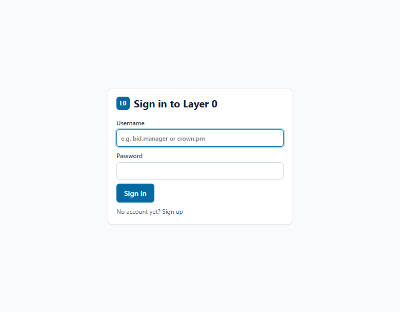

*Figure 1. The sign-in page.*

- Every person signs in with a username and password. The demonstration accounts are the Bid Manager and, for each business unit, a Unit manager and a Unit designer / engineer, plus an Administrator who can read everything and change nothing.
- The top bar then shows the signed-in name with the **role** and **unit** (for example "Bid manager · No unit", or "Unit manager · CROWN"). **Sign out** returns to this page to continue as someone else. There is no "acting as" picker.

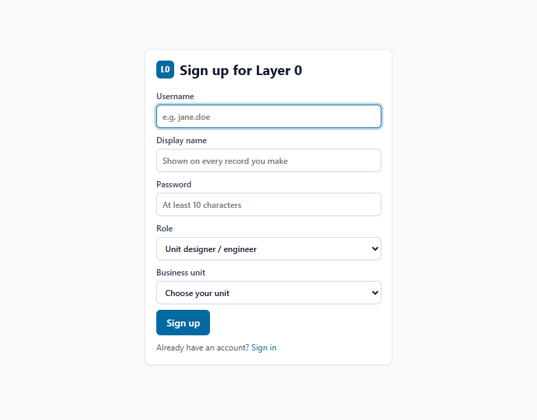

*Figure 2. The sign-up page.*

- **Sign up** asks for a username, a display name, a password of at least 10 characters, a **role** (Bid manager, Unit manager or Unit designer / engineer; never Administrator) and, for the unit roles, the **business unit**. Repeated failed sign-ins or sign-ups are limited.
- In this proof of concept anyone can sign up with the bid manager role. This **needs confirmation** before any real use.
- What each role may do is enforced by the server. Technical items are answered by a unit's designers / engineers; its schedule, commercial and staffing items by the unit manager, who also validates the unit's answers. The bid manager creates bids, answers the bid desk's items, sends the work, decides go or no-go and applies changes.

## 5. Bids

**Purpose.** The starting page. It lists the bids and where each one stands.

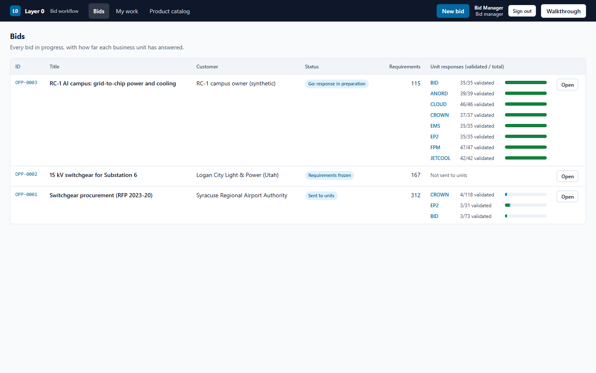

*Figure 3. The Bids page.*

- The top bar offers **Bids**, **My work** and **Product catalog**, a **New bid** button and, on the right, the signed-in person with **Sign out** and the **Walkthrough** button.
- Each row shows the bid ID, title, customer, status and number of requirements (312 in the example).
- **Unit responses (validated / total)** shows, for each unit and the bid desk, how many items are validated out of those assigned: CROWN 1 of 118, EP2 0 of 31 and BID 0 of 73. A bar beside each count shows validated work (green) and work awaiting validation (blue). Each unit code opens that unit's work package under **My work**.
- **Open** enters the bid at its Requirement Traceability step.

## 6. New Bid

**Purpose.** Starts a new bid. Only the bid manager creates bids.

The form asks for a **title**, the **customer** and the **customer type**. The page notes that one bid is created per RFP, and that the RFP is uploaded on the next page.

## 7. RFP

**Purpose.** Holds the RFP and the other documents of the bid.

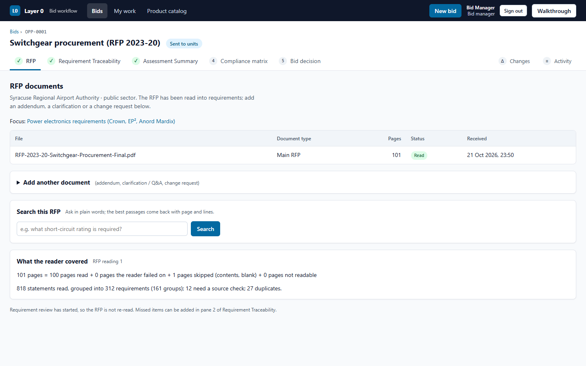

*Figure 4. The RFP step, showing the RFP with status "ingested".*

- Each document shows its **file name**, **document type** ("Main RFP", Addendum, Clarification / Q&A, Change request or Other), **page count** (101), **status** ("ingested") and the date received.
- **Add another document** takes addenda, clarification / Q&A answers and change requests. They are compared with the baseline on the Changes page.
- **One RFP is read once.** Each file is identified by the Document ID and Instance ID embedded in it (PDF or Word), or by a fingerprint when it has none. Uploading a file that is already in another bid opens that bid with its stored requirements instead of reading it again. A newer version of a known RFP names the bid that holds the earlier one.
- **Search this RFP** answers a question in plain words with the best passages, each with page and lines.
- **What the reader covered** shows the first extraction snapshot (E1): 101 pages = 100 read + 1 skipped (contents, blank); 818 candidates = 779 in the register + 12 exceptions + 27 duplicates; 161 groups. It is never altered.
- **How the requirements are produced.** A model (the reader agent) reads the RFP page by page and returns each requirement with its exact quotation. Layer 0 then checks every quotation against the page and records its page, lines and position. A quotation that cannot be found waits in the exception queue (see section 8). The model's answers are stored (frozen), so a second reading gives the same list. No keyword or pattern rule is used to find requirements.
- **Automatic freeze.** When the main RFP has been read completely, with no failed page, the register is frozen at once as Baseline 1. There is no Publish or Freeze step. After that the RFP is not read again; changes are saved as corrections with a reason.

## 8. Requirement Traceability

This step brings together the source document, the requirement register, and the proposed products and responses in three panes. The register used to be a page of its own; it is now pane 2.

**Purpose.** Shows a requirement, its source and its proposed product and response in one view, and lets the register be corrected.

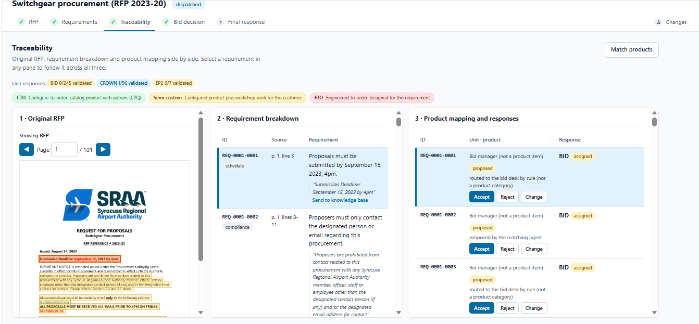

*Figure 5. Requirement Traceability with REQ-0001-0001 selected in all three panes.*

| Pane | Content |
|---|---|
| **1. Original RFP** | The RFP page, with the lines of each requirement highlighted. Page controls move through the document. After a change document has been applied, the pane can also show its pages. |
| **2. Requirement register** | The register: ID, category, source, requirement text and exact quotation, status. Tabs for **Register** and **Exceptions**, filter chips, corrections and history (see below). |
| **3. Product mapping and responses** | The proposed business unit and product, offering type, matching rationale, an expandable Bill of materials, the proposal status with **Accept**, **Reject** and **Change** buttons, and the units' responses and their status. |

**How it works**
- Selecting a requirement in any pane selects it in all three. The RFP opens on its page with its lines highlighted.
- A filter bar above the panes filters all three the same way: category, offering type, unit, response, compliance, source, origin, page range and text, with a sort order. The filters are kept in the page address, so a filtered view can be shared; the counts on the Assessment page link into such views.
- **Match products** proposes a business unit and product for each requirement. A proposal can be accepted, rejected or changed. **Change** lets a person pick the unit and product, and several units where the work needs them (**Add unit**, **Remove**).
- The **Bill of materials** under a proposed product is read from a separate BOM system; Layer 0 does not build one. In this demonstration the lines come from the catalog file and are illustrative. The real BOM source **needs confirmation**.
- Until the bid is sent for assessment, the Response column reads "Responses appear once the bid is sent for assessment".

**The register (pane 2)**
- A line states the baseline: "Baseline 1 frozen automatically when Bid Manager read the RFP (312 items)", and the reading coverage (E1).
- **Register** holds the requirements that stand. **Exceptions** (12) holds reader items whose quotation could not be matched word for word; each is either **linked to its lines** on the RFP page or **dismissed** with a reason.
- Filter chips show **In register** (312), **Excluded**, **Duplicates** (27), **Ungrouped / split / merged** and **All**.
- Each requirement has an **ID** (for example REQ-0001-0001), a **category** (technical, compliance, commercial, schedule, submission, legal or staffing), a **source** (page and lines) and a status. A group can be expanded to show its sub-requirements.
- **Corrections.** **Exclude** (not a requirement), **Edit**, **Split**, **Merge** (several selected rows) and **Add a requirement the reader missed** (by selecting lines on the RFP page) each ask for a reason and are saved as a new version, with the old one kept. **History** shows every version, who made it, when and why.
- **Nominate as a reviewed example** (see Appendix B) appears under the selected requirement.

**Offering types.** A legend under the page introduction explains the three types:

| Type | Meaning |
|---|---|
| CTO | Configure-to-order: catalog product with options (CPQ) |
| Semi-custom | Configured product plus workshop work for this customer |
| ETO | Engineered-to-order: designed for this requirement |

**Linked, Enlarge and the workspace controls.** The three panes can be arranged to suit the work:

| Control | What it does |
|---|---|
| **Linked / Unlinked** | A linked pane follows the selected requirement. An unlinked pane keeps its page or scroll position; linking it again catches up. |
| **Enlarge / Restore** | Shows one pane across the whole width and hides the other two. Restore, or the Esc key, brings them back. |
| **Reorder** | Drag a pane by its grip (six dots) onto another pane: it moves into that place and the others shift along. The left and right arrow buttons beside the grip move it one place and work from the keyboard. |
| **Resize** | Drag the bar between two panes, or focus it and use the arrow keys (Shift for larger steps, Home and End for the limits). A label shows the two shares. |
| **New window** | Opens a pane in a window of its own, without the top bar and bid header, for a second screen. The main window shows a notice with **Show window** and **Return to main window**. |
| **Reset layout** | Returns to the original order and widths. |

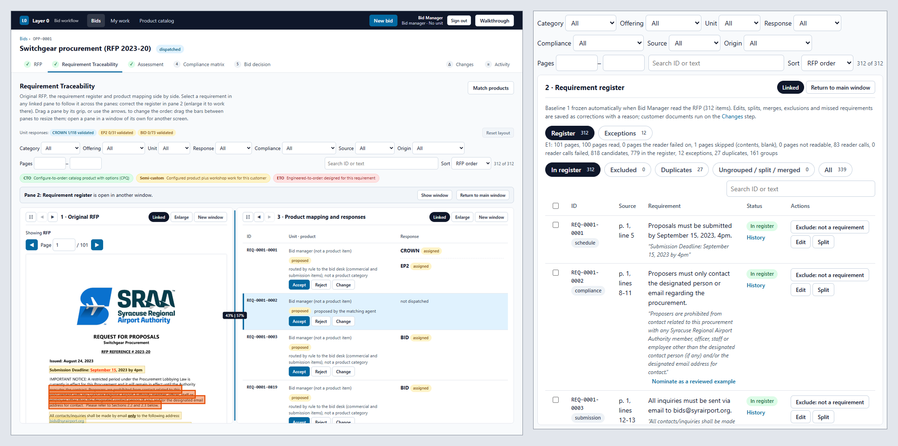

*Figure 6. The register in a window of its own beside the main window.*

- The windows stay in step: selecting a requirement, the Linked setting, the filters and any saved change reach all of them. Closing the window, or **Return to main window**, puts the pane back.
- The order and widths are remembered in the browser. Below 1100 pixels the panes stack in the saved order and the arrange, resize and new-window controls are not shown.
- If the browser blocks the new window, the page says so; allow pop-ups for the site and select **New window** again.

**Traceability.** From one requirement the reader can see its exact RFP wording and location, the product proposed for it and the response it received. The same ID and source then appear in the unit's work package under My work and in the Compliance matrix.

## 9. Assessment

**Purpose.** Turns the frozen register into a plan: what the bid looks like, what is open, which units take part, how the work is routed, and when the units expect to finish.

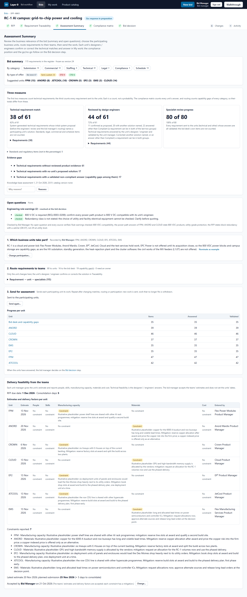

*Figure 7. The Assessment step.*

1. **Bid summary.** The requirements by category (technical 148, compliance 66, submission 61, legal 12, schedule 9, commercial 8, staffing 8), by offering type (ETO 85, CTO 11, Semi-custom 3, NONE 213, where NONE means requirements that are not product items), the major sections of the RFP and the suggested units with a count (Crown Technical Systems 93, Electrical Power Products 6).
2. **Assessment.** Four measures, each a count and never a probability: **Domain alignment** (technical requirements matched to a participating unit's product: 99 of 214), **Product-evidence coverage**, **Specialist-review progress** (validated answers: 1 of 222) and **Preliminary feasibility**. A measure not yet assessed reads "Not assessed yet". **Evidence gaps** list what is missing, for example 115 technical requirements matched to no unit's product and 12 requirements whose source is not verified. **Assess with the knowledge base** records a numbered assessment run with the reason, the evidence used and the catalog version. Later runs never change the requirements.
3. **Open questions.** Source not verified (12), product requirements that **need an owner** (115; assign a unit in Requirement Traceability or record a **capability gap** with the reason), engineering rule warnings and questions not yet closed.
4. **1. Which business units take part?** The bid manager records the participating units with a rationale; the matching suggestion is pre-selected (Electrical Power Products and Crown Technical Systems).
5. **Routing.** Where each requirement goes: 124 to units and 73 to the bid desk in the example. The rules are held in a data file, not in code. Technical items go to the unit's designers / engineers. Schedule, commercial and staffing items go to the unit managers of the participating units. Only the high-level submission and legal items stay with the bid manager.
6. **2. Send for assessment.** Gives each participating unit its work. It is repeated after changing matches or participation: new work is sent and work that no longer fits is withdrawn. **Progress per unit** counts items, answered and validated (Crown 118, 2 answered, 1 validated; EP2 31; bid desk 73).
7. **Schedule and approvals.** Each unit manager gives an estimated completion date. The bid manager sets the RFP due date and the consolidation days (a placeholder of 5 that **needs confirmation**); the page shows the planned submission date and warns when it falls after the due date. A table counts each unit's fully, partially and non-compliant answers. The bid manager approves the schedule (not before every participating unit has a date) and the compliance position; an approval is reopened when a date or a count changes.

## 10. Work Packages and Responses

**Purpose.** Gives each unit, and the bid desk, its own list of requirements to answer.

**My work** opens the work of the signed-in person: a unit's people see their unit's package, the bid manager sees the bid desk. The figure shows the package of Crown Technical Systems as its unit manager.

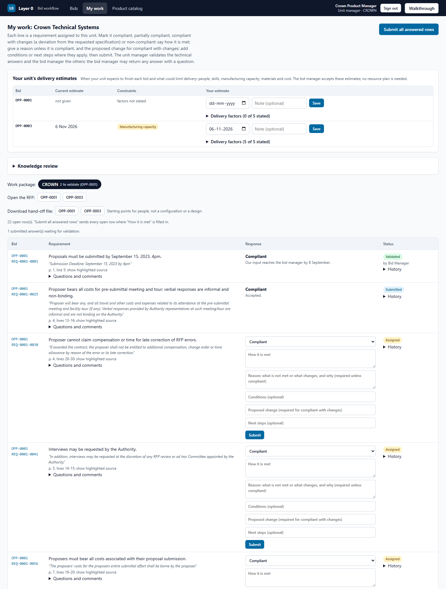

*Figure 8. My work: the work package of Crown Technical Systems, seen by its unit manager.*

- **Your unit's completion dates.** The unit manager states when the unit expects to finish each bid. The bid manager plans the submission from these dates.
- **Knowledge review** lists reviewed examples waiting for this person's decision (see Appendix B).
- **Work package** chips switch between the bid desk and each unit with work, with the number of answers waiting for validation. **Open the RFP** opens the bid in Requirement Traceability. **Hand-off for this unit's systems** downloads a file that groups the unit's items by route for its own tools: a configuration seed for configure-to-order products, a basis of design for semi-custom ones and a specialist queue for engineered-to-order work. It states that a person still has to complete the work.
- Each line shows the requirement, its exact quotation, its source and a link to the highlighted source.
- The response has a compliance choice (**Fully compliant**, **Partially compliant** or **Non-compliant**), a **Product / configuration** field and a **How it is met** field. For a partial or non-compliant answer a **Reason** is required; **Conditions**, **Workaround** and **Next steps** are optional. **Submit** sends the response; **Submit all answered rows** sends every row that has an answer.
- The status of each line is assigned, submitted, validated or returned, with **History** showing every change. The unit manager validates the unit's answers; the bid manager validates the bid desk's, and may return any answer with a question. A returned answer reopens for the unit with the note. Questions and comments stay on the line until closed.

## 11. Compliance Matrix

**Purpose.** Brings all responses together and shows what remains open.

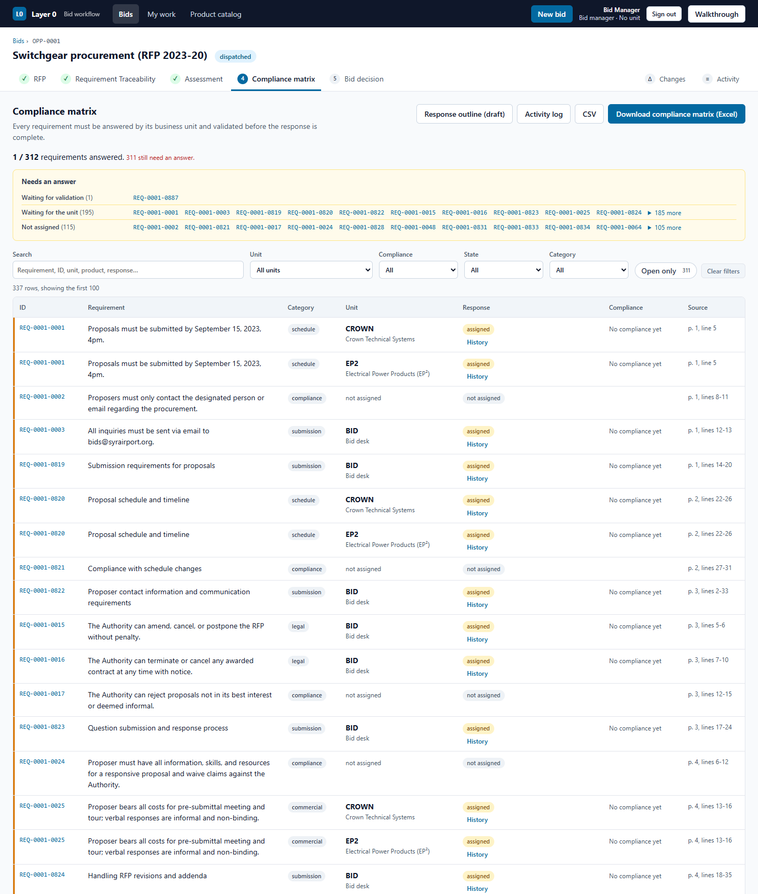

*Figure 9. The Compliance matrix step.*

- The page explains that every requirement must be answered by its business unit and validated before the response is complete.
- A progress line shows the requirements answered out of the total (1 / 312 in the example) and how many still need an answer (311).
- **Needs an answer** groups what is open by reason: Waiting for validation (1), Waiting for the unit (195) and Not assigned (115), plus Returned when there is any. Each requirement ID links to it in Requirement Traceability.
- Filters: a search box, **Unit**, **Compliance**, **State** and **Category**, and **Open only** (311). The table shows the first 100 matching rows (337 rows in the example, because a requirement owned by two units appears once for each).
- Each row shows the requirement, its category, the unit, the response state, the compliance and the source. **History** on a row shows every change to that answer. Selecting a row opens a detail panel with the unit's **Reason**, **Conditions**, **Workaround** and **Next steps** ("Not provided" when blank), the source page with its highlighted lines and a link to Requirement Traceability. Hovering a partially compliant or non-compliant answer shows its reason.
- **Download compliance matrix (Excel)** exports a workbook with two sheets: **Compliance matrix**, for the customer, with one row per requirement in RFP order (sub-requirements listed under their group, each with its RFP reference), the compliance in customer terms, the four detail fields and only validated answers (everything else reads "Open"); and **Tracking**, for internal use, with one row per unit answer. **CSV** exports the tracking table. A requirement taken from a change document gives that document's name with its page and lines.
- **Response outline (draft)** opens a first draft of the response, one chapter per group of requirement categories plus an executive summary. It is written only from validated answers, every paragraph cites its requirements, and what is still open is listed. It can be downloaded as Markdown for the bid manager to edit.
- **Activity log** opens the Activity page (section 12).

## 12. Activity

**Purpose.** Lists everything recorded on the bid, so that who did what, and when, can always be answered.

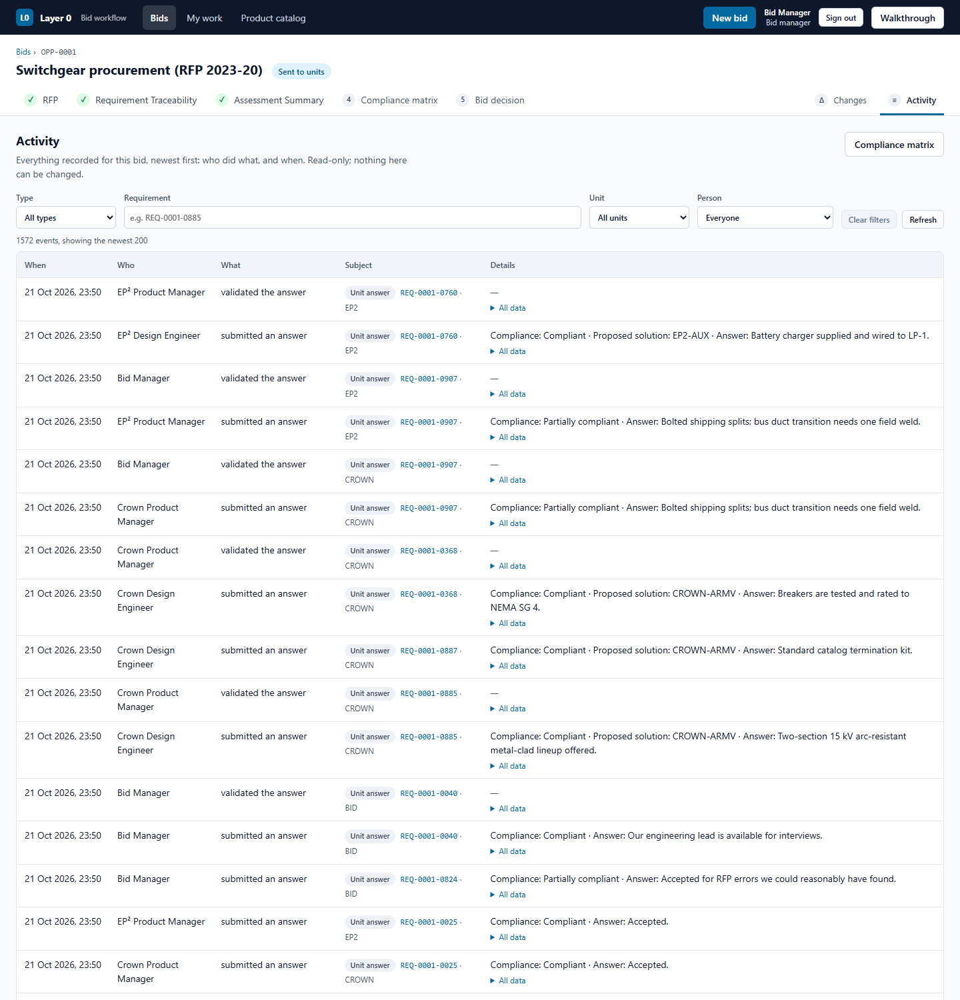

*Figure 10. The Activity page.*

- Events are listed newest first: when, who, what, the subject (a requirement, an answer or the bid) and the details. A line states how many events there are and that the newest 200 are shown; **Show older events** pages back.
- Filters: **Type**, **Requirement**, **Unit** and **Person**. They are kept in the page address, so a filtered view can be shared.
- The page is read-only. It comes from the append-only audit log, so entries cannot be edited or removed. The same facts appear as **History** on a requirement and on an answer.

## 13. Bid Decision

**Purpose.** Records the go or no-go decision of the bid manager. It follows the Assessment, once the units have assessed the bid.

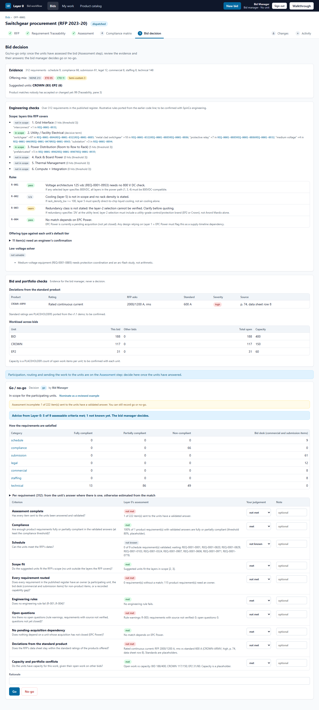

*Figure 11. The Bid decision step.*

1. **Evidence.** The requirements by category (312 in total), the offering mix, the suggested units, any requirements whose source is not verified, and the product matches nobody has accepted or changed yet (99 in the example).
2. **Engineering checks.** Evidence for the bid manager, never a decision. The rules are illustrative, ported from an earlier version of Layer 0, and **need confirmation** with SpinCo engineering. They cover:
   - **Scope:** which of six layers the RFP covers (Grid Interface; Utility / Facility Electrical; Power Distribution; Rack and Board Power; Thermal Management; Compute and Integration), each in scope or not with its number of hits against a threshold of 3. In the example, two layers are in scope: Utility / Facility Electrical and Power Distribution.
   - **Rules R-001 to R-004:** each shown as pass, warn or not applicable. They cover 800 VDC compatibility, liquid cooling at high rack density, the redundancy class and any dependency on EPC Power, whose acquisition has not closed. In the example, R-003 warns because the redundancy class is not stated.
   - **Offering type against each unit's default tier:** lists the matches that need an engineer's confirmation (11 in the example).
   - **Low-voltage solver:** reports "not solvable" for equipment such as medium-voltage switchgear, which needs protection coordination and an arc-flash study rather than arithmetic.
3. **Bid and portfolio checks.** **Deviations from the standard product** compares the RFP's data sheet with the standard ratings of the matched products (in the example, 2000/1200 A continuous current against a standard 600 A, a high deviation on page 74). **Workload across bids** compares each unit's open work with a capacity. Standard ratings and capacities are placeholders and **need confirmation** with each unit.
4. **Go / no-go.** A note points back to the Assessment step, where participation, routing and sending the work are handled. An advice line summarises the criteria (for example "5 of 9 assessable criteria met; 1 not known yet"); the bid manager decides. **How the requirements are satisfied** counts fully, partially and non-compliant answers per category. Ten criteria each show **Layer 0's assessment** (met, not met or not known, with the detail) and **Your judgement**, a choice that starts from Layer 0's assessment, with an optional note. The bid manager writes a rationale and selects **Go** or **No-go**. The decision is stored with the evidence as shown, the judgements and the participating units, and the screen shows who decided. **No-go** asks for confirmation first; a later **Go** resumes the bid. If the units have not finished, a warning says so, but the decision can still be recorded.

## 14. Change Handling

**Purpose.** Handles addenda, question-and-answer documents and change requests that arrive after the baseline is frozen.

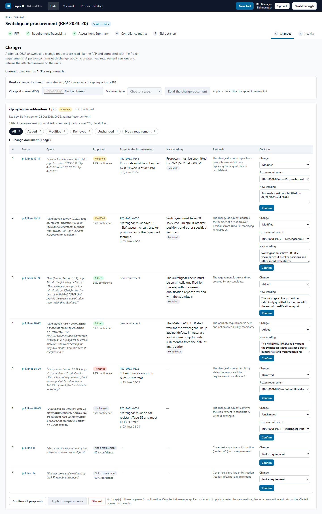

*Figure 12. The Changes page with an addendum read and awaiting confirmation.*

The numbered steps do not include this stage. It appears as a separate link, **Changes**, beside them in the bar under the bid title. The page shows the current baseline and its number of requirements.

1. **Read.** A change document (PDF) is uploaded with **Read the change document**. It is read in the same way as the RFP, and each statement is compared with the frozen baseline. Each is proposed as **added**, **modified**, **removed**, **unchanged** or **not a requirement**, with the baseline requirement it affects, the new wording, a rationale and its source (page and lines in the change document).
2. **Confirm.** A person checks each proposal against the change document's page and confirms or changes it. **Confirm all proposals** confirms the remaining ones.
3. **Apply.** The bid manager selects **Apply to requirements**. Nothing is edited in place: a modified requirement gets a new version anchored in the change document, a removed one gets a "removed" version, and an added one gets a new ID. Together they form the next baseline (Baseline 2), and the earlier wording stays readable in each requirement's history.
4. **Follow-up.** Answers to modified requirements are returned to their units with the new wording, work on removed requirements is withdrawn, and added requirements are matched and sent. Only the requirements that changed are matched again; all other matches and answers stay as they are.

A change set can also be discarded instead of applied. One change set is reviewed at a time. The demonstration includes an illustrative addendum, invented for the demonstration and marked as such on its first lines.

## 15. Summary

Layer 0 provides a structured workflow for turning an RFP into actionable requirements, assigning work to the appropriate business units, tracking responses and consolidating the results, while keeping every response traceable to the original source material.

This proof of concept demonstrates the workflow from document upload through assessment, unit responses, consolidation and the bid decision, and the handling of later changes to the RFP against the frozen baseline.

## 16. Key Benefits

- Maintains end-to-end traceability from source requirements to responses.
- Freezes the requirement register automatically and records every later correction with a reason.
- Lets the three panes be arranged, resized and moved to another screen for the way each person works.
- Shows what the bid looks like, what is open and who owns each requirement before the work is sent.
- Gives visibility of the work assigned to participating business units, and routes each kind of item to the right role.
- Helps coordinate responses across multiple business units and consolidates them in one matrix.
- Supports compliance tracking and a complete, read-only audit trail throughout the bid process.
- Handles RFP changes against a frozen baseline, so only the requirements that changed are revisited.

## Appendix A: Product Catalog

**Purpose.** The reference list of business units and products, the documents behind the evidence, and the products published by Flex.

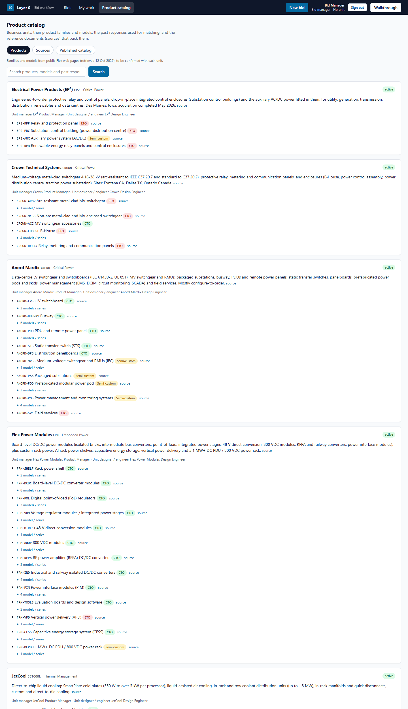

*Figure 13. The Product catalog: the Products view.*

- **Products.** Each business unit is listed with its status, a short description, its Unit manager and Unit designer / engineer, and its products, each with a code, a name, an offering type and a source link. A search box looks up products, models and past responses; results show a score, the kind (product or past response), the unit and the beginning of the text.
- The catalog content is illustrative sample data and **needs confirmation** with each business unit.

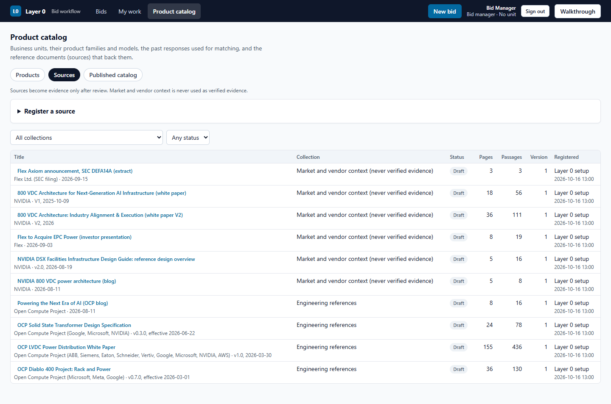

*Figure 14. The Sources view.*

- **Sources.** The reference documents behind the evidence, each with its collection (engineering references, or market and vendor context), status, pages, passages and version. A document is read page by page, so every passage keeps its page and lines. A source becomes evidence only after review, and market and vendor context is never used as verified evidence. The ten public references in the example are still drafts.

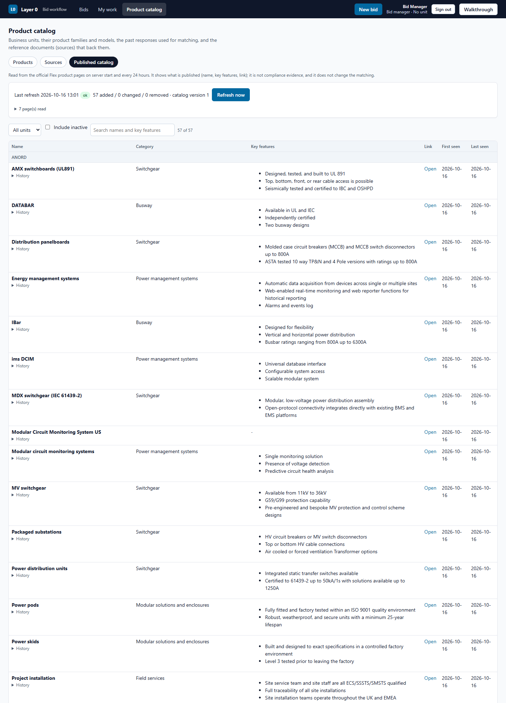

*Figure 15. The Published catalog view.*

- **Published catalog.** The product pages published by Flex (power and cooling, power modules, Anord Mardix, Crown, EP² and JetCool) are read on server start and every 24 hours. Each product keeps its name, category, key features and link, and a renamed product keeps its earlier names. **Refresh now** runs it on demand. This view shows what is published; it is not compliance evidence and does not change the matching.

## Appendix B: Reviewed Examples and Knowledge Review

**Purpose.** Collects what the next bids should learn from.

- There is no separate knowledge page. A requirement, a validated answer, a decision rationale or a correction is nominated with **Nominate as a reviewed example** where it appears: in the register, on a validated answer, and on the bid decision. The form asks what the item teaches (requirement, preference, background, partial compliance, insufficient evidence), when it holds and when it does not.
- The right reviewer decides in **Knowledge review** under My work: a unit's manager or designer / engineer for its answers, the bid manager for bid-level items. A rejection needs a note. Approved examples carry their conditions and limits, are found by matching, by the response outline and by the catalog search, and seeded illustrative examples are never treated as verified.

## Appendix C: History of the Names Used

Earlier versions of this walkthrough used other names. The functions remain; the screens and words changed.

| Earlier | Now |
|---|---|
| Opportunities, New opportunity | Bids, New bid |
| Switch (the picker for the acting person) | Sign in, Sign out and sign-up with a role |
| Requirements page, Requirements review | The requirement register, pane 2 of Requirement Traceability |
| Approve every requirement, then Freeze baseline | The register is frozen automatically when the RFP has been read |
| Participation and dispatch on the bid decision page | Assessment step: participating units, routing and Send for assessment |
| Final response | Compliance matrix |
| Knowledge base page and Send to knowledge base | Nominate as a reviewed example and Knowledge review under My work |
